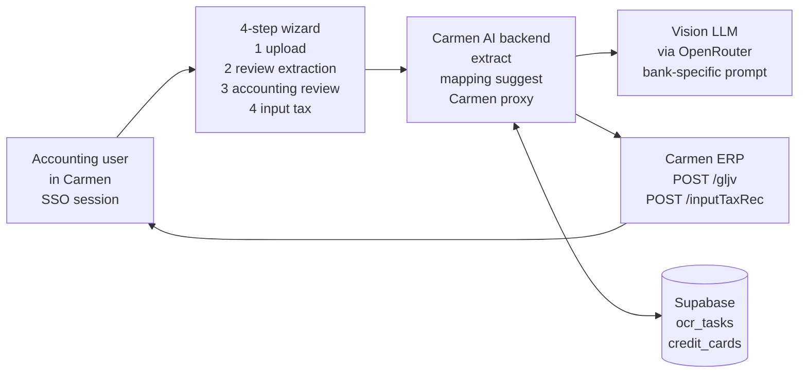
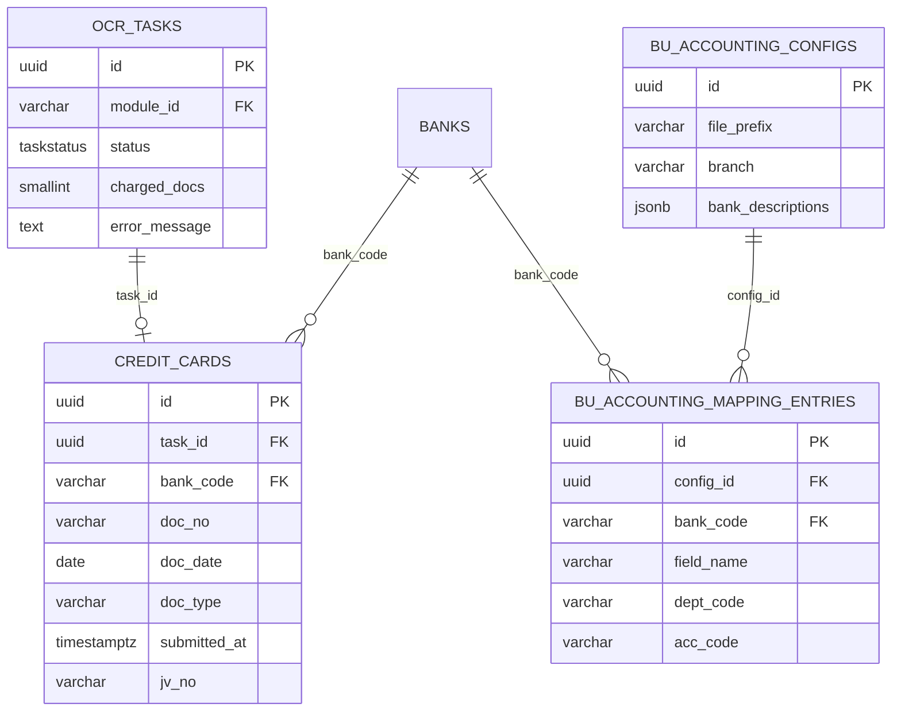
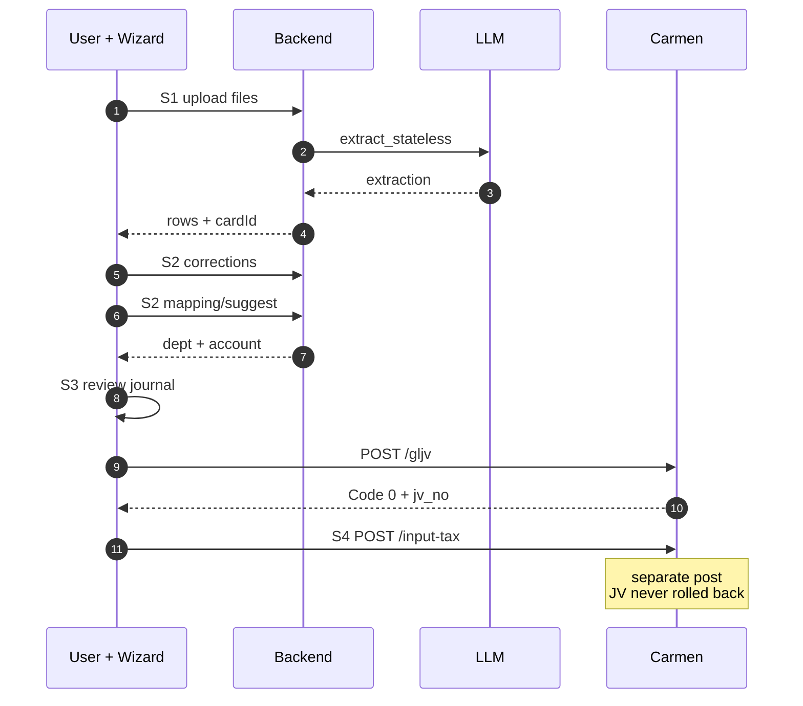
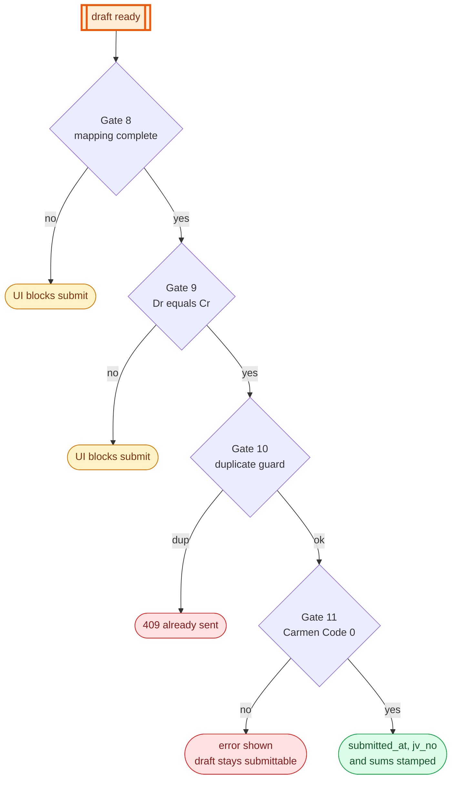
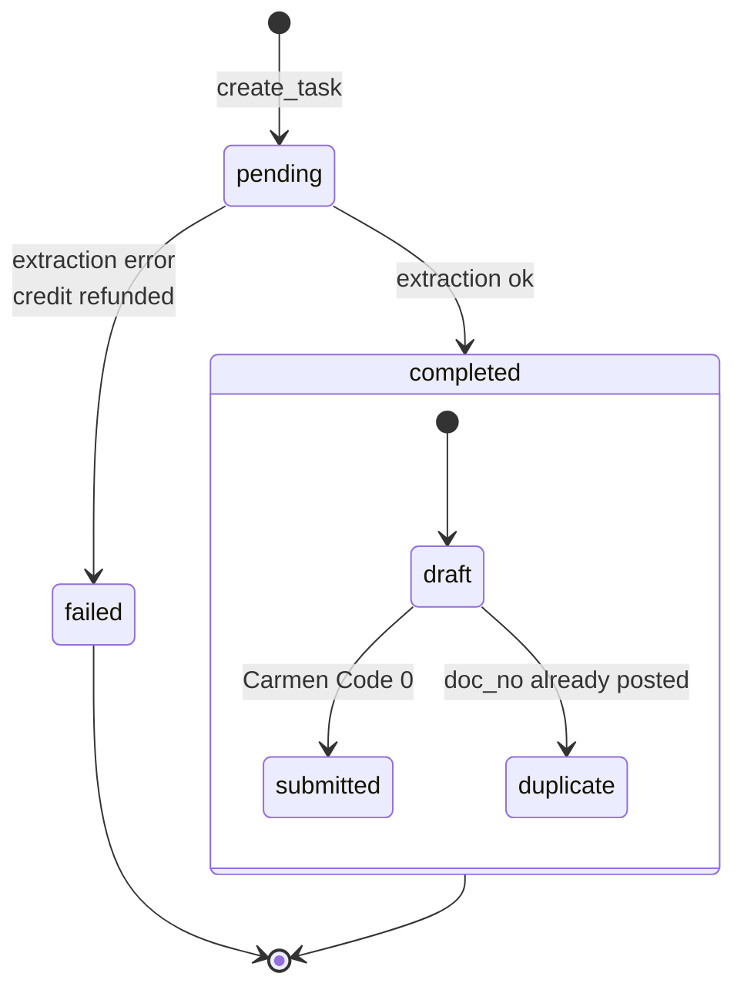

**เอกสารชุดนี้:** FRD-01 อธิบายการอ่าน statement ค่าธรรมเนียมบัตรเครดิตของธนาคารผ่าน wizard และหน้า GL mapping ของโมดูล ส่วนที่แยกเป็นเอกสารของตัวเอง: ภาษีซื้อ (step 4) → FRD-09, ใบแจ้งค่าธรรมเนียมของ payment gateway และ statement ของ BAY → FRD-10, คิวตรวจที่เป็นหน้าแรกของโมดูล → FRD-12, การรับเอกสารทางอีเมลและ settlement report ของ KBANK → Email FRD v4.0

## Document Revision History

| Version | Date | Author | Description of Changes | Approved By |
|---|---|---|---|---|
| 1.0 | 25/08/2026 | Dev Team | ฉบับแรก — เขียนจากโค้ดที่ merge เข้า main แล้ว ครอบคลุม extract / mapping / submit / correction learning พร้อม gate ladder, error matrix และ QA matrix | รอ Lead Dev |
| 2.0 | 27/10/2026 | Dev Team | ปรับตามโค้ด ณ `945c63ea` — หน้าแรกของโมดูลเป็นคิวตรวจ และ wizard ย้ายไป `/manual`; GL mapping แยกตามธนาคาร; Description ต่อธนาคารพร้อม tag 3 ตัว (ไม่เติมวันที่ให้อัตโนมัติ); Branch ค่าเริ่มต้น 00000; ส่วน Settlement ของ KBANK บนหน้า mapping; JV source `AICC*` (CA-110); key กันซ้ำมี `doc_type`; JV ถือว่าสำเร็จเฉพาะ `Code: 0` และเก็บเลข JV กับยอดภาษีซื้อ; คำเตือนเป็น code ที่แปล EN/TH; AI แนะนำบัญชีลูกหนี้ตามแบรนด์บัตร; path ในตาราง feature ตามโครงสร้างหลัง refactor 25–28/09; แยกเนื้อหา input tax, payment gateway และคิวไปไว้ FRD-09/10/12 | รอ Lead Dev |

<!-- pagebreak -->

# 1. Executive Summary & Objective

**Credit Card OCR** คือ wizard 4 ขั้น (Upload → Review → Accounting → Input Tax) บนหน้าจอ Carmen ที่ให้พนักงานบัญชีอัปโหลดใบแจ้งค่าธรรมเนียมบัตรเครดิตจากธนาคาร (ไฟล์ภาพหรือ PDF) แล้วระบบใช้ Vision LLM อ่านข้อมูลออกมาเป็นตาราง ให้ผู้ใช้ตรวจแก้ จับคู่ผังบัญชีด้วย AI แล้วส่ง Journal Voucher เข้า Carmen ERP โดยผู้ใช้กดยืนยันเองทุกครั้ง

งานเดิมคือคีย์รายการจากเอกสารทีละบรรทัดเข้าสมุดรายวัน ซึ่งใช้เวลาและเกิดข้อผิดพลาดจากการพิมพ์ ระบบนี้ลดเหลือการตรวจทานและกดยืนยัน

**ตำแหน่งในโมดูล (ใหม่ใน v2.0):** เมนู AI JV Automation ของ Carmen เปิดหน้า `#/CreditCardOCR` ซึ่งเป็นคิวตรวจที่รวมเอกสารจากอีเมล, จากการสแกนเอง และจาก PMS (FRD-12) ปุ่ม Scan manually บนคิวพาเข้า wizard ที่ `#/CreditCardOCR/manual` และปุ่ม Mapping Settings เปิดหน้า GL mapping ที่ `#/CreditCardOCR/mapping` ทุกเส้นทางใช้โค้ด extract, GL mapping, การ post JV และตาราง `credit_cards` ชุดเดียวกัน

**กลไกการคิดค่าใช้จ่าย:** เสีย 1 document credit ต่อ 1 ไฟล์ ณ จุดที่เรียก `consume_document()` ซึ่งอยู่หลังการตรวจไฟล์และสิทธิ์ทั้งหมด ไฟล์ที่ระบบเปิดไม่ได้หรือ module ถูกปิดจึงไม่เสียเครดิต และไฟล์ที่ extraction ล้มเหลวจะได้เครดิตคืนเฉพาะไฟล์นั้น (ดู §8.4 และ §9)

## 1.1 System Context Diagram (ภาพรวมการไหลของข้อมูล)

เส้นทางของเอกสารตั้งแต่ผู้ใช้อัปโหลด จนถึง JV ที่ลงใน Carmen ERP



# 2. Scope of Work

## 2.1 In-Scope (ขอบเขตการทำงานของระบบ)

- **Multi-file extraction:** อัปโหลดได้ครั้งละ 1–10 ไฟล์ รองรับ JPG, PNG, PDF, WebP, BMP, TIFF, HEIC ขนาดไม่เกิน 5 MB ต่อไฟล์ (HEIC ถูกแปลงเป็น JPEG อัตโนมัติ) แต่ละไฟล์ประมวลผลขนานกันและคิดเครดิตแยกกัน
- **Bank-specific prompting:** รองรับ statement ของ BBL, KBANK, SCB (เอกสารนี้) และ BAY, KTC, GHL, PAYPAL, SIAMPAY (FRD-10) ผู้ใช้เลือกธนาคารเองหรือปล่อยให้ระบบตรวจจับจากเนื้อเอกสาร
- **Correction learning:** ทุกครั้งที่ผู้ใช้แก้ค่าที่ AI อ่านมา ระบบบันทึกลง `correction_feedback` และนำ field ที่ผิดเกิน 10% มาเป็น hint ในการ extract ครั้งถัดไปของธนาคารเดียวกัน (แยกตาม tenant)
- **AI GL mapping พร้อม history bypass:** แนะนำ department code และ account code ให้ field คงที่ 3 ตัว (Credit card commission, Input Tax, Bank Account) และให้ payment type ที่พบในเอกสาร คู่ที่เคยยืนยันแล้วตั้งแต่ 3 ครั้งขึ้นไปจะข้ามการเรียก LLM ทั้งหมด — ประเภทบัตรถูกแนะนำไปที่บัญชีลูกหนี้ของแบรนด์บัตรนั้น (ไม่ใช่บัญชีเงินฝากบัญชีแรก)
- **GL mapping แยกตามธนาคาร (ใหม่ v2.0):** BU ที่รับ statement จากหลายธนาคารมี mapping ของแต่ละธนาคารแยกกัน ทั้ง payment type, ผัง 3 field คงที่ และ Description
- **Description ของ JV ต่อธนาคาร (ใหม่ v2.0):** ข้อความอิสระ + tag `{Settlement_Date}`, `{Tax_Invoice_No}`, `{Bank_Name}` ที่ผู้ใช้เลือกเอง ระบบไม่เติมวันที่ให้อัตโนมัติ
- **Journal balance validation:** ตรวจว่าแต่ละบรรทัดสอดคล้องกัน (gross = commission + tax + net) และ Dr รวมเท่ากับ Cr รวม ก่อนเปิดปุ่มยืนยัน
- **Duplicate prevention 2 ชั้น:** ชั้นแรกตอน extract (ไม่สร้าง draft ซ้ำ) ชั้นสองตอน submit (ล็อกแถวก่อน post จริง)
- **Draft persistence:** งานที่ยังไม่ส่งถูกเก็บไว้ในเครื่องผู้ใช้ และเสนอให้กู้คืนครั้งเดียวเมื่อเปิดหน้าจอใหม่ — draft ที่ post JV แล้วถูกเสนอเฉพาะเมื่อภาษีซื้อยังค้างยื่น (FRD-09)
- **Input tax reconciliation:** Step 4 ส่งข้อมูลภาษีซื้อเข้า Carmen แยกจาก JV — รายละเอียดใน FRD-09
- **ร่องรอยของการสแกนที่ไม่ได้ post (ใหม่ v2.0):** การสแกนที่เสียเครดิตแล้วแต่ไม่ได้ post ปรากฏในคิวเป็น "Not posted" เพื่อให้ BU เห็นว่าเครดิตใช้ไปกับอะไร

## 2.2 Out-of-Scope (สิ่งที่ระบบไม่ทำ และผู้ใช้ต้องทำแทน)

| ไม่ทำ | ผู้ใช้ต้องทำอะไรแทน |
|---|---|
| ไม่เก็บไฟล์ต้นฉบับ | ไฟล์อยู่ในหน่วยความจำระหว่างประมวลผลเท่านั้น ไม่มีการเขียนลง storage — ต้องเก็บเอกสารต้นฉบับไว้เองตามระเบียบบัญชี |
| ไม่แก้ JV ที่ post ไปแล้ว | ต้องออก reversing JV ที่ Carmen ด้วยมือ ระบบไม่มี rollback (ดู §9) |
| ไม่ประมวลผลซ้ำอัตโนมัติ | เอกสารที่ extraction ล้มเหลวได้เครดิตคืน แต่ต้องอัปโหลดใหม่เอง |
| ไม่มี template CMS สำหรับ prompt | prompt ของแต่ละธนาคารยัง hardcode ในโค้ด (`_REGISTRY`) การเพิ่มธนาคารใหม่ต้อง deploy — ตาราง `prompt_templates` มีอยู่แล้วแต่ยังไม่ถูกใช้ตอน runtime |
| ไม่ตรวจว่าเลขที่อ่านมาตรงกับเอกสารจริง | ตรวจได้แค่ว่าตัวเลขในบรรทัดสอดคล้องกันเองและกับยอดรวมที่พิมพ์ (§8.5) ผู้ใช้ต้องเทียบกับเอกสารต้นฉบับใน Step 2 |
| ไม่รองรับ ZIP หรือหลายหน้าแยกเอกสาร | PDF หลายหน้าถือเป็นเอกสารเดียว 1 เครดิต — ถ้าเป็นคนละเอกสารต้องแยกไฟล์ก่อน (ZIP รองรับเฉพาะทางอีเมล) |
| ไม่อ่าน settlement report ของ KBANK ผ่าน wizard | settlement report รับทางอีเมลเท่านั้น (Email FRD v4.0) ส่วน mapping ของมันตั้งบนหน้า mapping ของโมดูลนี้ (§4.4) |
| CA-124 (รวมหน้า JV ไว้ใต้ step 2, ย้ายปุ่ม mapping, ไอคอน home, AI suggest บันทึกทันที) | อยู่สถานะ SA Documented ใน Jira ยังไม่ได้พัฒนา — เอกสารนี้อธิบายหน้าจอปัจจุบัน |

# 3. Feature List & Sub-Modules

<!-- widths: 8,30,62 -->
| รหัส | ฟีเจอร์ | Source (โค้ดจริง) |
|---|---|---|
| F-01 | Multi-file upload + validation | `routers/credit_card/ocr.py` · `services/shared/file.py` (`validate_and_read`) |
| F-02 | PDF password handling ก่อนคิดเงิน | `utils/pdf_utils.py` (`ensure_pdf_openable`) |
| F-03 | Module entitlement gate | `services/shared/module_gate.py` (`assert_module_enabled`) |
| F-04 | Document credit consumption + refund | `services/shared/credits.py` (`consume_document`, `refund_document`) |
| F-05 | Bank-specific vision extraction | `services/credit_card/ocr.py` (`extract_stateless`) · `llm/prompts/__init__.py` (`_REGISTRY`) |
| F-06 | Correction hint injection | `services/shared/correction.py` (`get_correction_hints`) |
| F-07 | Layout normalizer ต่อกลุ่มธนาคาร | `services/credit_card/postprocess.py` (`_strip_noncard_rows` สำหรับ BBL/KBANK/SCB, ส่วน fee invoice/BAY ดู FRD-10) |
| F-08 | Duplicate check ชั้นที่ 1 + สร้าง draft | `services/credit_card/extraction.py` (`finalize_extraction`) |
| F-09 | AI GL mapping (fixed fields) | `routers/credit_card/mapping.py` · `services/credit_card/gl_suggestion.py` (`suggest_fixed_fields`) |
| F-10 | AI GL mapping (payment types) | `services/credit_card/gl_suggestion.py` (`suggest_payment_types`) |
| F-11 | History bypass ≥ 3 ครั้ง | `services/credit_card/mapping_history.py` (`get_confirmed_mappings`, `BYPASS_THRESHOLD`) |
| F-12 | Journal balance validation ฝั่ง UI | `features/credit-card/components/AccountingReview.tsx` |
| F-13 | Duplicate guard ชั้นที่ 2 + post JV | `routers/carmen.py` (`proxy_gljv`) |
| F-14 | Input tax reconciliation | `routers/carmen.py` (`proxy_create_input_tax`) — FRD-09 |
| F-15 | Correction feedback logging | `routers/feedback.py` → `correction_feedback` |
| F-16 | Draft persistence ฝั่ง client | `features/credit-card/hooks/useOcrWizard.ts` |
| F-17 | Audit trail (EXTRACT / SUBMIT) | `services/shared/audit.py` (`log_action`) |
| F-18 | Accounting config ต่อธนาคาร (ใหม่) | `routers/config.py` (`/api/v1/config/accounting`) · `services/credit_card/accounting_config.py` |
| F-19 | Mapping page (ใหม่) | `features/credit-card/pages/Mapping.tsx` (`#/CreditCardOCR/mapping`) |
| F-20 | JV builder + Description (ใหม่) | `services/credit_card/jv.py` (`build_gljv_payload`, `render_description`) · `features/credit-card/lib/ccJv.ts` |

<!-- pagebreak -->

# 4. UI Specs & Field Mapping

## 4.1 Extraction Output (ExtractedCreditCardData)

โครงสร้างที่ POST /extract คืนกลับมา 1 object ต่อ 1 ไฟล์ และเป็นสิ่งที่ Step 2 แสดงให้ผู้ใช้แก้

| Field | Type | M/O | ความหมายและ business logic | ตัวอย่าง |
|---|---|---|---|---|
| `id` | UUID | O | รหัส draft ใน credit_cards — เป็น null เมื่อตรวจพบว่าเป็นเอกสารซ้ำ | d3b0a1c2-… |
| `task_id` | UUID | M | รหัสงานใน ocr_tasks ใช้ตามผลและดู error | a91f… |
| `bank_name` | Text | O | ชื่อธนาคารตามที่พิมพ์บนเอกสาร | Bangkok Bank |
| `doc_name` | Text | O | ชนิดเอกสารตามที่พิมพ์ | Tax Invoice |
| `company_name` | Text | O | ชื่อบริษัทผู้รับ (ฝั่งโรงแรม) | Grand Hotel Co., Ltd. |
| `bank_company_name` | Text | O | ชื่อนิติบุคคลผู้ออกเอกสาร ใช้ช่วยตรวจจับธนาคาร | ธนาคารกรุงเทพ จำกัด (มหาชน) |
| `doc_date` | Text | O | วันที่เอกสาร — เป็นส่วนหนึ่งของ duplicate key | 31/07/2026 |
| `doc_no` | Text | O | เลขที่ใบกำกับภาษี — เป็นส่วนหนึ่งของ duplicate key ถ้าว่างจะข้ามการตรวจซ้ำ | KB-8839201 |
| `branch_no` | Text | O | เลขที่สาขาผู้ออกเอกสาร — ถ้าว่างใช้สาขาที่ BU ตั้งไว้ แล้วจึง 00000 | 00000 |
| `merchant_name / merchant_id` | Text | O | ข้อมูลร้านค้าตามที่ธนาคารระบุ | GRAND HOTEL |
| `tax_ids[]` | Array | O | เลขผู้เสียภาษี 13 หลักทุกเลขที่พบบนเอกสาร ค่าที่ไม่ใช่ 13 หลักถูกทิ้งโดย validator — Email Ingest ใช้ตรวจตัวตน BU | ["0105567890123"] |
| `details[]` | Array | M | บรรทัดรายการ แต่ละบรรทัดมี transaction, pay_amt, commis_amt, tax_amt, total | — |
| `is_duplicate` | Boolean | M | true = มีเอกสารเลขนี้ (วันที่และชนิดเอกสารเดียวกัน) ที่ post ไปแล้ว ระบบจะไม่สร้าง draft ให้ | false |
| `warnings[]` | Array | O | คำเตือนจาก normalizer ฝั่ง backend **เป็น code พร้อมค่า** (`{code, params}`) หน้าจอแปลเป็น EN/TH เอง แสดงเป็นแบนเนอร์สีเหลืองใน Step 2 — LLM ไม่ได้เป็นคนเขียนฟิลด์นี้ | [{"code":"reconMismatch", …}] |
| `raw_text` | Text | O | ข้อความดิบที่อ่านได้ ใช้ช่วยตรวจจับธนาคารและ debug | — |

## 4.2 Detail Row (บรรทัดรายการ)

| Field | ความหมาย | ข้อบังคับทางบัญชี |
|---|---|---|
| `transaction` | ประเภทรายการ / payment type ที่ธนาคารระบุ | ใช้เป็น key ในการขอ AI mapping และหา mapping ที่บันทึกไว้ (§8.3) |
| `pay_amt` | ยอดขายรวม (gross) | ลง Cr — เป็นตัวตั้งของสมการ |
| `commis_amt` | ค่าธรรมเนียมบัตร | ลง Dr (Credit card commission) |
| `tax_amt` | ภาษีซื้อจากค่าธรรมเนียม | ลง Dr (Input Tax) |
| `total` | ยอดสุทธิที่ธนาคารโอนเข้า | ลง Dr (Bank Account) |
| ความสัมพันธ์ที่ทุก layout ต้องเป็นจริง | pay_amt = commis_amt + tax_amt + total | ถ้าไม่จริง UI จะบล็อกปุ่มยืนยัน (Gate 9) |

## 4.3 Task Record (ocr_tasks)

| Field | Type | ความหมาย |
|---|---|---|
| `status` | enum | pending → processing → completed / failed |
| `charged_docs` | smallint | จำนวนเครดิตที่ถูกหักจริงสำหรับงานนี้ ปกติ 1 และเป็น 0 เมื่อ consume_document() fail-open (เกิดจาก DB error ชั่วคราว ไม่ใช่เครดิตหมด) |
| `error_message` | text | ข้อความ error ตรง ๆ จาก exception ที่ทำให้ล้มเหลว — เป็นสิ่งที่หน้า #/admin/extractions แสดง |
| `ocr_engine` | varchar | model ที่ใช้จริงกับงานนี้ |
| `carmen_user_id` | varchar | ผู้ใช้ Carmen ที่กดอัปโหลด ใช้แยกสถิติรายคนในหน้า #/admin/user-usage |

## 4.4 หน้า GL Mapping — `#/CreditCardOCR/mapping` (ใหม่ v2.0)

หน้าเดียวที่ตั้งค่าการลงบัญชีของโมดูล ค่าทั้งหมดผูกกับ**ธนาคารที่เลือกอยู่** (`?bank=KBANK` เปิดธนาคารนั้นโดยตรง)

| ส่วน | เนื้อหา | หมายเหตุ |
|---|---|---|
| Bank / File Prefix | เลือกธนาคาร และ prefix ของเลข JV (จาก `GET /api/v1/carmen/gl-prefix`) แบบ search-select | การสลับธนาคารเมื่อมีการแก้ค้างถามยืนยันก่อน และบันทึกผิดธนาคารไม่ได้ |
| Description | ข้อความอิสระ + chip ของ tag `{Settlement_Date}`, `{Tax_Invoice_No}`, `{Bank_Name}` | tag ไม่อยู่ในช่องพิมพ์ (กันการพิมพ์ทับจน token เสีย) — JV และรายการภาษีซื้อใช้ข้อความเดียวกัน ไม่มีวันที่เติมให้อัตโนมัติ (decision-log #32) และไม่มีค่ากลางของ BU อีกต่อไป (#33) |
| Branch No. | สาขาที่ใช้เมื่อเอกสารไม่ได้ระบุ | ค่าเริ่มต้น 00000 (สำนักงานใหญ่) |
| ผัง 3 field คงที่ | Credit card commission, Input Tax, Bank Account — แผนกและบัญชี | AI Suggest เติมให้ได้ |
| Payment types | รายการ payment type ของธนาคาร → แผนกและบัญชี แก้ใน dialog เดียวสำหรับทุกธนาคารและชนิดเอกสาร (เอาออกแล้ว undo ได้) | AI Suggest แนะนำบัญชีลูกหนี้ตามแบรนด์บัตร |
| Settlement report (เฉพาะธนาคารที่มี layout settlement — KBANK) | Credit breakdown: Detail (หนึ่งบรรทัดต่อประเภทบัตรที่พิมพ์) หรือ Summary (รวมตาม prefix ของแบรนด์ เช่น VS, MC, JCB) และ mapping ของกลุ่มเหล่านั้น | ใช้โดย settlement report ที่มาทางอีเมล (Email FRD v4.0) การเปิด/ปิด reconciliation เป็นสวิตช์บน rule ของ KBANK ในหน้า email settings ไม่ใช่หน้านี้ |
| Save | `PUT /api/v1/config/accounting` (แทนที่ทั้งชุดของธนาคารนั้น) | ถ้ามีคนบันทึกจากที่อื่นระหว่างนั้น หน้าจอเสนอให้โหลดใหม่หรือคงของตัวเอง |

## 4.5 JV ที่ส่งเข้า Carmen

| ส่วน | ค่า |
|---|---|
| `JvhSource` | ตามธนาคาร: `AICCBBL`, `AICCKBANK`, `AICCSCB` (และ `AICCBAY`, `AICCKTC`, `AICCGHL`, `AICCPAYPAL`, `AICCSPAY` ใน FRD-10) — CA-110 |
| `Prefix` | File Prefix ของธนาคารนั้นจากหน้า mapping |
| `Description` | Description ของธนาคารนั้น โดยแทน tag ด้วยวันที่เอกสาร เลขที่เอกสาร และชื่อธนาคาร |
| `Status` | Draft |
| `Detail[]` | หนึ่งบรรทัด Cr ต่อ payment type (ยอด `pay_amt`) และ Dr สามบรรทัด: Credit card commission (Σ `commis_amt`), Input Tax (Σ `tax_amt`), Bank Account (Σ `total`) — สกุลเงิน THB อัตรา 1 |

# 5. Action Buttons & Business Logic

| ปุ่ม | Action | พฤติกรรมของระบบ |
|---|---|---|
| Scan manually (หน้าคิว) | Navigate | เปิด wizard ที่ `#/CreditCardOCR/manual` |
| Browse File / Drop | File select | ตรวจนามสกุลและขนาดฝั่ง client แล้วส่งจริงตอนกด extract |
| เลือกธนาคาร | Dropdown | ส่งเป็น query param bank_code — ถ้าไม่เลือก ระบบใช้ prompt รวมแล้วตรวจจับธนาคารจากเนื้อเอกสารเอง |
| Extract | Form submit | POST /api/v1/credit-card/extract — จุดที่เกิดค่าใช้จ่าย |
| Re-extract with… | Re-submit | ส่งไฟล์เดิมซ้ำด้วย bank_code ใหม่ — คิดเครดิตใหม่ทุกครั้ง เพราะเป็นการเรียก LLM ครั้งใหม่ |
| แก้ค่าในตาราง Step 2 | Inline edit | ค่าที่แก้ถูกส่งเข้า POST /api/v1/feedback/corrections เพื่อใช้เป็น hint ครั้งต่อไป — field ที่ไม่ผ่าน validation (เช่น Branch No.) ถูกข้ามเฉพาะ field นั้น ไม่ทิ้งทั้งชุด |
| Next → Review | Navigate | ขอ AI mapping ให้ field คงที่และ payment type ที่พบ (ใช้ mapping ของธนาคารของเอกสาร) |
| Edit Mapping / Go to Mapping Settings | Navigate | เปิดหน้า mapping (`#/CreditCardOCR/mapping`) ในแท็บใหม่ เมื่อ mapping ไม่ครบ |
| Confirm and Submit | Form submit | POST /api/v1/carmen/gljv — ปุ่มถูก disable เมื่อ mapping ไม่ครบ หรือ Dr ≠ Cr หรือกำลังส่งอยู่ สำเร็จเมื่อ Carmen ตอบ `Code: 0` เท่านั้น |
| Add Input Tax / Skip | Form submit | Step 4 — ดู FRD-09 |
| Restore / Discard (draft) | Modal | เสนอกู้งานค้างครั้งเดียวตอนเข้าหน้าจอ ไม่กู้อัตโนมัติ เพราะเครื่องอาจใช้ร่วมกันหลายคน |
| Save (หน้า mapping) | Form submit | PUT /api/v1/config/accounting สำหรับธนาคารที่เลือก |

<!-- pagebreak -->

# 6. Database Schema & Tables

**ฐานข้อมูล:** PostgreSQL (Supabase) — schema อยู่ใน `supabase/migrations/` ทุกตารางธุรกิจมี tenant_id และ soft delete

## 6.1 ตารางที่เกี่ยวข้อง

| ตาราง | บทบาทใน module นี้ |
|---|---|
| `ocr_tasks` | 1 แถวต่อ 1 ไฟล์ที่อัปโหลด เก็บสถานะ ผลลัพธ์ และจำนวนเครดิตที่หัก |
| `credit_cards` | draft ของเอกสารที่อ่านสำเร็จ — submitted_at เป็น null คือยังไม่ส่ง Carmen คอลัมน์ใหม่ตั้งแต่ v1.0: `jv_no` (เลข JV ที่ Carmen คืน), `doc_type` (`fee_invoice` / `ar_reconcile`), `commis_amt`, `tax_amt`, `input_tax_at` (FRD-09) |
| `correction_feedback` | ค่าที่ผู้ใช้แก้ ใช้คำนวณ hint รอบถัดไป unique ต่อ (tenant, doc_no, field_name) |
| `bu_accounting_configs` | การตั้งค่าบัญชีของ BU (1 แถวต่อ tenant) — file_prefix, file_source, branch และ `bank_descriptions` (Description ต่อธนาคาร) |
| `bu_accounting_mapping_entries` | แถว mapping (field → แผนก/บัญชี) **มี `bank_code` ตั้งแต่ 24/09/2026** — แถวที่ไม่มีธนาคารถูกย้ายไปให้ธนาคารที่ BU ใช้จริงแล้วเลิกใช้ (01/10/2026) |
| `banks` | รายการธนาคารที่ระบบรู้จัก เป็น FK ของ credit_cards.bank_code — `settlement_grouping` บอกว่าธนาคารใดมี layout settlement |
| `ocr_sessions` | session ของผู้ใช้ Carmen ที่ยัง active เก็บ token ที่เข้ารหัสไว้ |

## 6.2 กุญแจกันเอกสารซ้ำ — สองชั้นและใช้คนละ key

นี่คือจุดที่คนอ่านโค้ดพลาดบ่อยที่สุด ระบบมีการตรวจซ้ำสองที่ และนิยามของ "ซ้ำ" ไม่เหมือนกัน

| ชั้น | ตรวจตอนไหนและใช้ key อะไร | ทำไมออกแบบแบบนี้ |
|---|---|---|
| ชั้นที่ 1 (application) | ตอน finalize_extraction ใช้ (tenant_id, doc_no, doc_date, doc_type) และเงื่อนไข submitted_at IS NOT NULL | bank_code ถูกตัดออกจาก key โดยตั้งใจ เพราะ wizard เอา bank_code จาก dropdown ของผู้ใช้ ส่วน Email Ingest เอาจากตัวเอกสาร — เอกสารใบเดียวกันเคยถูกบันทึกเป็นสองแถวและ post ซ้ำเพราะสองทางนี้ระบุธนาคารไม่ตรงกัน doc_date กันเลขที่ซ้ำข้ามธนาคาร **doc_type ถูกเพิ่มใน v2.0** เพราะ KBANK พิมพ์เลขใบกำกับภาษีเดียวกันบนใบกำกับค่าธรรมเนียมและ settlement report ซึ่ง post JV ของตัวเองทั้งคู่ |
| ชั้นที่ 2 (submit) | ตอน POST /gljv ล็อกแถว credit_cards ด้วย FOR UPDATE แล้วตรวจสองเงื่อนไข: (ก) แถวนี้ submitted_at ไม่ null แล้ว (ข) มีแถวอื่นที่ (tenant, doc_no, doc_date) เดียวกัน submit ไปแล้ว | ล็อกถูกถือไว้ตลอดจนกว่าจะ post เสร็จและ stamp เวลาเสร็จ การกดยืนยันซ้อนกันสองครั้งจึงถูกจัดคิว ครั้งที่สองจะเจอ submitted_at ที่ถูก stamp แล้วและถูกปฏิเสธ |
| ระดับ DB | `unique index uq_credit_card_no_dup on (tenant_id, bank_code, doc_no) where submitted_at is not null` | เป็นตาข่ายชั้นสุดท้าย — index นี้ยังมี bank_code อยู่ จึงเข้มน้อยกว่าการตรวจในโค้ด ไม่ควรพึ่ง index นี้เป็นกลไกหลัก |

## 6.3 Entity Relationship Diagram



<!-- pagebreak -->

# 7. Required Data Tables (External Integrations)

| ปลายทาง | เรียกตอนไหน | ใช้ทำอะไร |
|---|---|---|
| OpenRouter (Vision LLM) | Step 1 — 1 ครั้งต่อไฟล์ | อ่านเอกสารด้วย prompt ของธนาคารนั้น ทุก request แนบ data_collection: deny เพื่อไม่ให้ข้อมูลถูกใช้เทรน |
| OpenRouter (Text LLM) | Step 2 → 3 — เฉพาะ field ที่ไม่ถูก bypass | แนะนำ dept/account จากผังบัญชีที่ดึงมาจาก Carmen |
| `GET /account-codes` | ก่อนขอ mapping | ผังบัญชีของ BU (proxy ผ่าน /api/v1/carmen/account-codes) — ส่งทั้งคำอธิบายไทยและอังกฤษให้ AI |
| `GET /department` | ก่อนขอ mapping | รายการแผนก พร้อม DefaultAccount ที่ใช้ตรวจว่าคู่ dept/acc ถูกกฎ |
| `GET /gl-prefix` | หน้า mapping และก่อนประกอบ JV | prefix ของเลขที่ JV — ถ้า Carmen ล่ม endpoint นี้คืน Data ว่างแทนที่จะ error |
| ประวัติ JV ของ Carmen | ก่อนขอ mapping | ใช้นับว่าคู่ dept/acc ถูกยืนยันมากี่ครั้ง (history bypass) |
| `POST /gljv` | Step 3 กดยืนยัน | ส่ง Journal Voucher — สำเร็จเมื่อ `Code: 0` และ Carmen คืนเลข JV ใน `InternalMessage` |
| `POST /inputTaxRec` | Step 4 | ส่งข้อมูลภาษีซื้อ แยก transaction จาก JV (FRD-09) |

**ข้อควรทราบ:** ทุก endpoint ของ Carmen ใน wizard ถูกเรียกด้วย token ของผู้ใช้ที่ login อยู่ ไม่ใช่ service account — สิทธิ์ที่ผู้ใช้มีใน Carmen จึงเป็นตัวกำหนดว่าจะ post ได้หรือไม่ (เส้นทางอีเมลใช้ credential ของ BU — FRD-12)

# 8. Workflow & End-to-End Walkthrough

## 8.1 Sequence — ภาพรวม wizard ทั้ง 4 ขั้น



| ขั้น | ชื่อขั้น | สิ่งที่เกิดขึ้น |
|---|---|---|
| 1 | Upload | เลือกธนาคาร (หรือปล่อยให้ตรวจจับ) อัปโหลด 1–10 ไฟล์ ใส่รหัส PDF ถ้ามี — จบขั้นนี้เครดิตถูกหักแล้ว |
| 2 | Review Extraction | ตรวจ header และตารางรายการ แก้ค่าที่ AI อ่านผิด ทุกการแก้ถูกบันทึกเป็น correction |
| 3 | Accounting Review | ระบบขอ AI mapping ให้ field คงที่และ payment type แสดงเป็นสมุดรายวัน ตรวจ Dr/Cr แล้วกดยืนยันเพื่อ post JV |
| 4 | Input Tax Reconciliation | ส่งข้อมูลภาษีซื้อเข้า Carmen แยกจาก JV — ขั้นนี้ทำหลัง JV ลงแล้วเท่านั้น (FRD-09) |

## 8.2 Sequence — ภายในของ POST /extract

ลำดับนี้สำคัญที่สุดในเอกสารทั้งฉบับ เพราะเป็นตัวกำหนดว่าเมื่อไหร่ผู้ใช้เสียเครดิตและเมื่อไหร่ได้คืน

```mermaid 8.2 | Inside the extract endpoint — free checks, charge, parallel work, partial refund
sequenceDiagram
    autonumber
    participant R as router
    participant CR as credit
    participant L as LLM
    participant CC as cc_service

    R->>R: validate + read files [free]
    R->>R: ensure_pdf_openable [free]
    R->>R: assert_module_enabled [free]
    rect rgb(255, 237, 213)
        R->>CR: consume_document n=files
    end
    R->>R: get_correction_hints
    R->>R: create_task per file
    par each file
        R->>L: extract_stateless
        L-->>R: raw JSON
        R->>CC: finalize_extraction
    end
    alt some files failed
        R->>CR: refund_document n=failed
    end
```

| ลำดับ | ขั้นตอน | หมายเหตุเรื่องเครดิต |
|---|---|---|
| 1 | ตรวจจำนวนไฟล์ ≤ 10 | ไม่เสียเครดิต |
| 2 | validate_and_read() — นามสกุล ขนาด magic bytes | ไม่เสียเครดิต · อ่านแบบ chunk เพื่อตัดไฟล์ใหญ่ทิ้งก่อนโหลดเข้า RAM ทั้งก้อน |
| 3 | ensure_pdf_openable() — เปิด PDF ด้วยรหัสที่ส่งมา | ไม่เสียเครดิต · วางไว้ก่อนคิดเงินโดยตั้งใจ ไฟล์ที่ล็อกอยู่ต้องไม่กินเครดิต |
| 4 | assert_module_enabled() | ไม่เสียเครดิต · ถ้า admin ปิด module ให้ tenant นี้ จะ 403 ตรงนี้ |
| 5 | consume_document(increment = จำนวนไฟล์) | **จุดตัดสินเรื่องค่าใช้จ่าย** — หัก n เครดิตในครั้งเดียว ทั้ง batch ดึงจาก tier เดียวกัน (allowance ก่อน แล้วค่อย balance) |
| 6 | get_correction_hints(bank_code) | เสียแล้ว · ดึง field ที่ error rate > 10% ของ tenant นี้ มี cache |
| 7 | create_task() ต่อไฟล์ พร้อม charged_docs | ถ้าขั้นนี้พัง จะคืนเครดิตทั้งหมดแล้ว raise |
| 8 | extract_stateless() ขนานกันทุกไฟล์ | เสียแล้ว · 1 LLM call ต่อไฟล์ |
| 9 | finalize_extraction() — ตรวจจับธนาคาร, normalize, ทำความสะอาดชื่อรายการ, ตรวจซ้ำ, สร้าง draft | เสียแล้ว |
| 10 | ถ้ามีไฟล์ล้มเหลว: refund_document(จำนวนที่ล้มเหลว) | **คืนเฉพาะไฟล์ที่ล้มเหลว** — ไฟล์ที่สำเร็จถือว่าผู้ใช้ได้รับคุณค่าแล้ว จึงไม่คืน |

**Normalizer ของ statement ธนาคาร (BBL/KBANK/SCB):** ตัดแถวสรุปและแถวภาษีหัก ณ ที่จ่ายที่ AI ส่งหลุดมา แล้วตรวจผลรวมรายการกับยอดรวมที่พิมพ์บนเอกสาร ถ้าไม่ตรงหรืออ่านยอดรวมไม่ได้ ใส่คำเตือน (`reconMismatch` / `totalMissing`)

## 8.3 GL Mapping — ลำดับการตัดสินใจ

ทั้ง /suggest และ /suggest-payment-types ใช้ตรรกะเดียวกัน ต่างกันแค่ชุด field ที่ถาม และทั้งคู่อ่าน mapping **ของธนาคารของเอกสาร**

- ดึงประวัติที่เคยยืนยันแล้วของ (bank_code, field, source) จาก JV เดิมใน Carmen
- ตรวจว่าคู่ dept/account ในประวัตินั้นยังถูกกฎอยู่ไหม เทียบกับ DefaultAccount ปัจจุบันของแผนก — ถ้า Carmen เปลี่ยนค่าไปแล้ว ประวัตินั้นถูกทิ้งและกลับไปถาม AI
- **ถ้าเคยยืนยันตั้งแต่ 3 ครั้งขึ้นไป** (`BYPASS_THRESHOLD`) ใช้ค่าจากประวัติเลย ไม่เรียก LLM — response จะมี source: "history"
- ถ้ายืนยัน 1–2 ครั้ง ส่งค่านั้นเข้าไปเป็น hint text ให้ LLM แต่ยังให้ LLM ตัดสิน
- ถ้าทุก field ถูก bypass ครบ ระบบไม่เรียก LLM เลยทั้งคำขอ
- **กรอบคำแนะนำ (ปรับใน v2.0):** ประเภทบัตรแต่ละแบรนด์ (VISA, Mastercard, JCB …) ถูกแนะนำไปที่บัญชีลูกหนี้ของแบรนด์นั้นถ้ามี โดยใช้คำอธิบายบัญชีทั้งไทยและอังกฤษ เดิมทุกประเภทบัตรกลายเป็นบัญชีเงินฝากบัญชีแรก ผู้ออกกลุ่ม gateway ใช้กรอบ "settlement receivable" (FRD-10)

**ผลข้างเคียงที่ต้องรู้:** เมื่อ bypass ทำงาน ค่าที่ได้จะนิ่งและไม่มีค่าใช้จ่าย LLM แต่ก็แปลว่าการแก้ผังบัญชีที่ Carmen จะไม่สะท้อนทันทีถ้าคู่เดิมยังถูกกฎอยู่ — ต้องแก้ที่ประวัติหรือเปลี่ยน DefaultAccount ของแผนก

## 8.4 Gate Ladder ช่วงที่ 1 — ก่อนหักเครดิต

```mermaid 8.4a | Before the charge point — nothing here costs the user anything
flowchart TB
    A([Upload 1 to 10 files]) --> G1{Gate 1<br/>file count ok}
    G1 -->|no| E1([422 too many files])
    G1 -->|yes| G2{Gate 2<br/>type + size ok}
    G2 -->|no| E2([400 or 413])
    G2 -->|yes| G3{Gate 3<br/>PDF opens}
    G3 -->|no| E3([400 pdf password])
    G3 -->|yes| G4{Gate 4<br/>module enabled}
    G4 -->|no| E4([403 module disabled])
    G4 -->|yes| G5{Gate 5<br/>documents left}
    G5 -->|no| E5([402 no credits])
    G5 -->|yes| CH[[consume_document<br/>CHARGED per file]]

    classDef warn fill:#FEF3C7,stroke:#D97706,color:#78350F
    classDef charge fill:#FFEDD5,stroke:#EA580C,stroke-width:3px,color:#7C2D12
    class E1,E2,E3,E4,E5 warn
    class CH charge
```

| Gate | เงื่อนไข | ถ้าไม่ผ่าน | HTTP | เครดิต |
|---|---|---|---|---|
| 1 | จำนวนไฟล์ ≤ 10 | too many files | 422 | ไม่เสีย |
| 2 | นามสกุลรองรับ, ≤ 5 MB, magic bytes ตรง, ไฟล์ไม่ว่าง | ValidationError / FileTooLargeError | 400 / 413 | ไม่เสีย |
| 3 | เปิด PDF ได้ด้วยรหัสที่ส่งมา | `pdf_password_required` | 400 | ไม่เสีย |
| 4 | module credit_card_ocr เปิดให้ tenant นี้ | ModuleDisabled | 403 | ไม่เสีย |
| 5 | มี allowance หรือ credit เหลือ | InsufficientCredits | 402 | ไม่เสีย |
| — | **consume_document() หักเครดิตที่จุดนี้ 1 ต่อ 1 ไฟล์** | — | — | **เริ่มเสีย** |

## 8.5 Gate Ladder ช่วงที่ 2 — หลังหักเครดิต จนได้ draft

```mermaid 8.4b | After the charge — extraction and the first duplicate check
flowchart TB
    CH[[credit already charged]] --> G6{Gate 6<br/>extraction ok}
    G6 -->|no| R([task FAILED<br/>CREDIT REFUNDED])
    G6 -->|yes| G7{Gate 7<br/>doc_no not posted}
    G7 -->|duplicate| D([no draft created<br/>is_duplicate true])
    G7 -->|new| DRAFT([credit_cards draft<br/>task COMPLETED])
    DRAFT --> NEXT[[submit path<br/>see diagram 8.4c]]

    classDef good fill:#DCFCE7,stroke:#16A34A,color:#14532D
    classDef bad fill:#FEE2E2,stroke:#DC2626,color:#7F1D1D
    classDef warn fill:#FEF3C7,stroke:#D97706,color:#78350F
    classDef charge fill:#FFEDD5,stroke:#EA580C,stroke-width:3px,color:#7C2D12
    class DRAFT good
    class D bad
    class R warn
    class CH,NEXT charge
```

| Gate | เงื่อนไข | ถ้าไม่ผ่าน | เครดิต |
|---|---|---|---|
| 6 | extract_stateless() + finalize_extraction() สำเร็จ | task = failed พร้อม error_message | **คืน** — เฉพาะไฟล์ที่ล้มเหลว |
| 7 | doc_no + doc_date + doc_type นี้ยังไม่เคย post | is_duplicate = true, ไม่สร้าง draft, id เป็น null | **ไม่คืน** — model อ่านเอกสารสำเร็จแล้ว |
| ✔ | ผ่านทั้งสอง | สร้างแถวใน credit_cards (submitted_at = null), task = completed | เสีย 1 ต่อไฟล์ |

## 8.6 Gate Ladder ช่วงที่ 3 — การส่ง JV



| Gate | เงื่อนไข | ตรวจที่ไหน | ถ้าไม่ผ่าน |
|---|---|---|---|
| 8 | mapping ครบทุก field ที่ JV ต้องใช้ (ของธนาคารนั้น) | UI (AccountingReview) | ปุ่มยืนยันถูก disable + แสดงรายชื่อ field ที่ขาด |
| 9 | ทุกบรรทัด gross = commission + tax + net และ Σ Dr = Σ Cr (tolerance 0.01) | UI (AccountingReview) | ปุ่มยืนยันถูก disable + ชี้บรรทัดที่ไม่สมดุล |
| 10 | เอกสารนี้ยังไม่ถูก submit (ล็อกแถวก่อนตรวจ) | Backend (POST /gljv) | DuplicateDocumentError → 409 |
| 11 | Carmen ตอบ `Code: 0` (Carmen ตอบ HTTP 200 พร้อมคำตัดสินใน body) | Backend + UI | Code อื่น: ไม่ stamp อะไร draft ยังส่งใหม่ได้ และ UI แสดงข้อความของ Carmen / ติดต่อไม่ได้: 503 |
| ✔ | ผ่านทุก gate | — | stamp submitted_at และ jv_no, อัปเดต doc_no/company/bank/branch, เก็บ commis_amt/tax_amt สำหรับภาษีซื้อ, บันทึก audit SUBMIT |

**เปลี่ยนจาก v1.0:** เดิมถือว่าสำเร็จเมื่อ `Code ≥ 0` ทำให้ JV ที่ Carmen ปฏิเสธถูก mark ว่า submit แล้ว และการส่งใหม่เจอ "already submitted" แทนข้อความจริงของ Carmen ตอนนี้ stamp เฉพาะ `Code: 0`

**กฎที่สำคัญที่สุด: เครดิตผูกกับการเรียก LLM ไม่ได้ผูกกับผลลัพธ์**

Gate 1–5 เป็นการตรวจที่ยังไม่ได้เรียก model จึงไม่คิดเงิน เมื่อ extraction สำเร็จแปลว่า vision model ทำงานและเกิดต้นทุนจริงแล้ว เอกสารนั้นถูกหักเครดิตไม่ว่าจะเกิดอะไรต่อ — ซ้ำ, mapping ไม่ครบ, Dr ≠ Cr หรือ Carmen ปฏิเสธ ล้วนเป็นการตัดสินใจเกี่ยวกับเอกสารที่อ่านสำเร็จแล้ว กรณีเดียวที่คืนคือ extraction ไม่สำเร็จ เพราะ model ไม่เคยให้ผลลัพธ์ — สแกนที่เสียเครดิตแล้วไม่ได้ post จะปรากฏในคิวเป็น "Not posted" (FRD-12)

**ข้อสังเกตสำหรับ Gate 9:** การตรวจสมดุลอยู่ฝั่ง UI เท่านั้น backend ไม่ได้ตรวจซ้ำ ผู้ที่เรียก API ตรงจึง post JV ที่ไม่สมดุลได้ — ดู §14 ข้อเสนอปรับปรุง

## 8.7 User Operational Workflow

**ตั้งค่าครั้งแรก (ต่อธนาคาร):**

- เปิด Mapping Settings → เลือกธนาคาร → ตั้ง File Prefix, Description (เลือก tag ที่ต้องการ), Branch No. และผัง 3 field คงที่ → กด AI Suggest สำหรับ payment type แล้วตรวจ → Save

**งานประจำวัน:**

- รวบรวมใบแจ้งค่าธรรมเนียมจากธนาคารที่ได้รับในเดือนนั้น
- จากคิว กด Scan manually แล้วอัปโหลดครั้งละไม่เกิน 10 ไฟล์ เลือกธนาคารให้ตรงเพื่อความแม่นยำสูงสุด
- ตรวจ Step 2 ทุกครั้งโดยเทียบกับเอกสารต้นฉบับ โดยเฉพาะยอดเงินและเลขที่เอกสาร
- กดยืนยันใน Step 3 แล้วทำ Step 4 ต่อทันทีในรอบเดียวกัน — ถ้าข้าม Step 4 ไป ยื่นย้อนหลังได้จากแถวในคิว

**เมื่อเจอปัญหา:**

- **แบนเนอร์คำเตือน (เช่น ผลรวมรายการไม่ตรงกับยอดรวมที่พิมพ์)** → normalizer พบความผิดปกติของยอด ให้ตรวจตารางก่อนไปต่อ
- **"Debit ≠ Credit"** → กลับไป Step 2 แก้บรรทัดที่ระบบชี้ให้ ตัวเลขในบรรทัดนั้นไม่สอดคล้องกันเอง
- **เอกสารซ้ำ** → ระบบแจ้งว่าเลขที่นี้ post ไปแล้ว ให้ตรวจใน Carmen ก่อนพยายามส่งใหม่ — เครดิตที่เสียไปไม่คืน
- **Carmen ปฏิเสธ JV** → อ่านข้อความของ Carmen (เช่น งวดปิดแล้ว) แก้แล้วกดยืนยันใหม่ได้
- **PDF ขอรหัสผ่าน** → ใส่รหัสในช่องที่ขึ้นมาแล้วส่งใหม่ ครั้งที่ล้มเหลวไม่เสียเครดิต
- **เครดิตหมด (402)** → ซื้อเพิ่มที่หน้า pricing (ดู FRD-05)

<!-- pagebreak -->

# 9. Error Handling & Edge Cases Matrix

ตารางนี้ครอบทุกทางออกที่ผู้ใช้มองเห็นได้ เรียงตามลำดับที่เกิดใน flow

| Case ID | สาเหตุ | สถานการณ์ | HTTP | เครดิต | ผู้ใช้ต้องทำ |
|---|---|---|---|---|---|
| EC-01 | too_many_files | อัปโหลดเกิน 10 ไฟล์ในคำขอเดียว | 422 | ไม่เสีย | แบ่งเป็นหลายรอบ |
| EC-02 | unsupported_file_type | นามสกุลไม่รองรับ หรือ magic bytes ไม่ตรงกับนามสกุล (ไฟล์ปลอมนามสกุล) | 400 | ไม่เสีย | แปลงไฟล์เป็น PDF/JPG |
| EC-03 | file_too_large | ไฟล์เกิน 5 MB — ระบบตัดตั้งแต่ยังอ่านไม่จบ | 413 | ไม่เสีย | ลดขนาดหรือสแกนใหม่ |
| EC-04 | empty_file | ไฟล์ขนาด 0 ไบต์ | 400 | ไม่เสีย | อัปโหลดใหม่ |
| EC-05 | pdf_password_required | PDF เข้ารหัส และไม่ได้ส่งรหัสหรือรหัสผิด | 400 | ไม่เสีย | ใส่รหัสแล้วส่งใหม่ |
| EC-06 | module_disabled | admin ปิด module นี้ให้ tenant | 403 | ไม่เสีย | ติดต่อผู้ดูแลระบบ |
| EC-07 | insufficient_credits | allowance หมดและ balance เป็นศูนย์ | 402 | ไม่เสีย | ซื้อเครดิตเพิ่ม |
| EC-08 | rate_limited | ยิงคำขอถี่เกินเพดานต่อ IP หรือเพดานรวมทั้งระบบ | 429 | ไม่เสีย | รอแล้วลองใหม่ |
| EC-09 | llm_unavailable | ต่อ OpenRouter ไม่ได้ / auth ล้มเหลว / upstream ล่ม | 503 | **คืน** | ลองใหม่ภายหลัง |
| EC-10 | llm_capacity | คิวเต็มเกินเวลารอสูงสุด | 429 + Retry-After | **คืน** | รอตามที่ระบบบอก |
| EC-11 | llm_parse_error | model ตอบกลับมาเป็นข้อความที่ parse เป็น JSON ไม่ได้ | 422 | **คืน** | ลองใหม่ หรือเลือกธนาคารให้ตรงกว่าเดิม |
| EC-12 | partial_batch_failure | อัปโหลด 5 ไฟล์ สำเร็จ 3 ล้มเหลว 2 | 503 (error แรก) | **คืน 2** — ที่สำเร็จไม่คืน | ส่งเฉพาะไฟล์ที่ล้มเหลวใหม่ |
| EC-13 | duplicate_on_extract | เลขที่ + วันที่ + ชนิดเอกสารนี้เคย post แล้ว | 200 (is_duplicate) | ไม่คืน | ตรวจใน Carmen ว่ามีจริงหรือไม่ |
| EC-14 | mapping_incomplete | mapping ของธนาคารนั้นยังไม่ครบ ปุ่มยืนยันถูกปิด | — (UI) | ไม่คืน | ไปตั้งค่า Mapping ให้ครบ |
| EC-15 | jv_imbalanced | Dr ≠ Cr หรือบรรทัดใดบรรทัดหนึ่งไม่สอดคล้องกัน | — (UI) | ไม่คืน | กลับไปแก้ตัวเลขใน Step 2 |
| EC-16 | duplicate_on_submit | กดยืนยันซ้ำ หรือมีแถวอื่นที่ post เลขที่เดียวกันไปแล้ว | 409 | ไม่คืน | ตรวจใน Carmen ก่อน |
| EC-17 | carmen_rejected | Carmen ตอบ Code ที่ไม่ใช่ 0 (ผิด business rule เช่น งวดปิดแล้ว) | 200 + ข้อความ Carmen | ไม่คืน | แก้ตามข้อความแล้วส่งใหม่ — draft ยังไม่ถูก mark ว่า submit |
| EC-18 | carmen_unreachable | timeout หรือต่อไม่ติดระหว่าง post JV | 503 | ไม่คืน | **ตรวจ Carmen ก่อนส่งซ้ำ** — ระบบไม่รู้ว่า JV เข้าไปแล้วหรือยัง |
| EC-19 | input_tax_failed | JV ลงแล้วแต่ POST /inputTaxRec ล้มเหลว | — | ไม่คืน | **JV ไม่ถูก rollback** — ยื่นใหม่จาก Step 4 หรือจากปุ่มในคิว (FRD-09) |
| EC-20 | credit_fail_open | DB มีปัญหาชั่วคราวตอนหักเครดิต ระบบปล่อยผ่านเพื่อไม่ให้งานสะดุด | 200 | ไม่เสีย (charged_docs = 0) | ไม่ต้องทำอะไร — ตรวจย้อนได้จาก charged_docs |
| EC-21 | bank_switch_unsaved | สลับธนาคารบนหน้า mapping ขณะมีการแก้ค้าง | — (UI) | — | ยืนยันทิ้งหรือบันทึกก่อน |
| EC-22 | mapping_conflict | มีคนบันทึก mapping ของธนาคารเดียวกันจากที่อื่นระหว่างแก้ | — (UI) | — | เลือกโหลดใหม่หรือคงของตัวเอง |

## 9.1 Task Status State Diagram



**จุดที่ต้องแยกให้ชัด:** ocr_tasks.status บอกว่า "อ่านเอกสารสำเร็จหรือไม่" ส่วน credit_cards.submitted_at บอกว่า "ส่งเข้า Carmen แล้วหรือยัง" งานที่ completed แต่ submitted_at ยังเป็น null คือ draft ที่ค้างอยู่ ซึ่งไม่มีวันหมดอายุ — ตั้งแต่ v2.0 แถวเหล่านี้ปรากฏในคิวเป็น "Not posted" (สถานะ `scanned`) ให้ BU เห็น

<!-- pagebreak -->

# 10. Non-Functional & Technical Requirements

## 10.1 Security & Privacy

- ทุกคำขอต้องมี session ที่ได้จาก Carmen SSO — token ของ Carmen ถูกเข้ารหัสก่อนเก็บใน ocr_sessions และไม่เคยคืนเป็น plaintext ทาง API
- รหัสผ่าน PDF ถูกส่งมาแบบ form field ใช้เปิดไฟล์ในหน่วยความจำแล้วทิ้ง ไม่ถูกบันทึกลงฐานข้อมูลในเส้นทางนี้
- ทุก request ที่ยิงไป OpenRouter แนบ `provider.data_collection = "deny"` บังคับที่ระดับโค้ด ไม่พึ่งการตั้งค่าใน dashboard ของผู้ให้บริการ และ production จะ log CRITICAL ถ้าค่านี้ไม่ใช่ deny
- SSRF gate บน carmen_uri ทุกครั้งก่อนยิงออก — ปฏิเสธ loopback และ private IP
- Rate limit แบบ sliding window ทั้งต่อ IP และเพดานรวมทั้งระบบสำหรับ endpoint ที่มีต้นทุนสูง

## 10.2 Performance & Capacity

- 1 vision LLM call ต่อ 1 ไฟล์ ไฟล์ในคำขอเดียวกันประมวลผลขนานกัน
- **เพดาน 10 ไฟล์ต่อคำขอถูกตั้งจากเหตุผลสองข้อ:** ทุกไฟล์ถูกอ่านเข้าหน่วยความจำเต็ม (10 × 5 MB คือ peak ที่ต้องรับไหว) และการอัปโหลดชุดใหญ่โดยไม่ตั้งใจจะกลายเป็นค่าใช้จ่ายก้อนโตทันที
- DB session ถูกเปิดสั้น ๆ เป็นช่วง ๆ ไม่ถือ connection ค้างระหว่างรอ LLM ตอบ
- correction hints มี cache ต่อ (tenant, bank_code) เพื่อไม่ให้ทุกการอัปโหลดต้อง aggregate ใหม่

## 10.3 Audit Trail & Logging

- บันทึก audit action EXTRACT ตอนเริ่มอัปโหลด (พร้อมชื่อไฟล์และ IP) และ SUBMIT ตอน post JV สำเร็จ (คีย์ด้วย doc_no ที่คนจะค้นจริง)
- ทุกงานถูกบันทึกใน ocr_tasks รวมทั้งที่ล้มเหลว พร้อม error_message เพื่อให้เห็น pattern เวลาธนาคารเปลี่ยนรูปแบบเอกสาร
- การใช้ token และค่าใช้จ่ายต่อ call ถูกบันทึกแยกสำหรับหน้า #/admin/llm-logs
- เลข JV ที่ Carmen คืนถูกเก็บใน `credit_cards.jv_no` แถวในคิวจึงลิงก์ไป JV ใน Carmen ได้

## 10.4 Data Minimization

- ไม่เก็บไฟล์ต้นฉบับ ไม่เก็บภาพ ไม่เก็บ line item ของเอกสาร — เก็บเฉพาะ header ที่จำเป็นต่อการกันซ้ำและการอ้างอิง และยอดรวมสองตัว (ฐานภาษีและ VAT) ที่ภาษีซื้อต้องใช้
- **ตาราง credit_cards ไม่มีคอลัมน์เก็บหมายเลขบัตรเลย** ชื่อ "credit card" หมายถึงชนิดเอกสาร ไม่ใช่ข้อมูลบัตร

## 10.5 Internationalization

หน้า mapping ของโมดูลแสดงได้ทั้ง EN และ TH คำเตือนจากการอ่านส่งเป็น code และหน้าจอแปลเป็นภาษาของผู้อ่าน (`i18n/dict/warn.ts`) หน้า mapping ใช้งานได้บนจอกว้างน้อยกว่า 640px

# 11. Developer Checklist & Acceptance Criteria

## 11.1 Developer Checklist

| สถานะ | รายการ |
|---|---|
| เสร็จ | Multi-file upload พร้อม validation และเพดาน 10 ไฟล์ |
| เสร็จ | ตรวจ PDF password และ module entitlement ก่อนหักเครดิต |
| เสร็จ | consume_document / refund_document พร้อม partial refund รายไฟล์ |
| เสร็จ | Bank prompt registry 8 layout พร้อม version tracking |
| เสร็จ | Correction feedback + hint injection |
| เสร็จ | AI GL mapping พร้อม history bypass ที่ threshold 3 และกรอบลูกหนี้ตามแบรนด์บัตร |
| เสร็จ | Duplicate guard สองชั้น พร้อม row lock ตอน submit และ doc_type ใน key |
| เสร็จ | Journal balance validation ฝั่ง UI |
| เสร็จ | Draft persistence + restore prompt (เช็คภาษีซื้อที่ค้าง) |
| เสร็จ | Audit logging EXTRACT / SUBMIT |
| เสร็จ (v2.0) | GL mapping และ Description แยกตามธนาคาร, Branch default 00000 |
| เสร็จ (v2.0) | JV source `AICC*` ต่อธนาคาร (CA-110) |
| เสร็จ (v2.0) | stamp submit เฉพาะ `Code: 0` พร้อม jv_no และยอดภาษีซื้อ |
| เสร็จ (v2.0) | wizard ย้ายไป `/manual` และคิวเป็นหน้าแรก |
| รอตัดสินใจ | ย้าย prompt จาก `_REGISTRY` ในโค้ด ไปใช้ตาราง `prompt_templates` (ดู §14) |
| รอตัดสินใจ | ตรวจสมดุล Dr/Cr ซ้ำฝั่ง backend (ดู §14) |

## 11.2 Acceptance Criteria

- **Pass Scenario:** อัปโหลดใบแจ้งค่าธรรมเนียมที่ถูกต้อง 1 ไฟล์ ระบบต้องอ่านค่าได้ครบ สร้าง draft ให้ตรวจ และเมื่อกดยืนยันต้องสร้าง JV ใน Carmen ที่ Dr เท่ากับ Cr ด้วย JV source ของธนาคารนั้น โดยเสียเครดิตไม่เกิน 1
- **Fail Scenario (ไฟล์ล็อก):** อัปโหลด PDF ที่มีรหัสโดยไม่ใส่รหัส ระบบต้องตอบ 400 พร้อม code pdf_password_required และต้องไม่หักเครดิต
- **Fail Scenario (ซ้ำ):** ส่งเอกสารเลขที่เดิมที่ post ไปแล้ว ระบบต้องไม่สร้าง JV ซ้ำ และต้องไม่คืนเครดิต
- **Partial Scenario:** อัปโหลด 3 ไฟล์ โดย 1 ไฟล์ทำให้ extraction ล้มเหลว ต้องคืนเครดิต 1 หน่วยพอดี ไม่ใช่ 3 และไม่ใช่ 0
- **Bank-scoped Scenario (v2.0):** BU ที่ตั้ง mapping ของ KBANK แล้ว เปิดหน้า mapping ของ SCB ไปบันทึก — mapping ของ KBANK ต้องไม่เปลี่ยน
- **Carmen-refusal Scenario (v2.0):** Carmen ปฏิเสธ JV ด้วย Code ที่ไม่ใช่ 0 — draft ต้องยังส่งใหม่ได้ และไม่ขึ้น "already submitted"

<!-- pagebreak -->

# 12. API Specifications

<!-- widths: 9,40,51 -->
| Method | Path | หมายเหตุ |
|---|---|---|
| POST | `/api/v1/credit-card/extract` | multipart — files[], query bank_code, form pdf_password · จุดที่หักเครดิต |
| GET | `/api/v1/credit-card/tasks` | รายการงาน แบ่งหน้า (limit 1–500, offset) กรองด้วย status ได้ |
| GET | `/api/v1/credit-card/tasks/{id}` | รายละเอียดงานพร้อม credit_card ที่ผูกอยู่ · จำกัดเฉพาะ tenant ตัวเอง |
| POST | `/api/v1/credit-card/mapping/suggest` | ขอ dept/account ให้ field คงที่ 3 ตัว · response มี source: history หรือ ai |
| POST | `/api/v1/credit-card/mapping/suggest-payment-types` | ขอ dept/account ให้ payment type ที่พบในเอกสาร |
| GET | `/api/v1/config/accounting?bank_code=` | การตั้งค่าบัญชีของธนาคารนั้น (mapping, prefix, branch, description) |
| PUT | `/api/v1/config/accounting` | บันทึกทั้งชุดของธนาคารที่ระบุ |
| PATCH | `/api/v1/config/accounting` | แก้เฉพาะ field ที่ระบุ (dialog ตรวจในคิวใช้ยืนยัน mapping ที่ AI แนะนำ) |
| GET | `/api/v1/carmen/account-codes` | proxy ผังบัญชีจาก Carmen |
| GET | `/api/v1/carmen/departments` | proxy รายการแผนก |
| GET | `/api/v1/carmen/gl-prefix` | proxy prefix ของเลข JV · ล้มเหลวแบบนุ่มนวล (คืน Data ว่าง) |
| POST | `/api/v1/carmen/gljv` | ส่ง JV · query credit_card_id, doc_no, company_name, bank_code, branch_no, commis_amt, tax_amt |
| POST | `/api/v1/carmen/input-tax` | ส่งภาษีซื้อ แยก transaction จาก JV (FRD-09) |
| POST | `/api/v1/feedback/correction` | บันทึกการแก้ 1 field · upsert ต่อ (tenant, doc_no, field_name) |
| POST | `/api/v1/feedback/corrections` | บันทึกหลาย field ใน transaction เดียว |

## 12.1 Auth Model

ทุก endpoint ต้องมี session ที่ออกโดยการแลก token จาก Carmen SSO ระบบใช้ `session.carmen_token` ยิงต่อไปยัง Carmen ของ BU นั้นโดยตรง — สิทธิ์ที่ผู้ใช้มีใน Carmen จึงเป็นตัวกำหนดว่าทำอะไรได้

## 12.2 Status Codes

| Code | ความหมายในระบบนี้ |
|---|---|
| 400 | ไฟล์ไม่ผ่าน validation หรือ PDF ต้องการรหัสผ่าน |
| 402 | เอกสารในระบบหมด (allowance + credit) — ต้องซื้อเพิ่ม ไม่ใช่รอ |
| 403 | module ถูกปิดสำหรับ tenant นี้ |
| 409 | เอกสารซ้ำ — เลขที่นี้ถูก post ไปแล้ว |
| 413 | ไฟล์ใหญ่เกิน 5 MB |
| 422 | จำนวนไฟล์เกิน หรือ LLM ตอบมาในรูปแบบที่ parse ไม่ได้ |
| 429 | ยิงถี่เกินเพดาน หรือคิว LLM เต็ม (มี Retry-After) |
| 503 | LLM หรือ Carmen ไม่ตอบ |

<!-- pagebreak -->

# 13. Test Cases & QA Matrix

ทุก case ระบุวิธีตรวจผลที่รันได้จริงและผลต่อเครดิต

## 13.1 Category 1: Upload & Admission (ก่อนหักเครดิต)

| Test Case ID | Scenario & Pre-conditions | Test Steps | Expected Result & วิธีตรวจผล | Pass Criteria |
|---|---|---|---|---|
| TC-UPL-01 | อัปโหลดไฟล์ถูกต้อง 1 ไฟล์ (happy path). Pre: module เปิด, มีเครดิต | 1. เลือกธนาคาร 2. อัปโหลด JPG ที่อ่านออก | ได้ ExtractedCreditCardData พร้อม id ไม่เป็น null, ocr_tasks.status = completed, charged_docs = 1 | เสียเครดิต 1 พอดี |
| TC-UPL-02 | อัปโหลด 11 ไฟล์ | 1. เลือก 11 ไฟล์แล้วกด extract | HTTP 422 และไม่มีแถวใหม่ใน ocr_tasks เลย | ไม่เสียเครดิต |
| TC-UPL-03 | ไฟล์ปลอมนามสกุล. Pre: เปลี่ยนชื่อ .exe เป็น .jpg | 1. อัปโหลดไฟล์นั้น | HTTP 400 จาก magic bytes check ตรวจที่ log และ ocr_tasks (ต้องไม่มีแถว) | ไม่เสียเครดิต |
| TC-UPL-04 | ไฟล์เกิน 5 MB | 1. อัปโหลดไฟล์ 8 MB | HTTP 413 และระบบตัดตั้งแต่ยังอ่านไม่จบ | ไม่เสียเครดิต และ worker ไม่ใช้ RAM เกิน |
| TC-UPL-05 | PDF มีรหัส ไม่ได้ใส่รหัส | 1. อัปโหลด PDF ที่ล็อก | HTTP 400 code = pdf_password_required | **ไม่เสียเครดิต** — ตรวจที่ credit_ledger ต้องไม่มีรายการ |
| TC-UPL-06 | module ถูกปิด. Pre: admin ปิด credit_card_ocr ให้ tenant นี้ | 1. อัปโหลดไฟล์ปกติ | HTTP 403 ก่อนถึง consume_document | ไม่เสียเครดิต |
| TC-UPL-07 | เครดิตหมด. Pre: allowance = 0 และ balance = 0 | 1. อัปโหลดไฟล์ปกติ | HTTP 402 InsufficientCredits ไม่มีการเรียก LLM | ไม่มี LLM call เกิดขึ้น |

## 13.2 Category 2: Extraction & Credit Accounting

| Test Case ID | Scenario & Pre-conditions | Test Steps | Expected Result & วิธีตรวจผล | Pass Criteria |
|---|---|---|---|---|
| TC-EXT-01 | อ่านเอกสารครบทุก layout ของธนาคาร. Pre: มีไฟล์ตัวอย่างของ BBL, KBANK, SCB | 1. อัปโหลดทีละธนาคารพร้อมเลือก bank_code ให้ตรง | header และ details ตรงกับเอกสารต้นฉบับทุกช่อง | ค่าที่อ่านได้ตรงกับเอกสาร |
| TC-EXT-02 | **Regression test สำคัญ:** partial batch failure. Pre: 3 ไฟล์ โดยไฟล์ที่ 2 ทำให้ LLM ล้มเหลว | 1. อัปโหลดพร้อมกัน 3 ไฟล์ | ตรวจที่ credit_ledger: charge 3 และ refund 1 | **Fail ถ้าคืน 0 หรือคืน 3** |
| TC-EXT-03 | LLM ต่อไม่ติดทั้งหมด. Pre: จำลอง OpenRouter ล่ม | 1. อัปโหลด 2 ไฟล์ | HTTP 503, task ทั้งสอง = failed, คืนเครดิตครบ 2 | คืนพอดี ไม่คืนซ้ำ |
| TC-EXT-04 | LLM ตอบเป็นข้อความที่ไม่ใช่ JSON | 1. จำลอง response ที่ parse ไม่ได้ | HTTP 422, task = failed, error_message มีสาเหตุ, คืนเครดิต | คืนเครดิต |
| TC-EXT-05 | consume_document เจอ DB error ชั่วคราว | 1. จำลอง DB ล่มเฉพาะช่วงหักเครดิต | ระบบไม่ block งาน, ocr_tasks.charged_docs = 0 | งานสำเร็จและตรวจย้อนได้ว่าไม่ได้หัก |
| TC-EXT-06 | Correction hint ถูกใช้จริง. Pre: มี correction ของ field เดียวกัน error rate > 10% | 1. อัปโหลดเอกสารธนาคารเดิม | prompt ที่ส่งไป LLM มี hint ของ field นั้น ตรวจที่ log ของ request | hint ถูกฉีดเข้า prompt |
| TC-EXT-07 | Cross-tenant leak ของ hint. Pre: tenant A มี correction จำนวนมาก | 1. เข้าเป็น tenant B แล้วอัปโหลด | hint ของ B ต้องไม่มีข้อมูลจาก A | **Fail ถ้ามีข้อมูลข้าม tenant** |
| TC-EXT-08 | คำเตือนแปลตามภาษา (v2.0) | 1. อัปโหลดเอกสารที่ยอดไม่ตรงกับยอดรวม 2. สลับ EN/TH | แบนเนอร์แสดงข้อความภาษาที่เลือก พร้อมตัวเลขผลต่าง | ไม่มีข้อความภาษาอังกฤษค้างในโหมดไทย |

## 13.3 Category 3: Mapping

| Test Case ID | Scenario & Pre-conditions | Test Steps | Expected Result & วิธีตรวจผล | Pass Criteria |
|---|---|---|---|---|
| TC-MAP-01 | History bypass. Pre: คู่ dept/acc ของ field หนึ่งถูกยืนยันมาแล้ว 3 ครั้ง | 1. ขอ mapping ของ field นั้น | response source = history และไม่มี LLM call เกิดขึ้น | ไม่มีค่าใช้จ่าย LLM |
| TC-MAP-02 | ยืนยันมา 2 ครั้ง | 1. ขอ mapping | ยังเรียก LLM แต่ prompt มี hint ของคู่นั้น | hint ถูกใส่ ไม่ bypass |
| TC-MAP-03 | **Regression test สำคัญ:** ประวัติที่ไม่ถูกกฎแล้ว. Pre: เปลี่ยน DefaultAccount ของแผนกใน Carmen ให้ขัดกับคู่ที่เคยยืนยัน | 1. ขอ mapping ของ field นั้น | ระบบต้องทิ้งประวัตินั้นและกลับไปถาม AI | **Fail ถ้าคืนคู่ที่ผิดกฎ** |
| TC-MAP-04 | ทุก field ถูก bypass ครบ | 1. ขอ mapping | ไม่มี LLM call เลยทั้งคำขอ | ประหยัดได้จริง |
| TC-MAP-05 | แบรนด์บัตร (v2.0). Pre: ผังมีลูกหนี้ VISA และ Mastercard | 1. ขอ AI Suggest ของ VSA-INT, MCA-INT | แต่ละประเภทไปที่ลูกหนี้ของแบรนด์ตัวเอง | ไม่ใช่บัญชีเงินฝากบัญชีแรก |
| TC-MAP-06 | Mapping แยกธนาคาร (v2.0) | 1. ตั้ง mapping ของ KBANK 2. สลับไป SCB แล้วบันทึก 3. กลับไป KBANK | mapping ของ KBANK เหมือนเดิม | ไม่มีแถวหาย |
| TC-MAP-07 | Description พร้อม tag (v2.0) | 1. ตั้ง "Commission" + {Bank_Name} + {Tax_Invoice_No} 2. post JV | Description ของ JV = "Commission KBANK KB-8839201" | ไม่มีวันที่เติมเอง |

## 13.4 Category 4: Journal & Posting

| Test Case ID | Scenario & Pre-conditions | Test Steps | Expected Result & วิธีตรวจผล | Pass Criteria |
|---|---|---|---|---|
| TC-PST-01 | ความถูกต้องของเดบิต-เครดิต. Pre: เอกสาร gross 16,478.00 = commission 15,400.00 + tax 1,078.00 + net 0 | 1. ผ่านถึง Step 3 2. เปิดดู JV ใน Carmen | Σ Dr = Σ Cr และตรงกับเอกสาร ตรวจที่ Carmen ตาม jv_no | สมดุลสมบูรณ์ |
| TC-PST-02 | **Regression test สำคัญ:** บรรทัดไม่สอดคล้อง. Pre: แก้ให้ pay_amt ≠ commission + tax + total | 1. ไปที่ Step 3 | ปุ่มยืนยันถูก disable และแบนเนอร์ชี้เลขบรรทัดที่ผิด | **Fail ถ้ากดยืนยันได้** |
| TC-PST-03 | mapping ไม่ครบ | 1. ลบ mapping ของ field หนึ่งแล้วไป Step 3 | ปุ่มถูก disable พร้อมรายชื่อ field ที่ขาด | บล็อกได้ถูกต้อง |
| TC-PST-04 | กดยืนยันซ้อนสองครั้ง (double-click) | 1. กด Confirm รัว ๆ | ครั้งแรกสำเร็จ ครั้งที่สอง 409 · ตรวจที่ Carmen ต้องมี JV ใบเดียว | **Fail ถ้ามี JV สองใบ** |
| TC-PST-05 | เอกสารซ้ำข้ามช่องทาง. Pre: เอกสารเดียวกันเคยถูก post โดย Email Ingest | 1. อัปโหลดเอกสารเดิมผ่าน wizard | is_duplicate = true และไม่สร้าง draft — key ไม่มี bank_code จึงจับได้แม้ธนาคารถูกระบุต่างกัน | **Fail ถ้าสร้าง draft ใหม่ได้** |
| TC-PST-06 | Carmen ปฏิเสธ JV | 1. จำลอง Carmen ตอบ Code ที่ไม่ใช่ 0 | ข้อความของ Carmen, submitted_at ยังเป็น null, draft ยังอยู่ให้แก้แล้วส่งใหม่ได้ | ไม่คืนเครดิต และไม่ขึ้น "already submitted" |
| TC-PST-07 | **Regression test สำคัญ:** input tax ล้มเหลวหลัง JV สำเร็จ | 1. post JV สำเร็จ 2. จำลอง input-tax timeout | submitted_at ยังถูก stamp ไว้ และ JV ไม่ถูก rollback | **Fail ถ้า JV หายหรือ submitted_at ถูกล้าง** |
| TC-PST-08 | JV source (v2.0) | 1. post JV ของ KBANK | `JvhSource` = `AICCKBANK` และ `jv_no` ถูกเก็บ | แถวในคิวมีปุ่ม Open JV |

## 13.5 Category 5: Security & Isolation

| Test Case ID | Scenario | Test Steps | Expected Result & วิธีตรวจผล |
|---|---|---|---|
| TC-SEC-01 | อ่าน task ของ tenant อื่น | 1. เรียก GET /tasks/{id} ด้วย id ของอีก tenant | HTTP 404 ไม่ใช่ 403 — ไม่ยืนยันแม้แต่ว่ามี id นี้อยู่ |
| TC-SEC-02 | ข้อมูลไม่ถูกใช้เทรน | 1. ตรวจ payload ที่ยิงไป OpenRouter | ทุก request มี provider.data_collection = deny |
| TC-SEC-03 | ไม่มีการเก็บไฟล์ | 1. อัปโหลดแล้วค้นหาไฟล์ใน storage และ DB | ไม่พบไฟล์หรือ base64 ของไฟล์ที่ใดเลย |
| TC-SEC-04 | รหัส PDF ไม่รั่ว | 1. อัปโหลด PDF พร้อมรหัส 2. ตรวจ log และ DB | ไม่พบรหัสในรูปแบบ plaintext ที่ใดเลย |

<!-- pagebreak -->

# 14. ข้อสังเกตและข้อเสนอปรับปรุง

รายการนี้เป็นสิ่งที่พบจากการอ่านโค้ดขณะทำเอกสาร ยังไม่ได้ตัดสินใจว่าจะทำหรือไม่ — บันทึกไว้เพื่อให้ทีมพิจารณา (สถานะ ณ v2.0)

| ลำดับ | ข้อสังเกต | ผลกระทบและข้อเสนอ |
|---|---|---|
| 1 | การตรวจสมดุล Dr/Cr อยู่ฝั่ง UI เท่านั้น (ยังเหมือนเดิม) | ผู้ที่เรียก POST /gljv ตรงสามารถ post JV ที่ไม่สมดุลได้ ควรทำการตรวจนี้ซ้ำที่ backend ก่อนส่งต่อไป Carmen — เส้นทางอีเมลกันได้บางส่วน (flag `unbalanced` กัน auto-post และ approve ปฏิเสธบรรทัดที่มียอดแต่ไม่มีบัญชี) แต่ proxy ของ wizard ยังไม่ตรวจอะไรเลย |
| 2 | draft ที่ไม่ถูก submit ไม่มีวันหมดอายุ (แก้บางส่วน) | ตั้งแต่ v2.0 แถวเหล่านี้ปรากฏในคิวเป็น Not posted แล้ว แต่ยังไม่มีอายุ และ resume ไม่ได้เพราะไม่เก็บ line item |
| 3 | unique index ระดับ DB ยังมี bank_code และไม่มี doc_type | ห่างจากกฎที่ใช้จริงในโค้ดมากขึ้น (โค้ดใช้ doc_no + doc_date + doc_type) ควรพิจารณาแก้ index ให้ตรงกับกฎ |
| 4 | prompt ของธนาคารยัง hardcode ใน `_REGISTRY` | การเพิ่มหรือแก้ layout ต้อง deploy ทั้งที่ตาราง `prompt_templates` มีอยู่แล้ว ควรตัดสินใจว่าจะย้ายเมื่อไร หรือถ้าไม่ย้ายก็ควรลบตารางออก |
| 5 | ไม่มีการบันทึกเวอร์ชันของ model ลงกับผลลัพธ์แต่ละชิ้น | ocr_tasks.ocr_engine เก็บชื่อ engine แต่เมื่อผู้ให้บริการเปลี่ยน model เงียบ ๆ จะตรวจย้อนหลังไม่ได้ว่าเอกสารใบไหนอ่านด้วยอะไร |
| 6 | ไม่มีเป้าความแม่นยำที่วัดได้ | ระบบเก็บ correction_feedback อยู่แล้วซึ่งเป็นฐานที่ดีมากสำหรับคำนวณ error rate ต่อ field ต่อธนาคาร แต่ยังไม่มีการตั้งเป้าและไม่มีการสุ่มตรวจ |
| 7 | EC-18 (Carmen timeout ระหว่าง post) ไม่มีทางรู้ผลลัพธ์ | ระบบไม่รู้ว่า JV เข้าไปแล้วหรือยัง และไม่มี reconciliation ย้อนหลัง ผู้ใช้ต้องไปตรวจเองใน Carmen ควรมีปุ่มหรือ job ตรวจสอบสถานะย้อนหลังด้วย doc_no |
