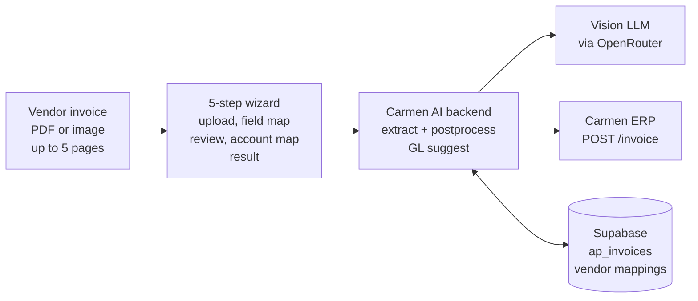
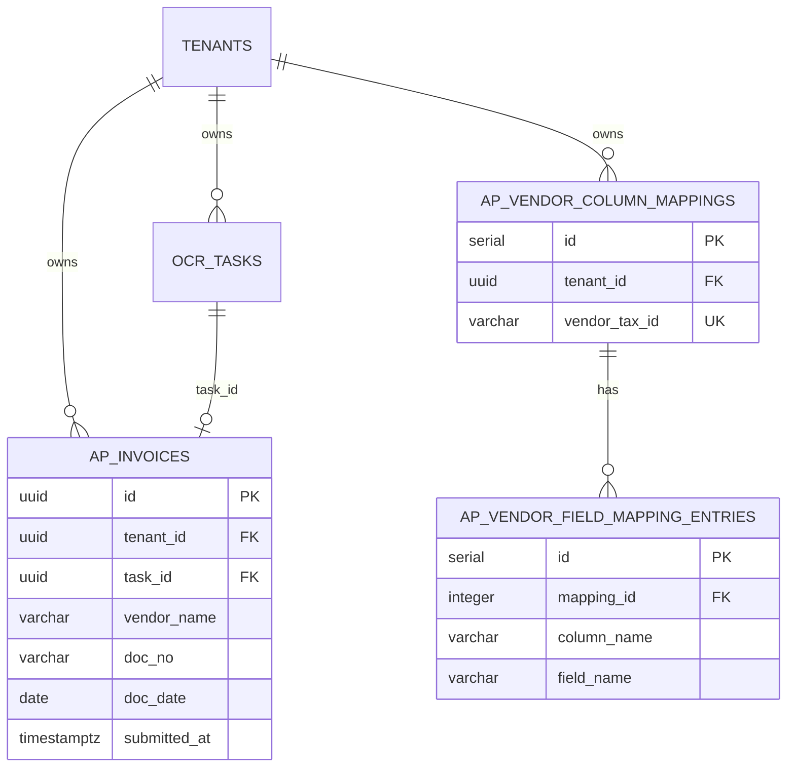
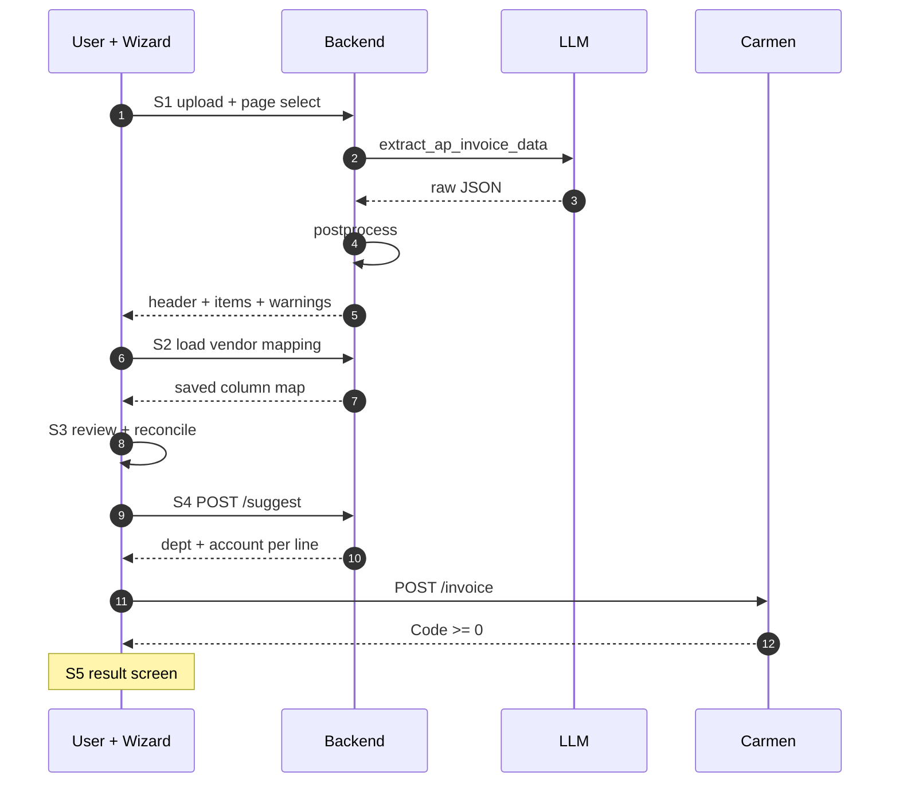
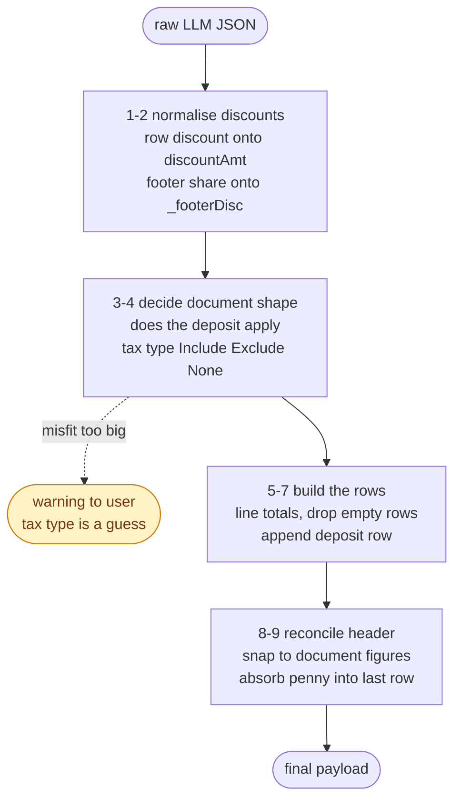
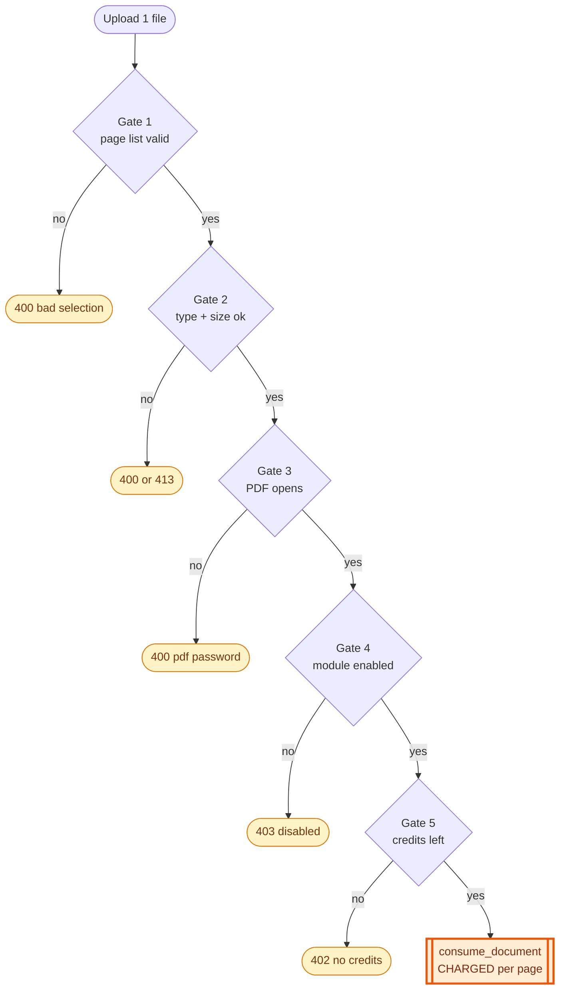
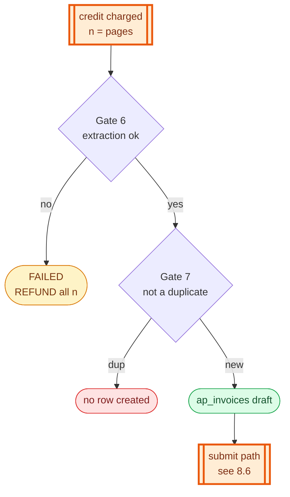
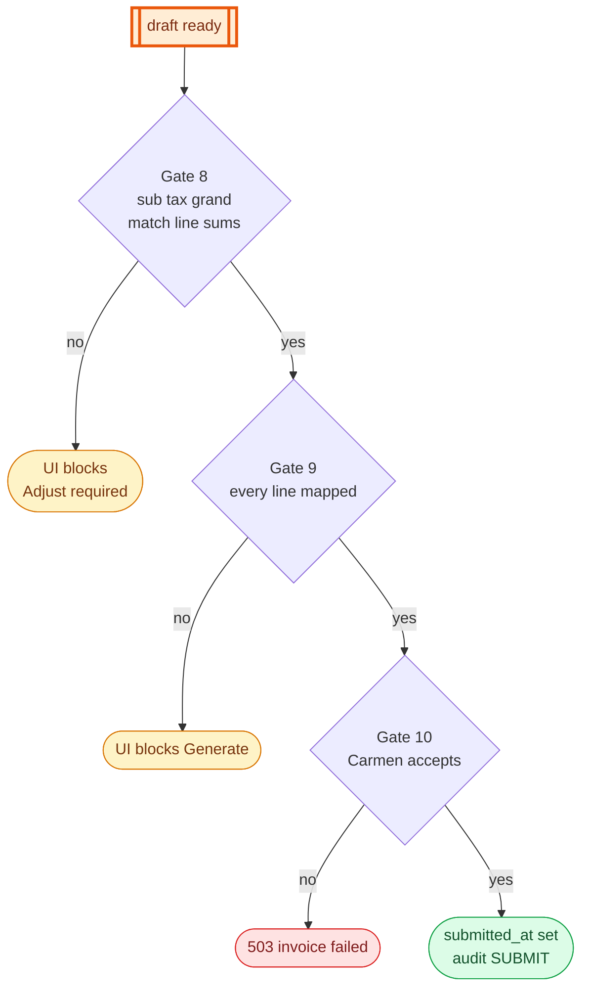

## Document Revision History

| Version | Date | Author | Description of Changes | Approved By |
|---|---|---|---|---|
| 1.0 | 25/08/2026 | Dev Team | ฉบับแรก — เขียนจากโค้ดที่ merge เข้า main แล้ว ครอบคลุม extraction, postprocess pipeline, field mapping ต่อผู้ขาย, การกระทบยอด และการส่งเข้า Carmen พร้อม gate ladder, error matrix และ QA matrix | Reviewed |
| 1.1 | 27/10/2026 | Dev Team | ปรับตามโค้ด ณ `945c63ea` — CA-122: header `TaxStatus` เป็น `None` เมื่อผลรวมภาษีของบรรทัดเป็น 0 (เดิม `Pending` ทุกใบ); CA-123: กฎการอ่านเฉพาะผู้ขายตามเลขผู้เสียภาษี (`VENDOR_RULES`) พร้อมคำเตือน `apQtyPriceMismatch` และการแก้เครื่องหมายของบรรทัดส่วนลดที่ qty ติดลบ; บันทึก CA-125 เป็นปัญหาที่ยังเปิดอยู่; คำเตือนเป็น code ที่แปล EN/TH; ขั้นตอนเปลี่ยนเลขที่เมื่อ Carmen แจ้งว่าเลขซ้ำ; path ในตาราง feature ตามโครงสร้างหลัง refactor 25–28/09; API บันทึก field mapping เป็น PUT | Reviewed |

<!-- pagebreak -->

# 1. Executive Summary & Objective

**AP Invoice Import** คือ wizard 5 ขั้นที่ให้พนักงานบัญชีอัปโหลดใบแจ้งหนี้จากผู้ขาย (PDF หรือภาพ) แล้วระบบใช้ Vision LLM อ่านทั้งส่วนหัวและตารางรายการสินค้าออกมา จับคู่คอลัมน์ในเอกสารกับ field ที่ Carmen ต้องการ ให้ผู้ใช้ตรวจและกระทบยอด แล้วสร้าง AP Invoice ใน Carmen ERP

งานที่ระบบนี้แทนที่คือการคีย์ใบแจ้งหนี้ทีละบรรทัดพร้อมคำนวณภาษีและส่วนลดเอง ผู้ใช้เหลือหน้าที่ตรวจทานและแก้เฉพาะจุดที่ระบบอ่านไม่ตรง

**จุดต่างจาก Credit Card OCR (FRD-01):** ใบแจ้งหนี้ผู้ขายไม่มีรูปแบบมาตรฐาน แต่ละรายวางคอลัมน์ไม่เหมือนกัน คิดภาษีคนละแบบ และวางส่วนลดไว้คนละที่ ระบบจึงมีสองอย่างที่ FRD-01 ไม่มี — **postprocess pipeline 9 ขั้น** ที่ตีความตัวเลขให้กระทบยอดกับท้ายเอกสารได้ และ **field mapping ที่จำได้ต่อผู้ขาย** เพื่อไม่ต้องจับคู่คอลัมน์ใหม่ทุกครั้ง

**กฎการอ่านเฉพาะผู้ขาย (ใหม่ v1.1, CA-123):** ผู้ขายบางรายวางตารางที่อ่านผิดได้ง่าย (เช่น พิมพ์จำนวน/ราคาสองชุดต่อบรรทัด) ระบบมีรายการกฎต่อเลขผู้เสียภาษีที่เติมเข้า prompt ของทุก BU และมีคำเตือนเมื่อบรรทัดของผู้ขายในรายการยังคูณไม่ลงตัว

**กลไกการคิดค่าใช้จ่าย:** คิดเป็น 1 document credit ต่อ 1 หน้าที่ส่งให้ LLM ไม่ใช่ต่อไฟล์ — ใบแจ้งหนี้ 3 หน้าเสีย 3 เครดิต และถ้าผู้ใช้เลือกเฉพาะหน้าที่ต้องการก็จ่ายเท่าจำนวนหน้าที่เลือก เพดานอยู่ที่ 5 หน้าต่อครั้ง (ดู §8.4)

## 1.1 System Context Diagram (ภาพรวมการไหลของข้อมูล)



# 2. Scope of Work

## 2.1 In-Scope (ขอบเขตการทำงานของระบบ)

- **Single-file, multi-page extraction:** 1 ไฟล์ต่อครั้ง รองรับ JPG, PNG, PDF, WebP, HEIC ขนาดไม่เกิน 5 MB PDF ที่ยาวกว่า 5 หน้าจะถูกตัดเหลือ 5 หน้าแรก
- **Page selection:** ผู้ใช้เลือกได้ว่าจะให้อ่านหน้าไหนบ้าง (ส่งเป็น index เริ่มจาก 0) เลือกกี่หน้าจ่ายเท่านั้น ไม่เลือกคืออ่านทั้งเอกสารตามเพดาน
- **Postprocess pipeline:** ตีความส่วนลด ตรวจว่าเป็นเอกสารมัดจำหรือไม่ ตัดสินชนิดภาษี (Include / Exclude / None) คำนวณยอดต่อบรรทัด และกระทบยอดหัวเอกสารกับตัวเลขที่พิมพ์อยู่ท้ายใบ
- **Per-vendor field mapping:** การจับคู่คอลัมน์ในเอกสารกับ field ของ Carmen ถูกบันทึกไว้ต่อเลขผู้เสียภาษีของผู้ขาย ครั้งถัดไปที่เจอผู้ขายรายเดิมระบบเติมให้เอง
- **Reconciliation with Adjust:** ถ้าผลรวมของบรรทัดไม่ตรงกับตัวเลขท้ายเอกสาร ระบบบอกว่าต่างกันตรงไหนและมีปุ่มให้ปรับ — ปุ่มสร้างเอกสารถูกปิดจนกว่ายอดจะตรง
- **AI GL suggestion ต่อบรรทัด:** แนะนำ department และ account code ให้ทุกบรรทัดจากคำอธิบายสินค้า โดยดึงผังบัญชีและแผนกจาก Carmen มาเป็นตัวเลือก
- **Duplicate prevention:** ตรวจด้วย (ผู้ขาย + เลขที่เอกสาร) — ใบที่เคยส่งเข้า Carmen แล้วจะไม่ถูกสร้างเป็น draft ซ้ำ
- **Draft persistence:** ตำแหน่งใน wizard และข้อมูลที่กู้คืนเองไม่ได้ถูกเก็บไว้ในเครื่องผู้ใช้ กันงานหายเมื่อ session หมดอายุกลางคัน
- **Vendor reading rules (ใหม่ v1.1):** `VENDOR_RULES` จับคู่เลขผู้เสียภาษี → คำสั่งการอ่าน เติมเป็นข้อ 8 ของ prompt (เหมือนกันทุก BU และมีลำดับเหนือข้อ 1) ปัจจุบันมีผู้ขาย 1 ราย: `0105559082715` (Polar Bear Mission, layout ของ Freshket) ให้อ่านจำนวน/ราคาจาก PACK DETAILS เท่านั้น
- **Tax status ของหัวเอกสาร (ใหม่ v1.1):** ใบที่ผลรวมภาษีของบรรทัดเป็น 0 ส่งเข้า Carmen ด้วย `TaxStatus: None` ใบอื่นเป็น `Pending`

## 2.2 Out-of-Scope (สิ่งที่ระบบไม่ทำ และผู้ใช้ต้องทำแทน)

| ไม่ทำ | ผู้ใช้ต้องทำอะไรแทน |
|---|---|
| ไม่เก็บไฟล์ต้นฉบับ | ไฟล์อยู่ในหน่วยความจำระหว่างประมวลผลเท่านั้น — ต้องเก็บเอกสารต้นฉบับไว้เองตามระเบียบบัญชี |
| ไม่แก้เอกสารที่ส่งเข้า Carmen แล้ว | ต้องแก้หรือยกเลิกที่ Carmen ด้วยมือ ระบบไม่มี rollback |
| ไม่อ่านเกิน 5 หน้าต่อครั้ง | เอกสารยาวกว่านั้นต้องแยกไฟล์ หรือใช้ page selection เลือกเฉพาะหน้าที่มีรายการ |
| ไม่รองรับหลายไฟล์ต่อครั้ง | อัปโหลดทีละใบ — ต่างจาก Credit Card OCR ที่รับได้ 10 ไฟล์ |
| ไม่เก็บส่วนลดรายบรรทัดลง Carmen | Carmen ไม่มี field ส่วนลดรายบรรทัด ระบบใช้ยอดสุทธิต่อบรรทัดแทน ส่วนลดเป็นตัวเลขสำหรับตรวจทานเท่านั้น |
| ไม่ประมวลผลซ้ำอัตโนมัติ | เอกสารที่ extraction ล้มเหลวได้เครดิตคืน แต่ต้องอัปโหลดใหม่เอง |
| แก้ปัญหา AI อ่านผู้ซื้อเป็นผู้ขาย และอ่านเลขข้างหัวเอกสาร (เช่น "BN-7") เป็นเลขที่เอกสาร (CA-125) | ยังอยู่ระหว่างแก้บน branch แยก ไม่อยู่ใน main — ผู้ใช้ต้องตรวจชื่อผู้ขาย เลขผู้เสียภาษี และเลขที่เอกสารใน Step 3 ทุกครั้ง |
| `InvhTotalAmt` ตามการแก้บรรทัดใน Step 3 | ยอดรวมของหัวเอกสารที่ส่ง Carmen เป็นยอดสุทธิตามเอกสาร ไม่ได้เปลี่ยนตามการแก้บรรทัด |
| เพิ่มกฎการอ่านของผู้ขายรายใหม่โดยไม่ deploy | `VENDOR_RULES` อยู่ในโค้ด ต้อง deploy |

# 3. Feature List & Sub-Modules

| รหัส | ฟีเจอร์ | Source (โค้ดจริง) |
|---|---|---|
| F-01 | Upload + page selection + validation | `routers/ap_invoice.py` · `utils/pages.py` (`parse_selected_pages`) |
| F-02 | Per-page credit pricing | `utils/pages.py` (`billable_pages`) |
| F-03 | PDF open + page truncation | `utils/pdf_utils.py` (`ensure_pdf_openable`, `MAX_PAGES_PER_CALL`) |
| F-04 | Vision extraction + vendor rules | `services/ap_invoice/service.py` (`extract_ap_invoice_data`) · `llm/prompts/ap_invoice.py` (`VENDOR_RULES`) |
| F-05 | Line discount normalisation | `services/ap_invoice/postprocess.py` (`_sign_on_price`, `_resolve_line_discount`) |
| F-06 | Footer discount distribution | `_distribute_footer_discount()` |
| F-07 | Deposit detection | `_deposit_applies()` · `_build_deposit_row()` |
| F-08 | Tax type detection + guess warning | `_detect_tax_type()` |
| F-09 | Line total computation | `_compute_line_totals()` |
| F-10 | Header reconciliation + penny absorption | `postprocess()` |
| F-11 | Per-vendor field mapping | `services/credit_card/accounting_config.py` (`get_ap_vendor_mapping`, `save_ap_vendor_mapping`) |
| F-12 | Client-side reconciliation + Adjust | `features/ap-invoice/hooks/useAPValidation.ts` |
| F-13 | AI GL suggestion ต่อบรรทัด | `POST /api/v1/ap-invoice/suggest` → `services/ap_invoice/service.py` (`suggest_for_items`) พร้อมตัวอย่างจากใบเก่าของผู้ขาย (`vendor_history.py`) |
| F-14 | Duplicate guard | `utils/db_helpers.py` (`has_submitted_doc`) ด้วย (tenant, doc_no, vendor_name) |
| F-15 | Post to Carmen + submit bookkeeping | `routers/carmen.py` (`proxy_create_invoice`) → `services/ap_invoice/service.py` (`mark_invoice_submitted`) · payload จาก `features/ap-invoice/lib/apInvoicePayload.ts` |
| F-16 | Draft persistence ฝั่ง client | `features/ap-invoice/hooks/useAPInvoice.ts` · `useAPDraft.ts` |
| F-17 | Audit trail (EXTRACT / SUGGEST_GL / SUBMIT) | `services/shared/audit.py` (`log_action`) |
| F-18 | Qty × price check ของผู้ขายในรายการ (ใหม่ v1.1) | `services/ap_invoice/postprocess.py` (`_qty_price_mismatch_warning`) |

<!-- pagebreak -->

# 4. UI Specs & Field Mapping

## 4.1 Header (ส่วนหัวเอกสาร)

| Field | Type | M/O | ความหมายและ business logic | ตัวอย่าง |
|---|---|---|---|---|
| `vendorName` | Text | M | ชื่อผู้ขาย — เป็นส่วนหนึ่งของ duplicate key | บริษัท เอบีซี ซัพพลาย จำกัด |
| `vendorTaxId` | Text | O | เลขผู้เสียภาษีของผู้ขาย — เป็น key ที่ใช้จำ field mapping ของผู้ขายรายนี้ | 0105512345678 |
| `vendorBranch` | Text | O | สาขาผู้ขาย | 00000 |
| `documentName` | Text | O | ชนิดเอกสารตามที่พิมพ์ | ใบแจ้งหนี้/ใบกำกับภาษี |
| `documentNumber` | Text | M | เลขที่เอกสาร — เป็นส่วนหนึ่งของ duplicate key | INV-66-0023 |
| `documentDate` | Text | O | วันที่เอกสาร ถูก normalize เป็นรูปแบบเดียวก่อนคืนกลับ | 15/07/2026 |
| `taxType` | Enum | M | Include / Exclude / None — ระบบตัดสินให้ ผู้ใช้แก้ได้ (ดู §8.3) | Exclude |
| `depositPct / depositAmt` | Number | O | สัดส่วนและยอดมัดจำ ถ้าเอกสารเป็นใบมัดจำ | 30 / 5,307.00 |
| `subTotal` | Number | M | ยอดก่อนภาษี — ต้องเท่ากับผลรวม lineSubTotal ของทุกบรรทัด |
| `taxAmount` | Number | M | ภาษี — ต้องเท่ากับผลรวม taxAmt ของทุกบรรทัด |
| `totalDiscount` | Number | O | ส่วนลดรวม — แสดงเพื่อตรวจทานเท่านั้น ไม่ได้ถูกส่งเข้า Carmen และไม่บล็อกการส่ง |
| `grandTotal` | Number | M | ยอดสุทธิ — ต้องเท่ากับผลรวม lineTotal ของทุกบรรทัด |
| `warnings[]` | Array | O | คำเตือนจาก postprocess เป็น code พร้อมค่า (`{code, params}`) หน้าจอแปลเป็น EN/TH เช่น ชนิดภาษีเป็นการเดา หรือ `apQtyPriceMismatch` (ระบุบรรทัด) — ไม่ใช่ข้อความจาก LLM |
| `is_duplicate` | Boolean | M | true = ใบนี้เคยส่งเข้า Carmen แล้ว ระบบไม่สร้าง draft ให้ |

## 4.2 Line Item (บรรทัดรายการ)

| Field | ความหมาย | ข้อบังคับ |
|---|---|---|
| `category` | หมวดสินค้า ใช้ประกอบการแนะนำผังบัญชี | บรรทัดมัดจำใช้ค่า "เงินมัดจำ" เป็นตัวแยกจากบรรทัดปกติ |
| `description` | คำอธิบายสินค้า | เป็น input หลักของ AI GL suggestion |
| `qty / unitPrice` | จำนวนและราคาต่อหน่วยตามที่เอกสารพิมพ์ | **unitPrice ถูกเก็บตามที่พิมพ์ไว้ไม่แปลง** ราคาสุทธิที่ Carmen ต้องการถูกคำนวณจากยอดต่อบรรทัดตอนสร้าง payload |
| `lineAmt` | ยอดในคอลัมน์ Amount ตามที่เอกสารพิมพ์ | **เป็นตัวตัดสินส่วนลดของบรรทัด** — ต่างจาก qty × unitPrice เท่าไร ส่วนนั้นคือส่วนลด |
| `discountAmt / discountPct` | ส่วนลดของบรรทัดนั้นเอง | ถูก normalize ให้เป็นยอดบาทเสมอ ไม่ว่าเอกสารจะเขียนเป็น % หรือยอด |
| `_footerDisc` | ส่วนแบ่งของส่วนลดท้ายเอกสารที่ตกกับบรรทัดนี้ | **แยกจาก discountAmt โดยตั้งใจ** — เอกสารที่มีทั้งคอลัมน์ส่วนลดและส่วนลดท้ายใบต้องไม่ถูกหักซ้ำ |
| `taxPct` | อัตราภาษีของบรรทัด | บรรทัดที่ยกเว้นภาษี (0) ต้องไม่ทำให้ทั้งเอกสารถูกตีความเป็น 0 |
| `lineSubTotal / taxAmt / lineTotal` | ยอดก่อนภาษี ภาษี และยอดรวมของบรรทัด | คำนวณโดยระบบตาม taxType ที่ตัดสินได้ |

## 4.3 Field Mapping (การจับคู่คอลัมน์)

ใบแจ้งหนี้แต่ละรายวางคอลัมน์ไม่เหมือนกัน Step 2 จึงให้ผู้ใช้บอกว่าคอลัมน์ที่ระบบอ่านมาแต่ละคอลัมน์คือ field อะไร

| หัวข้อ | รายละเอียด |
|---|---|
| ค่าที่เลือกได้ | `ignore, category, description, qty, unitPrice, discountPct, discountAmt, lineSubTotal, taxPct, taxType, taxAmt, lineTotal, taxProfileCode1` |
| ค่าเริ่มต้น | มีชุด default mapping ให้ (col1 = category, col2 = description, col3 = qty, col4 = unitPrice, …) ใช้เมื่อยังไม่เคยเจอผู้ขายรายนี้ |
| การจำต่อผู้ขาย | บันทึกลง ap_vendor_column_mappings + ap_vendor_field_mapping_entries โดยใช้ vendor_tax_id เป็น key (unique ต่อ tenant) และเก็บสำเนาไว้ใน localStorage ของเครื่องด้วย |
| ข้อจำกัด | **ผู้ขายที่ไม่มีเลขผู้เสียภาษีบนเอกสารจะจำ mapping ไม่ได้** ต้องจับคู่ใหม่ทุกครั้ง |

## 4.4 ค่าที่หัวเอกสารใน payload ถูกกำหนดโดยระบบ (ใหม่ v1.1)

| Field ของ Carmen | กติกา |
|---|---|
| `TaxStatus` | Σ `taxAmt` ของบรรทัด (ค่าที่ Carmen รวมเป็นหัวเอกสาร) เท่ากับ 0 (ต่างไม่เกิน 0.005) → `None` มิฉะนั้น `Pending` — ใช้ยอดของบรรทัด ไม่ใช่ `taxAmount` ท้ายเอกสาร ถ้าผู้ใช้ตั้งทุกบรรทัดเป็น None ใน Step 3 ใบนั้นเป็น `None` แม้ท้ายเอกสารจะมี VAT (CA-122) |
| `InvhInvNo` / `InvhTInvNo` | เลขที่เอกสาร — ถ้า Carmen แจ้งว่าเลขซ้ำ ผู้ใช้ใส่เลขใหม่แล้วส่งซ้ำได้ (§5) |
| `InvhTotalAmt` | ยอดสุทธิของเอกสาร (`grandTotal`) |
| `TaxPeriod` / `InvhTInvDt` | จากวันที่เอกสาร |

# 5. Action Buttons & Business Logic

| ปุ่ม | Action | พฤติกรรมของระบบ |
|---|---|---|
| Browse / Drop file | File select | ตรวจนามสกุลและขนาดฝั่ง client |
| เลือกหน้า | Page picker | ส่งเป็น JSON array ของ index เริ่มจาก 0 — เลือกกี่หน้าจ่ายเท่านั้น |
| Extract | Form submit | POST /api/v1/ap-invoice/extract — จุดที่เกิดค่าใช้จ่าย |
| Confirm Mapping | Navigate | ยืนยันการจับคู่คอลัมน์แล้วไป Step 3 พร้อมบันทึก mapping ให้ผู้ขายรายนี้ |
| แก้ค่าในตาราง Step 3 | Inline edit | ทุกครั้งที่แก้ ระบบคำนวณยอดบรรทัดใหม่และอัปเดตผลต่างกับหัวเอกสารทันที |
| Adjust | Recalculate | ปรับให้ผลรวมของบรรทัดตรงกับตัวเลขท้ายเอกสาร ใช้เมื่อมีผลต่างจากการปัดเศษ |
| Next → Account Mapping | Navigate | ขอ AI แนะนำ dept/account ให้ทุกบรรทัด |
| Generate | Form submit | POST /api/v1/carmen/invoice — ปุ่มถูกปิดจนกว่าทุกบรรทัดจะมี mapping ครบ |
| Change Invoice Number | Modal | เมื่อ Carmen ตอบว่าเลขที่ใบนี้ของผู้ขายรายนี้มีอยู่แล้ว ระบบแสดง Invoice Already Exists in Carmen ให้ใส่เลขที่ใหม่แล้ว Re-submit ด้วยข้อมูลเดิม หรือ Cancel กลับไป Step 1 |
| Proceed (Skip Warning) | Confirm | ใช้เมื่อยอดของตารางไม่ตรงกับเอกสาร — คำเตือน `apQtyPriceMismatch` อย่างเดียวไม่บล็อกการไปต่อ |

<!-- pagebreak -->

# 6. Database Schema & Tables

## 6.1 ตารางที่เกี่ยวข้อง

| ตาราง | บทบาทใน module นี้ |
|---|---|
| `ocr_tasks` | 1 แถวต่อ 1 การอัปโหลด เก็บสถานะและจำนวนเครดิตที่หัก (เท่ากับจำนวนหน้า) |
| `ap_invoices` | draft ของใบแจ้งหนี้ที่อ่านสำเร็จ — submitted_at เป็น null คือยังไม่ส่ง Carmen |
| `ap_vendor_column_mappings` | 1 แถวต่อ (tenant, vendor_tax_id) — หัวของการจับคู่คอลัมน์ |
| `ap_vendor_field_mapping_entries` | รายการคู่ column_name → field_name ของ mapping นั้น |
| `bu_accounting_configs` | ผังบัญชีของ BU ที่ใช้ประกอบ payload |

## 6.2 กุญแจกันเอกสารซ้ำ

| จุดตรวจ | Key ที่ใช้ | พฤติกรรม |
|---|---|---|
| ตอน extract | `(tenant_id, doc_no, vendor_name)` และเงื่อนไข submitted_at IS NOT NULL | ถ้าซ้ำ ระบบไม่สร้างแถวใน ap_invoices และคืน id เป็น null พร้อม is_duplicate = true — แต่ยังหักเครดิตแล้ว เพราะ LLM ทำงานไปแล้ว |
| เงื่อนไขที่จะตรวจ | ต้องมีทั้ง doc_no และ vendor_name | **ถ้าอ่านชื่อผู้ขายหรือเลขที่เอกสารไม่ออก การตรวจซ้ำจะถูกข้ามทั้งหมด** เอกสารนั้นจะสร้าง draft ได้เสมอ |
| ตอน submit | ไม่มีการตรวจซ้ำที่ backend | **ต่างจาก FRD-01 ที่ล็อกแถวก่อน post — AP Invoice ส่งต่อไป Carmen แล้วค่อย stamp submitted_at** |

## 6.3 Entity Relationship Diagram



<!-- pagebreak -->

# 7. Required Data Tables (External Integrations)

| ปลายทาง | เรียกตอนไหน | ใช้ทำอะไร |
|---|---|---|
| OpenRouter (Vision LLM) | Step 1 — 1 ครั้งต่อการอัปโหลด | อ่านหัวเอกสารและตารางรายการ ทุก request แนบ data_collection: deny |
| OpenRouter (Text LLM) | Step 4 | แนะนำ dept/account ให้ทุกบรรทัดพร้อมกันในคำขอเดียว |
| `GET /account-codes` | ก่อนขอ suggestion | ผังบัญชีของ BU |
| `GET /department` | ก่อนขอ suggestion | รายการแผนก |
| `GET /vendors` | Step 3 | ค้นหาผู้ขายใน Carmen เพื่อผูกกับรหัสผู้ขายจริง |
| `POST /invoice` | Step 4 กด Generate | สร้าง AP Invoice ใน Carmen — Code ≥ 0 คือสำเร็จ |

**ข้อควรทราบ:** ถ้า Carmen ตอบ error ตอนขอผังบัญชีหรือแผนก endpoint /suggest จะคืน status code เดียวกับที่ Carmen ตอบมา ไม่ได้แปลงเป็น 503 — ผู้เรียกจึงเห็นสาเหตุจริงจากฝั่ง Carmen

# 8. Workflow & End-to-End Walkthrough

## 8.1 Sequence — ภาพรวม wizard ทั้ง 5 ขั้น



| ขั้น | ชื่อขั้น | สิ่งที่เกิดขึ้น |
|---|---|---|
| 1 | Upload Document | อัปโหลด 1 ไฟล์ เลือกหน้า ใส่รหัส PDF ถ้ามี — จบขั้นนี้เครดิตถูกหักแล้วตามจำนวนหน้า |
| 2 | Field Mapping | บอกว่าคอลัมน์ที่อ่านมาแต่ละคอลัมน์คือ field อะไร ถ้าเคยเจอผู้ขายรายนี้แล้วระบบเติมให้ |
| 3 | Review Data | ตรวจหัวเอกสารและตารางรายการ แก้ค่าที่อ่านผิด กระทบยอดกับตัวเลขท้ายใบ |
| 4 | Account Mapping | ขอ AI แนะนำ dept/account ทุกบรรทัด ตรวจแล้วกด Generate เพื่อส่งเข้า Carmen |
| 5 | Success | แสดงผลลัพธ์และเลขที่เอกสารที่ Carmen สร้างให้ |

## 8.2 Sequence — ภายในของ POST /extract

```mermaid 8.2 | Inside the extract endpoint — free checks, per-page charge, full refund on failure
sequenceDiagram
    autonumber
    participant R as router
    participant CR as credit
    participant L as LLM
    participant PP as postprocess

    R->>R: parse selected_pages [free]
    R->>R: validate_and_read [free]
    R->>R: ensure_pdf_openable [free]
    R->>R: assert_module_enabled [free]
    rect rgb(255, 237, 213)
        R->>CR: consume_document<br/>n = billable_pages
    end
    R->>R: create_task charged_docs=n
    R->>L: extract_ap_invoice_data
    L-->>R: raw JSON
    R->>PP: postprocess
    PP-->>R: normalised header + items
    R->>R: duplicate check + insert row
    alt any failure after charge
        R->>CR: refund_document n
    end
```

| ลำดับ | ขั้นตอน | หมายเหตุเรื่องเครดิต |
|---|---|---|
| 1 | ตรวจว่า OPENROUTER_API_KEY ถูกตั้งค่า | ไม่เสียเครดิต · กันไม่ให้ server ที่ตั้งค่าผิดกินเครดิตฟรี |
| 2 | parse_selected_pages() — ต้องเป็น JSON array ของ index และไม่เกิน 5 หน้า | ไม่เสียเครดิต |
| 3 | validate_and_read() — นามสกุล ขนาด magic bytes | ไม่เสียเครดิต |
| 4 | ensure_pdf_openable() — เปิดไฟล์และนับจำนวนหน้า | ไม่เสียเครดิต · จำนวนหน้าที่ได้จากขั้นนี้คือฐานในการคิดราคา |
| 5 | assert_module_enabled() | ไม่เสียเครดิต |
| 6 | billable_pages() แล้ว consume_document(increment = n) | **จุดตัดสินเรื่องค่าใช้จ่าย** — n = จำนวนหน้าที่เลือก หรือจำนวนหน้าทั้งเอกสาร โดยไม่เกิน 5 และไม่ต่ำกว่า 1 |
| 7 | create_task() พร้อม charged_docs = n | เสียแล้ว |
| 8 | extract_ap_invoice_data() — 1 LLM call | เสียแล้ว |
| 9 | postprocess() — pipeline 9 ขั้น (ดู §8.3) | เสียแล้ว |
| 10 | ตรวจซ้ำ แล้วสร้างแถวใน ap_invoices | เสียแล้ว |
| — | **ถ้าขั้นที่ 7–10 ขั้นใดล้มเหลว: refund_document(n)** | **คืนทั้งหมด** — ต่างจาก FRD-01 ที่คืนเป็นรายไฟล์ เพราะที่นี่ทั้งเอกสารเป็นหน่วยเดียว |

## 8.3 Postprocess Pipeline — ลำดับที่สลับไม่ได้

ขั้นตอนนี้คือสิ่งที่ทำให้ใบแจ้งหนี้ต่างรูปแบบกันออกมาเป็นตารางที่กระทบยอดได้ และลำดับของมันมีเหตุผลทางบัญชีกำกับอยู่



| ขั้น | ทำอะไร | ทำไมต้องอยู่ตำแหน่งนี้ |
|---|---|---|
| 0a (v1.1) | ย้ายเครื่องหมายลบจาก qty ไปที่ราคา (`_sign_on_price`) สำหรับบรรทัดส่วนลดที่พิมพ์ "Quantity -1 × 190.00 = -190.00" | กันไม่ให้ qty ติดลบไปทำให้การตีความส่วนลดและยอดบรรทัดผิด (พบระหว่างทดสอบ CA-123) |
| 0b (v1.1) | ตรวจ qty × price ของผู้ขายที่อยู่ใน `VENDOR_RULES` | ถ้าบรรทัดที่ไม่มีส่วนลดยังคูณไม่ได้ Amount (ต่างเกิน 1 สตางค์) ใส่คำเตือน `apQtyPriceMismatch` ระบุบรรทัด — ไม่บล็อก |
| 1 | แปลงส่วนลดของแต่ละบรรทัดให้เป็นยอดบาท | **ต้องมาก่อนทุกการบวกยอด** — คอลัมน์ Amount ที่พิมพ์บนเอกสารเป็นตัวตัดสิน: ต่างจาก qty × unitPrice เท่าไร ส่วนนั้นคือส่วนลด ถ้าปล่อยส่วนลดค้างอยู่ในคอลัมน์ % ผลรวมจะสูงเกินจริงและทำให้ขั้นที่ 4 ตัดสินชนิดภาษีผิดทั้งใบ |
| 2 | กระจายส่วนลดท้ายเอกสารตามสัดส่วนยอดของแต่ละบรรทัด | **เก็บไว้คนละ field กับส่วนลดของบรรทัดเอง** เอกสารที่มีทั้งสองอย่างจะได้ไม่ถูกหักซ้ำ เศษที่ปัดไม่ลงตัวตกกับบรรทัดที่ยอดใหญ่ที่สุด ไม่ใช่บรรทัดสุดท้าย |
| 3 | ตรวจว่าคำว่า "มัดจำ X%" เป็นเงื่อนไขการชำระจริง หรือเป็นแค่หมายเหตุ | ถ้าท้ายเอกสารเป็นยอดเต็ม แปลว่าเป็นหมายเหตุ ต้องล้างค่ามัดจำทิ้ง ไม่งั้นขั้นถัดไปจะย่อยอดทั้งใบผิด |
| 4 | ตัดสินชนิดภาษี Include / Exclude / None | ลองตีความทั้งสองแบบแล้วดูว่าแบบไหนกระทบยอดกับท้ายเอกสารได้ใกล้กว่า · None ใช้เมื่อเอกสารระบุภาษีเป็น 0 และผลรวมตรงกับยอดสุทธิพอดี · ใช้อัตราภาษีตัวแรกที่ไม่เป็นศูนย์ ไม่ใช่ของบรรทัดแรก เพื่อไม่ให้บรรทัดยกเว้นภาษีลากทั้งใบ |
| — | **คำเตือนเมื่อผลลัพธ์เป็นการเดา** | **ขั้นที่ 4 เลือกตัวที่ผิดน้อยกว่าเสมอ แม้ไม่มีตัวไหนกระทบยอดได้จริง** ถ้าส่วนต่างของตัวที่ชนะยังเกินเกณฑ์ ระบบใส่คำเตือนไว้ใน warnings เพื่อบอกผู้ใช้ว่าให้ตรวจเอง |
| 5 | คำนวณยอดก่อนภาษี ภาษี และยอดรวมของแต่ละบรรทัด | ใช้ชนิดภาษีที่ตัดสินได้จากขั้นที่ 4 · ราคาต่อหน่วยไม่ถูกแก้ ถูกเก็บตามที่เอกสารพิมพ์ |
| 6 | ตัดบรรทัดที่ไม่มียอดทิ้ง | ยกเว้นบรรทัดที่ยอดเป็นศูนย์แต่มีส่วนลด (ของแถมที่ลด 100%) ซึ่งต้องเก็บไว้ ไม่งั้นส่วนลดรวมจะขาดและกระทบยอดไม่ลง |
| 7 | เพิ่มบรรทัดมัดจำ ถ้าเอกสารเป็นใบมัดจำ | บรรทัดนี้ใช้ category ว่า "เงินมัดจำ" เป็นตัวแยกจากบรรทัดปกติ |
| 8 | ปรับหัวเอกสารให้ตรงกับตัวเลขที่พิมพ์ท้ายใบ | ถ้าผลรวมที่คำนวณได้ต่างจากที่พิมพ์ไม่เกิน 0.05 บาท ให้ใช้ตัวเลขที่พิมพ์ |
| 9 | ดูดเศษสตางค์เข้าบรรทัดปกติบรรทัดสุดท้าย | **ต่างไม่เกิน 0.02 บาทเท่านั้น** และหลังจากนั้นต้องบวกภาษีจากบรรทัดใหม่ทั้งหมด ไม่ใช่บวกส่วนต่างทับลงไป มิฉะนั้นหัวเอกสารจะเพี้ยนไปหนึ่งสตางค์ |

## 8.4 Gate Ladder ช่วงที่ 1 — ก่อนหักเครดิต



| Gate | เงื่อนไข | ถ้าไม่ผ่าน | HTTP | เครดิต |
|---|---|---|---|---|
| 1 | selected_pages เป็น JSON array ของ index และไม่เกิน 5 หน้า | ValueError | 400 | ไม่เสีย |
| 2 | นามสกุลรองรับ, ≤ 5 MB, magic bytes ตรง | ValidationError / FileTooLargeError | 400 / 413 | ไม่เสีย |
| 3 | เปิดไฟล์ได้ด้วยรหัสที่ส่งมา และนับหน้าได้ | `pdf_password_required` | 400 | ไม่เสีย |
| 4 | module ap_invoice เปิดให้ tenant นี้ | ModuleDisabled | 403 | ไม่เสีย |
| 5 | มี allowance หรือ credit เหลือพอสำหรับจำนวนหน้าที่จะอ่าน | InsufficientCredits | 402 | ไม่เสีย |
| — | **consume_document() หักเครดิต n หน่วย โดย n = จำนวนหน้า** | — | — | **เริ่มเสีย** |

**ข้อสังเกตเรื่องการหักเครดิตของ batch:** ทั้ง n หน่วยถูกดึงจาก pool เดียวกัน — tenant ที่มี allowance เหลือ 3 หน่วยแล้วอ่านเอกสาร 5 หน้า จะจ่ายด้วย credit ทั้ง 5 หน่วย และ allowance 3 หน่วยนั้นค้างอยู่

## 8.5 Gate Ladder ช่วงที่ 2 — หลังหักเครดิต จนได้ draft



| Gate | เงื่อนไข | ถ้าไม่ผ่าน | เครดิต |
|---|---|---|---|
| 6 | extract + postprocess + บันทึกลง DB สำเร็จ | task = failed พร้อม error_message | **คืนทั้ง n หน่วย** |
| 7 | อ่าน doc_no และ vendor_name ได้ และคู่นี้ยังไม่เคยส่ง | is_duplicate = true, ไม่สร้าง draft, id เป็น null | **ไม่คืน** — model อ่านเอกสารสำเร็จแล้ว |
| ✔ | ผ่านทั้งสอง | สร้างแถวใน ap_invoices (submitted_at = null), task = completed | เสีย n หน่วย |

## 8.6 Gate Ladder ช่วงที่ 3 — การส่งเข้า Carmen



| Gate | เงื่อนไข | ตรวจที่ไหน | ถ้าไม่ผ่าน |
|---|---|---|---|
| 8 | ผลรวมของบรรทัดตรงกับหัวเอกสารทั้ง 3 ตัว: ยอดก่อนภาษี, ภาษี, ยอดสุทธิ | UI (useAPValidation) | แสดงผลต่างและปุ่ม Adjust ปุ่มสร้างเอกสารถูกปิด |
| 9 | ทุกบรรทัดมี dept และ account ครบ | UI (Account Mapping) | ปุ่ม Generate ถูกปิด |
| 10 | Carmen ตอบ Code ≥ 0 | Backend + UI | Code ติดลบ: UI แสดงข้อความของ Carmen — ถ้าเป็นเลขซ้ำ เสนอให้เปลี่ยนเลขที่แล้วส่งใหม่ / ติดต่อไม่ได้: 503 |
| ✔ | ผ่านทุก gate | — | stamp submitted_at (ค้นแบบผูก tenant) และบันทึก audit SUBMIT |

**ส่วนลดไม่ถูกนับเป็นเงื่อนไขปิดกั้น** ทั้งที่แสดงผลต่างให้เห็น เพราะ Carmen ไม่มี field ส่วนลดรายบรรทัดและ payload ไม่ได้อ่านค่านั้น ผลต่างของส่วนลดจึงไม่มีผลต่อสิ่งที่ถูกบันทึกจริง

**กรณีที่กด Adjust แล้วไม่หาย:** ถ้าตัวเลขท้ายเอกสารเองไม่สอดคล้องกัน (ยอดก่อนภาษี + ภาษี ≠ ยอดสุทธิ) การปรับบรรทัดจะไม่มีวันทำให้ตรงได้ ระบบจึงแสดงคำเตือนแทนปุ่ม Adjust เพื่อไม่ให้ผู้ใช้วนอยู่กับปุ่มที่ไม่ช่วยอะไร

**กฎที่สำคัญที่สุด: เครดิตผูกกับจำนวนหน้าที่ส่งให้ LLM ไม่ได้ผูกกับผลลัพธ์**

Gate 1–5 ตรวจได้โดยยังไม่ต้องเรียก model จึงไม่คิดเงิน เมื่อ extraction สำเร็จแปลว่า model ทำงานครบทุกหน้าและเกิดต้นทุนจริงแล้ว เอกสารนั้นถูกหักเครดิตไม่ว่าจะเกิดอะไรต่อ — ซ้ำ, ยอดไม่ตรง, mapping ไม่ครบ หรือ Carmen ปฏิเสธ กรณีเดียวที่คืนคือ extraction ไม่สำเร็จ และคืนทั้งจำนวนหน้าที่หักไป

## 8.7 User Operational Workflow

**งานประจำวัน:**

- อัปโหลดใบแจ้งหนี้ทีละใบ ถ้าเอกสารมีหน้าแนบที่ไม่ใช่รายการสินค้า ให้เลือกเฉพาะหน้าที่มีตาราง เพื่อไม่ให้เสียเครดิตเกิน
- ครั้งแรกของผู้ขายแต่ละราย ต้องจับคู่คอลัมน์ใน Step 2 ครั้งเดียว ครั้งถัดไประบบจำให้
- ที่ Step 3 ให้ดูแถบผลต่างก่อนเสมอ ถ้าไม่มีผลต่างแปลว่ากระทบยอดกับเอกสารได้แล้ว
- ตรวจ dept/account ที่ AI แนะนำใน Step 4 ก่อนกด Generate

**เมื่อเจอปัญหา:**

- **คำเตือนเรื่องชนิดภาษี** → ระบบเดาไม่ลงตัว ให้ตรวจว่าราคาที่แสดงเป็นราคารวมภาษีหรือไม่ แล้วแก้ช่อง taxType เอง
- **มีผลต่างที่กด Adjust แล้วไม่หาย** → ตัวเลขท้ายเอกสารเองไม่สอดคล้อง ให้เทียบกับใบจริงและแก้ที่หัวเอกสาร
- **ผู้ขายไม่มีเลขผู้เสียภาษีบนเอกสาร** → ระบบจำ mapping ไม่ได้ ต้องจับคู่คอลัมน์ใหม่ทุกครั้ง
- **เอกสารซ้ำ** → ระบบแจ้งว่าเลขที่นี้ของผู้ขายรายนี้ส่งไปแล้ว ให้ตรวจใน Carmen ก่อน — เครดิตที่เสียไปไม่คืน

<!-- pagebreak -->

# 9. Error Handling & Edge Cases Matrix

| Case ID | สาเหตุ | สถานการณ์ | HTTP | เครดิต | ผู้ใช้ต้องทำ |
|---|---|---|---|---|---|
| EC-01 | api_key_missing | server ไม่ได้ตั้งค่า OPENROUTER_API_KEY | 500 | ไม่เสีย | แจ้งผู้ดูแลระบบ |
| EC-02 | bad_page_selection | selected_pages ไม่ใช่ JSON array หรือเลือกเกิน 5 หน้า | 400 | ไม่เสีย | เลือกหน้าใหม่ไม่เกิน 5 |
| EC-03 | unsupported_file_type | นามสกุลไม่รองรับ หรือ magic bytes ไม่ตรงกับนามสกุล | 400 | ไม่เสีย | แปลงไฟล์ |
| EC-04 | file_too_large | ไฟล์เกิน 5 MB | 413 | ไม่เสีย | ลดขนาดหรือแยกไฟล์ |
| EC-05 | pdf_password_required | PDF เข้ารหัส และไม่ได้ส่งรหัสหรือรหัสผิด | 400 | ไม่เสีย | ใส่รหัสแล้วส่งใหม่ |
| EC-06 | module_disabled | admin ปิด module นี้ให้ tenant | 403 | ไม่เสีย | ติดต่อผู้ดูแลระบบ |
| EC-07 | insufficient_credits | เครดิตเหลือไม่พอสำหรับจำนวนหน้าที่จะอ่าน | 402 | ไม่เสีย | ซื้อเครดิต หรือเลือกหน้าให้น้อยลง |
| EC-08 | pages_out_of_range | เลือกหน้าที่เกินจำนวนหน้าจริงทั้งหมด | 422 | **คืน** | เลือกหน้าที่มีอยู่จริง |
| EC-09 | llm_unavailable | ต่อ OpenRouter ไม่ได้ หรือ upstream ล่ม | 503 | **คืนทั้ง n** | ลองใหม่ภายหลัง |
| EC-10 | llm_parse_error | model ตอบมาในรูปแบบที่แปลงเป็นตารางไม่ได้ | 422 | **คืนทั้ง n** | ลองใหม่ หรือเลือกเฉพาะหน้าที่มีตาราง |
| EC-11 | tax_type_guessed | ทั้ง Include และ Exclude ไม่กระทบยอดกับท้ายเอกสาร ระบบเลือกตัวที่ผิดน้อยกว่า | 200 + warning | ไม่คืน | **ต้องตรวจ taxType เอง** — ถ้าเดาผิดทุกบรรทัดจะเพี้ยนตามอัตราภาษี |
| EC-12 | duplicate_on_extract | ผู้ขาย + เลขที่เอกสารนี้เคยส่งเข้า Carmen แล้ว | 200 (is_duplicate) | ไม่คืน | ตรวจใน Carmen ก่อน |
| EC-13 | duplicate_check_skipped | อ่านชื่อผู้ขายหรือเลขที่เอกสารไม่ออก | 200 | ไม่คืน | **ระบบไม่ตรวจซ้ำให้เลย** — ต้องตรวจเองก่อนกด Generate |
| EC-14 | doc_inconsistent | ตัวเลขท้ายเอกสารเองไม่สอดคล้อง (ก่อนภาษี + ภาษี ≠ สุทธิ) | — (UI) | ไม่คืน | แก้ที่หัวเอกสารตามใบจริง ปุ่ม Adjust ช่วยไม่ได้ |
| EC-15 | reconcile_diff | ผลรวมของบรรทัดไม่ตรงกับหัวเอกสาร | — (UI) | ไม่คืน | กด Adjust หรือแก้บรรทัดที่ผิด |
| EC-16 | mapping_incomplete | ยังมีบรรทัดที่ไม่มี dept หรือ account | — (UI) | ไม่คืน | เติมให้ครบ |
| EC-17 | carmen_lookup_failed | ดึงผังบัญชีหรือแผนกจาก Carmen ไม่ได้ตอนขอ suggestion | ตาม Carmen | ไม่คืน | ลองใหม่ หรือตรวจสิทธิ์ใน Carmen |
| EC-18 | llm_partial | AI แนะนำได้ไม่ครบทุกบรรทัด response มี llm_partial = true | 200 | ไม่คืน | เติม dept/account บรรทัดที่ขาดเอง |
| EC-19 | carmen_rejected | Carmen ตอบ Code < 0 หรือต่อไม่ติดตอนสร้างเอกสาร | 503 | ไม่คืน | **ตรวจใน Carmen ก่อนส่งซ้ำ** — ระบบไม่ตรวจซ้ำที่ขั้นนี้ |
| EC-20 | submit_bookkeeping_skipped | Carmen รับเอกสารแล้วแต่ ap_invoice_id ไม่ถูกส่งมาหรือรูปแบบผิด | 200 | ไม่คืน | **เอกสารเข้า Carmen แล้วแต่ draft ยังขึ้นว่ายังไม่ส่ง** |
| EC-21 | credit_fail_open | DB มีปัญหาชั่วคราวตอนหักเครดิต ระบบปล่อยผ่านเพื่อไม่ให้งานสะดุด | 200 | ไม่เสีย (charged_docs = 0) | ไม่ต้องทำอะไร |
| EC-22 | apQtyPriceMismatch (v1.1) | ผู้ขายใน `VENDOR_RULES` แต่บรรทัดยังคูณไม่ลงตัว | 200 + warning | ไม่คืน | ตรวจบรรทัดที่ระบุ — ไม่บล็อก |
| EC-23 | carmen_duplicate_invoice (v1.1) | Carmen ตอบว่าเลขที่นี้ของผู้ขายรายนี้มีอยู่แล้ว | 200 + Code ติดลบ | ไม่คืน | ตรวจใน Carmen แล้วเปลี่ยนเลขที่และส่งใหม่ หรือยกเลิก |
| EC-24 | buyer_read_as_vendor (CA-125, ยังเปิดอยู่) | AI อ่านผู้ซื้อเป็นผู้ขาย หรืออ่านเลขข้างหัวเอกสารเป็นเลขที่ | 200 | ไม่คืน | แก้ชื่อผู้ขาย เลขผู้เสียภาษี และเลขที่ใน Step 3 ก่อนส่ง |

# 10. Non-Functional & Technical Requirements

## 10.1 Security & Privacy

- ทุกคำขอต้องมี session จาก Carmen SSO และใช้ token ของผู้ใช้คนนั้นยิงต่อไป Carmen
- **การ stamp submitted_at ค้นแถวโดยผูก tenant_id เสมอ** ผู้เรียกที่ส่ง id ของ tenant อื่นมาจึงไม่สามารถเปลี่ยนสถานะเอกสารของคนอื่นได้
- ทุก request ไป OpenRouter แนบ `provider.data_collection = "deny"`
- รหัสผ่าน PDF ใช้เปิดไฟล์ในหน่วยความจำแล้วทิ้ง ไม่ถูกบันทึก

## 10.2 Performance & Capacity

- 1 vision LLM call ต่อการอัปโหลด ไม่ว่าจะกี่หน้า — เพดาน 5 หน้าตั้งจากขนาด context ที่ส่งไหวในคำขอเดียว
- DB session ถูกเปิดสั้น ๆ เป็นช่วง ๆ ไม่ถือ connection ระหว่างรอ LLM ตอบ (2–10 วินาที) เพื่อไม่ให้ connection pool หมดตอนมีคนใช้พร้อมกัน
- AI GL suggestion ขอทีเดียวสำหรับทุกบรรทัด ไม่ใช่ทีละบรรทัด

## 10.3 Audit Trail & Logging

- บันทึก audit 3 จุด: EXTRACT ตอนอัปโหลด, SUGGEST_GL ตอนขอ AI แนะนำ, SUBMIT ตอนสร้างเอกสารใน Carmen สำเร็จ
- ทุกงานถูกบันทึกใน ocr_tasks รวมทั้งที่ล้มเหลว พร้อม error_message และจำนวนหน้าที่หัก

## 10.4 Data Minimization

- ไม่เก็บไฟล์ต้นฉบับ ไม่เก็บรายการสินค้ารายบรรทัด — เก็บเฉพาะหัวเอกสารที่จำเป็นต่อการกันซ้ำและการอ้างอิง
- ตารางที่เก็บถาวรคือการจับคู่คอลัมน์ต่อผู้ขาย ซึ่งเป็นข้อมูลรูปแบบเอกสาร ไม่ใช่ข้อมูลรายการค้า

# 11. Developer Checklist & Acceptance Criteria

## 11.1 Developer Checklist

| สถานะ | รายการ |
|---|---|
| เสร็จ | Upload + page selection + validation พร้อมเพดาน 5 หน้า |
| เสร็จ | ตรวจ config, page list, ไฟล์, PDF password และ module entitlement ก่อนหักเครดิต |
| เสร็จ | คิดเครดิตต่อหน้า พร้อมคืนเต็มจำนวนเมื่อ extraction ล้มเหลว |
| เสร็จ | Postprocess pipeline 9 ขั้น พร้อมคำเตือนเมื่อชนิดภาษีเป็นการเดา |
| เสร็จ | Per-vendor field mapping บันทึกลง DB และ localStorage |
| เสร็จ | Client-side reconciliation พร้อมปุ่ม Adjust และการตรวจว่าเอกสารเองไม่สอดคล้อง |
| เสร็จ | AI GL suggestion ต่อบรรทัด พร้อม flag llm_partial |
| เสร็จ | Duplicate guard ด้วย (ผู้ขาย + เลขที่เอกสาร) |
| เสร็จ | Post to Carmen + submit bookkeeping แบบผูก tenant |
| เสร็จ | Draft persistence + restore |
| เสร็จ | Audit logging EXTRACT / SUGGEST_GL / SUBMIT |
| เสร็จ (v1.1) | `TaxStatus` None/Pending ตามผลรวมภาษีของบรรทัด (CA-122) |
| เสร็จ (v1.1) | `VENDOR_RULES` + คำเตือน `apQtyPriceMismatch` + `_sign_on_price` (CA-123) |
| กำลังแก้ | AI อ่านผู้ซื้อเป็นผู้ขาย / เลขที่เอกสารผิด (CA-125) — ยังไม่อยู่ใน main |

## 11.2 Acceptance Criteria

- **Pass Scenario:** อัปโหลดใบแจ้งหนี้ 1 หน้าที่ถูกต้อง ระบบต้องอ่านหัวและรายการครบ ผลรวมของบรรทัดตรงกับตัวเลขท้ายเอกสารโดยไม่ต้องกด Adjust และเมื่อกด Generate ต้องสร้าง AP Invoice ใน Carmen โดยเสียเครดิต 1
- **Pass Scenario (หลายหน้า):** เอกสาร 3 หน้า เลือกอ่าน 2 หน้า ต้องเสียเครดิต 2 ไม่ใช่ 3 และไม่ใช่ 1
- **Fail Scenario (ไฟล์ล็อก):** อัปโหลด PDF ที่มีรหัสโดยไม่ใส่รหัส ต้องตอบ 400 และไม่หักเครดิต
- **Fail Scenario (LLM ล่ม):** เอกสาร 4 หน้าที่ extraction ล้มเหลว ต้องคืนเครดิตครบ 4 หน่วย
- **Reconciliation Scenario:** เอกสารที่มีทั้งคอลัมน์ส่วนลดและส่วนลดท้ายใบ ต้องไม่ถูกหักส่วนลดซ้ำ และผลรวมต้องกระทบยอดกับท้ายเอกสารได้
- **Tax Status Scenario (v1.1):** ใบที่ไม่มี VAT ต้องถึง Carmen ด้วย `TaxStatus: None` และใบ VAT 7% ต้องเป็น `Pending`
- **Vendor Rule Scenario (v1.1):** ใบของ Polar Bear Mission ต้องได้ qty × price = Amount ทุกบรรทัด (อ่านจาก PACK DETAILS) และยอดใน Carmen ตรงกับเอกสาร

<!-- pagebreak -->

# 12. API Specifications

| Method | Path | หมายเหตุ |
|---|---|---|
| POST | `/api/v1/ap-invoice/extract` | multipart — file, form selected_pages (JSON array 0-based), form pdf_password · จุดที่หักเครดิต |
| POST | `/api/v1/ap-invoice/suggest` | ขอ dept/account ให้ทุกบรรทัดในคำขอเดียว · คืน suggestions และ llm_partial |
| GET | `/api/v1/config/ap-mapping/{vendorTaxId}` | อ่าน field mapping ที่บันทึกไว้ของผู้ขายรายนั้น |
| PUT | `/api/v1/config/ap-mapping/{vendorTaxId}` | บันทึก field mapping ของผู้ขาย — เขียนทับทั้งชุด |
| GET | `/api/v1/carmen/vendors` | proxy ค้นหาผู้ขายใน Carmen |
| GET | `/api/v1/carmen/account-codes` | proxy ผังบัญชี |
| GET | `/api/v1/carmen/departments` | proxy รายการแผนก |
| POST | `/api/v1/carmen/invoice` | สร้าง AP Invoice · query ap_invoice_id เพื่อให้ระบบ stamp submitted_at ให้ |

## 12.1 Status Codes

| Code | ความหมายในระบบนี้ |
|---|---|
| 400 | page selection ผิดรูปแบบ, ไฟล์ไม่ผ่าน validation หรือ PDF ต้องการรหัสผ่าน |
| 402 | เครดิตไม่พอสำหรับจำนวนหน้าที่จะอ่าน |
| 403 | module ถูกปิดสำหรับ tenant นี้ |
| 413 | ไฟล์ใหญ่เกิน 5 MB |
| 422 | หน้าที่เลือกไม่มีอยู่จริง หรือ LLM ตอบมาในรูปแบบที่ใช้ไม่ได้ |
| 500 | server ไม่ได้ตั้งค่า API key |
| 503 | LLM หรือ Carmen ไม่ตอบ |
| ตาม Carmen | endpoint /suggest ส่ง status code ของ Carmen ต่อมาตรง ๆ เมื่อดึงผังบัญชีหรือแผนกไม่ได้ |

<!-- pagebreak -->

# 13. Test Cases & QA Matrix

## 13.1 Category 1: Upload & Admission (ก่อนหักเครดิต)

| Test Case ID | Scenario & Pre-conditions | Test Steps | Expected Result & วิธีตรวจผล | Pass Criteria |
|---|---|---|---|---|
| TC-UPL-01 | อัปโหลดไฟล์ 1 หน้าที่ถูกต้อง. Pre: module เปิด, มีเครดิต | 1. อัปโหลด PDF 1 หน้า | ได้ header + items, ocr_tasks.status = completed, charged_docs = 1 | เสียเครดิต 1 พอดี |
| TC-UPL-02 | selected_pages ผิดรูปแบบ | 1. ส่ง selected_pages = "abc" | HTTP 400 และไม่มีแถวใหม่ใน ocr_tasks | ไม่เสียเครดิต |
| TC-UPL-03 | เลือกเกิน 5 หน้า | 1. ส่ง selected_pages = [0,1,2,3,4,5] | HTTP 400 ระบุเพดาน 5 หน้า | ไม่เสียเครดิต |
| TC-UPL-04 | PDF มีรหัส ไม่ได้ใส่รหัส | 1. อัปโหลด PDF ที่ล็อก | HTTP 400 code = pdf_password_required | **ไม่เสียเครดิต** — ตรวจที่ credit_ledger |
| TC-UPL-05 | server ไม่ได้ตั้ง API key | 1. ลบ env แล้วอัปโหลด | HTTP 500 ก่อนถึง consume_document | ไม่เสียเครดิต |
| TC-UPL-06 | module ถูกปิด | 1. admin ปิด ap_invoice แล้วอัปโหลด | HTTP 403 | ไม่เสียเครดิต |

## 13.2 Category 2: Per-Page Credit Accounting

| Test Case ID | Scenario & Pre-conditions | Test Steps | Expected Result & วิธีตรวจผล | Pass Criteria |
|---|---|---|---|---|
| TC-CRD-01 | **Regression test สำคัญ:** คิดเงินตามหน้าที่เลือก. Pre: PDF 4 หน้า | 1. เลือกอ่านเฉพาะหน้า 0 และ 2 | ตรวจที่ credit_ledger: หัก 2 และ ocr_tasks.charged_docs = 2 | **Fail ถ้าหัก 1 หรือ 4** |
| TC-CRD-02 | ไม่เลือกหน้า. Pre: PDF 3 หน้า | 1. อัปโหลดโดยไม่ส่ง selected_pages | หัก 3 หน่วย | ตรงกับจำนวนหน้าจริง |
| TC-CRD-03 | เอกสารยาวเกินเพดาน. Pre: PDF 9 หน้า | 1. อัปโหลดโดยไม่เลือกหน้า | หัก 5 หน่วย และอ่านเฉพาะ 5 หน้าแรก | ไม่หักเกินเพดาน |
| TC-CRD-04 | ไฟล์ภาพ (ไม่ใช่ PDF) | 1. อัปโหลด JPG | หัก 1 หน่วย | ภาพนับเป็น 1 หน้า |
| TC-CRD-05 | **Regression test สำคัญ:** คืนเครดิตเต็มจำนวน. Pre: PDF 4 หน้า และจำลอง LLM ล้มเหลว | 1. อัปโหลด 4 หน้า | ตรวจที่ credit_ledger: หัก 4 และคืน 4 | **Fail ถ้าคืน 1 หรือไม่คืน** |
| TC-CRD-06 | เลือกหน้าที่เกินจำนวนจริงทั้งหมด. Pre: PDF 2 หน้า | 1. เลือกหน้า [7,8] | หักอย่างน้อย 1 แล้วคืน 1 — ยอดสุทธิเป็นศูนย์ | **Fail ถ้าคืนมากกว่าที่หัก** |
| TC-CRD-07 | เครดิตไม่พอสำหรับจำนวนหน้า. Pre: เหลือ 2 หน่วย | 1. อัปโหลด PDF 5 หน้า | HTTP 402 และไม่มีการเรียก LLM | ไม่หักบางส่วน |

## 13.3 Category 3: Postprocess Correctness

| Test Case ID | Scenario & Pre-conditions | Test Steps | Expected Result & วิธีตรวจผล | Pass Criteria |
|---|---|---|---|---|
| TC-PP-01 | **Regression test สำคัญ:** ส่วนลดคอลัมน์ % ต้องถูกแปลงก่อนตัดสินภาษี. Pre: เอกสารที่มีคอลัมน์ส่วนลด 15% และคอลัมน์ Amount | 1. อัปโหลดเอกสารนั้น | ผลรวมของบรรทัดต้องคิดจาก Amount ที่พิมพ์ ไม่ใช่ qty × unitPrice และชนิดภาษีต้องตรงกับที่เอกสารระบุ | **Fail ถ้าชนิดภาษีพลิก** |
| TC-PP-02 | **Regression test สำคัญ:** เอกสารที่มีทั้งคอลัมน์ส่วนลดและส่วนลดท้ายใบ | 1. อัปโหลดเอกสารนั้น | ส่วนลดต้องไม่ถูกหักสองครั้ง — ผลรวม lineTotal ต้องเท่ากับยอดสุทธิท้ายใบ | **Fail ถ้าหักซ้ำ** |
| TC-PP-03 | บรรทัดแรกยกเว้นภาษี (0%) | 1. อัปโหลดเอกสารที่บรรทัดแรก taxPct = 0 แต่บรรทัดอื่น 7% | การตัดสินชนิดภาษีของทั้งเอกสารต้องใช้ 7% ไม่ใช่ 0% | ไม่ถูกบรรทัดแรกลาก |
| TC-PP-04 | เอกสารไม่มีภาษี | 1. อัปโหลดเอกสารที่ระบุภาษี 0 และผลรวมเท่ากับยอดสุทธิ | taxType = None | แยก None ออกจาก Include ได้ |
| TC-PP-05 | มัดจำที่เป็นแค่หมายเหตุ. Pre: เอกสารเขียน "มัดจำ 30%" แต่ท้ายใบเป็นยอดเต็ม | 1. อัปโหลด | ระบบต้องล้างค่ามัดจำ ยอดทั้งใบต้องไม่ถูกย่อลง 30% | **Fail ถ้ายอดถูกย่อ** |
| TC-PP-06 | มัดจำจริง. Pre: ท้ายใบเป็น 30% ของผลรวมรายการ | 1. อัปโหลด | มีบรรทัดมัดจำเพิ่มเข้ามา และ depositAmt ตรงกับยอดสุทธิ | สร้างบรรทัดมัดจำถูกต้อง |
| TC-PP-07 | ของแถมที่ลด 100% | 1. อัปโหลดเอกสารที่มีบรรทัดยอด 0 แต่มีส่วนลด | บรรทัดนั้นต้องยังอยู่ และส่วนลดรวมต้องนับรวมด้วย | ไม่ถูกตัดทิ้ง |
| TC-PP-08 | **Regression test สำคัญ:** ไม่มีการตีความไหนกระทบยอดได้ | 1. อัปโหลดเอกสารที่ผลรวมห่างจากท้ายใบมาก | ต้องมีคำเตือนใน warnings ว่าชนิดภาษีเป็นการเดา | **Fail ถ้าเงียบ** |
| TC-PP-09 | เศษสตางค์จากการปัด | 1. อัปโหลดเอกสารที่ผลรวมต่างจากท้ายใบ 0.01 | เศษถูกดูดเข้าบรรทัดปกติบรรทัดสุดท้าย และหัวเอกสารยังสอดคล้องกัน (ก่อนภาษี + ภาษี = สุทธิ) | **Fail ถ้าหัวเอกสารเพี้ยน 1 สตางค์** |

## 13.4 Category 4: Mapping, Reconciliation & Posting

| Test Case ID | Scenario & Pre-conditions | Test Steps | Expected Result & วิธีตรวจผล | Pass Criteria |
|---|---|---|---|---|
| TC-MAP-01 | จำ field mapping ต่อผู้ขาย. Pre: ผู้ขายมีเลขผู้เสียภาษีบนเอกสาร | 1. จับคู่คอลัมน์แล้วยืนยัน 2. อัปโหลดใบใหม่ของผู้ขายรายเดิม | Step 2 ถูกเติมให้อัตโนมัติ · ตรวจที่ ap_vendor_field_mapping_entries | ไม่ต้องจับคู่ซ้ำ |
| TC-MAP-02 | ผู้ขายไม่มีเลขผู้เสียภาษี | 1. อัปโหลดเอกสารที่อ่าน vendorTaxId ไม่ได้ | ไม่มีการบันทึก mapping และครั้งถัดไปยังต้องจับคู่ใหม่ | พฤติกรรมตรงกับที่ระบุใน §4.3 |
| TC-MAP-03 | ผลรวมไม่ตรงกับหัวเอกสาร | 1. แก้ยอดบรรทัดหนึ่งให้ผิด | แถบผลต่างขึ้น และปุ่มสร้างเอกสารถูกปิด | บล็อกได้ถูกต้อง |
| TC-MAP-04 | **Regression test สำคัญ:** ผลต่างของส่วนลดต้องไม่บล็อก. Pre: ทำให้ส่วนลดรวมต่างจากท้ายใบ | 1. ไปที่ Step 3 แล้ว Step 4 | ผลต่างแสดงให้เห็น แต่ปุ่ม Generate ยังกดได้ | **Fail ถ้าถูกบล็อก** |
| TC-MAP-05 | เอกสารเองไม่สอดคล้อง | 1. อัปโหลดเอกสารที่ก่อนภาษี + ภาษี ≠ สุทธิ | ระบบแสดงคำเตือนแทนปุ่ม Adjust | **Fail ถ้าให้ปุ่ม Adjust ที่กดแล้ววนไม่จบ** |
| TC-MAP-06 | AI แนะนำได้ไม่ครบ | 1. จำลอง LLM ตอบไม่ครบทุกบรรทัด | response มี llm_partial = true และ UI ให้เติมเอง | ไม่บล็อกทั้งหน้า |
| TC-MAP-07 | Carmen ปฏิเสธ | 1. จำลอง Carmen ตอบ Code < 0 | HTTP 503 และ submitted_at ยังเป็น null | draft ยังอยู่ให้แก้ต่อ |
| TC-MAP-08 | เอกสารซ้ำ. Pre: ผู้ขาย + เลขที่เอกสารนี้เคยส่งแล้ว | 1. อัปโหลดใบเดิม | is_duplicate = true และไม่สร้างแถวใน ap_invoices | ไม่คืนเครดิต |

## 13.5 Category 5: Security & Isolation

| Test Case ID | Scenario | Test Steps | Expected Result & วิธีตรวจผล |
|---|---|---|---|
| TC-SEC-01 | stamp เอกสารของ tenant อื่น | 1. เรียก POST /carmen/invoice พร้อม ap_invoice_id ของอีก tenant | submitted_at ของ tenant นั้นต้องไม่เปลี่ยน |
| TC-SEC-02 | อ่าน field mapping ของ tenant อื่น | 1. เรียก GET /config/ap-mapping ด้วย tax id ที่อีก tenant ใช้ | ต้องไม่คืน mapping ของ tenant อื่น |
| TC-SEC-03 | ข้อมูลไม่ถูกใช้เทรน | 1. ตรวจ payload ที่ยิงไป OpenRouter | ทุก request มี provider.data_collection = deny |
| TC-SEC-04 | ไม่มีการเก็บไฟล์ | 1. อัปโหลดแล้วค้นหาไฟล์ใน storage และ DB | ไม่พบไฟล์หรือ base64 ของไฟล์ที่ใดเลย |

## 13.6 Category 6: Tax status & vendor reading rules (ใหม่ v1.1)

| Test Case ID | Scenario & Pre-conditions | Test Steps | Expected Result & วิธีตรวจผล | Pass Criteria |
|---|---|---|---|---|
| TC-TAX-01 | ใบไม่มี VAT | 1. อัปโหลดและส่ง | payload `TaxStatus: "None"` และทุกบรรทัด `InvdTaxT1: "None"` | Carmen รับเอกสาร |
| TC-TAX-02 | ใบ VAT 7% | 1. อัปโหลดและส่ง | `TaxStatus: "Pending"` | regression |
| TC-TAX-03 | ใบรวม VAT ที่ผู้ใช้ตั้งทุกบรรทัดเป็น None | 1. แก้ใน Step 3 แล้วส่ง | `TaxStatus: "None"` แม้ท้ายเอกสารมี VAT | บรรทัดเป็นตัวตัดสิน |
| TC-TAX-04 | เลขที่ซ้ำใน Carmen | 1. ส่งใบที่เลขซ้ำ 2. Change Invoice Number | ส่งซ้ำด้วยเลขใหม่ และ `TaxStatus` คำนวณเหมือนเดิม | — |
| TC-VR-01 | ใบของ Polar Bear Mission (PDF, PNG, JPEG) | 1. อัปโหลด | qty/price จาก PACK DETAILS, qty × price = Amount, ผู้ขายถูกต้อง | ไม่มีคำเตือน |
| TC-VR-02 | ใบของผู้ขายในรายการที่อ่านผิด | 1. จำลองบรรทัดที่คูณไม่ลงตัว | คำเตือน `apQtyPriceMismatch` ระบุบรรทัด ทั้ง EN และ TH | ไม่บล็อก Step 4 |
| TC-VR-03 | ผู้ขายที่ไม่อยู่ในรายการ | 1. อัปโหลดใบอื่น | ผลเหมือน prompt เดิม | ไม่มีคำเตือนจากกฎ |
| TC-VR-04 | บรรทัดส่วนลด qty ติดลบ | 1. อัปโหลดใบที่มี "-1 × 190.00 = -190.00" | บรรทัดเป็นส่วนลด -190.00 ถูกต้อง | ยอดรวมตรงกับเอกสาร |
