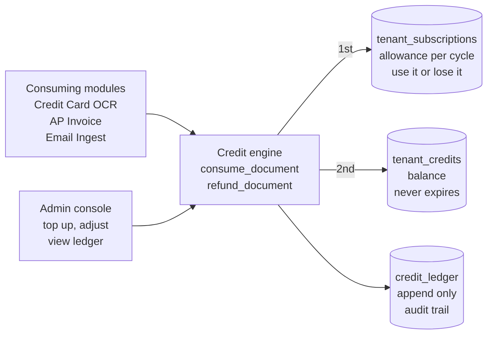
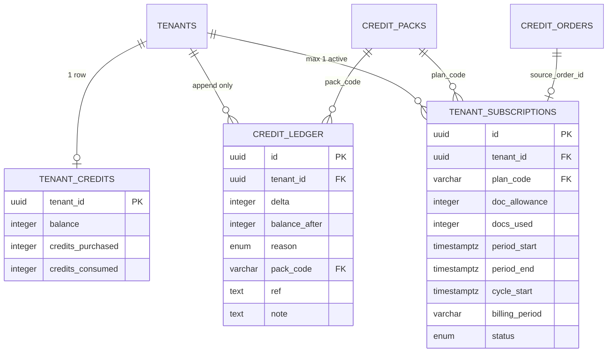
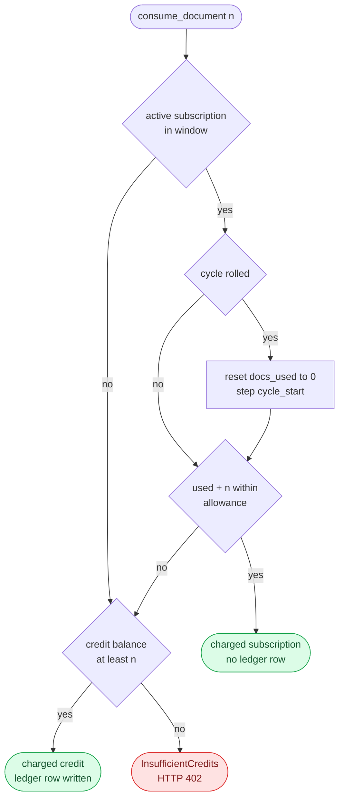
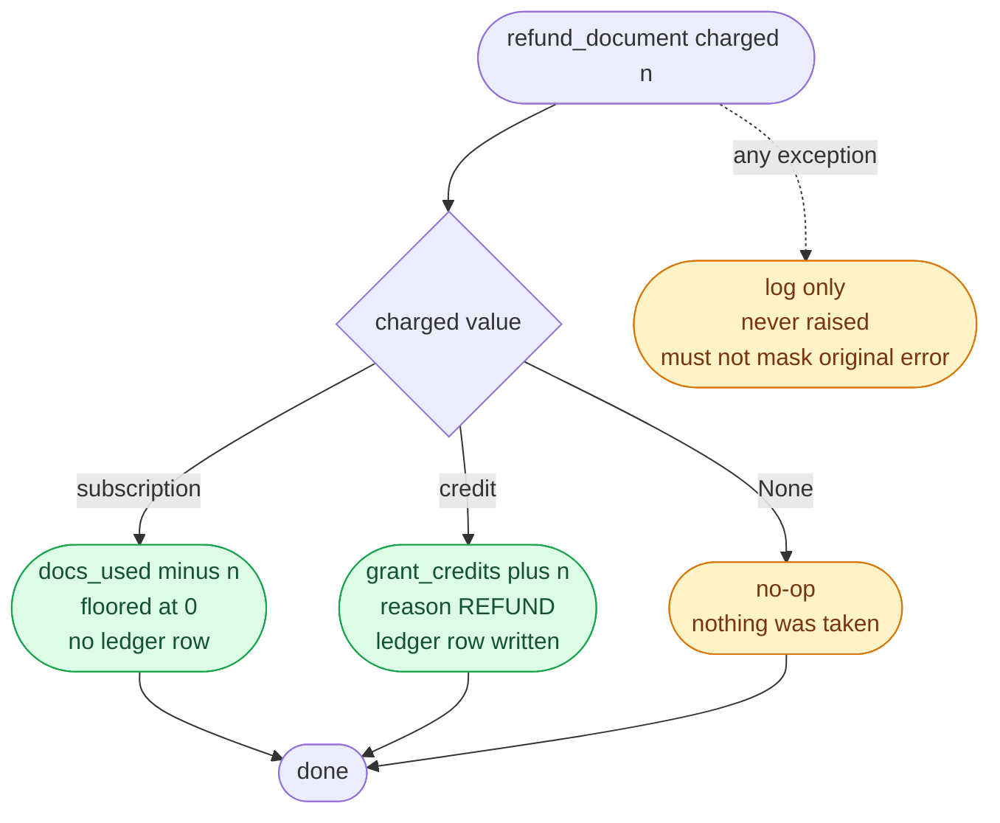
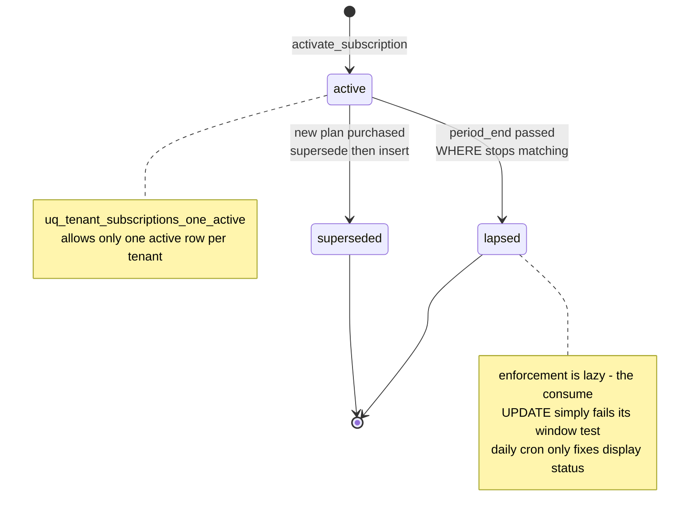

## Document Revision History

| Version | Date | Author | Description of Changes | Approved By |
|---|---|---|---|---|
| 1.0 | 25/08/2026 | Dev Team | ฉบับแรก — เขียนจากโค้ดที่ merge เข้า main แล้ว ครอบคลุมลำดับการหักสองกระเป๋า การคืน การรีเซ็ตรอบ ledger และการจัดการโดย admin | Reviewed |
| 1.1 | 27/10/2026 | Dev Team | ปรับตามโค้ด ณ `945c63ea` — ลบกติกาการซื้อทับ (`purchase_block_reason` ถูกลบเมื่อ 14/09/2026, CA-105: เปลี่ยนแพ็กได้ทุกทิศพร้อมคำเตือนฝั่งหน้าจอ ดู FRD-05); เพิ่ม AI Status API (`GET /api/v1/carmen/ai-status`) ที่ Carmen ใช้เลือก popup ขายของ อ่านจากเครดิตทดลองที่ใช้ไป; ระบุว่า PMS Interface ไม่หักเครดิต; path ตามโครงสร้างหลัง refactor (`services/shared/credits.py`) | Reviewed |

<!-- pagebreak -->

# 1. Executive Summary & Objective

**Credit & Document Consumption Engine** คือกลไกกลางที่ตอบคำถามเดียว: "การอ่านเอกสาร 1 ชิ้นนี้ ใครเป็นคนจ่าย และจ่ายจากกระเป๋าไหน" ทุก module ที่เรียก Vision LLM เรียกฟังก์ชันเดียวกันนี้ก่อนเริ่มงาน และเรียกฟังก์ชันคู่กันเพื่อคืนเมื่องานล้มเหลว

ระบบมีสองกระเป๋าที่ใช้จ่ายได้ และมีลำดับที่ตายตัว:

- **Subscription allowance** — โควตาเอกสารต่อรอบเดือนที่มากับแพ็กเกจ ใช้ไม่หมดในรอบนั้นถือว่าหมดสิทธิ์ ไม่ทบไปรอบถัดไป
- **Credit balance** — เครดิตที่ซื้อเติมแยก ไม่มีวันหมดอายุ อยู่กับ tenant ไปเรื่อย ๆ จนกว่าจะใช้

**เหตุผลที่หัก allowance ก่อนเสมอ:** allowance หมดอายุเมื่อจบรอบ ส่วนเครดิตไม่หมดอายุ ถ้าหักเครดิตก่อน ระบบจะกินเงินที่ลูกค้าจ่ายมาแบบถาวรทิ้งไปเงียบ ๆ แล้วปล่อยให้โควตาที่จ่ายไปแล้วละลายหายไปตอนสิ้นรอบ ลำดับนี้จึงไม่ใช่รายละเอียดการ implement แต่เป็นข้อตกลงทางการค้า

**พฤติกรรมเมื่อระบบมีปัญหา:** ถ้าฐานข้อมูลมีปัญหาชั่วคราวตอนจะหักเครดิต ระบบเลือกปล่อยผ่าน (fail-open) และบันทึกว่าไม่ได้หัก แทนที่จะบล็อกงานของลูกค้า — มีเพียงกรณี "เครดิตหมดจริง" เท่านั้นที่หยุดงาน

## 1.1 System Context Diagram



# 2. Scope of Work

## 2.1 In-Scope

- **Two-pool consumption:** หักจาก subscription allowance ก่อน ถ้าไม่พอหรือไม่มี จึงหักจาก credit balance
- **Batch charging:** หักได้ครั้งละหลายหน่วยในคำสั่งเดียว (n ไฟล์ หรือ n หน้า) โดยทั้ง n หน่วยมาจากกระเป๋าเดียวกัน
- **Monthly cycle reset:** สัญญารายปีเปิดหน้าต่างใช้งานยาว 1 ปี แต่โควตาเอกสารรีเซ็ตทุกเดือน — การรีเซ็ตเกิดขึ้นตอนที่มีคนใช้ครั้งแรกของรอบใหม่ ไม่ใช่ตอนเที่ยงคืนสิ้นเดือน
- **Refund on failure:** คืนสิ่งที่หักไปตามกระเป๋าที่หักจริง — คืน allowance กลับเป็นโควตา คืนเครดิตกลับเป็นเครดิต
- **Append-only ledger:** ทุกการเปลี่ยนแปลงของ credit balance ถูกบันทึกพร้อมยอดคงเหลือหลังทำรายการและเหตุผล
- **Signup grant:** tenant ใหม่ได้เครดิตทดลอง 30 หน่วยครั้งเดียว ผูกกับ transaction ที่สร้าง tenant
- **Admin operations:** เติมเครดิตตามแพ็ก ปรับยอดด้วยมือ (บวกหรือลบ) และดู ledger ย้อนหลัง
- **Purchase guard:** กติกาว่า tenant ที่มีแพ็กเกจอยู่แล้วซื้อแพ็กไหนได้บ้าง

## 2.2 Out-of-Scope

| ไม่ทำ | ผู้ใช้ต้องทำอะไรแทน / อยู่ที่ไหนแทน |
|---|---|
| ไม่มีการทบโควตาข้ามรอบ | allowance ที่เหลือตอนสิ้นรอบหายไป ถ้าต้องการใช้ข้ามรอบต้องซื้อเครดิตเติม ซึ่งไม่หมดอายุ |
| ไม่แบ่งจ่ายข้ามสองกระเป๋าในรายการเดียว | **tenant ที่มี allowance เหลือ 3 แล้วอ่านเอกสาร 5 หน้า จะจ่ายด้วยเครดิตทั้ง 5 หน่วย** และ allowance 3 หน่วยนั้นค้างอยู่จนหมดรอบ |
| ไม่รับชำระเงินออนไลน์ | การซื้อและอนุมัติออเดอร์อยู่ใน FRD-05 Billing & Purchase — ฉบับนี้รับหน้าที่ต่อจากตอนที่ออเดอร์ถูกอนุมัติแล้ว |
| ไม่คิดราคาหรือส่วนลด | ราคาต่อแพ็กและส่วนลดรายปีอยู่ในตาราง credit_packs และตรรกะการคำนวณอยู่ใน FRD-05 |
| ไม่บังคับเรื่องสิทธิ์ใช้ module | การเปิด-ปิด module ต่อ tenant อยู่ใน FRD-06 — engine นี้ถูกเรียกหลังผ่านการตรวจสิทธิ์แล้ว |
| ไม่แจ้งเตือนเมื่อเครดิตใกล้หมด | ผู้ใช้เห็นยอดคงเหลือบนหน้าจอ แต่ระบบไม่ส่งการแจ้งเตือนล่วงหน้า |

# 3. Feature List & Sub-Modules

| รหัส | ฟีเจอร์ | Source (โค้ดจริง) |
|---|---|---|
| F-01 | หักเอกสาร (สองกระเป๋า ตามลำดับ) | `services/shared/credits.py` (`consume_document`) |
| F-02 | หักจาก subscription allowance | `_try_consume_subscription()` |
| F-03 | หักจาก credit balance + เขียน ledger | `_consume_credits()` |
| F-04 | คืนเอกสาร | `refund_document()` · `_refund_subscription()` |
| F-05 | รีเซ็ตโควตารายเดือนแบบ in-place | `fn_cycle_start()` (SQL function) เรียกจาก `_try_consume_subscription` |
| F-06 | เพิ่ม/ลดเครดิต + เขียน ledger | `grant_credits()` |
| F-07 | เครดิตทดลองสำหรับ tenant ใหม่ | `grant_signup_credits()` · `SIGNUP_GRANT_CREDITS = 30` |
| F-08 | เติมเครดิตตามแพ็ก (ปิดออเดอร์) | `topup_order()` |
| F-09 | ปรับยอดด้วยมือโดย admin | `adjust_balance()` |
| F-10 | เปิดหน้าต่างสัญญาใหม่ | `activate_subscription()` |
| F-11 | ~~กติกาการซื้อทับแพ็กเดิม~~ | ยกเลิกแล้ว 14/09/2026 (CA-105) — ไม่มีการบล็อกฝั่ง server หน้าจอเตือนแทน (FRD-05 §5) |
| F-12 | อ่านยอดคงเหลือ + สัญญาปัจจุบัน | `get_credit_balance()` · `get_active_subscription()` → `GET /auth/usage` |
| F-13 | สรุปสัญญาแบบหลาย tenant สำหรับหน้า admin | `active_subscription_map()` |
| F-14 | อ่าน ledger ย้อนหลัง | `get_ledger()` |
| F-15 | ราคาแบบรายปีและการคืนเงินตามสัดส่วน | `annual_price()` · `proration_credit()` · `ANNUAL_DISCOUNT = 0.10` |
| F-16 | AI Status สำหรับ Carmen (ใหม่ v1.1) | `routers/carmen.py` (`GET /api/v1/carmen/ai-status`) · `services/shared/credits.py` (`trial_used`) |

<!-- pagebreak -->

# 4. Field Specs

## 4.1 tenant_credits (กระเป๋าเครดิตที่ไม่หมดอายุ)

| Field | Type | ความหมายและ business logic |
|---|---|---|
| `tenant_id` | uuid PK | 1 แถวต่อ 1 tenant สร้างอัตโนมัติเมื่อมีการให้เครดิตครั้งแรก |
| `balance` | integer | ยอดคงเหลือที่ใช้ได้จริง ห้ามติดลบ — การปรับที่จะทำให้ติดลบถูกปฏิเสธ |
| `credits_purchased` | integer | **หมายถึงเงินที่รับมาจริง** เครดิตทดลองตอนสมัครจึงไม่นับเข้าช่องนี้ เพราะเครดิตที่ซื้อคือหนี้สินรับล่วงหน้า ส่วนเครดิตที่แจกไม่ใช่ — ทั้งสองแยกจากกันไม่ได้แล้วในช่อง balance เหตุผลของรายการใน ledger จึงเป็นที่เดียวที่ความต่างนี้ยังอยู่ |
| `credits_consumed` | integer | ยอดสะสมที่ถูกใช้ไป นับเฉพาะที่หักจากกระเป๋านี้ ไม่รวมที่หักจาก allowance |

## 4.2 tenant_subscriptions (สัญญาและโควตาต่อรอบ)

| Field | Type | ความหมายและ business logic |
|---|---|---|
| `plan_code` | varchar FK | อ้างถึงแพ็กใน credit_packs |
| `doc_allowance` | integer | จำนวนเอกสารต่อรอบเดือน — สัญญารายปีใช้ค่าต่อเดือนเท่ากับรายเดือน |
| `docs_used` | integer | ใช้ไปแล้วในรอบปัจจุบัน ถูกรีเซ็ตเป็น 0 เมื่อรอบเดือนหมุน |
| `period_start / period_end` | timestamptz | หน้าต่างของสัญญา คำนวณเป็น now() ถึง now() + เทอม − 1 วัน ที่ลบหนึ่งวันเพื่อให้สัญญาต่อเนื่องกันไม่ทับกันที่วันรอยต่อ (สัญญารายเดือนที่เริ่ม 24 มิ.ย. สิ้นสุด 23 ก.ค.) |
| `cycle_start` | timestamptz | จุดเริ่มของรอบเดือนปัจจุบัน ใช้ตรวจว่ารอบหมุนไปหรือยัง |
| `billing_period` | varchar | monthly หรือ annual — เป็นตัวกำหนดความยาวหน้าต่าง |
| `status` | enum | active / superseded — มี unique index บังคับว่าแต่ละ tenant มี active ได้แถวเดียว |
| `source_order_id` | uuid FK | ออเดอร์ที่ทำให้สัญญานี้เกิด ใช้ตามรอยกลับไปที่การชำระเงิน |

## 4.3 credit_ledger (สมุดบันทึกที่เขียนอย่างเดียว)

| Field | Type | ความหมายและ business logic |
|---|---|---|
| `delta` | integer | บวกคือได้เพิ่ม ลบคือถูกหัก |
| `balance_after` | integer | **ยอดคงเหลือหลังทำรายการนั้น** ทำให้ตรวจย้อนหลังได้โดยไม่ต้องบวกสะสมทั้งตาราง และจับได้ทันทีถ้ามีใครแก้ balance นอกทางที่ควร |
| `reason` | enum | topup · consumption · admin_adjust · refund · signup_grant |
| `pack_code` | varchar FK | แพ็กที่ใช้ ถ้ารายการนั้นมาจากการเติม |
| `ref` | text | ตัวอ้างอิงตามบริบท — ชื่อไฟล์ที่กำลังประมวลผล หรือรหัสออเดอร์ |
| `note` | text | ข้อความอิสระ เช่นเหตุผลที่ admin ปรับยอด |

**ข้อสังเกตที่สำคัญต่อการตรวจสอบ:** การหักและการคืน allowance ไม่ถูกบันทึกใน ledger เลย ledger บันทึกเฉพาะการเคลื่อนไหวของ credit balance — ประวัติการใช้ allowance ดูได้จาก docs_used ซึ่งเป็นตัวเลขปัจจุบันเท่านั้น ไม่มีประวัติรายรายการ

# 5. Admin Actions & Business Logic

| การกระทำ | พฤติกรรมของระบบ |
|---|---|
| เติมเครดิตตามแพ็ก | **ล็อกแถวออเดอร์ก่อนตรวจสถานะ** เพื่อไม่ให้การเติมพร้อมกันสองครั้งผ่านการตรวจ "ยังไม่จ่าย" ทั้งคู่แล้วให้เครดิตซ้ำ · ออเดอร์ที่จ่ายแล้วถูกปฏิเสธด้วย ConflictError |
| ปรับยอดด้วยมือ | บวกหรือลบก็ได้ แต่ delta ต้องไม่เป็นศูนย์ และผลลัพธ์ต้องไม่ติดลบ · บันทึกเป็น admin_adjust พร้อม note |
| เปิดสัญญาใหม่ | ตั้งสัญญาเดิมเป็น superseded ก่อนเสมอ แล้วค่อยสร้างแถวใหม่ — ทำแบบไม่มีเงื่อนไขเพื่อให้ unique index ปลอดภัยแม้ในอนาคตจะผ่อนกติกาการซื้อ |
| ~~กติกาการซื้อทับ~~ | ยกเลิกแล้ว (CA-105) — การซื้อแพ็กสัญญาใหม่ทุกทิศ (อัปเกรด, downgrade, รายปีเป็นรายเดือน) แทนที่สัญญาเดิมตอนอนุมัติ (`activate_subscription` ทำแบบนั้นอยู่แล้ว) ผลที่เสียไปถูกเตือนบนหน้าจอก่อนชำระเงิน |
| ดู ledger | แบ่งหน้าได้และกรองช่วงวันที่ได้ · ใช้ทั้งในหน้า admin และการตรวจสอบย้อนหลัง |

<!-- pagebreak -->

# 6. Database Schema & Tables

## 6.1 ข้อบังคับระดับฐานข้อมูล

| ข้อบังคับ | ป้องกันอะไร |
|---|---|
| `uq_tenant_subscriptions_one_active` | partial unique index บน tenant_id เฉพาะแถวที่ status = active — กันไม่ให้ tenant เดียวมีสองสัญญาที่ใช้งานได้พร้อมกัน |
| `uq_credit_ledger_one_signup_grant` | **กันการแจกเครดิตทดลองซ้ำ** — การให้ครั้งที่สองจะพังด้วย IntegrityError แทนที่จะเพิ่มยอดให้เงียบ ๆ |
| เงื่อนไข balance ≥ increment ใน UPDATE | การหักเครดิตเป็น atomic — ตรวจและหักในคำสั่งเดียว ไม่มีช่องให้สองคำขอพร้อมกันหักจนติดลบ |
| ตรวจ balance หลังคำนวณใน grant_credits | การปรับยอดที่จะทำให้ติดลบถูกปฏิเสธก่อนเขียน ledger |

## 6.2 Entity Relationship Diagram



# 7. Integrations

Engine นี้ไม่เรียกระบบภายนอกเลย ทำงานอยู่กับฐานข้อมูลของตัวเองทั้งหมด สิ่งที่เข้ามาเกี่ยวข้องคือผู้เรียกจากภายในระบบ

| ผู้เรียก | เรียกอะไร ตอนไหน |
|---|---|
| Credit Card OCR (FRD-01) | หัก n หน่วยตามจำนวนไฟล์ · คืนเป็นรายไฟล์ที่ล้มเหลว |
| AP Invoice (FRD-02) | หัก n หน่วยตามจำนวนหน้า · คืนทั้งก้อนเมื่อล้มเหลว |
| Email Ingest (FRD-03) | หัก 1 หน่วยต่อ 1 เอกสารแนบ · คืนเมื่อ extraction ไม่สำเร็จ |
| Auth / session bootstrap | ให้เครดิตทดลองใน transaction เดียวกับที่สร้าง tenant |
| Billing (FRD-05) | เรียกเติมเครดิตและเปิดสัญญาเมื่อออเดอร์ถูกอนุมัติ |
| Admin console | ปรับยอด ดู ledger และดูสรุปสัญญาหลาย tenant |

# 8. Workflow

## 8.1 ลำดับการหัก — สองกระเป๋าและการหมุนรอบ



| ลำดับ | ขั้นตอน | รายละเอียด |
|---|---|---|
| 1 | หา tenant จาก context ของคำขอ | ถ้าไม่มี ถือว่าไม่มีใครต้องจ่าย คืนค่าว่างและไม่หักอะไร |
| 2 | พยายามหักจาก subscription allowance | เป็นคำสั่ง UPDATE คำสั่งเดียวที่ทั้งตรวจหน้าต่างสัญญา ตรวจโควตา และหักพร้อมกัน |
| 3 | ถ้ารอบเดือนหมุนไปแล้ว | **รีเซ็ต docs_used เป็น 0 แล้วเลื่อน cycle_start ไปข้างหน้าในคำสั่งเดียวกัน** — สัญญารายเดือนมีหน้าต่างสั้นกว่า 1 เดือนจึงไม่มีวันหมุน ส่วนสัญญารายปีหมุนทุกเดือนโดยที่หน้าต่างยังเปิดอยู่ |
| 4 | ถ้าหัก allowance สำเร็จ | จบ คืนค่าว่าหักจาก subscription · ไม่มีการเขียน ledger |
| 5 | ถ้าไม่สำเร็จ ให้หักจาก credit balance | UPDATE ที่มีเงื่อนไข balance ≥ n ในตัว ถ้าไม่มีแถวถูกแก้ แปลว่าเครดิตไม่พอ |
| 6 | เขียน ledger 1 แถว | delta เป็นลบ พร้อม balance_after และชื่อไฟล์ที่กำลังทำเป็น ref |
| 7 | ถ้าทั้งสองกระเป๋าไม่พอ | ยก InsufficientCredits ซึ่งกลายเป็น HTTP 402 |
| 8 | ถ้าเกิดข้อผิดพลาดอื่นที่ไม่ใช่เครดิตหมด | **ปล่อยผ่าน (fail-open)** บันทึก log แล้วคืนค่าว่าไม่ได้หัก — ผู้เรียกจะบันทึกลงงานว่าหัก 0 หน่วย |

**ทำไมการรีเซ็ตรอบถึงเกิดตอนใช้งาน ไม่ใช่ตอนสิ้นเดือน:** ระบบไม่ต้องมี job ที่วิ่งไล่รีเซ็ตทุก tenant ทุกเดือน และไม่มีช่วงเวลาที่ข้อมูลไม่ตรงกันระหว่างที่ job ยังทำไม่ถึง tenant นั้น — ค่าที่ถูกต้องถูกคำนวณ ณ วินาทีที่มีคนใช้ ผลข้างเคียงคือหน้าจอที่แสดงยอดคงเหลือต้องคำนวณแบบเดียวกัน มิฉะนั้นจะแสดงยอดของรอบที่แล้ว

## 8.2 การคืน



| กรณี | พฤติกรรม |
|---|---|
| ไม่ได้หักอะไรไว้ | ไม่ทำอะไรเลย |
| หักจาก allowance | ลด docs_used ลง n โดยไม่ให้ต่ำกว่า 0 · ไม่มีการเขียน ledger เพราะ ledger ติดตามเฉพาะ credit balance |
| หักจาก credit | เพิ่มยอดคืน n หน่วยพร้อมเขียน ledger ด้วยเหตุผล refund และหมายเหตุว่า extraction ล้มเหลว |
| เกิดข้อผิดพลาดระหว่างคืน | **บันทึก log อย่างเดียว ไม่ยก exception ต่อ** — เพราะการคืนถูกเรียกจากใน exception handler อยู่แล้ว ถ้ายก exception ซ้อนจะกลบสาเหตุจริงที่ทำให้งานล้มเหลว |

**ผลที่ตามมาซึ่งต้องรู้:** การคืน allowance ตรวจแค่ว่าสัญญายัง active และยังไม่หมดอายุ ไม่ได้ตรวจว่ารอบเดือนหมุนไปหรือยัง — ถ้างานล้มเหลวคาบเกี่ยวจังหวะที่รอบหมุนพอดี การคืนจะไปลด docs_used ของรอบใหม่แทนรอบที่หักไป

## 8.3 วงจรชีวิตของสัญญา



**การหมดอายุเป็นแบบ lazy:** ไม่มีอะไรมาเปลี่ยนสถานะเป็นหมดอายุตอนเที่ยงคืน สัญญาที่เลยกำหนดจะหยุดทำงานเองเพราะเงื่อนไขหน้าต่างในคำสั่งหักไม่ผ่าน งานประจำวันมีหน้าที่แค่ทำให้สถานะที่แสดงบนหน้าจอตรงกับความจริงเท่านั้น ไม่ได้เป็นตัวบังคับ

## 8.4 Gate Ladder ของการหักเครดิต

| Gate | เงื่อนไข | ถ้าไม่ผ่าน | ผลต่อผู้ใช้ |
|---|---|---|---|
| 1 | มี tenant ใน context | คืนค่าว่าไม่ได้หัก | งานเดินต่อโดยไม่คิดเงิน |
| 2 | มีสัญญา active ที่ยังอยู่ในหน้าต่าง | ข้ามไปกระเป๋าเครดิต | — |
| 3 | โควตารอบนี้ (หลังคิดการหมุนรอบ) เหลือพอสำหรับ n | ข้ามไปกระเป๋าเครดิต | — |
| 4 | credit balance ≥ n | ยก InsufficientCredits | **HTTP 402 — งานหยุด** |
| — | **ข้อผิดพลาดอื่นที่ไม่ใช่เครดิตหมด** | ปล่อยผ่าน บันทึก log | งานเดินต่อ และงานนั้นบันทึกว่าหัก 0 หน่วย |

**กฎที่สำคัญที่สุด: มีเพียงเงื่อนไขเดียวที่หยุดงานของลูกค้าได้ คือเครดิตหมดจริง**

ทุกความล้มเหลวอื่นของ engine นี้ — ฐานข้อมูลตอบช้า การเชื่อมต่อหลุด การคืนเครดิตพัง — ถูกออกแบบให้ปล่อยผ่านและบันทึกไว้ตรวจย้อนหลัง เพราะการบล็อกงานบัญชีของลูกค้าเพราะปัญหาภายในของเราเองมีต้นทุนสูงกว่าการเสียเครดิตไปหนึ่งหน่วย ผลที่ตามมาคือช่อง charged_docs ในตารางงานคือหลักฐานเดียวที่บอกว่ารายการนั้นถูกหักจริงหรือไม่

<!-- pagebreak -->

# 9. Error Handling & Edge Cases Matrix

| Case ID | สาเหตุ | สถานการณ์ | ผล | ผู้ใช้ต้องทำ |
|---|---|---|---|---|
| EC-01 | no_tenant_context | คำขอที่ไม่มี tenant ผูกอยู่ | ไม่หัก คืนค่าว่าง | ไม่มีผลกับผู้ใช้ |
| EC-02 | insufficient_credits | allowance หมดและ balance น้อยกว่า n | HTTP 402 งานไม่เริ่ม | ซื้อเครดิตเพิ่ม หรือลดจำนวนไฟล์/หน้า |
| EC-03 | allowance_stranded | allowance เหลือ 3 แต่ขอหัก 5 | **หักเครดิต 5** | **allowance 3 หน่วยค้างจนหมดรอบ** — แบ่งไฟล์ให้เล็กลงถ้าอยากใช้ให้หมด |
| EC-04 | cycle_rolled_mid_use | สัญญารายปีข้ามเดือนพอดีตอนกำลังใช้ | โควตารีเซ็ตเป็น 0 แล้วหักใหม่ในคำสั่งเดียวกัน | ไม่ต้องทำอะไร |
| EC-05 | window_lapsed | เลยวันสิ้นสุดสัญญาแล้ว | คำสั่งหัก allowance ไม่เข้าเงื่อนไข ตกไปที่กระเป๋าเครดิตทันที | ต่อสัญญาหรือใช้เครดิต |
| EC-06 | db_error_on_charge | ฐานข้อมูลมีปัญหาชั่วคราวตอนหัก | **ปล่อยผ่าน งานเดินต่อ** บันทึกว่าหัก 0 | ไม่ต้องทำอะไร — ตรวจย้อนได้จาก charged_docs |
| EC-07 | refund_failed | การคืนเครดิตล้มเหลว | บันทึก log อย่างเดียว ไม่กลบ error เดิม | **ต้องให้ admin ปรับยอดคืนให้** |
| EC-08 | refund_after_cycle_roll | งานล้มเหลวหลังรอบเดือนหมุนพอดี | การคืนไปลด docs_used ของรอบใหม่ | โควตารอบใหม่ได้เพิ่มมาเกินจริง 1 หน่วย |
| EC-09 | unexpected_charged_value | ค่าที่ส่งมาให้คืนไม่ตรงกับที่รู้จัก | ข้ามและบันทึกเตือน | ไม่มีการคืนเกิดขึ้น |
| EC-10 | negative_adjustment | admin ปรับยอดจนติดลบ | ปฏิเสธด้วย ValidationError ก่อนเขียน ledger | ปรับใหม่ให้ไม่ติดลบ |
| EC-11 | zero_delta | admin ปรับยอดด้วยค่า 0 | ปฏิเสธด้วย ValidationError | ใส่ค่าที่ไม่ใช่ศูนย์ |
| EC-12 | double_signup_grant | พยายามให้เครดิตทดลองซ้ำ | **IntegrityError จาก unique index** | ไม่เกิดยอดซ้ำ |
| EC-13 | order_already_paid | เติมเครดิตจากออเดอร์ที่ปิดไปแล้ว | ConflictError · แถวถูกล็อกไว้ก่อนตรวจ จึงกันการเติมซ้ำพร้อมกันได้ | ตรวจสถานะออเดอร์ |
| EC-14 | pack_not_found | รหัสแพ็กไม่มีอยู่จริง | NotFoundError | ตรวจรหัสแพ็ก |
| EC-15 | plan_change_loss (v1.1) | มีแพ็กอยู่แล้วและซื้อแพ็กที่โควตาน้อยกว่า หรือเปลี่ยนรายปีเป็นรายเดือน | ไม่ถูกปฏิเสธ — หน้าจอเตือนว่าโควตาจะลด / เดือนที่จ่ายล่วงหน้าจะหายไป และยืนยันอีกครั้งตอนอัปโหลดสลิป | ผู้ซื้อตัดสินใจเอง |
| EC-16 | annual_to_monthly_blocked | ถือรายปีอยู่แล้วจะเปลี่ยนเป็นรายเดือนกลางเทอม | ถูกปฏิเสธพร้อมเหตุผล | เลือกแพ็กรายปี หรือรอหมดเทอม |
| EC-17 | balance_read_failed | อ่านยอดคงเหลือไม่ได้ | คืนค่า 0 แทนที่จะพัง | **หน้าจออาจแสดง 0 ทั้งที่ยังมีเครดิต** — ลองรีเฟรช |

# 10. Non-Functional & Technical Requirements

## 10.1 ความถูกต้องภายใต้การใช้งานพร้อมกัน

- **การหักทั้งสองกระเป๋าเป็นคำสั่ง UPDATE ที่มีเงื่อนไขอยู่ในตัว** ไม่มีการอ่านก่อนแล้วค่อยเขียน จึงไม่มีช่องว่างให้สองคำขอพร้อมกันหักจนโควตาหรือยอดติดลบ
- การเติมเครดิตจากออเดอร์ล็อกแถวออเดอร์ก่อนตรวจสถานะ กันการอนุมัติซ้อนกัน
- การคำนวณรอบเดือนอยู่ในฟังก์ชันฐานข้อมูลตัวเดียว ใช้ร่วมกันทั้งตอนหักและตอนแสดงผล เพื่อไม่ให้สองที่คำนวณต่างกัน

## 10.2 ความทนทาน

- fail-open ทุกกรณีที่ไม่ใช่เครดิตหมด — ปัญหาภายในของระบบต้องไม่หยุดงานของลูกค้า
- การคืนไม่ยก exception ต่อ เพื่อไม่ให้กลบสาเหตุจริงที่ทำให้งานล้มเหลว
- การอ่านยอดคงเหลือคืน 0 เมื่ออ่านไม่ได้ แทนที่จะทำให้หน้าจอทั้งหน้าพัง

## 10.3 Audit Trail

- ทุกการเคลื่อนไหวของ credit balance มีแถวใน ledger พร้อมยอดคงเหลือหลังทำรายการ
- การหักบันทึกชื่อไฟล์ที่กำลังประมวลผลเป็น ref ทำให้ตามได้ว่าเครดิตหน่วยไหนหายไปกับเอกสารใบไหน
- **ข้อจำกัดที่ต้องรู้:** การใช้ allowance ไม่มีประวัติรายรายการ มีแต่ตัวเลขปัจจุบัน

## 10.4 ตัวเลขที่ตั้งไว้

| ค่า | ความหมาย |
|---|---|
| เครดิตทดลอง 30 หน่วย | ให้ tenant ใหม่ครั้งเดียว ไม่นับเป็นเงินที่รับมา |
| ส่วนลดรายปี 10% | ราคาต่อปีคิดจากราคารายเดือน 12 เดือนหักส่วนลดนี้ |
| สัญญา active ได้ 1 แถวต่อ tenant | บังคับที่ระดับฐานข้อมูล |
| หน้าต่างสัญญา = เทอม − 1 วัน | ให้สัญญาต่อเนื่องกันไม่ทับที่วันรอยต่อ |

# 11. Developer Checklist & Acceptance Criteria

## 11.1 Developer Checklist

| สถานะ | รายการ |
|---|---|
| เสร็จ | หักสองกระเป๋าตามลำดับ allowance ก่อน credit |
| เสร็จ | หักแบบหลายหน่วยในคำสั่งเดียว |
| เสร็จ | รีเซ็ตโควตารายเดือนแบบ in-place สำหรับสัญญารายปี |
| เสร็จ | คืนตามกระเป๋าที่หักจริง |
| เสร็จ | fail-open ทุกกรณีที่ไม่ใช่เครดิตหมด |
| เสร็จ | ledger แบบเขียนอย่างเดียวพร้อม balance_after |
| เสร็จ | เครดิตทดลองครั้งเดียวพร้อม unique index กันซ้ำ |
| เสร็จ | เติมเครดิตจากออเดอร์พร้อม row lock |
| เสร็จ | ปรับยอดด้วยมือพร้อมกันติดลบ |
| เสร็จ (v1.1) | ยกเลิกกติกาการซื้อทับ แทนด้วยคำเตือนฝั่งหน้าจอ (CA-105) |
| เสร็จ (v1.1) | AI Status API สำหรับ Carmen |
| เสร็จ | สรุปสัญญาแบบหลาย tenant ที่ใช้สูตรคำนวณรอบเดียวกับตอนหัก |

## 11.2 Acceptance Criteria

- **Pass Scenario (ลำดับกระเป๋า):** tenant ที่มีทั้ง allowance และเครดิต เมื่อใช้งาน 1 เอกสาร ต้องเห็น docs_used เพิ่มขึ้น 1 และ credit balance ไม่เปลี่ยน
- **Pass Scenario (ตกไปกระเป๋าที่สอง):** เมื่อ allowance หมดพอดี การใช้งานครั้งถัดไปต้องหักจากเครดิตและมีแถวใหม่ใน ledger
- **Pass Scenario (รอบหมุน):** สัญญารายปีที่ใช้จนหมดโควตาเดือนนี้ ต้องใช้งานได้อีกครั้งเมื่อข้ามเดือนโดยที่ยอดเครดิตไม่ถูกแตะ
- **Fail Scenario:** เมื่อทั้งสองกระเป๋าไม่พอ ต้องได้ HTTP 402 และต้องไม่มีการเรียก LLM เกิดขึ้น
- **Integrity Scenario:** สองคำขอที่หักพร้อมกันเมื่อเหลือเครดิต 1 หน่วย ต้องมีคำขอเดียวที่สำเร็จ และ balance ต้องไม่ติดลบ

<!-- pagebreak -->

# 12. API Specifications

Engine นี้ถูกเรียกจากภายในเป็นหลัก endpoint ที่เปิดออกภายนอกมีดังนี้

| Method | Path | หมายเหตุ |
|---|---|---|
| GET | `/api/v1/auth/usage` | คืนยอดเครดิตและสัญญาปัจจุบัน — เรียงตามลำดับที่ระบบหักจริง · docs_used ที่คืนมาเป็นค่าหลังคิดการหมุนรอบแล้ว |
| GET | `/api/v1/credits/packs` | รายการแพ็กที่เปิดขาย |
| GET | `/api/v1/carmen/ai-status?uri=&bu=` | (ใหม่ v1.1) Carmen เรียกครั้งเดียวต่อ login ด้วย token ของผู้ใช้ เพื่อเลือก AI Sales Popup — คืน `paid`, `trial` (`used`/`total`) และจำนวนเอกสารต่อ product ดู §12.2 |
| — | ledger และการปรับยอด | อยู่ในกลุ่ม endpoint ของ admin (ดู FRD-08 Admin Console) |

## 12.1 รูปแบบคำตอบของ /usage

```
{
  "usage": {
    "credit_balance": 120,
    "subscription": {
      "plan_code": "PRO",
      "doc_allowance": 500,
      "docs_used": 137,
      "docs_remaining": 363,
      "period_start": "2026-01-15T00:00:00+00:00",
      "period_end":   "2027-01-14T00:00:00+00:00",
      "billing_period": "annual",
      "status": "active"
    }
  }
}
```

**subscription เป็นค่าว่างได้** เมื่อ tenant ไม่มีสัญญาที่ยังอยู่ในหน้าต่าง — หน้าจอต้องรองรับกรณีที่มีแต่เครดิตอย่างเดียว

<!-- pagebreak -->

# 13. Test Cases & QA Matrix

## 13.1 Category 1: ลำดับการหักและการตกกระเป๋า

| Test Case ID | Scenario & Pre-conditions | Test Steps | Expected Result & วิธีตรวจผล | Pass Criteria |
|---|---|---|---|---|
| TC-CON-01 | **Regression test สำคัญ:** allowance ต้องถูกหักก่อน. Pre: allowance เหลือ 10, credit balance 100 | 1. ประมวลผล 1 เอกสาร | docs_used เพิ่มเป็น 1 · balance ยังเป็น 100 · ไม่มีแถวใหม่ใน credit_ledger | **Fail ถ้าหักเครดิตก่อน** |
| TC-CON-02 | ตกไปกระเป๋าที่สอง. Pre: allowance เหลือ 0, balance 100 | 1. ประมวลผล 1 เอกสาร | balance เหลือ 99 · มีแถว ledger reason = consumption, delta = -1, balance_after = 99 | ledger ถูกต้อง |
| TC-CON-03 | ไม่มีสัญญาเลย. Pre: balance 5 | 1. ประมวลผล 1 เอกสาร | หักจากเครดิตทันทีโดยไม่มี error | ทำงานได้โดยไม่ต้องมีสัญญา |
| TC-CON-04 | **Regression test สำคัญ:** ไม่แบ่งจ่ายข้ามกระเป๋า. Pre: allowance เหลือ 3, balance 100 | 1. ประมวลผลงานที่ต้องหัก 5 หน่วย | docs_used ไม่เปลี่ยน · balance เหลือ 95 | **Fail ถ้าหัก allowance 3 + เครดิต 2** |
| TC-CON-05 | ทั้งสองกระเป๋าไม่พอ. Pre: allowance 0, balance 2 | 1. ประมวลผลงานที่ต้องหัก 5 หน่วย | HTTP 402 · balance ยังเป็น 2 · ไม่มีการเรียก LLM | ไม่หักบางส่วน |
| TC-CON-06 | สัญญาหมดอายุแล้ว. Pre: period_end เป็นอดีต, balance 50 | 1. ประมวลผล 1 เอกสาร | หักจากเครดิต · docs_used ไม่เปลี่ยน | หน้าต่างสัญญาถูกบังคับจริง |

## 13.2 Category 2: การหมุนรอบเดือน

| Test Case ID | Scenario & Pre-conditions | Test Steps | Expected Result & วิธีตรวจผล | Pass Criteria |
|---|---|---|---|---|
| TC-CYC-01 | **Regression test สำคัญ:** สัญญารายปีต้องรีเซ็ตทุกเดือน. Pre: สัญญารายปี allowance 100, docs_used 100, ข้ามเดือนแล้ว | 1. ประมวลผล 1 เอกสาร | docs_used กลายเป็น 1 · cycle_start เลื่อนไปข้างหน้า · balance ไม่ถูกแตะ | **Fail ถ้าไปหักเครดิตแทน** |
| TC-CYC-02 | สัญญารายเดือนไม่มีวันหมุน. Pre: สัญญารายเดือน | 1. ใช้จนหมดโควตาแล้วใช้ต่อ | ตกไปกระเป๋าเครดิต ไม่มีการรีเซ็ต | หน้าต่างสั้นกว่า 1 เดือนจึงไม่หมุน |
| TC-CYC-03 | **Regression test สำคัญ:** หน้าจอต้องแสดงยอดของรอบปัจจุบัน. Pre: สัญญารายปีที่รอบหมุนแล้วแต่ยังไม่มีใครใช้ | 1. เรียก GET /auth/usage | docs_used ที่คืนมาต้องเป็น 0 ไม่ใช่ยอดของรอบที่แล้ว | **Fail ถ้าแสดงยอดเก่า** |
| TC-CYC-04 | หน้า admin แสดงหลาย tenant | 1. เปิดหน้ารายชื่อ tenant ที่มีทั้งรายเดือนและรายปีที่รอบหมุนแล้ว | ยอดที่แสดงตรงกับที่ /usage แสดงของแต่ละ tenant | สองที่ใช้สูตรเดียวกัน |

## 13.3 Category 3: การคืน

| Test Case ID | Scenario & Pre-conditions | Test Steps | Expected Result & วิธีตรวจผล | Pass Criteria |
|---|---|---|---|---|
| TC-REF-01 | คืนสิ่งที่หักจาก allowance. Pre: หักจาก allowance แล้ว LLM ล้มเหลว | 1. ประมวลผลงานที่จะล้มเหลว | docs_used ลดกลับเท่าเดิม · ไม่มีแถวใหม่ใน ledger | คืนถูกกระเป๋า |
| TC-REF-02 | คืนสิ่งที่หักจากเครดิต | 1. ทำให้หักจากเครดิตแล้วล้มเหลว | balance กลับเท่าเดิม · มีแถว ledger reason = refund | คืนถูกกระเป๋าและมีร่องรอย |
| TC-REF-03 | **Regression test สำคัญ:** คืนเท่าจำนวนที่หัก. Pre: หัก 4 หน่วย | 1. ทำให้งานล้มเหลวทั้งก้อน | คืน 4 หน่วยพอดี | **Fail ถ้าคืน 1 หรือคืนเกิน** |
| TC-REF-04 | ไม่ได้หักอะไรไว้ | 1. ทำให้ consume คืนค่าว่างแล้วสั่งคืน | ไม่มีอะไรเปลี่ยน ไม่มี error | ไม่แจกเครดิตฟรี |
| TC-REF-05 | **Regression test สำคัญ:** การคืนที่ล้มเหลวต้องไม่กลบ error เดิม | 1. ทำให้ทั้ง LLM ล้มเหลวและ DB ล้มเหลวตอนคืน | ผู้ใช้เห็น error ของ LLM ไม่ใช่ error ของการคืน | **Fail ถ้าเห็น error การคืน** |
| TC-REF-06 | ค่ากระเป๋าที่ส่งมาไม่รู้จัก | 1. เรียกคืนด้วยค่าที่ไม่ใช่ subscription หรือ credit | ไม่มีการคืน มี log เตือน | ไม่แจกเครดิตฟรี |

## 13.4 Category 4: การให้เครดิตและงาน admin

| Test Case ID | Scenario & Pre-conditions | Test Steps | Expected Result & วิธีตรวจผล | Pass Criteria |
|---|---|---|---|---|
| TC-GRT-01 | tenant ใหม่ได้เครดิตทดลอง | 1. login ครั้งแรกของ tenant ใหม่ | balance = 30 · ledger reason = signup_grant · credits_purchased ยังเป็น 0 | **Fail ถ้า credits_purchased เพิ่ม** |
| TC-GRT-02 | **Regression test สำคัญ:** ให้เครดิตทดลองซ้ำไม่ได้ | 1. พยายามให้ครั้งที่สองกับ tenant เดิม | ล้มเหลวด้วย IntegrityError · balance ไม่เพิ่ม | **Fail ถ้ายอดกลายเป็น 60** |
| TC-GRT-03 | เติมเครดิตจากออเดอร์ | 1. อนุมัติออเดอร์ | balance เพิ่มตามแพ็ก · ออเดอร์เป็น PAID · ledger reason = topup พร้อม pack_code | ครบทั้งสามอย่าง |
| TC-GRT-04 | **Regression test สำคัญ:** เติมซ้อนกันสองครั้ง | 1. อนุมัติออเดอร์เดียวกันพร้อมกันสองคำขอ | สำเร็จครั้งเดียว อีกครั้งได้ ConflictError · เครดิตเพิ่มครั้งเดียว | **Fail ถ้าเครดิตเพิ่มสองเท่า** |
| TC-GRT-05 | ปรับยอดจนติดลบ. Pre: balance 5 | 1. ปรับ -10 | ValidationError · balance ยังเป็น 5 · ไม่มีแถว ledger | กันติดลบได้ |
| TC-GRT-06 | ปรับยอดด้วยค่า 0 | 1. ปรับ 0 | ValidationError | ปฏิเสธ |
| TC-GRT-07 | ซื้อแพ็กที่เล็กกว่าเดิม (v1.1) | 1. มีแพ็ก 500 อยู่แล้ว ซื้อแพ็ก 100 | สร้างออเดอร์ได้ · หน้าจอเตือนว่าโควตาจะลด · เมื่ออนุมัติ สัญญาใหม่แทนที่ของเดิม | ไม่มี 409 |
| TC-GRT-08 | รายปีเปลี่ยนเป็นรายเดือน (v1.1) | 1. ถือรายปีอยู่ ซื้อรายเดือนแพ็กเดิม | สร้างออเดอร์ได้ · หน้าจอเตือนว่าเดือนที่จ่ายล่วงหน้าจะหายไป | ไม่มี 409 |
| TC-GRT-09 | เปิดสัญญาใหม่ทับของเดิม | 1. อนุมัติแพ็กใหม่ที่ใหญ่กว่า | สัญญาเดิมเป็น superseded · มีแถว active แถวเดียว | unique index ไม่ถูกละเมิด |

## 13.5 Category 5: ความทนทานและการใช้งานพร้อมกัน

| Test Case ID | Scenario | Test Steps | Expected Result & วิธีตรวจผล |
|---|---|---|---|
| TC-RES-01 | **Regression test สำคัญ:** DB มีปัญหาตอนหัก ต้องไม่บล็อกงาน | 1. จำลอง DB error เฉพาะช่วงหักเครดิต | งานเดินต่อจนจบ · ocr_tasks.charged_docs = 0 · มี log ระดับ exception |
| TC-RES-02 | หักพร้อมกันตอนเหลือหน่วยสุดท้าย | 1. ยิงสองคำขอพร้อมกันเมื่อ balance = 1 | สำเร็จคำขอเดียว อีกคำขอได้ 402 · balance = 0 ไม่ติดลบ |
| TC-RES-03 | หัก allowance พร้อมกันตอนเหลือหน่วยสุดท้าย | 1. ยิงสองคำขอพร้อมกันเมื่อโควตาเหลือ 1 | docs_used ไม่เกิน doc_allowance |
| TC-RES-04 | อ่านยอดคงเหลือไม่ได้ | 1. จำลอง DB error ตอนอ่านยอด | คืน 0 · หน้าจอไม่พัง · มี log ระดับ error |
| TC-RES-05 | ตรวจสอบย้อนหลังจาก ledger | 1. ไล่ ledger ของ tenant ที่มีการเคลื่อนไหวหลายรายการ | balance_after ของแถวล่าสุดต้องตรงกับ tenant_credits.balance ปัจจุบัน |


## 12.2 AI Status (ใหม่ v1.1) — `GET /api/v1/carmen/ai-status`

Carmen ส่ง token ของผู้ใช้ (`Authorization: <token>` ไม่มี Bearer) ระบบตรวจ token กับ Carmen ของ BU นั้นก่อนตอบทุกครั้ง ระบบส่งตัวเลข ส่วน Carmen เป็นผู้ตัดสินว่าจะแสดง popup แบบไหน (สเปกเต็มใน `docs/AI_STATUS_INTEGRATION.md`)

| Field | ความหมาย |
|---|---|
| `paid` | true = มีแพ็กสัญญาที่ยังไม่หมดอายุ หรือเคยซื้อ top-up |
| `trial.used` / `trial.total` | เครดิตทดลองที่ใช้ไป (ไม่นับเอกสารที่ได้เครดิตคืน) / ทั้งหมด (`SIGNUP_GRANT_CREDITS` = 30) — เป็น null เมื่อ `paid` เป็น true เพราะเมื่อมีเครดิตที่ซื้อแล้ว 30 − balance ไม่มีความหมาย |
| `modules` | จำนวนเอกสารต่อ product ตั้งแต่เริ่มใช้ (`ap_invoice`, `jv`) — product ที่ไม่เคยใช้ไม่มี key |

```
{"paid": false, "trial": {"used": 26, "total": 30}, "modules": {"ap_invoice": 2, "jv": 24}}
```
