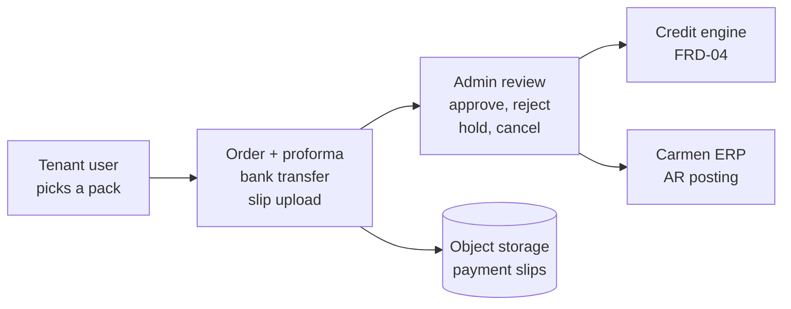
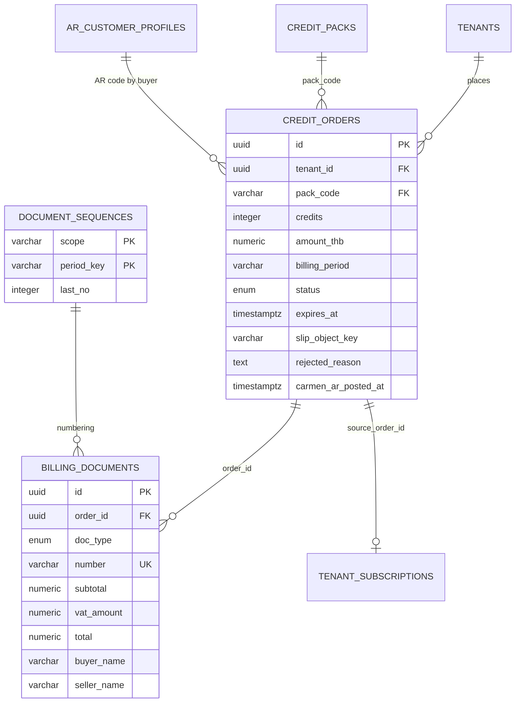
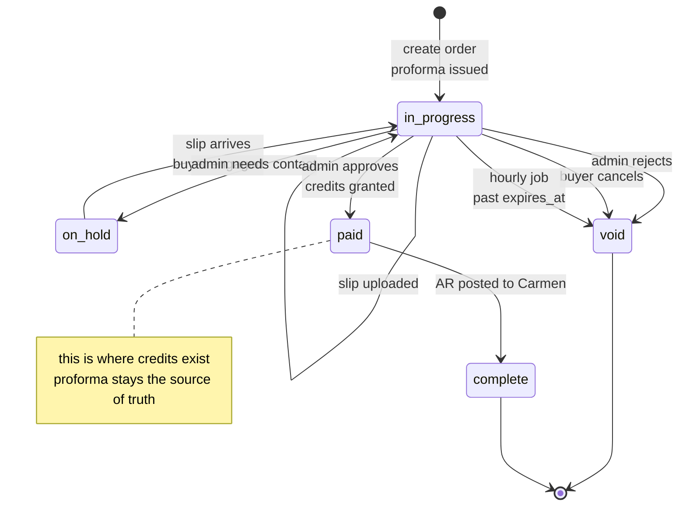
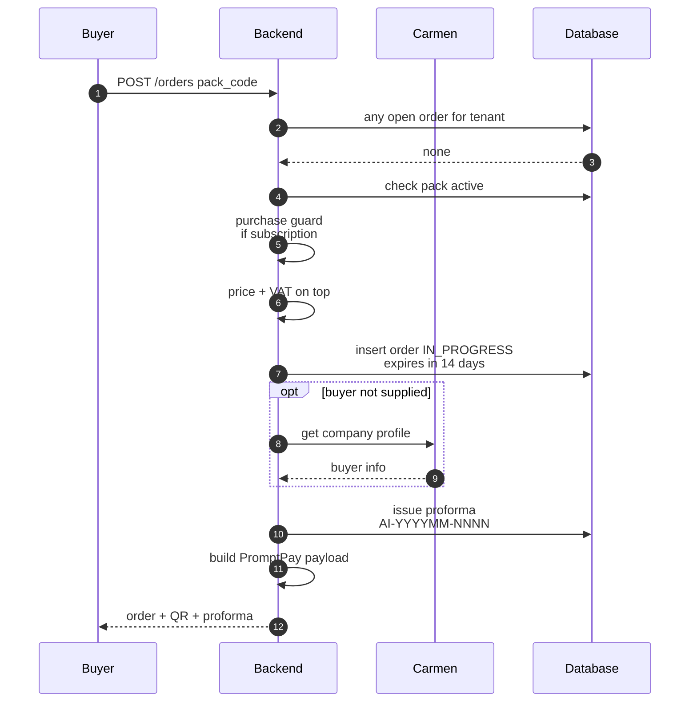
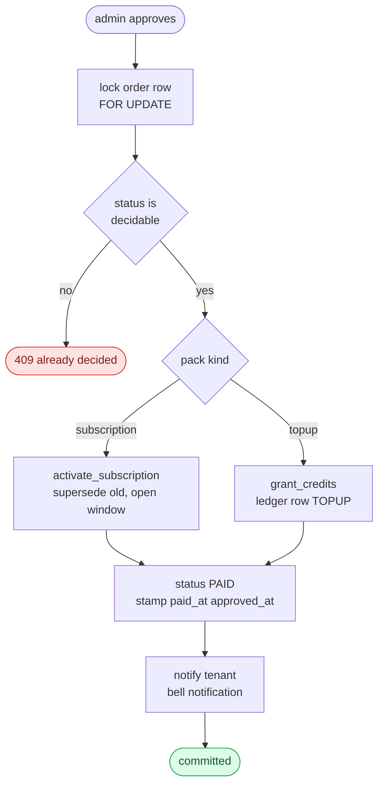

## Document Revision History

| Version | Date | Author | Description of Changes | Approved By |
|---|---|---|---|---|
| 1.0 | 25/08/2026 | Dev Team | ฉบับแรก — เขียนจากโค้ดที่ merge เข้า main แล้ว ครอบคลุมการสร้างออเดอร์ ใบเสนอราคา PromptPay การอัปโหลดสลิป การอนุมัติโดย admin และการโพสต์ AR เข้า Carmen | รอ Lead Dev |
| 1.1 | 27/10/2026 | Dev Team | ปรับตามโค้ด ณ `945c63ea` — CA-105: เลิกบล็อก downgrade และการเปลี่ยนรายปีเป็นรายเดือน แทนด้วยคำเตือนบนขั้นตอนชำระเงินและการยืนยันตอนอัปโหลดสลิป; CA-99: แพ็ก Lite (100 เอกสาร/เดือน ฿290); CA-109: top-up Micro (100 เครดิต ฿450) และราคาทั้งหมดอ่านจาก backend ไม่มีราคาเขียนในหน้าจอ; หน้า Order History ของลูกค้าไม่แสดงขั้นตอน AR posting ของ admin; ระบุว่าหน้าจอไม่แสดง PromptPay QR แล้ว (ลูกค้าโอนตามบัญชีบนใบเสนอราคา); path ตามโครงสร้างหลัง refactor | รอ Lead Dev |

<!-- pagebreak -->

# 1. Executive Summary & Objective

**Billing & Purchase** คือเส้นทางที่ลูกค้าใช้ซื้อโควตาเอกสารเพิ่ม ตั้งแต่เลือกแพ็ก โอนเงินตามบัญชีบนใบเสนอราคาแล้วแนบสลิป จนถึงทีมงานตรวจสลิปและอนุมัติ แล้วโควตาถูกเติมเข้าบัญชี

**จุดที่ต้องเข้าใจก่อนอ่านทั้งฉบับ:** ระบบนี้ไม่ได้ตัดเงินออนไลน์ การชำระเป็นการโอนจริงนอกระบบ แล้วลูกค้าแนบหลักฐานเข้ามา ทีมงานเป็นผู้ตรวจและอนุมัติ **เครดิตจึงไม่ได้ถูกให้ตอนสร้างออเดอร์ แต่ให้ตอนที่ admin กดอนุมัติเท่านั้น**

ระบบขายของสองแบบจากตารางแพ็กเดียวกัน และสองแบบนี้ให้ผลต่างกันอย่างสิ้นเชิงเมื่อออเดอร์ถูกอนุมัติ:

- **แพ็กแบบ subscription** — เปิดหน้าต่างสัญญาใหม่พร้อมโควตาต่อรอบเดือน ใช้ไม่หมดในรอบนั้นถือว่าหมดสิทธิ์
- **แพ็กแบบ top-up** — เติมเครดิตที่ไม่มีวันหมดอายุเข้ากระเป๋าโดยตรง

**เอกสารทางบัญชี:** ระบบออกใบเสนอราคา (proforma) ให้ทันทีตอนสร้างออเดอร์ พร้อมเลขที่เอกสารที่รันต่อเนื่องต่อเดือน และเก็บภาพนิ่งของข้อมูลผู้ขายและผู้ซื้อไว้ในเอกสารนั้น **ระบบไม่ออกใบกำกับภาษีเอง** — Carmen ERP เป็นระบบบันทึกทางภาษี ใบเสนอราคาจึงเป็นแหล่งอ้างอิงตัวเลขเดียวของออเดอร์นั้นตลอดทั้ง flow

## 1.1 System Context Diagram

# 2. Scope of Work

## 2.1 In-Scope

- **Pack catalog:** แสดงเฉพาะแพ็กที่เปิดขายอยู่ แยกเป็นแบบสัญญาและแบบเติม
  - แพ็กสัญญา: Lite 100 เอกสาร/เดือน (฿290, ใหม่ v1.1), Starter 200 (฿490), Growth 500 (฿990), Pro 1,500 (฿2,490)
  - top-up: Micro 100 เครดิต (฿450, ใหม่ v1.1), Small 500 (฿2,000), Medium 2,500 (฿7,500), Large 10,000 (฿20,000)
  - ราคาก่อน VAT ตาม migration ล่าสุด — ตัวเลขที่ใช้จริงอ่านจาก `GET /api/v1/credits/packs` เสมอ หน้าจอไม่มีราคาเขียนไว้เอง (CA-109)
- **One open order per tenant:** แต่ละ tenant มีออเดอร์ที่ยังไม่จบได้ครั้งละหนึ่งใบเท่านั้น บังคับทั้งด้วยการตรวจก่อนสร้างและด้วย unique index
- **เปลี่ยนแพ็กสัญญาได้ทุกทิศ (CA-105):** อัปเกรด, downgrade และรายปีเป็นรายเดือนสร้างออเดอร์ได้ทั้งหมด ถ้าการเปลี่ยนทำให้เสียบางอย่าง (`planChangeLoss`: โควตาต่อเดือนลดลง หรือเดือนที่จ่ายล่วงหน้าของรายปีหายไป) หน้าจอแสดงคำเตือนค้างไว้บนขั้นตอนชำระเงิน และให้ยืนยันอีกครั้งเมื่อกดอัปโหลดสลิป — แพ็กเปลี่ยน "เมื่อการชำระเงินได้รับการอนุมัติ" ไม่ใช่ทันที
- **ราคาและภาษี:** ราคารายปีคิดจาก 12 เดือนหักส่วนลด 10% แล้วบวก VAT ทับด้านบน (ราคาที่ตั้งไว้เป็นราคาก่อน VAT)
- **Proforma + running number:** ออกให้ทันทีตอนสร้างออเดอร์ เลขที่รันต่อเนื่องต่อเดือนแบบไม่มีช่องว่าง
- **การชำระเงิน:** ลูกค้าโอนตามบัญชีธนาคารที่พิมพ์บนใบเสนอราคา แล้วแนบสลิป — backend ยังสร้าง PromptPay payload ไปกับคำตอบของออเดอร์ แต่หน้าจอไม่แสดง QR แล้ว
- **Slip upload:** รับ JPG PNG PDF ย่อขนาดภาพก่อนเก็บ และจัดเก็บตามเดือนที่สร้างออเดอร์
- **Admin decision queue:** อนุมัติ ปฏิเสธพร้อมเหตุผล พักไว้เพื่อติดต่อ หรือยกเลิก — ทุกการตัดสินล็อกแถวก่อนเสมอ
- **Auto-expiry:** ออเดอร์ที่ไม่มีความคืบหน้าเกินกำหนดถูกยกเลิกโดยงานที่วิ่งรายชั่วโมง
- **AR posting:** ส่งออเดอร์ที่จ่ายแล้วเข้า Carmen เป็นรายการลูกหนี้ ทำได้ทีละหลายใบ
- **Notification:** แจ้งลูกค้าผ่านกระดิ่งในระบบเมื่อออเดอร์ถูกอนุมัติหรือถูกปฏิเสธ

## 2.2 Out-of-Scope

| ไม่ทำ | ผู้ใช้ต้องทำอะไรแทน / อยู่ที่ไหนแทน |
|---|---|
| ไม่ตัดเงินออนไลน์ | ลูกค้าโอนเองตามบัญชีธนาคารบนใบเสนอราคา แล้วแนบสลิป ไม่มีการเชื่อมกับ payment gateway |
| ไม่ตรวจสลิปอัตโนมัติ | ทีมงานเปิดดูภาพสลิปแล้วตัดสินเอง ระบบไม่ได้อ่านสลิปหรือเทียบยอดกับธนาคาร |
| ไม่ออกใบกำกับภาษี | **Carmen ERP เป็นระบบบันทึกทางภาษี** ระบบนี้ออกได้แค่ใบเสนอราคาที่ใช้เป็นแหล่งอ้างอิงตัวเลข |
| ไม่คืนเงินตามสัดส่วนเมื่ออัปเกรดกลางเทอม | **คิดราคาเต็มทุกครั้งที่ซื้อ** ฟังก์ชันคำนวณสัดส่วนมีอยู่ในโค้ดแต่ไม่ถูกเรียกใช้ |
| ไม่มีการต่ออายุอัตโนมัติ | สัญญาที่หมดอายุแล้วต้องซื้อใหม่เอง ระบบไม่เก็บวิธีชำระไว้ต่ออายุให้ |
| ไม่ลบสลิปเก่าออกจากที่เก็บ | การอัปโหลดใหม่จะสร้างไฟล์ใหม่เสมอและตัวชี้จะชี้ไปที่ไฟล์ล่าสุด ไฟล์เดิมค้างอยู่ **ไม่มีงานตามลบ — ยอมรับไว้เพราะไฟล์เล็กและเกิดไม่บ่อย** |

# 3. Feature List & Sub-Modules

| รหัส | ฟีเจอร์ | Source (โค้ดจริง) |
|---|---|---|
| F-01 | รายการแพ็กที่เปิดขาย | `GET /credits/packs` |
| F-02 | สร้างออเดอร์ + กันออเดอร์ซ้อน | `POST /credits/orders` · unique index ต่อ tenant |
| F-03 | คำเตือนการเปลี่ยนแพ็ก (แทน purchase guard) | `features/billing/constants.ts` (`planChangeLoss`) · `SlipUpload.tsx` · `CheckoutFlow.tsx` · `PendingOrderBanner.tsx` |
| F-04 | ราคารายปี + VAT บนราคา | `annual_price()` · `utils/tax.vat_on_top()` |
| F-05 | ออกใบเสนอราคา + เลขที่รัน | `services/billing/documents.py` (`issue_document`, `_next_document_number`) |
| F-06 | ภาพนิ่งข้อมูลผู้ขาย/ผู้ซื้อ | `services/billing/documents.py` (`get_seller_snapshot`, `get_last_buyer_info`) |
| F-07 | PromptPay payload (หน้าจอไม่แสดงแล้ว) | `services/billing/promptpay.py` (`build_payload`) |
| F-08 | อัปโหลดสลิป + ย่อภาพ | `POST /credits/orders/{id}/slip` · `utils/image_processing.py` (`resize_if_needed`) · `services/billing/slip_storage.py` |
| F-09 | ยกเลิกออเดอร์โดยลูกค้า | `POST /credits/orders/{id}/cancel` |
| F-10 | คิวตรวจสอบของ admin | `services/billing/orders.py` (`list_orders`, `get_order_for_update`) |
| F-11 | อนุมัติ (เติมเครดิต หรือเปิดสัญญา) | `services/billing/orders.py` (`approve`) |
| F-12 | ปฏิเสธ / พักไว้ / ยกเลิก | `reject() · hold() · hold_batch() · cancel()` |
| F-13 | ลิงก์ดูสลิปแบบมีอายุ | `get_slip_url()` |
| F-14 | ยกเลิกออเดอร์หมดอายุอัตโนมัติ | `fn_cancel_expired_orders()` (รายชั่วโมง) |
| F-15 | ปรับสถานะสัญญาที่หมดอายุ | `fn_lapse_expired_subscriptions()` (รายวัน) |
| F-16 | โพสต์ AR เข้า Carmen ทีละหลายใบ | `services/billing/ar_posting.py` (`post_ar_batch`) |
| F-17 | ทะเบียนรหัสลูกหนี้ | `services/billing/ar_posting.py` (`list_ar_profiles`, `update_ar_profile`, `sync_ar_profiles`) |
| F-18 | แจ้งเตือนผลการตัดสิน | `notification_service.notify()` |
| F-19 | สรุปตัวเลขสำหรับหน้า admin | `get_kpi()` |

<!-- pagebreak -->

# 4. Field Specs

## 4.1 credit_orders

| Field | Type | ความหมายและ business logic |
|---|---|---|
| `pack_code` | varchar FK | แพ็กที่ซื้อ — ชนิดของแพ็ก (สัญญา หรือ เติม) เป็นตัวกำหนดว่าตอนอนุมัติจะเกิดอะไร |
| `credits` | integer | **ภาพนิ่งของจำนวนเอกสารตอนซื้อ** ถ้าแพ็กถูกแก้ทีหลัง ออเดอร์เก่ายังได้ตามที่ตกลงตอนนั้น |
| `amount_thb` | numeric | ยอดรวมภาษีที่ต้องชำระ — เป็นยอดที่ใช้สร้าง QR |
| `billing_period` | varchar | monthly หรือ annual · แพ็กแบบเติมเป็น monthly เสมอเพราะเครดิตไม่มีวันหมดอายุ |
| `status` | enum | in_progress · on_hold · paid · complete · void (ดู §8.1) |
| `expires_at` | timestamptz | ตั้งเป็น 14 วันนับจากสร้าง · งานรายชั่วโมงยกเลิกออเดอร์ที่เลยกำหนด |
| `slip_object_key` | varchar | ตัวชี้ไปยังไฟล์สลิปล่าสุด — ไม่ใช่ตัวไฟล์ |
| `rejected_reason` | text | เหตุผลที่ปฏิเสธ ถูกส่งไปกับการแจ้งเตือนถึงลูกค้า |
| `approved_by / approved_at` | varchar / ts | ผู้อนุมัติและเวลา · ผู้อนุมัติถูกเขียนโดย router ไม่ใช่โดย service เพื่อไม่ให้ตัวตนของ admin ปนเข้าไปในข้อความ log ของการทำรายการ |
| `carmen_ar_posted_at / carmen_ar_ref` | ts / varchar | บันทึกว่าออเดอร์นี้ถูกโพสต์เป็นลูกหนี้ใน Carmen แล้ว |

## 4.2 billing_documents (ใบเสนอราคา)

| Field | Type | ความหมายและ business logic |
|---|---|---|
| `number` | varchar | **รูปแบบ AI-YYYYMM-NNNN** รันต่อเนื่องต่อเดือนแบบไม่มีช่องว่าง ใช้ลำดับเดียวร่วมกันทุกชนิดเอกสารเพื่อไม่ให้เลขชนกัน |
| `seller_* ` | varchar | **ภาพนิ่งของข้อมูลผู้ขาย ณ วันที่ออกเอกสาร** ถ้าที่อยู่บริษัทเปลี่ยนทีหลัง เอกสารเก่ายังแสดงข้อมูลเดิม ซึ่งเป็นสิ่งที่ผู้ตรวจสอบต้องการ |
| `buyer_*` | varchar | ภาพนิ่งของข้อมูลผู้ซื้อ · ที่มาเรียงตามลำดับ: ค่าที่ผู้ใช้กรอกมา → ข้อมูลบริษัทจาก Carmen → ข้อมูลจากเอกสารใบล่าสุดของ tenant นั้น → เว้นว่าง |
| `subtotal / vat_rate / vat_amount / total` | numeric | ยอดก่อนภาษี อัตรา ภาษี และยอดรวม · อัตราภาษีถูกเก็บไว้ในเอกสารด้วย ไม่ได้อ้างอิงค่าปัจจุบันของระบบ |
| `credits / description` | integer / text | รายการที่ขาย · แพ็กรายปีมีข้อความกำกับว่าเป็นแบบ 12 เดือน |

## 4.3 document_sequences

ตารางเล็กที่ทำหน้าที่เดียว คือแจกเลขที่เอกสารแบบไม่ซ้ำและไม่มีช่องว่าง โดยเพิ่มค่าและอ่านค่ากลับในคำสั่งเดียว ไม่ว่าจะมีคนสร้างออเดอร์พร้อมกันกี่คน

| Field | ความหมาย |
|---|---|
| `scope` | ขอบเขตของลำดับ — ปัจจุบันใช้ค่าเดียวสำหรับเอกสารทางบัญชีทั้งหมด |
| `period_key` | เดือนในรูปแบบ YYYYMM — ลำดับเริ่มใหม่ทุกเดือน |
| `last_no` | เลขล่าสุดที่แจกไป |

# 5. Actions & Business Logic

## 5.1 ฝั่งลูกค้า

| การกระทำ | พฤติกรรมของระบบ |
|---|---|
| เลือกแพ็กแล้วสั่งซื้อ | ตรวจว่าไม่มีออเดอร์ค้าง → ตรวจว่าแพ็กเปิดขาย → คิดราคาและภาษี → สร้างออเดอร์ → ออกใบเสนอราคา — ไม่มีการตรวจกติกาการซื้อทับแล้ว (CA-105) ถ้าเป็นการเปลี่ยนแพ็กที่เสียโควตาหรือเดือนที่จ่ายไว้ หน้าจอยืนยันก่อนกด Continue to payment |
| อัปโหลดสลิป (ขณะเปลี่ยนแพ็กที่ทำให้เสียบางอย่าง) | คำเตือนแสดงค้างบนขั้นตอนชำระเงินตั้งแต่โหลด และปุ่ม Confirm เปิด dialog ยืนยันก่อนอัปโหลด — อยู่ใน `SlipUpload` เอง จึงครอบทั้ง checkout และแบนเนอร์ออเดอร์ค้าง |
| โอนเงิน | เกิดขึ้นนอกระบบทั้งหมด ระบบไม่รู้ว่าโอนแล้วหรือยังจนกว่าจะมีสลิป |
| อัปโหลดสลิป | **อัปโหลดไฟล์เข้าที่เก็บก่อน แล้วจึงล็อกแถวออเดอร์และตรวจสถานะอีกครั้งก่อนเขียน** · ออเดอร์ที่ถูกพักไว้จะกลับเข้าคิวตรวจปกติเมื่อมีสลิปเข้ามา เพราะแปลว่าลูกค้าตอบสนองแล้ว |
| ยกเลิกออเดอร์ | ล็อกแถวก่อนเปลี่ยนสถานะ กันการชนกับการตัดสินของ admin ที่กำลังเกิดขึ้นพร้อมกัน |

## 5.2 ฝั่ง admin

| การกระทำ | พฤติกรรมของระบบ |
|---|---|
| เปิดดูสลิป | ได้ลิงก์ที่มีอายุจำกัด ไม่ใช่ลิงก์ถาวร |
| อนุมัติ | ล็อกแถว → ตรวจว่ายังตัดสินได้ → ถ้าเป็นแพ็กสัญญาให้เปิดหน้าต่างสัญญาใหม่ ถ้าเป็นแพ็กเติมให้เพิ่มเครดิต → ตั้งสถานะเป็นจ่ายแล้ว → แจ้งเตือนลูกค้า |
| ปฏิเสธ | ตั้งสถานะเป็นยกเลิกพร้อมเหตุผล และแจ้งเตือนลูกค้าพร้อมเหตุผลนั้น |
| พักไว้ | ใช้เมื่อต้องติดต่อลูกค้าก่อน ทำได้ทีละหลายใบ · ออเดอร์ที่พักไว้ยังนับเป็นออเดอร์ค้าง ลูกค้าจึงยังสร้างใบใหม่ไม่ได้ |
| โพสต์ AR เข้า Carmen | **ทำทีละใบและยืนยันผลทีละใบ ไม่รวบยืนยันตอนจบทั้งชุด** — เพื่อให้ใบที่ Carmen รับไปแล้วถูกบันทึกทันที และการล้มเหลวของใบถัดไปไม่ทำให้ต้องส่งซ้ำจนเกิดรายการซ้ำใน Carmen |

<!-- pagebreak -->

# 6. Database Schema & Tables

## 6.1 ข้อบังคับระดับฐานข้อมูล

| ข้อบังคับ | ป้องกันอะไร |
|---|---|
| unique index ออเดอร์ค้างต่อ tenant | **กันไม่ให้ tenant เดียวมีออเดอร์ที่ยังไม่จบสองใบ** — การตรวจก่อนสร้างเป็นด่านแรก index เป็นด่านที่กันการสร้างพร้อมกันสองคำขอ ซึ่งโค้ดจับ IntegrityError แล้วตอบเหมือนกับด่านแรก |
| unique index บนเลขที่เอกสาร | กันเลขซ้ำแม้จะมีการสร้างพร้อมกัน |
| unique บน (scope, period_key) ในตารางลำดับ | ทำให้การเพิ่มเลขเป็น atomic — เพิ่มและอ่านค่ากลับในคำสั่งเดียว |
| FOR UPDATE ทุกจุดที่ตัดสินออเดอร์ | อนุมัติ ปฏิเสธ พัก ยกเลิก และการอัปโหลดสลิป ล้วนล็อกแถวก่อนเปลี่ยนสถานะ |

## 6.2 Entity Relationship Diagram

<!-- pagebreak -->

# 7. Integrations

| ปลายทาง | เรียกตอนไหน | ใช้ทำอะไร |
|---|---|---|
| Carmen — ข้อมูลบริษัท | ตอนสร้างออเดอร์ ถ้าลูกค้าไม่ได้กรอกข้อมูลผู้ซื้อมาเอง | ดึงชื่อ เลขผู้เสียภาษี ที่อยู่ มาใส่ในใบเสนอราคา |
| Carmen — AR posting | ตอน admin สั่งโพสต์ | สร้างรายการลูกหนี้จากออเดอร์ที่จ่ายแล้ว โดยอ่านยอดจากใบเสนอราคา |
| Object storage | ตอนอัปโหลดสลิป และตอน admin ขอดู | เก็บไฟล์สลิปและออกลิงก์ที่มีอายุจำกัด |
| PromptPay | — (ไม่ได้เรียกจริง) | **ระบบสร้าง payload ของ QR เองตามมาตรฐาน ไม่ได้ติดต่อกับธนาคารหรือ payment gateway ใด ๆ** |

**สิ่งที่ตามมาจากการไม่เชื่อมกับธนาคาร:** ระบบไม่มีทางรู้ว่าเงินเข้าจริงหรือยัง การยืนยันการชำระจึงขึ้นกับสายตาของทีมงานที่ดูสลิปทั้งหมด และไม่มีการเทียบยอดอัตโนมัติกับรายการเดินบัญชี

# 8. Workflow

## 8.1 วงจรชีวิตของออเดอร์

| สถานะ | ความหมาย | ออกจากสถานะนี้ได้อย่างไร |
|---|---|---|
| `in_progress` | สร้างแล้ว รอชำระหรือรอตรวจ | admin อนุมัติ / ปฏิเสธ / พักไว้ · ลูกค้ายกเลิก · หมดอายุ |
| `on_hold` | พักไว้เพราะต้องติดต่อลูกค้าก่อน | **กลับเป็น in_progress เมื่อลูกค้าอัปโหลดสลิปเข้ามา** หรือ admin ตัดสินไปเลย |
| `paid` | อนุมัติแล้ว เครดิตหรือสัญญาถูกให้แล้ว | โพสต์ AR เข้า Carmen แล้วกลายเป็น complete |
| `complete` | จบทั้งฝั่งลูกค้าและฝั่งบัญชี | — (สถานะสุดท้าย) |
| `void` | ถูกปฏิเสธ ยกเลิก หรือหมดอายุ | — (สถานะสุดท้าย) |

**ทั้ง in_progress และ on_hold นับเป็น "ออเดอร์ค้าง"** ซึ่งเป็นเงื่อนไขที่กันไม่ให้สร้างใบใหม่ — ลูกค้าที่ถูกพักไว้จึงต้องยกเลิกใบเดิมก่อนถ้าอยากเปลี่ยนแพ็ก

## 8.2 Sequence — การสร้างออเดอร์

| ลำดับ | ขั้นตอน | รายละเอียด |
|---|---|---|
| 1 | ตรวจว่ามีออเดอร์ค้างอยู่หรือไม่ | ถ้ามี ตอบ 409 พร้อมข้อความให้จบใบเดิมก่อน |
| 2 | ตรวจว่าแพ็กมีอยู่และเปิดขาย | แพ็กที่ปิดขายแล้วซื้อไม่ได้แม้จะรู้รหัส |
| 3 | ~~ตรวจกติกาการซื้อทับ~~ | ยกเลิกแล้ว (CA-105) — server ไม่บล็อก การเตือนอยู่ที่หน้าจอ |
| 4 | คิดราคา | **รายปี = ราคารายเดือน × 12 หักส่วนลด 10% · จากนั้นบวก VAT ทับด้านบน** เพราะราคาที่ตั้งไว้ในตารางแพ็กเป็นราคาก่อนภาษี |
| 5 | สร้างแถวออเดอร์ | สถานะเริ่มต้นคือรอดำเนินการ กำหนดวันหมดอายุ 14 วัน · ถ้าชนกับคำขอที่สร้างพร้อมกัน index จะจับได้และตอบ 409 เหมือนขั้นที่ 1 |
| 6 | หาข้อมูลผู้ซื้อ | ตามลำดับ: ที่ลูกค้ากรอก → จาก Carmen → จากเอกสารใบล่าสุด → เว้นว่าง |
| 7 | ออกใบเสนอราคา | เก็บภาพนิ่งข้อมูลผู้ขายและผู้ซื้อ พร้อมเลขที่ที่รันมาจากตารางลำดับ |
| 8 | สร้าง QR | **ถ้ายังไม่ได้ตั้งค่าหมายเลขพร้อมเพย์ ระบบจะบันทึกเตือนและคืน QR เป็นค่าว่าง แทนที่จะทำให้การสร้างออเดอร์ล้มเหลว** |

## 8.3 การอนุมัติ

**จุดที่ต่างกันสองทาง:** แพ็กสัญญาไปเปิดหน้าต่างสัญญาใหม่ (ซึ่งจะปิดสัญญาเดิมให้เป็น superseded ก่อน) ส่วนแพ็กเติมไปเพิ่มยอดเครดิตพร้อมเขียนรายการลงสมุดบัญชีเครดิต ทั้งสองทางจบด้วยการตั้งสถานะเป็นจ่ายแล้วเหมือนกัน

**ทำไมไม่ออกใบกำกับภาษีตอนอนุมัติ:** Carmen ERP เป็นระบบบันทึกทางภาษี การออกเอกสารทางภาษีซ้ำอีกชุดในระบบนี้จะทำให้มีเลขที่เอกสารสองชุดสำหรับรายการเดียว ใบเสนอราคาที่ออกตั้งแต่ตอนสร้างออเดอร์จึงถูกใช้เป็นแหล่งอ้างอิงตัวเลขเดียวตลอด รวมถึงตอนโพสต์ AR ด้วย

## 8.4 Gate Ladder — การสร้างและการตัดสินออเดอร์

| Gate | เงื่อนไข | ตรวจที่ไหน | ถ้าไม่ผ่าน |
|---|---|---|---|
| 1 | ไม่มีออเดอร์ค้างของ tenant นี้ | ตอนสร้าง | 409 ให้จบใบเดิมก่อน |
| 2 | แพ็กมีอยู่และเปิดขาย | ตอนสร้าง | 404 |
| 3 | ~~ผ่านกติกาการซื้อทับ~~ | — | ยกเลิกแล้ว (CA-105) |
| 4 | ไม่ชนกับคำขอที่สร้างพร้อมกัน | unique index | 409 เหมือน Gate 1 |
| 5 | ไฟล์สลิปเป็นชนิดที่รับได้และขนาดไม่เกิน | ตอนอัปโหลด | 400 หรือ 422 |
| 6 | ออเดอร์ยังอยู่ในสถานะที่แนบสลิปได้ (ตรวจสองครั้ง) | ตอนอัปโหลด — ก่อนและหลังการอัปโหลดไฟล์ | **409 · การตรวจครั้งที่สองหลังล็อกแถวเป็นด่านที่สำคัญกว่า** |
| 7 | ออเดอร์ยังตัดสินได้ | ตอน admin ตัดสิน | 409 ถ้าถูกตัดสินไปแล้ว |
| 8 | ออเดอร์อยู่ในขอบเขตที่ admin คนนั้นดูแล | ตอน admin ตัดสิน | ปฏิเสธการเข้าถึง |
| 9 | สถานะเป็นจ่ายแล้ว | ตอนโพสต์ AR | ข้ามใบนั้นพร้อมเหตุผล ใบอื่นในชุดยังทำต่อ |

**กฎที่สำคัญที่สุด: ทุกการเปลี่ยนสถานะของออเดอร์ต้องล็อกแถวก่อน**

การอัปโหลดสลิปเป็นตัวอย่างที่ชัดที่สุดว่าทำไม — การอัปโหลดไฟล์เป็นการเรียกผ่านเครือข่ายที่ใช้เวลานาน ระหว่างนั้น admin อาจอนุมัติออเดอร์ไปแล้ว ถ้าเขียนสถานะทับโดยไม่ตรวจซ้ำ ออเดอร์ที่จ่ายแล้วจะย้อนกลับไปเป็นรอดำเนินการ กลายเป็นตัดสินได้อีกครั้ง และเครดิตจะถูกให้สองรอบ ระบบจึงอัปโหลดไฟล์ก่อน แล้วค่อยล็อกแถวและตรวจสถานะอีกครั้งก่อนเขียน ซึ่งทำให้ล็อกถูกถือไว้สั้นมาก

## 8.5 งานอัตโนมัติ

| งาน | ความถี่ | ทำอะไร |
|---|---|---|
| ยกเลิกออเดอร์หมดอายุ | รายชั่วโมง | ตั้งออเดอร์ที่เลยกำหนดและยังไม่ถูกตัดสินให้เป็นยกเลิก · ปลดล็อกให้ลูกค้าสร้างใบใหม่ได้ |
| ปรับสถานะสัญญาที่หมดอายุ | รายวัน | **ทำให้สถานะที่แสดงตรงกับความจริงเท่านั้น** ไม่ได้เป็นตัวบังคับ — การหมดอายุจริงถูกบังคับด้วยเงื่อนไขหน้าต่างเวลาตอนหักโควตา (ดู FRD-04 §8.3) |

<!-- pagebreak -->

# 9. Error Handling & Edge Cases Matrix

| Case ID | สาเหตุ | สถานการณ์ | HTTP | ผู้ใช้ต้องทำ |
|---|---|---|---|---|
| EC-01 | open_order_exists | สร้างออเดอร์ใหม่ขณะที่ยังมีใบค้าง (รวมใบที่ถูกพักไว้) | 409 | จบหรือยกเลิกใบเดิมก่อน |
| EC-02 | concurrent_create | สองคำขอสร้างออเดอร์พร้อมกัน | 409 | ใบเดียวถูกสร้าง อีกคำขอเห็นข้อความเดียวกับ EC-01 |
| EC-03 | pack_not_found | รหัสแพ็กไม่มี หรือถูกปิดขายแล้ว | 404 | เลือกแพ็กใหม่ |
| EC-04 | plan_downgrade (v1.1) | ซื้อแพ็กที่โควตาน้อยกว่าแพ็กที่ถืออยู่ | 200 + คำเตือนบนหน้าจอ | ยืนยันแล้วชำระ หรือเปลี่ยนใจ |
| EC-05 | annual_to_monthly (v1.1) | ถือรายปีอยู่ เปลี่ยนเป็นรายเดือน | 200 + คำเตือนว่าเดือนที่จ่ายล่วงหน้าจะหายไป | ยืนยันแล้วชำระ หรือเปลี่ยนใจ |
| EC-06 | promptpay_not_configured | ยังไม่ได้ตั้งค่าหมายเลขพร้อมเพย์ของระบบ | 200 | **ออเดอร์ถูกสร้างแต่ QR ว่าง** — ลูกค้าไม่เห็นความต่าง เพราะหน้าจอไม่แสดง QR แล้ว (โอนตามบัญชีบนใบเสนอราคา) |
| EC-07 | carmen_profile_unavailable | ดึงข้อมูลบริษัทจาก Carmen ไม่ได้ | 200 | ระบบใช้ข้อมูลจากเอกสารใบล่าสุดแทน · ถ้าไม่มีเลยจะเว้นว่าง ต้องแก้ในเอกสารทีหลัง |
| EC-08 | slip_wrong_type | อัปโหลดไฟล์ที่ไม่ใช่ JPG PNG หรือ PDF | 422 | แปลงไฟล์ |
| EC-09 | slip_too_large | ไฟล์ใหญ่เกินกำหนด | 400 / 413 | ลดขนาด |
| EC-10 | slip_compression_failed | ย่อภาพไม่สำเร็จ | 200 | **ระบบเก็บไฟล์ต้นฉบับแทน** — การได้ไฟล์เล็กลงไม่คุ้มกับการทิ้งการอัปโหลด |
| EC-11 | storage_unavailable | ที่เก็บไฟล์ไม่ตอบ | 502 | ลองใหม่ภายหลัง |
| EC-12 | slip_orphaned | อัปโหลดสำเร็จแต่การบันทึกลงฐานข้อมูลล้มเหลว | 5xx | **ไฟล์ค้างอยู่ในที่เก็บโดยไม่มีใครอ้างถึง** ข้อมูลไม่หาย แต่ไม่มีงานตามลบ — อัปโหลดใหม่ได้เลย |
| EC-13 | slip_on_decided_order | อัปโหลดสลิปตอนที่ admin เพิ่งตัดสินไปแล้ว | 409 | **ด่านนี้คือสิ่งที่กันการให้เครดิตซ้ำ** |
| EC-14 | already_decided | อนุมัติหรือปฏิเสธออเดอร์ที่ถูกตัดสินไปแล้ว | 409 | รีเฟรชคิวแล้วดูสถานะล่าสุด |
| EC-15 | out_of_scope | admin ตัดสินออเดอร์ของ tenant ที่ไม่ได้ดูแล | ปฏิเสธ | ให้ผู้ที่ดูแล tenant นั้นเป็นคนตัดสิน |
| EC-16 | order_expired | ไม่มีความคืบหน้าจนเลย 14 วัน | — | ออเดอร์ถูกยกเลิกอัตโนมัติ · สร้างใบใหม่ได้ |
| EC-17 | ar_wrong_status | สั่งโพสต์ AR ออเดอร์ที่ยังไม่จ่าย | 200 + รายการล้มเหลว | ใบนั้นถูกข้าม ใบอื่นในชุดยังทำต่อ |
| EC-18 | ar_partial_failure | โพสต์ AR หลายใบแล้วบางใบล้มเหลว | 200 + ผลรายใบ | **ใบที่สำเร็จถูกบันทึกถาวรแล้ว** ส่งซ้ำเฉพาะใบที่ล้มเหลวได้โดยไม่เกิดรายการซ้ำ |

# 10. Non-Functional & Technical Requirements

## 10.1 ความถูกต้องภายใต้การใช้งานพร้อมกัน

- ทุกจุดที่เปลี่ยนสถานะออเดอร์ล็อกแถวก่อน — อนุมัติ ปฏิเสธ พัก ยกเลิก และการเขียนผลของการอัปโหลดสลิป
- **การอัปโหลดสลิปตรวจสถานะสองครั้ง** ครั้งแรกเพื่อไม่ให้เสียเวลาอัปโหลดฟรี ครั้งที่สองหลังล็อกแถวเพื่อความถูกต้องจริง
- การแจกเลขที่เอกสารเป็นคำสั่งเดียวที่เพิ่มและอ่านค่ากลับ จึงไม่มีเลขซ้ำและไม่มีช่องว่าง
- การโพสต์ AR ยืนยันผลทีละใบ ไม่ถือล็อกข้ามการเรียก Carmen ของใบถัดไป

## 10.2 ความทนทาน

- การตั้งค่าที่ขาด (หมายเลขพร้อมเพย์) ทำให้ QR ว่าง แต่ไม่ทำให้การสร้างออเดอร์ล้มเหลว
- การย่อภาพที่ล้มเหลวไม่ทำให้การอัปโหลดล้มเหลว
- การดึงข้อมูลบริษัทจาก Carmen ที่ล้มเหลวไม่ทำให้การสร้างออเดอร์ล้มเหลว ระบบมีลำดับสำรองสามชั้น

## 10.3 Audit Trail

- ทุกการตัดสินบันทึก log พร้อมรหัสออเดอร์ tenant และตัวตนของ admin
- ผู้อนุมัติและเวลาถูกเก็บไว้ในแถวออเดอร์
- เอกสารทางบัญชีเก็บภาพนิ่งของข้อมูลผู้ขายและผู้ซื้อ ณ วันที่ออก จึงตรวจย้อนหลังได้แม้ข้อมูลปัจจุบันจะเปลี่ยนไปแล้ว

## 10.4 ตัวเลขที่ตั้งไว้

| ค่า | ความหมาย |
|---|---|
| อายุออเดอร์ 14 วัน | นับจากวันสร้าง · งานรายชั่วโมงยกเลิกใบที่เลยกำหนด |
| ส่วนลดรายปี 10% | คิดจากราคารายเดือน 12 เดือน |
| VAT 7% บนราคา | ราคาในตารางแพ็กเป็นราคาก่อนภาษี · อัตราที่ใช้จริงอ่านจากการตั้งค่าและถูกเก็บลงในเอกสาร |
| ออเดอร์ค้างได้ 1 ใบต่อ tenant | บังคับทั้งด้วยการตรวจและด้วย unique index |
| ลิงก์ดูสลิปมีอายุ 1 ชั่วโมง | ไม่ใช่ลิงก์ถาวร |

# 11. Developer Checklist & Acceptance Criteria

## 11.1 Developer Checklist

| สถานะ | รายการ |
|---|---|
| เสร็จ | สร้างออเดอร์พร้อมกันออเดอร์ซ้อนทั้งด้วยการตรวจและ unique index |
| เสร็จ | Purchase guard สำหรับแพ็กสัญญา |
| เสร็จ | ราคารายปีหักส่วนลด และ VAT บนราคา |
| เสร็จ | ใบเสนอราคาพร้อมเลขที่รันต่อเนื่องต่อเดือน |
| เสร็จ | ภาพนิ่งข้อมูลผู้ขายและผู้ซื้อ พร้อมลำดับสำรองสามชั้น |
| เสร็จ | PromptPay payload ตามยอดรวมภาษี |
| เสร็จ | อัปโหลดสลิปพร้อมย่อภาพ และตรวจสถานะสองครั้ง |
| เสร็จ | ลูกค้ายกเลิกออเดอร์ได้พร้อมล็อกแถว |
| เสร็จ | อนุมัติ ปฏิเสธ พัก และพักทีละหลายใบ |
| เสร็จ | ลิงก์ดูสลิปแบบมีอายุ |
| เสร็จ | ยกเลิกออเดอร์หมดอายุอัตโนมัติรายชั่วโมง |
| เสร็จ | โพสต์ AR ทีละหลายใบพร้อมยืนยันผลรายใบ |
| เสร็จ | ทะเบียนรหัสลูกหนี้และการซิงก์ |
| เสร็จ | แจ้งเตือนลูกค้าเมื่ออนุมัติหรือปฏิเสธ |

## 11.2 Acceptance Criteria

- **Pass Scenario (แพ็กเติม):** สร้างออเดอร์ → แนบสลิป → admin อนุมัติ → ยอดเครดิตต้องเพิ่มตามแพ็กและมีรายการในสมุดบัญชีเครดิต
- **Pass Scenario (แพ็กสัญญา):** อนุมัติแพ็กสัญญาแล้วต้องมีสัญญาที่ใช้งานได้หนึ่งแถว สัญญาเดิม (ถ้ามี) ต้องถูกปิด และยอดเครดิตต้องไม่ถูกแตะ
- **Pass Scenario (ราคา):** แพ็กราคา 490 บาทต่อเดือน ซื้อแบบรายปีต้องได้ยอดก่อนภาษี 5,292 บาท และยอดรวมภาษี 5,662.44 บาท
- **Fail Scenario (ออเดอร์ซ้อน):** สร้างออเดอร์ใบที่สองขณะที่ใบแรกยังค้าง ต้องได้ 409 และต้องมีออเดอร์ใบเดียวในฐานข้อมูล
- **Integrity Scenario (สำคัญที่สุด):** อัปโหลดสลิปที่ช้ามาก แล้วให้ admin อนุมัติระหว่างนั้น เมื่อการอัปโหลดจบต้องได้ 409 และออเดอร์ต้องยังเป็นจ่ายแล้ว ห้ามย้อนกลับเป็นรอดำเนินการ

<!-- pagebreak -->

# 12. API Specifications

## 12.1 ฝั่งลูกค้า

| Method | Path | หมายเหตุ |
|---|---|---|
| GET | `/api/v1/credits/packs` | แพ็กที่เปิดขาย |
| GET | `/api/v1/credits/company-profile` | ข้อมูลบริษัทที่จะใช้เป็นผู้ซื้อ |
| GET | `/api/v1/credits/payment-info` | ข้อมูลการชำระเงินของผู้ขาย |
| POST | `/api/v1/credits/orders` | สร้างออเดอร์ · คืนออเดอร์ QR และใบเสนอราคาในคำตอบเดียว |
| POST | `/api/v1/credits/orders/{id}/slip` | อัปโหลดสลิป · multipart |
| POST | `/api/v1/credits/orders/{id}/cancel` | ยกเลิกออเดอร์ของตัวเอง |
| GET | `/api/v1/credits/orders` | ประวัติออเดอร์ แบ่งหน้า |
| GET | `/api/v1/credits/orders/{id}/documents` | เอกสารทางบัญชีของออเดอร์นั้น |

## 12.2 ฝั่ง admin

| Method | Path | หมายเหตุ |
|---|---|---|
| GET | `/admin/credit-orders` | คิวตรวจสอบ แบ่งหน้าและกรองได้ |
| GET | `/admin/credit-orders/{id}/slip-url` | ลิงก์ดูสลิปแบบมีอายุ |
| POST | `/admin/credit-orders/{id}/approve` | อนุมัติ · ต้องมีสิทธิ์เขียนในกลุ่มออเดอร์ |
| POST | `/admin/credit-orders/{id}/reject` | ปฏิเสธพร้อมเหตุผล |
| POST | `/admin/credit-orders/{id}/hold` | พักไว้ |
| POST | `/admin/credit-orders/hold-batch` | พักไว้ทีละหลายใบ |
| POST | `/admin/credit-orders/{id}/cancel` | ยกเลิกโดย admin |
| POST | `/admin/credit-orders/post-ar` | โพสต์ AR ทีละหลายใบ · คืนผลรายใบ |
| GET | `/admin/credit-orders/kpi` | ตัวเลขสรุปสำหรับหน้าจอ |
| GET/PATCH | `/admin/ar-customer-profiles` | ทะเบียนรหัสลูกหนี้ |
| POST | `/admin/ar-customer-profiles/sync` | ซิงก์ทะเบียนกับ Carmen |
| GET/POST | `/admin/tenants/{id}/credits ...` | ดูยอด เติม ปรับ และดูสมุดบัญชีเครดิต (ตรรกะอยู่ใน FRD-04) |

## 12.3 Status Codes

| Code | ความหมายในระบบนี้ |
|---|---|
| 404 | ไม่พบออเดอร์ หรือแพ็กไม่มี/ปิดขายแล้ว |
| 409 | มีออเดอร์ค้าง · ออเดอร์ถูกตัดสินไปแล้ว · แนบสลิปกับออเดอร์ที่ตัดสินแล้ว |
| 422 | ชนิดไฟล์สลิปไม่รองรับ |
| 502 | ที่เก็บไฟล์ไม่ตอบ |

<!-- pagebreak -->

# 13. Test Cases & QA Matrix

## 13.1 Category 1: การสร้างออเดอร์และการคิดราคา

| Test Case ID | Scenario & Pre-conditions | Test Steps | Expected Result & วิธีตรวจผล | Pass Criteria |
|---|---|---|---|---|
| TC-ORD-01 | สร้างออเดอร์แพ็กเติม (happy path) | 1. เรียกสร้างออเดอร์ | ได้ออเดอร์ QR และใบเสนอราคาครบในคำตอบเดียว · สถานะเป็นรอดำเนินการ · วันหมดอายุ = วันนี้ + 14 | ครบทั้งสามส่วน |
| TC-ORD-02 | **Regression test สำคัญ:** กันออเดอร์ซ้อน. Pre: มีออเดอร์ค้างอยู่แล้ว | 1. สร้างออเดอร์ใหม่ | 409 · มีออเดอร์ใบเดียวในฐานข้อมูล | **Fail ถ้าสร้างได้สองใบ** |
| TC-ORD-03 | **Regression test สำคัญ:** สร้างพร้อมกันสองคำขอ | 1. ยิงสร้างออเดอร์พร้อมกัน 2 คำขอ | สำเร็จใบเดียว อีกคำขอได้ 409 จาก unique index | **Fail ถ้าได้สองใบ** |
| TC-ORD-04 | ออเดอร์ที่ถูกพักไว้ก็นับเป็นค้าง | 1. ให้ admin พักออเดอร์ 2. ลูกค้าสร้างใบใหม่ | 409 | on_hold นับเป็นออเดอร์ค้าง |
| TC-ORD-05 | แพ็กที่ปิดขาย | 1. สร้างออเดอร์ด้วยรหัสแพ็กที่ปิดขายแล้ว | 404 | ปิดขายแล้วซื้อไม่ได้แม้รู้รหัส |
| TC-ORD-06 | **Regression test สำคัญ:** ราคารายปี. Pre: แพ็ก 490 บาทต่อเดือน | 1. สร้างออเดอร์แบบรายปี | ยอดก่อนภาษี 5,292.00 · ภาษี 370.44 · ยอดรวม 5,662.44 · ตรวจที่ใบเสนอราคา | **Fail ถ้าคิด VAT ก่อนหักส่วนลด** |
| TC-ORD-07 | ลดขนาดได้พร้อมคำเตือน (v1.1). Pre: ถือแพ็ก 500 อยู่ | 1. ซื้อแพ็ก 100 | สร้างออเดอร์ได้ · คำเตือนโควตาลดแสดงบนขั้นตอนชำระเงิน · dialog ยืนยันตอนอัปโหลดสลิป | ไม่มี 409 |
| TC-ORD-08 | รายปีเป็นรายเดือนได้พร้อมคำเตือน (v1.1) | 1. ถือรายปี ซื้อรายเดือนแพ็กเดิม | สร้างออเดอร์ได้ · คำเตือนเดือนที่จ่ายล่วงหน้าหายไป | ไม่มี 409 |
| TC-ORD-09 | อัปเกรดกลางเทอมทำได้ | 1. ถือแพ็ก 100 ซื้อแพ็ก 500 | สร้างออเดอร์ได้ · คิดราคาเต็ม ไม่มีการหักตามสัดส่วน | ราคาเต็ม |
| TC-ORD-10 | แพ็กใหม่ (v1.1) | 1. เปิดหน้า pricing | มี Lite ฿290 และ Micro ฿450 ราคาตรงกับ `GET /api/v1/credits/packs` | ไม่มีราคาที่หน้าจอเขียนเอง |
| TC-ORD-11 | Order History ของลูกค้า (v1.1) | 1. admin โพสต์ AR ของออเดอร์ที่จ่ายแล้ว 2. ลูกค้าเปิด Order History | สถานะเหมือนก่อนโพสต์ (paid และ complete ใช้ป้ายเดียวกัน) | ลูกค้าไม่เห็นขั้นตอน AR ของ admin |
| TC-ORD-10 | ยังไม่ตั้งค่าพร้อมเพย์ | 1. ลบค่าหมายเลขพร้อมเพย์ แล้วสร้างออเดอร์ | ออเดอร์ถูกสร้าง · QR เป็นค่าว่าง · มี log เตือน | **Fail ถ้าการสร้างล้มเหลว** |

## 13.2 Category 2: เอกสารและเลขที่

| Test Case ID | Scenario & Pre-conditions | Test Steps | Expected Result & วิธีตรวจผล | Pass Criteria |
|---|---|---|---|---|
| TC-DOC-01 | **Regression test สำคัญ:** เลขที่เอกสารไม่ซ้ำและไม่มีช่องว่าง | 1. สร้างออเดอร์พร้อมกัน 20 คำขอในเดือนเดียวกัน | ได้เลข 0001 ถึง 0020 ครบ ไม่ซ้ำ ไม่ข้าม | **Fail ถ้ามีเลขซ้ำหรือเลขหาย** |
| TC-DOC-02 | ลำดับเริ่มใหม่ทุกเดือน | 1. ออกเอกสารในเดือนถัดไป | เลขกลับไปเริ่มที่ 0001 พร้อมเดือนใหม่ในเลขที่ | รูปแบบถูกต้อง |
| TC-DOC-03 | **Regression test สำคัญ:** ภาพนิ่งข้อมูลผู้ขาย | 1. ออกเอกสาร 2. แก้ที่อยู่บริษัทในการตั้งค่า 3. เปิดเอกสารเดิม | เอกสารเดิมยังแสดงที่อยู่เดิม | **Fail ถ้าเอกสารเปลี่ยนตาม** |
| TC-DOC-04 | ลำดับสำรองของข้อมูลผู้ซื้อ | 1. ไม่ส่งข้อมูลผู้ซื้อ และทำให้ Carmen ตอบไม่ได้ | ระบบใช้ข้อมูลจากเอกสารใบล่าสุดของ tenant นั้น | ไม่ล้มเหลว |
| TC-DOC-05 | ไม่มีข้อมูลผู้ซื้อจากที่ไหนเลย | 1. tenant ใหม่ที่ไม่เคยมีเอกสาร และ Carmen ตอบไม่ได้ | เอกสารถูกออกโดยเว้นช่องผู้ซื้อว่าง | สร้างออเดอร์ได้ |
| TC-DOC-06 | อัตราภาษีถูกเก็บในเอกสาร | 1. ออกเอกสาร 2. เปลี่ยนอัตราภาษีในการตั้งค่า 3. เปิดเอกสารเดิม | เอกสารเดิมยังใช้อัตราเดิม | ไม่คำนวณใหม่ |

## 13.3 Category 3: สลิปและสถานะ

| Test Case ID | Scenario & Pre-conditions | Test Steps | Expected Result & วิธีตรวจผล | Pass Criteria |
|---|---|---|---|---|
| TC-SLP-01 | อัปโหลดสลิปปกติ | 1. อัปโหลด JPG | ตัวชี้ไฟล์ถูกบันทึก · เวลาที่อัปโหลดถูกบันทึก · สถานะเป็นรอดำเนินการ | ครบทั้งสาม |
| TC-SLP-02 | **Regression test สำคัญ:** อัปโหลดชนกับการอนุมัติ | 1. เริ่มอัปโหลดสลิปที่ช้ามาก 2. ให้ admin อนุมัติระหว่างนั้น 3. ปล่อยให้อัปโหลดจบ | 409 · ออเดอร์ยังเป็นจ่ายแล้ว · เครดิตถูกให้ครั้งเดียว | **Fail ถ้าสถานะย้อนกลับหรือเครดิตถูกให้สองรอบ** |
| TC-SLP-03 | สลิปเข้ามาตอนที่ออเดอร์ถูกพักไว้ | 1. admin พักออเดอร์ 2. ลูกค้าอัปโหลดสลิป | สถานะกลับเป็นรอดำเนินการ | กลับเข้าคิวตรวจปกติ |
| TC-SLP-04 | ชนิดไฟล์ไม่รองรับ | 1. อัปโหลดไฟล์ .docx | 422 | ปฏิเสธ |
| TC-SLP-05 | ที่เก็บไฟล์ล่ม | 1. จำลองที่เก็บไม่ตอบ | 502 · ไม่มีการเขียนตัวชี้ลงออเดอร์ | ไม่เขียนตัวชี้ที่ใช้ไม่ได้ |
| TC-SLP-06 | อัปโหลดสลิปใหม่ทับของเดิม | 1. อัปโหลดครั้งที่สอง | ตัวชี้ชี้ไปไฟล์ใหม่ · ไฟล์เดิมยังอยู่ในที่เก็บ | พฤติกรรมตรงกับที่ระบุใน §2.2 |
| TC-SLP-07 | ไฟล์ถูกเก็บตามเดือนที่สร้างออเดอร์ | 1. สร้างออเดอร์เดือนนี้ 2. อัปโหลดสลิปเดือนหน้า | ไฟล์อยู่ในโฟลเดอร์ของเดือนที่สร้าง ไม่ใช่เดือนที่อัปโหลด | จัดเก็บคู่กับใบเสนอราคา |

## 13.4 Category 4: การตัดสินและการเติมโควตา

| Test Case ID | Scenario & Pre-conditions | Test Steps | Expected Result & วิธีตรวจผล | Pass Criteria |
|---|---|---|---|---|
| TC-APR-01 | อนุมัติแพ็กเติม | 1. admin อนุมัติ | ยอดเครดิตเพิ่มตามแพ็ก · มีรายการในสมุดบัญชีเครดิตพร้อมรหัสแพ็ก · สถานะเป็นจ่ายแล้ว · ลูกค้าได้รับการแจ้งเตือน | ครบทั้งสี่ |
| TC-APR-02 | **Regression test สำคัญ:** อนุมัติแพ็กสัญญา. Pre: มีสัญญาเดิมอยู่ | 1. admin อนุมัติแพ็กสัญญาที่ใหญ่กว่า | สัญญาเดิมถูกปิด · มีสัญญาที่ใช้งานได้แถวเดียว · ยอดเครดิตไม่ถูกแตะ | **Fail ถ้ามีสองสัญญา หรือเครดิตถูกเพิ่ม** |
| TC-APR-03 | **Regression test สำคัญ:** อนุมัติซ้อนกันสองคำขอ | 1. ยิงอนุมัติออเดอร์เดียวกันพร้อมกัน | สำเร็จครั้งเดียว อีกครั้ง 409 · โควตาถูกเติมครั้งเดียว | **Fail ถ้าเติมสองรอบ** |
| TC-APR-04 | ปฏิเสธพร้อมเหตุผล | 1. admin ปฏิเสธ | สถานะเป็นยกเลิก · เหตุผลถูกบันทึก · ลูกค้าได้รับการแจ้งเตือนพร้อมเหตุผล | เหตุผลถึงลูกค้า |
| TC-APR-05 | ตัดสินออเดอร์ที่ตัดสินไปแล้ว | 1. อนุมัติแล้วปฏิเสธ | 409 | กันการตัดสินซ้ำ |
| TC-APR-06 | admin นอกขอบเขต | 1. admin ที่ดูแล tenant A ตัดสินออเดอร์ของ tenant B | ถูกปฏิเสธ | ขอบเขตถูกบังคับ |
| TC-APR-07 | ลูกค้ายกเลิกชนกับ admin อนุมัติ | 1. ยิงยกเลิกและอนุมัติพร้อมกัน | มีเพียงฝ่ายเดียวที่สำเร็จ · สถานะสุดท้ายสอดคล้องกับผู้ชนะ | ไม่มีสถานะกำกวม |

## 13.5 Category 5: งานอัตโนมัติและ AR

| Test Case ID | Scenario | Test Steps | Expected Result & วิธีตรวจผล |
|---|---|---|---|
| TC-JOB-01 | ออเดอร์หมดอายุถูกยกเลิก | 1. ตั้งวันหมดอายุเป็นอดีต 2. รันงานรายชั่วโมง | สถานะเป็นยกเลิก · ลูกค้าสร้างใบใหม่ได้ทันที |
| TC-JOB-02 | งานหมดอายุต้องไม่แตะออเดอร์ที่ตัดสินแล้ว | 1. มีออเดอร์ที่จ่ายแล้วและเลยวันหมดอายุ 2. รันงาน | ออเดอร์ที่จ่ายแล้วไม่ถูกเปลี่ยน |
| TC-AR-01 | **Regression test สำคัญ:** โพสต์ AR ล้มเหลวกลางชุด | 1. โพสต์ 3 ใบ โดยใบที่ 2 ทำให้ Carmen ล้มเหลว | ใบที่ 1 ถูกบันทึกว่าโพสต์แล้ว · ใบที่ 3 ยังทำต่อ · ส่งซ้ำเฉพาะใบที่ 2 ได้โดยไม่เกิดรายการซ้ำใน Carmen |
| TC-AR-02 | โพสต์ AR ออเดอร์ที่ยังไม่จ่าย | 1. สั่งโพสต์ใบที่ยังรอดำเนินการ | ใบนั้นถูกข้ามพร้อมเหตุผล ใบอื่นในชุดยังทำต่อ |
| TC-AR-03 | ยอดที่โพสต์ตรงกับใบเสนอราคา | 1. โพสต์ AR แล้วเทียบยอดใน Carmen | ยอดตรงกับใบเสนอราคาของออเดอร์นั้น ไม่ใช่ราคาปัจจุบันของแพ็ก |
