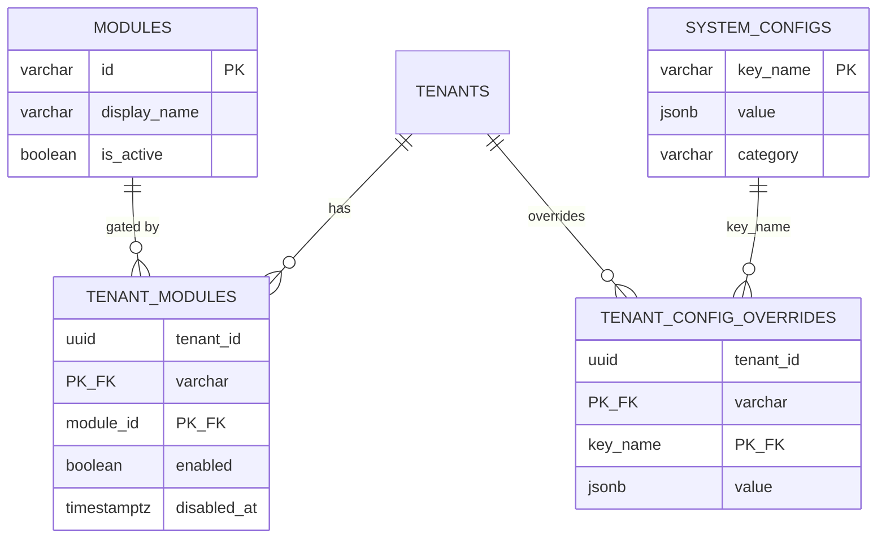
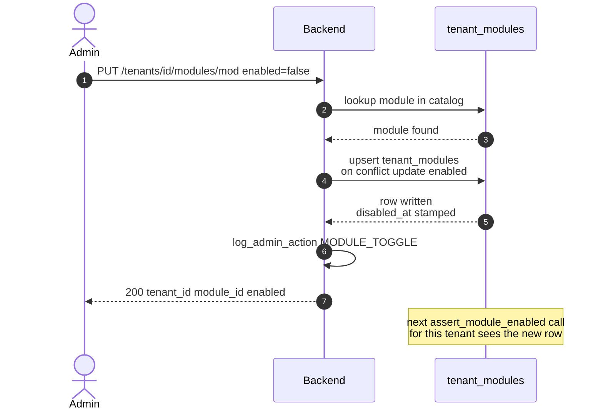

## Document Revision History

| Version | Date | Author | Description of Changes | Approved By |
|---|---|---|---|---|
| 1.0 | 25/08/2026 | Dev Team | ฉบับแรก — เขียนจากโค้ดที่ merge เข้า main แล้ว ครอบคลุมแคตตาล็อก module การเปิด-ปิดต่อ tenant แบบ opt-out และกลไก system config ทั่วไป | รอ Lead Dev |
| 1.1 | 27/10/2026 | Dev Team | ปรับตามโค้ด ณ `945c63ea` — ตาราง modules มี 4 แถว: เพิ่ม `cc_ar_reconcile` (สร้าง 09/09/2026 แล้วปิดเมื่อ 22/09/2026 เมื่อรวมเข้ากับ credit-card flow) และ `pms_interface` (09/10/2026 มีไว้ให้ `llm_usage_logs` อ้างถึงเท่านั้น ไม่คิดเครดิต); Email Automation ต้องมีแพ็กสัญญาที่ active (ข้อยกเว้นของ "ไม่ผูก module กับแพ็ก"); แคตตาล็อกแพ็ก Lite และ Micro; path ตามโครงสร้างหลัง refactor | รอ Lead Dev |

<!-- pagebreak -->

# 1. Executive Summary & Objective

**Plans, Modules & Entitlement** คือกลไกที่ตอบคำถาม "tenant นี้ใช้ฟีเจอร์นี้ได้ไหม" — เป็นการตรวจที่เกิดขึ้นก่อนทุกอย่าง ก่อนที่จะไปถึงเรื่องเครดิตพอหรือไม่พอด้วยซ้ำ ระบบมี module ที่ขายแยกอยู่ 2 ตัว คือ Credit Card OCR และ AP Invoice ส่วน Email Ingest ไม่ได้เป็น module แยก แต่ใช้สิทธิ์ของ Credit Card OCR ร่วมกัน (และต้องมีแพ็กสัญญาที่ active ด้วย) ตาราง modules ยังมีอีก 2 แถวที่ไม่ได้ขาย: `cc_ar_reconcile` (ปิดแล้ว) และ `pms_interface` (สำหรับบันทึกการใช้ LLM ของ PMS Interface)

**กติกาเป็นแบบ opt-out ไม่ใช่ opt-in:** ค่าเริ่มต้นของทุก tenant คือเปิดใช้งานได้ทุก module — ต้องมีแถวที่ระบุ enabled = false ชัดเจนเท่านั้นจึงจะถูกปิด การไม่มีแถวเลยแปลว่าอนุญาต ไม่ใช่ปฏิเสธ

**ทำไมต้องออกแบบแบบนี้:** ถ้ากลับกัน (ต้องมีแถวอนุญาตถึงจะใช้ได้) การเปิดใช้กลไกนี้ครั้งแรกจะล็อก tenant ทุกรายที่มีอยู่แล้วออกจากทุก module ทันทีเพราะไม่มีใครมีแถวเลย การออกแบบแบบ opt-out ทำให้เปิดใช้กลไกได้โดยไม่กระทบใครเลยจนกว่า admin จะสั่งปิดให้ tenant ใดรายหนึ่งจริง ๆ

## 1.1 System Context Diagram

```mermaid 1.1 | Catalog, per-tenant override, and the gate every request passes through
flowchart LR
    subgraph SETUP [Setup]
        CAT[Module catalog<br/>2 sold + 2 internal]
        ADM[Admin toggle]
    end
    TM[(Tenant modules<br/>opt-out only)]
    GATE{module_gate}
    ROUTE[CC OCR / AP Invoice<br/>Email Ingest]

    ADM --> TM
    CAT --> GATE
    TM --> GATE
    GATE --> ROUTE
```

# 2. Scope of Work

## 2.1 In-Scope

- **Module catalog:** ทะเบียนกลางของ module ที่มีอยู่ในระบบ พร้อมชื่อที่แสดงและลำดับการแสดงผล
- **Per-tenant override แบบ opt-out:** admin ปิดการใช้งาน module ใดรายใดได้ทีละ tenant โดยไม่กระทบ tenant อื่น
- **Runtime enforcement:** ทุก endpoint ที่เรียก LLM ตรวจสิทธิ์ก่อนเสมอ ก่อนที่จะไปถึงการตรวจเครดิต
- **Shared entitlement ระหว่าง module:** Email Ingest ใช้สิทธิ์เดียวกับ Credit Card OCR ปิด Credit Card OCR จึงปิด Email Ingest ไปด้วยโดยอัตโนมัติ
- **แคตตาล็อกแพ็กเกจ:** รายการแพ็กที่ขายได้ ทั้งแบบสัญญาและแบบเติม (รายละเอียดการซื้อและการเปิดใช้สิทธิ์อยู่ใน FRD-04/FRD-05)
- **System configuration ทั่วไป:** กลไก key-value กลางที่ใช้เก็บค่าตั้งค่าระดับระบบ พร้อมช่องทางให้ override เฉพาะ tenant
- **Audit trail ของการปรับสิทธิ์:** ทุกครั้งที่ admin เปิดหรือปิด module ถูกบันทึกลง audit log

## 2.2 Out-of-Scope

| ไม่ทำ | ผู้ใช้ต้องทำอะไรแทน / อยู่ที่ไหนแทน |
|---|---|
| ไม่มีหน้าจอแก้ไขแคตตาล็อกแพ็กเกจ | **รายการแพ็ก ราคา และจำนวนเครดิตถูกกำหนดผ่าน migration เท่านั้น** ไม่มี endpoint หรือหน้าจอ admin สำหรับสร้าง แก้ไข หรือปิดขายแพ็กโดยตรง — การเปลี่ยนราคาต้องผ่านการ deploy |
| ไม่มีการเปิด-ปิด feature ย่อยภายใน module | สิทธิ์เป็นระดับ module ทั้งก้อน ไม่แยกฟีเจอร์ย่อยภายใน (เช่น เปิด extract แต่ปิด mapping ไม่ได้) |
| ไม่ผูก module กับแพ็กเกจที่ซื้อ | **การซื้อแพ็กเกจกับการเปิด module เป็นคนละกลไก** tenant ที่ไม่เคยซื้ออะไรเลยก็ยังใช้ทุก module ได้ถ้าไม่ถูกปิดด้วยมือ — การกันสิทธิ์ตามแพ็กที่ซื้อจริงทำโดยอาศัยเครดิตหมด (FRD-04) **ข้อยกเว้นเดียว:** Email Automation ต้องมีแพ็กสัญญาที่ยัง active (`is_entitled`) ทั้งตอนเปิดใช้และทุกรอบ poll |
| ไม่มี feature flag ที่ทำงานจริง | **ตาราง feature_flags ถูกนิยามไว้ในโค้ดแต่ไม่มี router หรือ service ใดอ่านค่าจากตารางนี้** ยังไม่มีผลต่อพฤติกรรมของระบบ |

# 3. Feature List & Sub-Modules

| รหัส | ฟีเจอร์ | Source (โค้ดจริง) |
|---|---|---|
| F-01 | ตรวจสิทธิ์ก่อนเข้าถึง module | `services/shared/module_gate.py` (`assert_module_enabled`) |
| F-02 | แคตตาล็อก module | `models.catalog.Module` · ตาราง `modules` |
| F-03 | สถานะสิทธิ์รายเทนแนนต์ | `models.catalog.TenantModule` · ตาราง `tenant_modules` |
| F-04 | สลับสิทธิ์โดย admin | `services/admin/quotas.py` (`toggle_module`) → `PUT /admin/tenants/{id}/modules/{id}` |
| F-05 | สรุปสิทธิ์และการใช้งานข้ามเทนแนนต์ | `services/admin/quotas.py` (`get_tenants_quota_overview`) → `GET /admin/quotas/overview` |
| F-06 | สรุปสิทธิ์ในหน้ารายละเอียด tenant | `routers/admin/tenants.py get_tenant_detail()` |
| F-07 | แคตตาล็อกแพ็กเกจ | `models.billing.CreditPack` → `GET /credits/packs` |
| F-08 | ตั้งค่าระดับระบบพร้อม override ต่อ tenant | `models.billing.SystemConfig / TenantConfigOverride` |
| F-09 | บันทึกการเปลี่ยนสิทธิ์ลง audit log | `log_admin_action(action=MODULE_TOGGLE)` |
| F-10 | Entitlement ของ Email Automation (ใหม่ในเอกสาร v1.1) | `services/email_automation/ingest_settings.py` (`is_entitled`) |

<!-- pagebreak -->

# 4. Field Specs

## 4.1 modules (แคตตาล็อกกลาง)

| Field | Type | ความหมายและ business logic |
|---|---|---|
| `id` | varchar PK | **natural key** เช่น credit_card_ocr — ใช้เป็นค่าคงที่ในโค้ดโดยตรง (คลาส Module ใน constants.py) ไม่ใช่ uuid ที่ต้องแปลไปมา |
| `is_active` | boolean | **module นี้ยังมีอยู่ในระบบไหม** — คนละความหมายกับ tenant_modules.enabled ซึ่งเป็นสิทธิ์ของ tenant หนึ่งราย ค่านี้เป็นสวิตช์ระดับทั้งระบบว่า module ยังขายอยู่หรือถูกเลิกใช้ไปแล้ว |
| `sort_order` | integer | ลำดับการแสดงผลในหน้าจอที่ต้องเรียง เช่นรายการ module ของ tenant หนึ่งราย |

**แถวที่มีอยู่ (v1.1):**

| id | ขาย | is_active | หมายเหตุ |
|---|---|---|---|
| `credit_card_ocr` | ใช่ | true | Credit Card OCR — Email Automation และ settlement report ใช้สิทธิ์นี้ |
| `ap_invoice` | ใช่ | true | AP Invoice |
| `cc_ar_reconcile` | ไม่ | false | สร้าง 09/09/2026 ปิด 22/09/2026 เมื่อรวมเข้ากับ credit-card flow — ยังใช้เป็น module ของงาน OCR ของ settlement report แต่การตรวจสิทธิ์ใช้ `credit_card_ocr` |
| `pms_interface` | ไม่ | true | มีไว้ให้ `llm_usage_logs.module_id` อ้างถึง — PMS Interface ไม่หักเครดิตและไม่ผ่าน `assert_module_enabled` (ปิด PMS ทำโดยเพิกถอน key) |

## 4.2 tenant_modules (สิทธิ์รายเทนแนนต์ — opt-out)

| Field | Type | ความหมายและ business logic |
|---|---|---|
| `(tenant_id, module_id)` | composite PK | คู่กุญแจ — ไม่มีแถวหมายถึง "อนุญาตโดยปริยาย" ไม่ใช่ "ยังไม่ได้ตั้งค่า" |
| `enabled` | boolean | **ค่านี้ถูกอ่านก็ต่อเมื่อมีแถวอยู่แล้วเท่านั้น** ฟังก์ชันตรวจสิทธิ์เช็คเฉพาะกรณี enabled = false เท่านั้นที่จะปฏิเสธ ค่า true หรือไม่มีแถวเลยให้ผลเหมือนกันคือผ่าน |
| `enabled_at / disabled_at` | timestamptz | เวลาที่ตั้งค่าล่าสุด — ใช้แสดงในหน้ารายละเอียด tenant ว่าเปิดใช้งานมาตั้งแต่เมื่อไร |

## 4.3 credit_packs (แคตตาล็อกแพ็กเกจ)

ดูรายละเอียดคอลัมน์ทั้งหมดใน FRD-04 §4.2 และ FRD-05 §4.1 — ตารางนี้สรุปเฉพาะส่วนที่เกี่ยวกับการจัดหมวดหมู่

| Field | Type | ความหมาย |
|---|---|---|
| `code` | varchar PK | **natural key** เช่น sub_growth, pack_medium — เปลี่ยนชื่อรหัสได้ผ่าน migration แบบ clone-repoint-delete เท่านั้น เพราะมี 3 ตารางอ้างถึงด้วย FK |
| `kind` | varchar | subscription หรือ topup — ตัดสินว่าตอนอนุมัติออเดอร์จะเปิดสัญญาใหม่ หรือเติมเครดิต (ดู FRD-04 §8.1) |
| `is_active` | boolean | แพ็กที่ปิดแล้วซื้อไม่ได้แม้รู้รหัส แต่ tenant ที่ถืออยู่แล้วไม่ได้รับผลกระทบ |

**แคตตาล็อกปัจจุบัน (v1.1, ราคาก่อน VAT):** แพ็กสัญญา `sub_lite` 100 เอกสาร/เดือน ฿290 (CA-99), `sub_starter` 200 ฿490, `sub_growth` 500 ฿990, `sub_pro` 1,500 ฿2,490 · top-up `pack_micro` 100 ฿450 (CA-109), `pack_small` 500 ฿2,000, `pack_medium` 2,500 ฿7,500, `pack_large` 10,000 ฿20,000 — หน้าจออ่านจาก `GET /api/v1/credits/packs` เสมอ

## 4.4 system_configs และ tenant_config_overrides

กลไกกลางสำหรับเก็บค่าตั้งค่าที่ปรับได้โดยไม่ต้อง deploy ใหม่ ปัจจุบันมีผู้ใช้จริงสองกลุ่ม:

| หมวด (prefix) | ใช้ที่ไหน |
|---|---|
| `billing.*` | ข้อมูลผู้ขายสำหรับออกใบเสนอราคา (ชื่อ เลขผู้เสียภาษี ที่อยู่ เลขบัญชี อัตราภาษี) — อ่านใน FRD-05 §4.2 |
| `maintenance.*` | สถานะโหมดปิดปรับปรุงระบบ ทั้งแบบสวิตช์ทันทีและแบบตั้งเวลาล่วงหน้า พร้อม override รายเทนแนนต์ — รายละเอียดอยู่ใน FRD-14 |

| Field | Type | ความหมายและ business logic |
|---|---|---|
| `key_name` | varchar PK | ชื่อค่าแบบมี namespace เช่น maintenance.enabled |
| `is_secret` | boolean | ทำเครื่องหมายว่าค่านี้ไม่ควรถูกแสดงตรง ๆ ในหน้าจอ (เช่น กรณีในอนาคตมีการเก็บ credential) |
| `requires_restart` | boolean | ทำเครื่องหมายว่าการแก้ค่านี้ต้อง restart service ถึงจะมีผล ต่างจากค่าทั่วไปที่มีผลทันทีผ่าน cache สั้น ๆ |
| `tenant_config_overrides.value` | jsonb | **ความหมายของการ override ขึ้นกับ key นั้น ๆ เอง** ไม่มีกติกากลาง — สำหรับ maintenance.enabled กติกาคือ "หรือ" กับค่า global ไม่ใช่ "override ทับ" (ดู FRD-14) |

# 5. Admin Actions & Business Logic

| การกระทำ | พฤติกรรมของระบบ |
|---|---|
| เปิด/ปิด module ให้ tenant หนึ่งราย | **upsert แถวเดียวแบบ on-conflict-update** — ไม่ว่าจะเป็นการตั้งค่าครั้งแรกหรือครั้งที่สิบ ใช้คำสั่งเดียวกันเสมอ พร้อมประทับเวลา enabled_at หรือ disabled_at ตามทิศทางที่สั่ง |
| ดูภาพรวมสิทธิ์ทุก tenant | นับจำนวน module ที่เปิดใช้งานได้ต่อ tenant โดยเริ่มจากจำนวน module ทั้งหมดในแคตตาล็อกแล้วหักด้วยจำนวนที่ถูกปิดไว้ — ไม่ใช่การนับแถวที่ enabled=true ตรง ๆ เพราะ tenant ส่วนใหญ่ไม่มีแถวเลย |
| ดูรายละเอียดสิทธิ์ของ tenant หนึ่งราย | แสดงรายการ module ที่ใช้งานได้ (join แบบ outer แล้วกรองเอาที่ enabled ไม่ใช่ false) และรายการที่ถูกปิดแยกต่างหาก |

<!-- pagebreak -->

# 6. Database Schema & Tables

## 6.1 ข้อบังคับระดับฐานข้อมูล

| ข้อบังคับ | ป้องกันอะไร |
|---|---|
| composite primary key บน tenant_modules | กัน tenant เดียวมีสองแถวสำหรับ module เดียวกัน — การ upsert จึงเป็น atomic |
| FK จาก tenant_modules.module_id ไป modules.id | กันการตั้งสิทธิ์ให้ module ที่ไม่มีอยู่จริง |
| FK จาก tenant_config_overrides.key_name ไป system_configs.key_name | กันการ override ค่าที่ไม่มีนิยามอยู่ก่อน |

## 6.2 Entity Relationship Diagram



# 7. Integrations

กลไกนี้ไม่เรียกระบบภายนอก เป็นการตรวจสอบภายในล้วน ๆ ที่ทุก endpoint ซึ่งเรียก LLM ต้องผ่านก่อน

| ผู้เรียก | เรียกอะไร |
|---|---|
| Credit Card OCR (FRD-01) | `assert_module_enabled(Module.CREDIT_CARD_OCR)` |
| AP Invoice (FRD-02) | `assert_module_enabled(Module.AP_INVOICE)` |
| Email Ingest (FRD-03) | `assert_module_enabled(Module.CREDIT_CARD_OCR)` — **ใช้ module เดียวกับ Credit Card OCR ไม่มี module แยกของตัวเอง** |
| Billing (FRD-05) | อ่านแคตตาล็อกแพ็กเกจตอนแสดงหน้าเลือกซื้อและตอนตรวจกติกาการซื้อทับ |
| Admin console | เรียกสลับสิทธิ์ และอ่านสรุปสิทธิ์ทั้งแบบรายเทนแนนต์และแบบภาพรวม |

# 8. Workflow

## 8.1 การตรวจสิทธิ์ ณ เวลาเรียกใช้งาน

```mermaid 8.1 | assert_module_enabled — opt-out default, fail-open on error
flowchart TB
    A([extract endpoint calls<br/>assert_module_enabled]) --> T{tenant in<br/>context}
    T -->|no| SKIP([nothing to check])
    T -->|yes| Q{row in<br/>tenant_modules}
    Q -->|no row| ALLOW1([allowed - opt-out default])
    Q -->|row, enabled=true| ALLOW2([allowed])
    Q -->|row, enabled=false| BLOCK([raise ModuleDisabled<br/>HTTP 403])
    Q -->|db error| FAILOPEN([log error, allow])

    classDef good fill:#DCFCE7,stroke:#16A34A,color:#14532D
    classDef bad fill:#FEE2E2,stroke:#DC2626,color:#7F1D1D
    classDef warn fill:#FEF3C7,stroke:#D97706,color:#78350F
    class ALLOW1,ALLOW2 good
    class BLOCK bad
    class FAILOPEN,SKIP warn
```

| ลำดับ | ขั้นตอน | รายละเอียด |
|---|---|---|
| 1 | หา tenant จาก context ของคำขอ | ถ้าไม่มี tenant ผูกอยู่เลย ถือว่าไม่มีอะไรต้องตรวจ ปล่อยผ่าน |
| 2 | ค้นแถวใน tenant_modules ด้วยคู่ (tenant, module) | เป็นการค้นด้วย primary key จึงเร็ว |
| 3 | ถ้าไม่พบแถว | **อนุญาต** — นี่คือกรณีปกติของ tenant ส่วนใหญ่ที่ไม่เคยถูกแตะต้อง |
| 4 | ถ้าพบแถวและ enabled เป็น true | อนุญาต |
| 5 | ถ้าพบแถวและ enabled เป็น false | **ปฏิเสธ** — ยก ModuleDisabled ซึ่งกลายเป็น HTTP 403 ที่ router |
| 6 | ถ้าเกิดข้อผิดพลาดระหว่างค้นหา (เช่น DB ไม่ตอบ) | **fail-open** บันทึก log ระดับ error แล้วอนุญาตให้ผ่านไปก่อน — เหตุผลเดียวกับ FRD-04: ปัญหาภายในของระบบต้องไม่หยุดงานบัญชีของลูกค้า |

**ผลที่ตามมาของ fail-open ตรงนี้:** ถ้าฐานข้อมูลมีปัญหาชั่วคราวพอดีตอนที่ admin เพิ่งปิด module ให้ tenant หนึ่ง คำขอที่มาในช่วงนั้นจะยังผ่านเข้าไปได้ เพราะระบบเลือกความต่อเนื่องของบริการมากกว่าความเข้มงวดของการบังคับสิทธิ์ในเสี้ยววินาทีนั้น

## 8.2 การสลับสิทธิ์โดย admin



| ลำดับ | ขั้นตอน | รายละเอียด |
|---|---|---|
| 1 | ตรวจว่ารหัส tenant เป็น UUID ที่ถูกต้อง | ป้องกันค่าที่พิมพ์ผิดตั้งแต่ต้นทาง |
| 2 | ตรวจว่า module มีอยู่จริงในแคตตาล็อก | ถ้าไม่พบ ตอบ NotFoundError |
| 3 | upsert แถวใน tenant_modules | **ใช้คำสั่งเดียวทั้งกรณีสร้างใหม่และกรณีมีแถวอยู่แล้ว** พร้อมประทับเวลาให้ตรงทิศทาง (enabled_at เมื่อเปิด, disabled_at เมื่อปิด) |
| 4 | บันทึก audit log | `action = MODULE_TOGGLE, target_id = "tenant:module"` พร้อมค่าใหม่ |

## 8.3 การอ่านสิทธิ์เพื่อแสดงผล

**หลักการเดียวที่ต้องยึด: เริ่มจากแคตตาล็อกเสมอ ไม่ใช่เริ่มจาก tenant_modules**

เพราะกติกาเป็น opt-out ถ้าเขียนคิวรีแบบ join ปกติแล้วกรองเอาแถวที่ enabled=true จะได้ผลลัพธ์ว่า tenant ที่ไม่เคยมีแถวเลยใช้ module อะไรไม่ได้สักตัว ทั้งที่ความจริงคือใช้ได้ทุกตัว วิธีที่ถูกต้องคือเริ่มจากรายการ module ทั้งหมดในแคตตาล็อก แล้ว outer join กับ tenant_modules เพื่อดูว่าแถวไหนถูกปิดไว้เป็นพิเศษเท่านั้น

## 8.4 Gate Ladder

| Gate | เงื่อนไข | ถ้าไม่ผ่าน | ผลต่อผู้ใช้ |
|---|---|---|---|
| 1 | มี tenant ใน context ของคำขอ | ข้ามการตรวจทั้งหมด | งานเดินต่อโดยไม่ตรวจสิทธิ์ |
| 2 | ไม่มีแถวปฏิเสธอย่างชัดเจนใน tenant_modules | ยก ModuleDisabled | **HTTP 403 — งานหยุดก่อนเสียเครดิต** (การตรวจนี้อยู่ก่อน consume_document เสมอในทุก endpoint) |
| — | เกิดข้อผิดพลาดระหว่างตรวจ | fail-open บันทึก log | งานเดินต่อ |

**กฎที่สำคัญที่สุด: การตรวจสิทธิ์เป็นด่านแรกเสมอ ก่อนแม้แต่จะแตะเรื่องเครดิต**

ลำดับนี้มีเหตุผล — ถ้าสลับให้ตรวจเครดิตก่อน tenant ที่ถูกปิด module ไปแล้วแต่ยังมีเครดิตเหลือ จะถูกหักเครดิตไปก่อนแล้วจึงมาเจอว่าใช้ไม่ได้ ซึ่งต้องคืนเครดิตอีกที การตรวจสิทธิ์ก่อนเสมอทำให้ tenant ที่ไม่มีสิทธิ์ไม่มีทางเสียเครดิตแม้แต่หน่วยเดียว

<!-- pagebreak -->

# 9. Error Handling & Edge Cases Matrix

| Case ID | สาเหตุ | สถานการณ์ | HTTP | ผู้ใช้ต้องทำ |
|---|---|---|---|---|
| EC-01 | module_disabled | admin ปิด module ให้ tenant นี้โดยเฉพาะ | 403 | ติดต่อผู้ดูแลระบบ |
| EC-02 | no_row_default_allow | tenant ไม่เคยถูกตั้งค่าอะไรเลย | 200 (ปกติ) | ไม่ต้องทำอะไร — พฤติกรรมที่ถูกต้อง |
| EC-03 | shared_module_side_effect | admin ปิด Credit Card OCR โดยตั้งใจจะปิดแค่ wizard | **403 — Email Ingest หยุดทำงานไปด้วย** | **ต้องรู้ก่อนปิดว่าสองอย่างผูกกัน** — ไม่มีทางปิดแยกจากกันในระบบปัจจุบัน |
| EC-04 | module_not_found | admin สั่งเปิด/ปิด module ด้วยรหัสที่ไม่มีในแคตตาล็อก | NotFoundError | ตรวจรหัส module |
| EC-05 | invalid_tenant_id | รหัส tenant ที่ส่งมาไม่ใช่ UUID | NotFoundError | ตรวจรหัส tenant |
| EC-06 | db_error_on_check | ฐานข้อมูลมีปัญหาชั่วคราวตอนตรวจสิทธิ์ | **fail-open — งานเดินต่อ** | ไม่ต้องทำอะไร — ตรวจย้อนได้จาก log ระดับ error |
| EC-07 | catalog_row_inactive | module ถูกตั้ง is_active = false ในแคตตาล็อก | ไม่มีผลต่อ assert_module_enabled โดยตรง | **ค่านี้กรองแค่ตอนแสดงผลรายการ ไม่ได้ใช้บล็อกการเรียกจริง** — ถ้า tenant ยังเรียก endpoint ตรง ๆ จะยังผ่านได้ถ้าไม่มีแถวปฏิเสธเฉพาะ |

# 10. Non-Functional & Technical Requirements

## 10.1 ความถูกต้อง

- การเปิด/ปิดสิทธิ์เป็นคำสั่ง upsert เดียว ไม่มีช่วงเวลาที่อ่านค่าเก่าแล้วเขียนค่าใหม่แยกกัน
- การตรวจสิทธิ์ค้นด้วย primary key เสมอ ไม่มีการสแกนตาราง

## 10.2 ความทนทาน

- fail-open เมื่อฐานข้อมูลมีปัญหา — สอดคล้องกับหลักการเดียวกับ FRD-04 ว่าปัญหาภายในต้องไม่หยุดงานของลูกค้า

## 10.3 Audit Trail

- ทุกการสลับสิทธิ์บันทึกลง audit log พร้อมตัวตนของ admin, tenant, module และค่าใหม่
- เวลาที่เปิดหรือปิดล่าสุดถูกเก็บไว้ในแถวเอง (enabled_at / disabled_at) แยกจาก audit log ทำให้อ่านค่าล่าสุดได้เร็วโดยไม่ต้องสืบจาก log

# 11. Developer Checklist & Acceptance Criteria

## 11.1 Developer Checklist

| สถานะ | รายการ |
|---|---|
| เสร็จ | แคตตาล็อก module พร้อมค่าที่ระบุ is_active และ sort_order |
| เสร็จ | ตรวจสิทธิ์แบบ opt-out พร้อม fail-open |
| เสร็จ | admin เปิด/ปิดสิทธิ์รายเทนแนนต์พร้อม audit log |
| เสร็จ | สรุปสิทธิ์ทั้งแบบภาพรวมและแบบรายเทนแนนต์ที่เริ่มนับจากแคตตาล็อกเสมอ |
| เสร็จ | Email Ingest ใช้สิทธิ์ร่วมกับ Credit Card OCR |
| เสร็จ | กลไก system config ทั่วไปพร้อม override รายเทนแนนต์ |

## 11.2 Acceptance Criteria

- **Pass Scenario (ค่าเริ่มต้น):** tenant ใหม่ที่ไม่เคยถูกตั้งค่าอะไรเลย ต้องเรียกทั้ง Credit Card OCR, AP Invoice และ Email Ingest ได้ทั้งหมด
- **Pass Scenario (ปิดสิทธิ์):** เมื่อ admin ปิด Credit Card OCR ให้ tenant หนึ่งราย ทั้ง wizard และ Email Ingest ของ tenant นั้นต้องได้ 403 ทันที โดยที่ tenant อื่นไม่ได้รับผลกระทบ
- **Pass Scenario (เปิดกลับ):** เมื่อเปิดกลับ ต้องใช้งานได้ทันทีโดยไม่ต้องรอ cache หมดอายุหรือ restart
- **Fail Scenario:** การปิด AP Invoice ต้องไม่มีผลต่อ Credit Card OCR หรือ Email Ingest เลย เพราะทั้งสองกลุ่มเป็นคนละ module_id กัน

<!-- pagebreak -->

# 12. API Specifications

| Method | Path | หมายเหตุ |
|---|---|---|
| GET | `/api/v1/credits/packs` | แคตตาล็อกแพ็กเกจที่เปิดขาย (รายละเอียดใน FRD-05 §12.1) |
| GET | `/api/v1/admin/quotas/overview` | สรุปสิทธิ์และการใช้งานข้ามเทนแนนต์ · จำกัดช่วงวันที่ไม่เกิน 92 วัน |
| PUT | `/api/v1/admin/tenants/{tenant_id}/modules/{module_id}` | สลับสิทธิ์ · body { "enabled": true/false } · ต้องมีสิทธิ์เขียนในกลุ่ม quotas |
| GET | `/api/v1/admin/tenants/{tenant_id}` | รายละเอียด tenant รวมรายการ module ที่เปิดและปิด (ดู FRD-08 Admin Console) |

## 12.1 Status Codes

| Code | ความหมายในระบบนี้ |
|---|---|
| 403 | module ถูกปิดสำหรับ tenant นี้โดยเฉพาะ |
| 404 | ไม่พบ tenant หรือ module ตามรหัสที่ระบุ |

<!-- pagebreak -->

# 13. Test Cases & QA Matrix

## 13.1 Category 1: การตรวจสิทธิ์แบบ opt-out

| Test Case ID | Scenario & Pre-conditions | Test Steps | Expected Result & วิธีตรวจผล | Pass Criteria |
|---|---|---|---|---|
| TC-ENT-01 | **Regression test สำคัญ:** tenant ใหม่ไม่มีแถวเลย | 1. เรียก extract ของ Credit Card OCR ด้วย tenant ที่เพิ่งสร้าง | 200 · ไม่มี ModuleDisabled | **Fail ถ้า tenant ใหม่ถูกบล็อก** |
| TC-ENT-02 | มีแถว enabled = true | 1. ตั้งค่า enabled=true อย่างชัดเจนแล้วเรียก | 200 | ค่า true ให้ผลเดียวกับไม่มีแถว |
| TC-ENT-03 | **Regression test สำคัญ:** มีแถว enabled = false | 1. admin ปิด module 2. เรียก extract | HTTP 403 ModuleDisabled | **Fail ถ้ายังผ่านได้** |
| TC-ENT-04 | ตรวจก่อนหักเครดิตเสมอ. Pre: module ถูกปิด และ tenant มีเครดิตเหลือ | 1. เรียก extract | 403 · credit_ledger ไม่มีแถวใหม่ | **Fail ถ้าเครดิตถูกหักไปก่อนเจอ 403** |
| TC-ENT-05 | DB ล่มระหว่างตรวจสิทธิ์ | 1. จำลอง DB error เฉพาะช่วงตรวจสิทธิ์ | งานเดินต่อ (fail-open) · มี log ระดับ error | ไม่บล็อกงานเพราะปัญหาภายใน |

## 13.2 Category 2: การใช้สิทธิ์ร่วมกันระหว่าง module

| Test Case ID | Scenario & Pre-conditions | Test Steps | Expected Result & วิธีตรวจผล | Pass Criteria |
|---|---|---|---|---|
| TC-SHR-01 | **Regression test สำคัญ:** ปิด Credit Card OCR กระทบ Email Ingest | 1. admin ปิด credit_card_ocr 2. รันรอบ email ingest ของ tenant นั้น | เอกสารของ tenant นี้ถูก skip หรือ fail ด้วยเหตุผล module_disabled | **Fail ถ้า Email Ingest ยังทำงานได้** |
| TC-SHR-02 | ปิด AP Invoice ไม่กระทบ Credit Card OCR | 1. admin ปิด ap_invoice 2. เรียก extract ของ Credit Card OCR | 200 — ไม่ได้รับผลกระทบ | สอง module แยกกันจริง |
| TC-SHR-03 | ปิด AP Invoice ไม่กระทบ Email Ingest | 1. admin ปิด ap_invoice 2. รันรอบ email ingest | ทำงานตามปกติ | Email Ingest ผูกกับ Credit Card OCR เท่านั้น |

## 13.3 Category 3: การจัดการโดย admin

| Test Case ID | Scenario & Pre-conditions | Test Steps | Expected Result & วิธีตรวจผล | Pass Criteria |
|---|---|---|---|---|
| TC-ADM-01 | สลับสิทธิ์สำเร็จ | 1. admin ปิด module | มีแถวใน tenant_modules พร้อม disabled_at ที่ประทับเวลา | ตรงตามที่คาด |
| TC-ADM-02 | สลับสิทธิ์บันทึก audit | 1. admin เปิด module ที่เคยปิด | มีแถว audit log ใหม่ action=MODULE_TOGGLE พร้อมค่า enabled=true | ตรวจสอบย้อนหลังได้ |
| TC-ADM-03 | module ไม่มีอยู่จริง | 1. เรียก toggle ด้วยรหัส module ที่ไม่มี | NotFoundError | ไม่สร้างแถวขยะ |
| TC-ADM-04 | tenant ไม่มีอยู่จริงหรือรหัสผิดรูปแบบ | 1. เรียก toggle ด้วย tenant_id ที่ไม่ใช่ UUID | NotFoundError | ปฏิเสธก่อนแตะฐานข้อมูล |
| TC-ADM-05 | **Regression test สำคัญ:** การนับสรุปสิทธิ์ต้องเริ่มจากแคตตาล็อก | 1. ดูภาพรวมสิทธิ์ของ tenant ที่ไม่เคยถูกแตะต้องเลย | จำนวน module ที่ใช้ได้ต้องเท่ากับจำนวน module ทั้งหมดในแคตตาล็อก ไม่ใช่ 0 | **Fail ถ้าแสดงเป็น 0** |
| TC-ADM-06 | สลับสิทธิ์ซ้ำ (idempotent) | 1. ปิด module ที่ปิดอยู่แล้วซ้ำอีกครั้ง | สำเร็จ · disabled_at ถูกอัปเดตเป็นเวลาล่าสุด | upsert ทำงานถูกต้อง |
