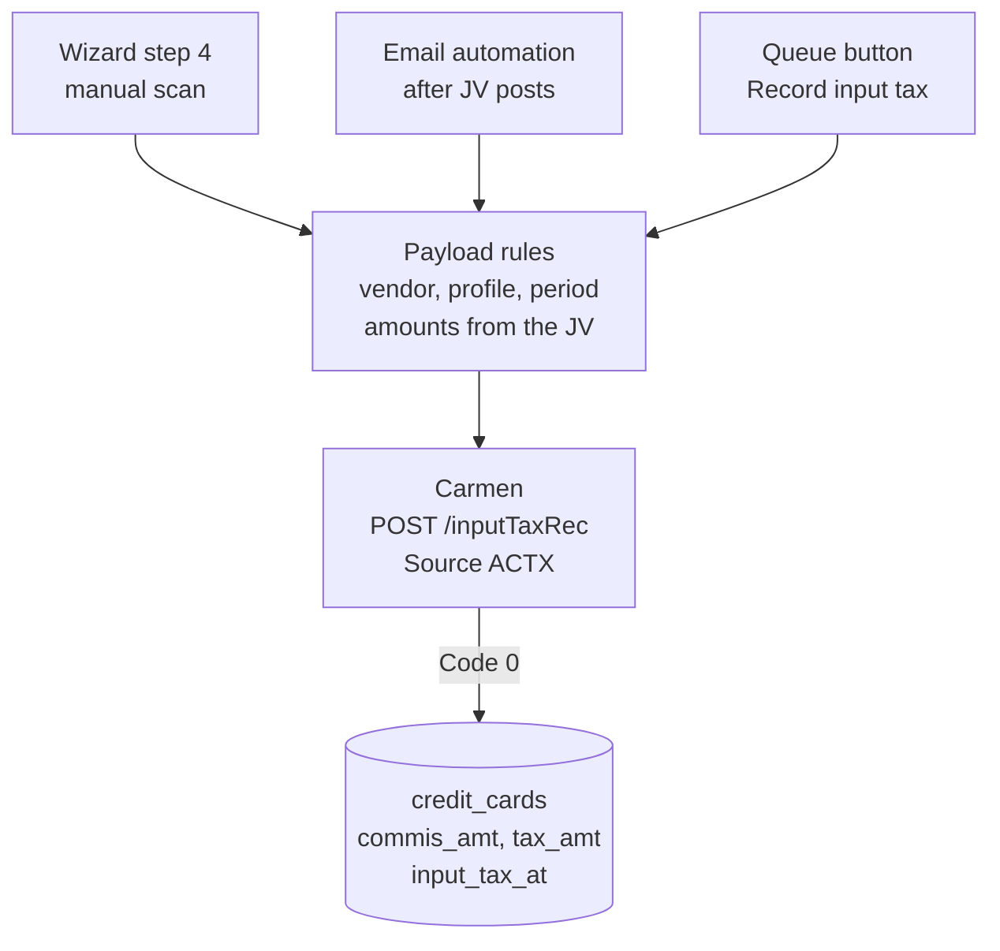
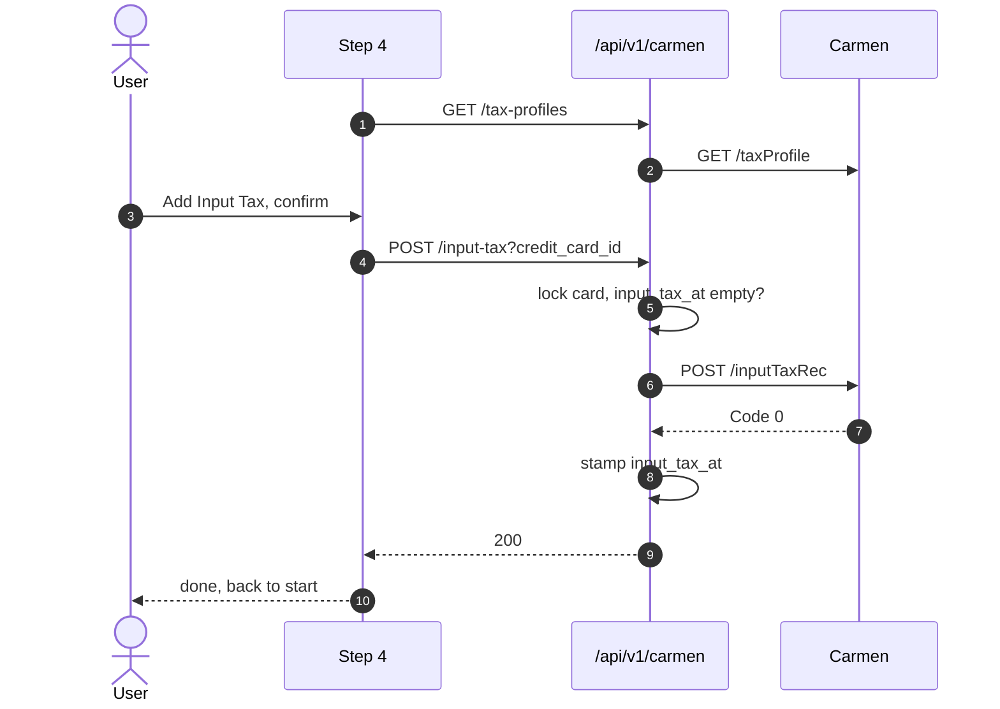
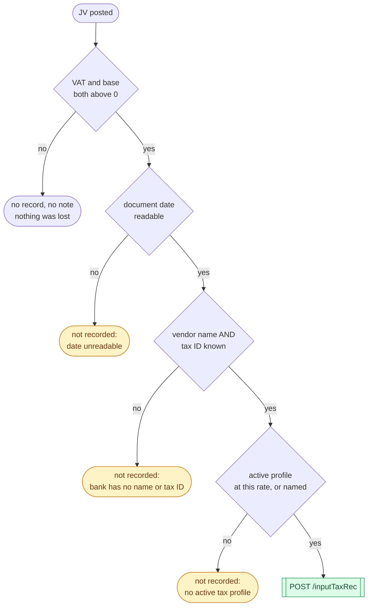
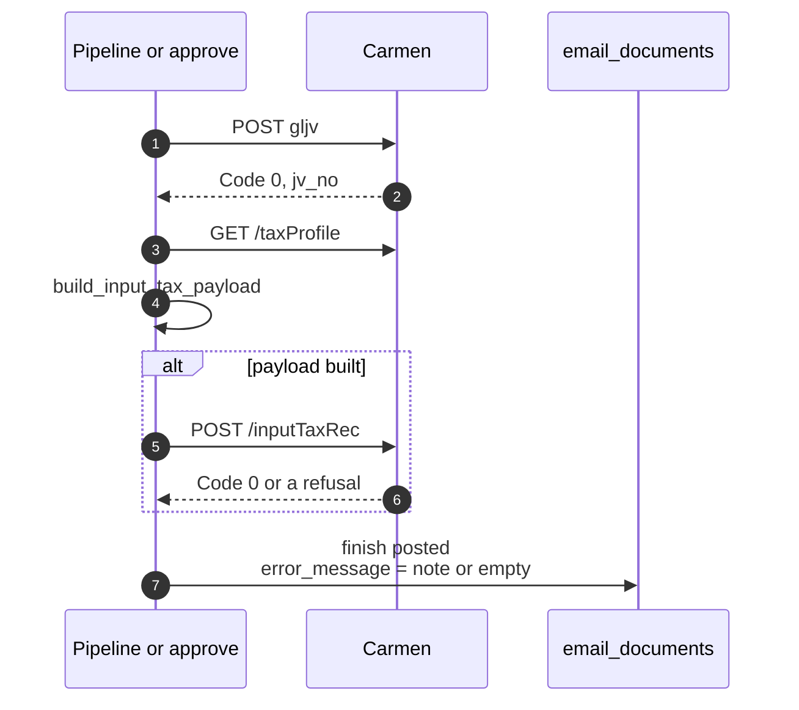

**ความสัมพันธ์กับเอกสารอื่น:** ใบแจ้งค่าธรรมเนียมบัตรเครดิตหนึ่งใบสร้างเอกสารใน Carmen สองฉบับ ฉบับแรกคือ JV (FRD-01 สำหรับ wizard, Email FRD สำหรับอีเมล) ฉบับที่สองคือรายการภาษีซื้อ (input tax record, Source `ACTX`) ซึ่งเป็นเรื่องของเอกสารนี้ การตรวจและอนุมัติในคิวอยู่ใน FRD-12

## Document Revision History

| Version | Date | Author | Description of Changes | Approved By |
|---|---|---|---|---|
| 1.0 | 27/10/2026 | Dev Team | ฉบับแรก — เขียนจากโค้ดที่ merge เข้า main แล้ว ครอบคลุมสามเส้นทางที่ยื่นภาษีซื้อ (wizard step 4, email automation, ปุ่มยื่นย้อนหลังในคิว), กติกาการเลือกผู้ขาย/tax profile/งวดภาษี, การกันยื่นซ้ำ และ QA matrix | Reviewed |

<!-- pagebreak -->

# 1. Executive Summary & Objective

**Input Tax Reconciliation** คือการบันทึกภาษีซื้อที่ธนาคารเรียกเก็บบนค่าธรรมเนียมบัตรเครดิต เข้าทะเบียนภาษีซื้อของ Carmen (`inputTaxRec`, Source `ACTX`) โดยอัตโนมัติจากข้อมูลที่ AI อ่านมาแล้ว หลังจากที่ JV ของเอกสารเดียวกันลงบัญชีสำเร็จ ผู้ใช้ไม่ต้องคีย์ภาษีซื้อซ้ำในหน้า AP ของ Carmen และรายการภาษีซื้อมีตัวเลขตรงกับ JV เสมอ เพราะใช้ยอดชุดเดียวกัน

**ปัญหาที่แก้:** เดิมพนักงานบัญชีต้องคีย์ภาษีซื้อของใบกำกับภาษีค่าธรรมเนียมทุกใบเองใน Carmen ซ้ำกับที่ลง JV ไปแล้ว ตัวเลขสองชุดจึงมีโอกาสไม่ตรงกัน และใบที่ลืมคีย์คือภาษีซื้อที่ขอคืนไม่ได้ในงวดนั้น

**หลักการ 5 ข้อ:**

- **JV ก่อน ภาษีซื้อทีหลัง และภาษีซื้อไม่มีวันทำให้ JV ล้มเหลว** — JV เข้าบัญชีของ Carmen แล้วและย้อนไม่ได้ ภาษีซื้อที่ยื่นไม่สำเร็จจึงถูกบันทึกเป็นหมายเหตุให้คนมาจัดการ ไม่ใช่ความล้มเหลวของเอกสาร
- **ไม่ยื่นรายการที่ไม่ครบ** — งวดภาษีผิดเดือนหรืออัตราที่เดาเอา ต้องมีคนไปแก้ใน Carmen ซึ่งแย่กว่าการไม่ยื่น ระบบจึงปฏิเสธพร้อมบอกเหตุผล
- **ผู้ขายคือธนาคารที่ออกใบกำกับภาษี** — ชื่อ เลขผู้เสียภาษี และที่อยู่มาจากทะเบียนธนาคาร ไม่ใช่จากข้อมูลของโรงแรม
- **ยื่นอัตราตาม tax profile แต่ยื่นยอดภาษีตามเอกสาร** — ยอดที่อ่านมาคลาดเล็กน้อยต้องไม่กลายเป็น "7% ของฐาน" ในบัญชีเงียบๆ
- **ยื่นได้ครั้งเดียวต่อเอกสาร** — `credit_cards.input_tax_at` เป็นตัวกันยื่นซ้ำ

## 1.1 System Context Diagram (ภาพรวมการไหลของข้อมูล)



# 2. Scope of Work

## 2.1 In-Scope (ขอบเขตการทำงานของระบบ)

- **Wizard step 4 (manual scan):** หลัง JV post สำเร็จ แสดงรายการภาษีซื้อหนึ่งแถวให้ตรวจ แล้วกด Add Input Tax เพื่อยื่น หรือ Skip เพื่อจบโดยไม่ยื่น
- **Email automation:** ยื่นต่อจาก JV ทันที ทั้งในเส้นทาง auto-post และเมื่อคนกด Approve ใน dialog ตรวจ ซึ่งมีแผงภาษีซื้อให้ติ๊กเปิด/ปิดการยื่น และแก้ผู้ขาย เลขผู้เสียภาษี tax profile และสาขาได้
- **ยื่นย้อนหลังจากคิว:** manual scan ที่ JV post แล้วแต่ภาษีซื้อไม่ได้ยื่น (session หมดก่อนถึง step 4 หรือผู้ใช้กด Skip) แสดง "input tax not recorded" บนแถว พร้อมปุ่ม Record input tax
- **Settlement report (KBANK):** รายงาน settlement ยื่นภาษีซื้อของตัวเองจากแถวรวมของรายงาน (`total_row`) เพราะแถวรายการแยกตามประเภทบัตรไม่ได้พิมพ์ค่าคอมมิชชันและ VAT (decision-log #28)
- **กู้ draft ของ wizard:** draft ที่ JV post แล้วจะถูกเสนอให้กู้คืนเฉพาะเมื่อ server ยืนยันว่ายังค้างยื่นภาษีซื้ออยู่จริง

## 2.2 Out-of-Scope (สิ่งที่ระบบไม่ทำ และผู้ใช้ต้องทำแทน)

| ไม่ทำ | ผู้ใช้ต้องทำอะไรแทน / อยู่ที่ไหนแทน |
|---|---|
| แก้รายการภาษีซื้อหลังยื่นแล้ว | แก้ใน Carmen โดยตรง (backend มี proxy `PUT /api/v1/carmen/input-tax/{rec_seq}` แต่ไม่มีหน้าจอเรียกใช้) |
| ขั้นตอน "Input Tax Reconciliation Completed" และรายงานภาษีซื้อ | เป็นขั้นตอนของ Carmen AP เอง ระบบนี้ทำแค่สร้างรายการเข้าไป |
| เอกสารที่มีหลายอัตราภาษีในใบเดียว | ระบบยื่นเป็นรายการเดียวตามอัตรารวม (ภาษี ÷ ฐาน) ถ้าไม่มี profile ตรงอัตรานั้น ต้องเลือก profile เองในแผงของ dialog ตรวจ หรือคีย์ใน Carmen |
| ยื่นภาษีซื้อของ manual scan ที่ post ก่อน 29/09/2026 | ใบเหล่านั้นไม่ได้เก็บยอดไว้ (`tax_amt` ว่าง) ต้องคีย์ใน Carmen |
| CA-111 "JV post without input tax handling" | ยังอยู่สถานะ To Do ใน Jira และยังไม่มีรายละเอียด |
| ตรวจว่ามีคนคีย์ภาษีซื้อใบเดียวกันเข้า Carmen เองแล้วหรือยัง | ระบบมองไม่เห็นรายการที่คีย์เอง ปุ่ม Record input tax จึงถามยืนยันก่อนทุกครั้ง |

<!-- pagebreak -->

# 3. Feature List & Sub-Modules

<!-- widths: 9,24,37,30 -->
| Feature ID | ชื่อฟีเจอร์ | คำอธิบาย | Source |
|---|---|---|---|
| F-01 | Wizard step 4 | แสดงและยื่นรายการภาษีซื้อของ manual scan สร้าง payload ฝั่ง browser | `InputTaxReconciliation.tsx` |
| F-02 | Server-side builder | กติกาเดียวกับ step 4 ฝั่ง server คืน (payload หรือเหตุผลที่ไม่ยื่น) อย่างใดอย่างหนึ่ง | `services/credit_card/input_tax.py` `build_input_tax_payload()` |
| F-03 | Tax profile resolution | เลือก profile ที่ active และอัตราตรงกับเอกสาร (คลาดได้ไม่เกิน 0.01) | `resolve_tax_profile()` / `resolveTaxProfileForRate` (`shared/lib/apTax.ts`) |
| F-04 | Email filing | ยื่นต่อจาก JV ทั้ง auto-post และ approve ไม่ raise ข้อผิดพลาด คืนเป็นหมายเหตุ | `email_automation/pipeline.py` `_post_input_tax()` |
| F-05 | Review panel | แผงภาษีซื้อใน dialog ตรวจ: ติ๊กยื่น/ไม่ยื่น และแก้ผู้ขาย เลขผู้เสียภาษี profile สาขา | `InputTaxPanel.tsx` |
| F-06 | Filing guard (wizard) | proxy ที่รับ `credit_card_id` ล็อกแถว ปฏิเสธการยื่นซ้ำ และ stamp `input_tax_at` | `routers/carmen.py` `proxy_create_input_tax()` |
| F-07 | Late filing (queue) | สร้างรายการจากยอดที่ stamp ไว้กับ JV แล้วยื่น | `file_input_tax_for_card()` + `POST /api/v1/credit-card/activity/{card_id}/input-tax` |
| F-08 | Owed check | "JV post แล้ว มี VAT และยังไม่ได้ยื่น" — ใช้ทั้งบนแถวคิวและตอนเสนอกู้ draft | `owes_input_tax()`, `input_tax_owed()`, `draftWorthOffering()` |

# 4. UI Specs & Field Mapping

## 4.1 Wizard step 4 — ตารางภาษีซื้อ

แถบหัวแสดง `Source: ACTX` และ `Tax Period: MM/YYYY` ตารางมีหนึ่งแถวต่อเอกสาร

| คอลัมน์ | ที่มา |
|---|---|
| Source | `ACTX` (ค่าคงที่) |
| Tax Invoice No. / Date | เลขที่และวันที่ของเอกสาร (หัวเอกสารที่ผู้ใช้ตรวจแล้วใน step 2) |
| Vendor Name / TAX ID. | ทะเบียนธนาคารของเอกสาร (`BANK_INFO`) ถ้าไม่มีจึงใช้ข้อมูลบริษัทใน accounting config |
| Branch No. | สาขาบนเอกสาร → สาขาที่ BU ตั้งไว้ → `00000` (สำนักงานใหญ่) |
| Description | ข้อความเดียวกับคำอธิบายของ JV (template ต่อธนาคาร) |
| Tax Profile | profile ที่อัตราตรงกับเอกสาร แสดงเป็น "code : desc" |
| Tax Rate % / Net / Tax / Total | อัตราของ profile, Σ ค่าคอมมิชชัน, Σ VAT, ผลรวม |

**ปุ่ม Add Input Tax ถูกปิด** เมื่อผู้ขายไม่มีชื่อหรือไม่มีเลขผู้เสียภาษี เพราะ Carmen รับคำขอแล้วจึงปฏิเสธภายหลังโดยไม่มีข้อความ ถ้า ฐาน × อัตรา ไม่ตรงกับ VAT บนเอกสารเกิน 0.02 บาท หน้าจอแสดงคำเตือนให้ตรวจก่อนยื่น

## 4.2 Review dialog — แผงภาษีซื้อ (เอกสารอีเมล)

แผงพับไว้เป็นค่าเริ่มต้น เพราะเป็นตัวอย่างของเอกสารฉบับที่สองที่คำนวณจากตัวเลขบนหน้าจออยู่แล้ว ช่องติ๊ก "post input tax" คือผลลัพธ์ (ค่าเริ่มต้นติ๊ก)

| ช่อง | แก้ได้ไหม | เหตุผล |
|---|---|---|
| Vendor name, Tax ID | ได้ | ทะเบียนธนาคารที่ขาดหรือล้าสมัยเป็นทางตันของเครื่อง แต่คนแก้ได้ในช่องเดียว |
| Tax profile | ได้ (เลือกจาก profile ที่ active ใน Carmen) | เอกสารอัตราที่ไม่มี profile ใดประกาศ คนเลือกได้ — browser บอกได้ว่า "profile ไหน" แต่กำหนดอัตราของ profile เองไม่ได้ |
| Branch No. | ได้ | เป็นข้อมูลบนเอกสารช่องเดียวที่ JV ไม่ได้ใช้ |
| งวดภาษี | ไม่ได้ | เป็นเดือนของเอกสาร แก้ได้ที่วันที่เอกสารด้านบน |
| ยอดฐาน / ภาษี / รวม | ไม่ได้ | เป็นยอดของ JV — ภาษีซื้อที่ไม่ตรงกับ JV ที่ยื่นคู่กันแย่กว่าไม่มีรายการ |

ถ้ารายการจะถูกปฏิเสธหากกด Approve ตอนนี้ (เช่น ไม่มีเลขผู้เสียภาษี) แผงรายงานขึ้นไปให้ปุ่ม Approve ถูกปิด

## 4.3 Payload ที่ส่งเข้า Carmen (`POST /inputTaxRec`)

<!-- widths: 18,46,36 -->
| Field | กติกา | ตัวอย่าง |
|---|---|---|
| `Prefix` | `vat` + ปี ค.ศ. + เดือน ของวันที่เอกสาร (ปี พ.ศ. แปลงเป็น ค.ศ.) | vat202610 |
| `Source` | ค่าคงที่ | ACTX |
| `FrDate` / `ToDate` | วันแรกและวันสุดท้ายของเดือนนั้น (ปีอธิกสุรทิน ก.พ. จบวันที่ 29) | 2026-10-01 / 2026-10-31 |
| `InvhTInvNo` / `InvhTInvDt` | เลขที่และวันที่ของเอกสาร | IV6910-00213 / 2026-10-15T00:00:00.000Z |
| `InvhDesc` | คำอธิบายแบบเดียวกับ JV (`render_description`) | Commission KTC 10/2026 |
| `VnName` / `TaxId` / `Address` | ทะเบียนของธนาคารผู้ออกใบกำกับ (ตาราง `banks`: `legal_name`, `tax_id`, `address`) หรือค่าที่ผู้ตรวจแก้ — ช่องว่างหรือช่องที่มีแต่ช่องว่างถือว่าไม่มีค่า | Krungthai Card PCL / 0107545000292 |
| `BranchNo` | สาขาบนเอกสาร → สาขาของ BU → `00000` | 00000 |
| `TaxProfileCode` / `TaxProfileDesc` | profile ที่ active และอัตราตรงกับ ภาษี ÷ ฐาน × 100 (คลาดไม่เกิน 0.01) หรือ profile ที่ผู้ตรวจเลือก | VAT07 / VAT 7% |
| `TaxRate` | อัตราของ profile (ถ้า profile ไม่ได้ประกาศอัตรา ใช้อัตราจริงของเอกสาร) | 7 |
| `BfTaxAmt` / `TaxAmt` / `TotalAmt` | Σ `commis_amt`, Σ `tax_amt`, ผลรวม — ยอดชุดเดียวกับ JV | 1500.00 / 105.00 / 1605.00 |
| `UserModified` | wizard ส่ง `admin`, ฝั่ง server ส่ง `OCR-EMAIL` | OCR-EMAIL |
| `VnCode` | ว่างเสมอ | "" |

# 5. Action Buttons & Business Logic

<!-- widths: 20,14,66 -->
| Button Name | Action Type | Business Logic / System Behavior |
|---|---|---|
| Add Input Tax (wizard) | Confirm + Submit | ถามยืนยัน → `POST /api/v1/carmen/input-tax?credit_card_id=<card>` ด้วย token ของผู้ใช้ → ถือว่าสำเร็จเฉพาะเมื่อ Carmen ตอบ `Code: 0` (Carmen ตอบ HTTP 200 พร้อมคำตัดสินใน body) → stamp `input_tax_at` แล้วจบ wizard |
| Skip (wizard) | Confirm | จบ wizard โดยไม่ยื่น — JV ยังอยู่ และแถวในคิวจะแสดง "input tax not recorded" พร้อมปุ่มยื่นย้อนหลัง |
| ช่องติ๊ก post input tax (dialog ตรวจ) | Toggle | ไม่ติ๊ก = ผู้ตรวจตั้งใจคีย์ภาษีซื้อเอง ระบบ post เฉพาะ JV |
| Approve and post (dialog ตรวจ) | Form Submit | หลัง JV สำเร็จ ยื่นภาษีซื้อด้วย credential ของ BU พร้อมค่าที่ผู้ตรวจแก้ (`input_tax`) ถ้าไม่สำเร็จ เอกสารยังเป็น `posted` และมีหมายเหตุ "Input tax not recorded …" |
| Record input tax (แถวคิว) | Confirm + Submit | ถามยืนยัน ("ทำเฉพาะเมื่อยังไม่มีใครคีย์ใน Carmen") → `POST /api/v1/credit-card/activity/{card_id}/input-tax` → server ล็อกแถว สร้างรายการจากยอดที่ stamp ไว้กับ JV แล้วยื่นด้วย token ของผู้ใช้ |
| Restore draft (wizard) | Prompt | draft ที่ JV post แล้วถูกเสนอเฉพาะเมื่อ `GET /api/v1/credit-card/activity/{card_id}/input-tax` ตอบ `owed: true` — ถ้าเช็คไม่ได้ (เครือข่ายขัดข้อง) ยังเสนอให้ ไม่ทิ้งงานที่ทำค้างไว้ |

<!-- pagebreak -->

# 6. Database Schema & Tables

## 6.1 คอลัมน์บน credit_cards (migration `20260929000000_credit_cards_input_tax.sql`)

| Column | ความหมาย |
|---|---|
| `commis_amt` | Σ ค่าคอมมิชชันก่อน VAT — stamp พร้อมกับ JV ใช้เป็นฐานของภาษีซื้อเมื่อยื่นย้อนหลัง |
| `tax_amt` | Σ VAT — stamp พร้อมกับ JV เป็น null สำหรับใบที่ post ก่อน migration นี้ |
| `input_tax_at` | เวลาที่แอปนี้ยื่นภาษีซื้อสำเร็จ — null พร้อมกับ `tax_amt > 0` และ `submitted_at` มีค่า หมายถึง "ยังค้างยื่น" |

## 6.2 ตาราง banks — ทะเบียนผู้ขาย

| Column | ใช้เป็น |
|---|---|
| `legal_name` | `VnName` |
| `tax_id` | `TaxId` |
| `address` | `Address` |

ธนาคารที่ไม่มี `legal_name` หรือ `tax_id` ยื่นอัตโนมัติไม่ได้ จนกว่าจะเพิ่มข้อมูลในตาราง หรือผู้ตรวจกรอกเองในแผงของ dialog

## 6.3 Entity Relationship Diagram

```mermaid 6.3 | The two sums travel with the JV so the claim can be filed later
erDiagram
    BANKS ||--o{ CREDIT_CARDS : bank_code
    CREDIT_CARDS }o--|| OCR_TASKS : task_id
    BANKS {
        varchar code PK
        varchar legal_name "VnName"
        varchar tax_id "TaxId"
        varchar address "Address"
    }
    CREDIT_CARDS {
        uuid id PK
        varchar bank_code FK
        varchar doc_no
        date doc_date
        varchar branch_no
        timestamptz submitted_at "JV posted"
        numeric commis_amt "base"
        numeric tax_amt "VAT"
        timestamptz input_tax_at "filed"
    }
```

# 7. Required Data Tables (External Integrations)

| Endpoint ฝั่ง Carmen | เรียกตอนไหน | credential |
|---|---|---|
| `GET /taxProfile` | โหลดรายการ tax profile ก่อนสร้างรายการทุกครั้ง (profile ที่ `Active: false` ถูกตัดทิ้ง) | ตามเส้นทาง |
| `POST /inputTaxRec` | ยื่นรายการภาษีซื้อ | wizard และปุ่มในคิว: token ของผู้ใช้ / email: credential ของ BU |

proxy ฝั่งแอป: `GET /api/v1/carmen/tax-profiles`, `POST /api/v1/carmen/input-tax` (เส้นทาง wizard)

# 8. Workflow & End-to-End Walkthrough

## 8.1 Sequence — Wizard step 4



## 8.2 Gate Ladder — สร้างรายการได้หรือไม่ (`build_input_tax_payload`)



| Gate | เงื่อนไข | ถ้าไม่ผ่าน | ผล |
|---|---|---|---|
| 1 | Σ VAT > 0 และ Σ ฐาน > 0 | ไม่มีภาษีซื้อให้ยื่น | ไม่สร้างรายการ ไม่มีหมายเหตุ |
| 2 | วันที่เอกสารอ่านได้ (DD/MM/YYYY ทั้ง ค.ศ. และ พ.ศ.) | "Input tax not recorded: document date … has no readable day" | ไม่ยื่น |
| 3 | มีชื่อผู้ขายและเลขผู้เสียภาษี (จากทะเบียนหรือผู้ตรวจ) | "Input tax not recorded: bank … has no registered name / tax ID on file" | ไม่ยื่น |
| 4 | มี profile ที่ active ตรงอัตรา หรือ profile ที่ผู้ตรวจเลือกมีอยู่จริง | "Input tax not recorded: no active tax profile at x.xx%" | ไม่ยื่น |
| ✔ | ผ่านทุกข้อ | — | ยื่นเข้า Carmen |

**ทุกเหตุผลขึ้นต้นด้วย "Input tax not recorded"** และไปอยู่ในช่องเดียวกับหมายเหตุของแถวที่ post แล้ว ไม่ใช่แค่ log เพราะภาษีซื้อที่ไม่ได้ยื่นโดยไม่มีใครเห็น คือการขอคืนภาษีที่หายไปเงียบๆ

**ข้อต่างของ wizard:** กติกาเดียวกันเขียนไว้สองที่ (browser และ server) และ `test_cc_input_tax.py` ตรึงคณิตกับการคำนวณงวดไว้ ข้อต่างที่เหลือคือ wizard ใส่ `UserModified: admin` และเมื่อไม่มี profile ตรงอัตรา wizard จะสร้างรหัสจากอัตราเอง (เช่น `VAT07`) แทนการปฏิเสธ

## 8.3 Sequence — Email automation (หลัง JV)



## 8.4 Sequence — ยื่นย้อนหลังจากคิว

```mermaid 8.4 | Built from what was stamped with the JV, not from a browser
sequenceDiagram
    autonumber
    actor U as User
    participant Q as Queue row
    participant API as /activity/card/input-tax
    participant C as Carmen
    U->>Q: Record input tax, confirm
    Q->>API: POST
    API->>API: lock card FOR UPDATE
    API->>API: JV posted? not filed? sums stamped?
    API->>C: GET /taxProfile
    API->>API: build_input_tax_payload from card
    API->>C: POST /inputTaxRec (user token)
    C-->>API: Code 0
    API->>API: stamp input_tax_at
    API-->>Q: 204, row note disappears
```

## 8.5 User Operational Workflow

- **Manual scan:** ทำ wizard จนถึง step 3 แล้ว post JV → step 4 แสดงรายการภาษีซื้อ → ตรวจผู้ขาย เลขผู้เสียภาษี และ profile → กด Add Input Tax → ยืนยัน
- **ข้าม step 4:** กด Skip ได้ถ้าจะคีย์ภาษีซื้อเองใน Carmen ถ้าภายหลังต้องการให้ระบบยื่นให้ ใช้ปุ่ม Record input tax บนแถวในคิว
- **Session หมดระหว่าง step 4:** เปิด wizard ใหม่ ระบบเสนอให้กู้ draft (ถ้ายังค้างยื่น) หรือไปกดปุ่มบนแถวในคิว
- **เอกสารอีเมล:** ภาษีซื้อยื่นให้เองหลัง JV ถ้าแถว Posted มีหมายเหตุ "Input tax not recorded …" ให้อ่านเหตุผลแล้วคีย์ใน Carmen หรือแก้ทะเบียนธนาคาร/ profile สำหรับใบถัดไป

# 9. Error Handling & Edge Cases Matrix

<!-- widths: 8,32,32,28 -->
| Case ID | Scenario | ระบบทำอะไร | ผู้ใช้เห็นอะไร |
|---|---|---|---|
| EC-01 | เอกสารไม่มี VAT | ไม่สร้างรายการ ไม่มีหมายเหตุ | step 4 แสดง "No … Input Tax data available" |
| EC-02 | ธนาคารไม่มีชื่อหรือเลขผู้เสียภาษีในทะเบียน | wizard ปิดปุ่ม / server ไม่ยื่นพร้อมเหตุผล | ปุ่มถูกปิด หรือหมายเหตุบนแถว |
| EC-03 | อัตราของเอกสารไม่ตรง profile ใด | server ไม่ยื่น เว้นแต่ผู้ตรวจเลือก profile | หมายเหตุ "no active tax profile at x.xx%" |
| EC-04 | ฐาน × อัตรา ไม่ตรงกับ VAT บนเอกสาร | ยื่นอัตราของ profile แต่ยอด VAT ตามเอกสาร | wizard แสดงคำเตือนให้ตรวจ |
| EC-05 | วันที่เป็นปี พ.ศ. | แปลงเป็น ค.ศ. ก่อนคำนวณงวด | Tax Period แสดงเป็น ค.ศ. |
| EC-06 | ไม่มีสาขาบนเอกสาร | ใช้สาขาของ BU แล้วจึง `00000` | Branch No. = 00000 |
| EC-07 | กดยื่นซ้ำ (wizard ที่กู้คืนมา หรือปุ่มในคิว) | 409 — `input_tax_at` มีค่าแล้ว | "already been recorded in Carmen" |
| EC-08 | card ถูกลบไปแล้ว แต่ draft ยังอยู่ | 404 และไม่เสนอ draft นั้น | "This document no longer exists…" |
| EC-09 | JV ยังไม่ได้ post แต่กดยื่นย้อนหลัง | 409 | "JV has not been posted to Carmen" |
| EC-10 | card post ก่อนเก็บยอด (`tax_amt` ว่าง) | 409 | "predates input-tax tracking; key it in Carmen" |
| EC-11 | Carmen ตอบ HTTP 200 แต่ `Code ≠ 0` | ถือว่าไม่สำเร็จ ไม่ stamp | wizard: toast ข้อความ Carmen / email: หมายเหตุบนแถว / คิว: 400 |
| EC-12 | Carmen รับรายการแล้ว แต่ stamp `input_tax_at` ล้มเหลว | ไม่ตอบ error (กันผู้ใช้กดซ้ำจนเกิดรายการที่สอง) | สำเร็จตามปกติ |
| EC-13 | โหลด tax profile ไม่ได้ | email: หมายเหตุ / คิว: 503 | ข้อความจาก Carmen |
| EC-14 | Settlement report | ใช้ `total_row` เป็นยอด ไม่ใช่แถวรายการ | ยอดตรงกับแถวรวมของรายงาน |

# 10. Non-Functional & Technical Requirements

## 10.1 ความถูกต้อง

- ยอดภาษีซื้อมาจากยอดชุดเดียวกับ JV เสมอ (Σ `commis_amt`, Σ `tax_amt`) ไม่มีเส้นทางที่ผู้ใช้แก้ยอดของภาษีซื้อแยกจาก JV
- ทุกเส้นทางที่มี card id ล็อกแถว (`FOR UPDATE`) ตลอดการเรียก Carmen การกดสองครั้งจึงเรียงลำดับกัน และครั้งที่สองถูกปฏิเสธ
- กติกาฝั่ง browser และฝั่ง server ตรึงไว้ด้วย test ชุดเดียวกัน (`test_cc_input_tax.py` 22 กรณี และ `InputTaxReconciliation.test.tsx`)

## 10.2 Security & Privacy

- ข้อมูลผู้ขายเป็นข้อมูลนิติบุคคลของธนาคาร (สาธารณะ) ไม่มีข้อมูลส่วนบุคคล
- browser กำหนดได้ว่าใช้ profile ไหน แต่กำหนดอัตราหรือคำอธิบายของ profile ไม่ได้ — server อ่านจากรายการของ Carmen เสมอ

## 10.3 Audit Trail

- `credit_cards.input_tax_at` บันทึกเวลาที่ยื่นสำเร็จ
- เอกสารอีเมล: หมายเหตุของการยื่นไม่สำเร็จอยู่ใน `email_documents.error_message` และแถวนั้นนับเป็นแถวผิดปกติในคิว (FRD-12)

## 10.4 ต้นทุน

การยื่นภาษีซื้อไม่เรียก LLM และไม่หักเครดิต ใช้ผลการอ่านที่จ่ายไปแล้วตอน extract

# 11. Developer Checklist & Acceptance Criteria

## 11.1 Developer Checklist

| สถานะ | รายการ |
|---|---|
| เสร็จ | Wizard step 4 พร้อมการตรวจ `Code: 0` และปุ่มที่ปิดเมื่อผู้ขายไม่ครบ |
| เสร็จ | `build_input_tax_payload()` ฝั่ง server คืน payload หรือเหตุผล อย่างใดอย่างหนึ่ง |
| เสร็จ | Email automation ยื่นต่อจาก JV ทั้ง auto-post และ approve โดยไม่ทำให้ JV ล้มเหลว |
| เสร็จ | แผงภาษีซื้อใน dialog ตรวจ พร้อมการแก้ผู้ขาย/เลขผู้เสียภาษี/profile/สาขา |
| เสร็จ | stamp `commis_amt`, `tax_amt` พร้อม JV และ `input_tax_at` เมื่อยื่นสำเร็จ |
| เสร็จ | ปุ่ม Record input tax ในคิว และการเช็คก่อนเสนอกู้ draft |
| เสร็จ | Branch default `00000` ทั้งสองฝั่ง |

## 11.2 Acceptance Criteria

- เอกสารที่ฐาน 1,500.00 VAT 105.00 สร้างรายการ ACTX ที่ `BfTaxAmt` 1500.00, `TaxAmt` 105.00, `TotalAmt` 1605.00, `TaxRate` ตาม profile 7% และงวดเป็นเดือนของเอกสาร
- ผู้ขายของรายการคือธนาคารผู้ออกใบกำกับ ไม่ใช่โรงแรม
- ยื่นซ้ำบนเอกสารเดียวกันไม่ได้ในทุกเส้นทาง
- ภาษีซื้อที่ยื่นไม่สำเร็จไม่ทำให้ JV ถูก rollback และมีเหตุผลแสดงให้คนเห็น
- manual scan ที่ข้าม step 4 แสดง "input tax not recorded" ในคิว และยื่นย้อนหลังได้หนึ่งครั้ง

# 12. API Specifications

## 12.1 Endpoints

ทุก endpoint ใช้ session JWT

<!-- widths: 9,44,47 -->
| Method | Path | หมายเหตุ |
|---|---|---|
| GET | `/api/v1/carmen/tax-profiles` | proxy ของ `GET /taxProfile` |
| POST | `/api/v1/carmen/input-tax?credit_card_id=<uuid>` | body = payload §4.3 → คำตอบของ Carmen ตามจริง ถ้ามี card id: 409 เมื่อยื่นแล้ว, 404 เมื่อ card ถูกลบ |
| GET | `/api/v1/credit-card/activity/{card_id}/input-tax` | → `{ "owed": true }` |
| POST | `/api/v1/credit-card/activity/{card_id}/input-tax` | ยื่นย้อนหลัง → 204 |
| POST | `/api/v1/email/documents/{id}/approve` | ฟิลด์ `post_input_tax` และ `input_tax` (`vendor_name`, `tax_id`, `profile_code`) — ดู FRD-12 |

## 12.2 ตัวอย่าง payload

```
POST /api/v1/carmen/input-tax?credit_card_id=4b1e…
{
  "Prefix": "vat202610", "Source": "ACTX",
  "FrDate": "2026-10-01", "ToDate": "2026-10-31",
  "InvhTInvNo": "IV6910-00213", "InvhTInvDt": "2026-10-15T00:00:00.000Z",
  "InvhDesc": "Commission KTC 10/2026",
  "VnName": "Krungthai Card Public Company Limited", "TaxId": "0107545000292",
  "BranchNo": "00000", "Address": "…",
  "TaxProfileCode": "VAT07", "TaxProfileDesc": "VAT 7%", "TaxRate": 7,
  "BfTaxAmt": "1500.00", "TaxAmt": 105.0, "TotalAmt": "1605.00",
  "UserModified": "admin", "VnCode": ""
}
```

## 12.3 Status Codes

| Status | เมื่อไหร่ | Client ควรทำ |
|---|---|---|
| 200 / 204 | ส่งถึง Carmen แล้ว (เส้นทาง wizard ต้องดู `Code` ใน body ต่อ) | wizard: ตรวจ `Code: 0` ก่อนถือว่าสำเร็จ |
| 400 | สร้างรายการไม่ได้ (เหตุผลขึ้นต้น "Input tax not recorded") หรือ Carmen ปฏิเสธ | แสดงเหตุผล |
| 404 | card ไม่ใช่ของ BU หรือถูกลบแล้ว | ไม่ยื่น |
| 409 | ยื่นแล้ว, JV ยังไม่ post หรือ card ไม่มียอดที่เก็บไว้ | ไม่ยื่นซ้ำ ตรวจใน Carmen |
| 503 | ติดต่อ Carmen ไม่ได้ | ลองใหม่ภายหลัง |

# 13. Test Cases & QA Matrix

## 13.1 Category 1: การสร้างรายการ

| Test Case ID | Scenario & Pre-conditions | Test Steps | Expected Result | Pass Criteria |
|---|---|---|---|---|
| TC-ITX-01 | เอกสาร VAT 7% ปกติ | post JV แล้วกด Add Input Tax | รายการ ACTX ตาม §4.3 | ยอดตรงกับ JV |
| TC-ITX-02 | วันที่ปี พ.ศ. 2569 | ใช้วันที่ 15/10/2569 | `Prefix` vat202610 | งวดเป็น ค.ศ. |
| TC-ITX-03 | กุมภาพันธ์ปีอธิกสุรทิน | วันที่ 10/02/2028 | `ToDate` 2028-02-29 | วันสุดท้ายถูกต้อง |
| TC-ITX-04 | VAT คลาดเล็กน้อย (70.10 / 1,000) | ยื่นรายการ | `TaxRate` 7, `TaxAmt` 70.10 | ไม่ปัดยอด VAT เป็น 70.00 |
| TC-ITX-05 | ไม่มีสาขาบนเอกสารและ BU ไม่ได้ตั้ง | ยื่นรายการ | `BranchNo` 00000 | — |
| TC-ITX-06 | profile ที่ inactive อัตราตรง | ยื่นรายการ | ไม่เลือก profile นั้น | ไม่ยื่นเข้า profile ที่ปิดแล้ว |

## 13.2 Category 2: การปฏิเสธ

| Test Case ID | Scenario & Pre-conditions | Test Steps | Expected Result | Pass Criteria |
|---|---|---|---|---|
| TC-ITX-10 | ธนาคารไม่มี tax ID ในทะเบียน | เอกสารอีเมลของธนาคารนั้น post | แถว Posted มีหมายเหตุ "…has no registered tax ID on file" | ไม่มีการเรียก `POST /inputTaxRec` |
| TC-ITX-11 | ผู้ตรวจกรอกผู้ขายเองใน dialog | approve พร้อม `vendor_name`, `tax_id` | ยื่นสำเร็จด้วยค่าที่กรอก | — |
| TC-ITX-12 | อัตรา 5% ไม่มี profile | approve โดยไม่เลือก profile | หมายเหตุ "no active tax profile at 5.00%" | ไม่ยื่น |
| TC-ITX-13 | อัตรา 5% แล้วเลือก profile เอง | approve พร้อม `profile_code` | ยื่นภายใต้ profile ที่เลือก | อัตราอ่านจาก Carmen |
| TC-ITX-14 | Carmen ตอบ `Code ≠ 0` | wizard กด Add Input Tax | toast ข้อความของ Carmen | ไม่ stamp `input_tax_at` |

## 13.3 Category 3: การกันยื่นซ้ำและการยื่นย้อนหลัง

| Test Case ID | Scenario & Pre-conditions | Test Steps | Expected Result | Pass Criteria |
|---|---|---|---|---|
| TC-ITX-20 | ข้าม step 4 | post JV แล้วกด Skip | แถวในคิว "input tax not recorded" + ปุ่ม | — |
| TC-ITX-21 | ยื่นย้อนหลัง | กด Record input tax → ยืนยัน | 204 และหมายเหตุหายจากแถว | `input_tax_at` มีค่า |
| TC-ITX-22 | ยื่นย้อนหลังซ้ำ | กดอีกครั้ง (หรือเรียก API ตรง) | 409 | Carmen มีรายการเดียว |
| TC-ITX-23 | กู้ draft หลังยื่นจากคิวแล้ว | เปิด wizard ใหม่ | ไม่เสนอ draft | `owed` = false |
| TC-ITX-24 | กู้ draft ของ card ที่ถูกลบ | ลบ card แล้วเปิด wizard | ไม่เสนอ draft และถ้าเรียก API ตรงได้ 404 | ไม่ยื่น VAT ของเอกสารที่ไม่มีแล้ว |
| TC-ITX-25 | ภาษีซื้อล้มเหลวหลัง JV (email) | จำลอง `POST /inputTaxRec` ล้มเหลว | สถานะ `posted` พร้อมหมายเหตุ | JV ไม่ถูก rollback |
