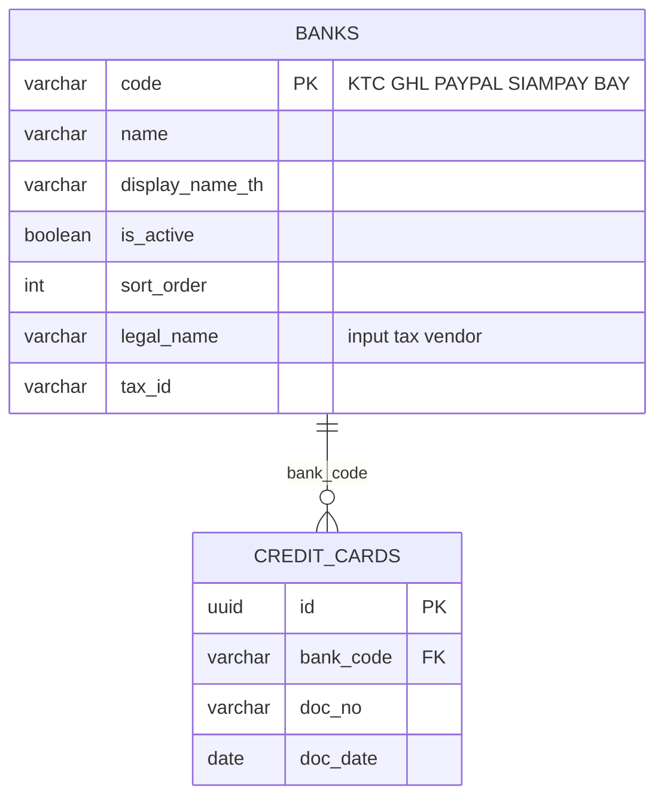
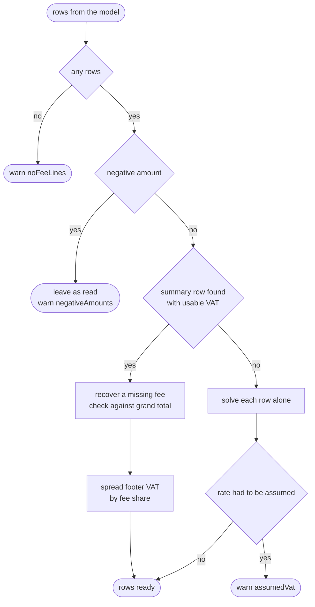

**ขอบเขตของ CR นี้:** FRD-01 อธิบายการอ่าน statement ค่าธรรมเนียมบัตรจากธนาคาร (BBL, KBANK, SCB) CR นี้เพิ่มเอกสารอีก 5 รูปแบบที่ส่งมอบพร้อมกันใน CA-4 คือใบแจ้งค่าธรรมเนียมของ payment gateway / card processor 4 ราย (KTC, GHL, PayPal, SiamPay) และ statement ของธนาคารกรุงศรี (BAY) ทุกอย่างหลังจากอ่านเอกสาร (GL mapping, การ post JV, ภาษีซื้อ, คิวตรวจ) ใช้ระบบเดิมของ FRD-01, FRD-09 และ FRD-12

## Document Revision History

| Version | Date | Author | Description of Changes | Approved By |
|---|---|---|---|---|
| 1.0 | 27/10/2026 | Dev Team | ฉบับแรก — เขียนจากโค้ดที่ merge เข้า main แล้ว ครอบคลุม layout 5 แบบ, การกระจาย VAT จากท้ายใบ, การตรวจกับยอดรวมที่พิมพ์, การตรวจจับผู้ออกเอกสาร, รูปแบบวันที่ไทย, JV source และ QA matrix | รอ Lead Dev |

<!-- pagebreak -->

# 1. Executive Summary & Objective

โรงแรมที่รับชำระผ่าน payment gateway (เช่น ชำระออนไลน์ผ่าน PayPal หรือ SiamPay) ได้รับใบแจ้งค่าธรรมเนียมจากผู้ให้บริการรายเดือน เอกสารประเภทนี้ต่างจาก statement ของธนาคาร คือไม่มีตารางแยกตามประเภทบัตร แต่เป็น**รายการค่าธรรมเนียม** (MDR, Processing Fee, Transaction Fee …) และ**พิมพ์ VAT เพียงครั้งเดียวที่ท้ายใบ** CR นี้สอน AI ให้อ่านเอกสารรูปแบบนี้ และเพิ่มขั้นตอนที่ไม่ต้องพึ่ง AI สำหรับแปลงผลการอ่านให้เป็นแถวที่ post เป็น JV ได้

**ปัญหาที่แก้:** ก่อน CR นี้ ระบบรองรับเฉพาะ statement ธนาคารที่แต่ละแถวมี gross / commission / VAT / net ครบ ใบแจ้งค่าธรรมเนียมของ gateway ทำให้แถวรายการไม่มียอดรวม (pay_amt ว่าง) ระบบจึงตัดทิ้งหมด หรือนับแถวยอดรวมท้ายใบซ้ำเป็นรายการ

**หลักการ 4 ข้อ:**

- **VAT อ่านจากเอกสาร ไม่คำนวณจากอัตราที่สมมติ** — ระบบกระจาย VAT ที่พิมพ์ท้ายใบไปยังแต่ละรายการตามสัดส่วนค่าธรรมเนียม ใช้ได้กับทุกอัตรา
- **แถวยอดรวมถูกใช้แล้วทิ้ง ไม่เป็นรายการ** — AI ส่งแถว TOTAL มาเพื่อให้ระบบใช้ ระบบไม่ปล่อยออกไปเป็นบรรทัดของ JV
- **ตรวจกับยอดรวมที่พิมพ์ไว้เสมอ** — Σ ค่าธรรมเนียม + VAT ต้องเท่ากับยอดรวมบนเอกสาร ถ้าไม่เท่าแสดงว่าอ่านตัวเลขผิดหนึ่งบรรทัด ระบบเตือนผู้ตรวจ
- **ชื่อรายการต้องเหมือนเดิมทุกเดือน** — ชื่อรายการเป็น key ของ GL mapping ระบบตัดวันที่ออกจากชื่อ เพื่อให้ mapping ที่บันทึกไว้ใช้กับใบเดือนถัดไปได้

## 1.1 System Context Diagram (ภาพรวมการไหลของข้อมูล)

```mermaid 1.1 | Same pipeline as FRD-01; the new parts are the layouts and the normaliser
flowchart TB
    DOC[Fee invoice or BAY statement<br/>wizard upload or email]
    LLM[Vision LLM<br/>issuer-specific layout]
    DET[Issuer detection<br/>model answer, then keywords]
    NORM[Normaliser<br/>fee invoice or BAY statement]
    JV[GL mapping + JV<br/>source AICC code]
    C[Carmen<br/>gljv + inputTaxRec]
    DOC --> LLM --> DET --> NORM --> JV --> C
```

# 2. Scope of Work

## 2.1 In-Scope (ขอบเขตการทำงานของระบบ)

- **Layout ใหม่ 5 แบบ** ใน `llm/prompts/`: `ktc.py`, `ghl.py`, `paypal.py`, `siampay.py` (fee invoice) และ `bay.py` (statement) ลงทะเบียนใน `_REGISTRY` พร้อมเวอร์ชันใน `_PROMPT_VERSIONS`
- **ข้อมูลธนาคาร/ผู้ให้บริการ** ในตาราง `banks` (migration `20260703000000_add_commission_banks.sql`) และค่าคงที่ฝั่งหน้าจอ (`shared/constants/banks.ts`)
- **การตรวจจับผู้ออกเอกสาร:** ใช้คำตอบของ model ก่อน แล้วจึงใช้ keyword ไทย/อังกฤษบนหัวเอกสาร
- **Normaliser ของ fee invoice:** ใช้แถวยอดรวม, กระจาย VAT, กู้ค่าธรรมเนียมที่ model วางผิดช่อง, ตรวจกับยอดรวม และ fallback เมื่อไม่มีท้ายใบ
- **Normaliser ของ BAY:** ใช้แถว TOTAL ที่มี VAT/NET เพียงแถวเดียว แล้วกระจาย และตรวจผลรวม gross
- **รูปแบบวันที่:** ชื่อเดือนภาษาไทย (เต็มและย่อ) พร้อมปี พ.ศ. และ DD/MM/YY ปี ค.ศ. 2 หลัก (SiamPay)
- **ชื่อรายการคงที่:** ตัดวันที่ออกจากชื่อรายการ และใช้เฉพาะบรรทัดแรก (GHL พิมพ์สามบรรทัดติดกัน)
- **AI GL suggestion กลุ่ม gateway:** บัญชีฝั่ง payment type ของ gateway เป็น "ลูกหนี้จากผู้ให้บริการ (settlement receivable)" ไม่ใช่บัญชีเงินฝาก
- **JV source ต่อผู้ออก:** `AICCKTC`, `AICCGHL`, `AICCPAYPAL`, `AICCSPAY`, `AICCBAY` (CA-110)

## 2.2 Out-of-Scope (สิ่งที่ระบบไม่ทำ และผู้ใช้ต้องทำแทน)

| ไม่ทำ | ผู้ใช้ต้องทำอะไรแทน / อยู่ที่ไหนแทน |
|---|---|
| ใบลดหนี้ / คืนเงิน (ยอดติดลบ) | ระบบแสดงตามที่อ่านได้พร้อมคำเตือน ไม่กระจาย VAT ผู้ตรวจต้องแก้เองก่อน post |
| กระทบยอดเงินที่ gateway โอนเข้าบัญชี (payout) | อยู่นอกขอบเขต — เอกสารนี้บันทึกเฉพาะค่าธรรมเนียมและภาษีซื้อ |
| เพิ่ม gateway รายใหม่โดยไม่ deploy | layout ยังอยู่ในโค้ด (ตาราง `prompt_templates` มีแต่ยังไม่ได้อ่านตอน runtime) ต้องเพิ่มตามขั้นตอน "Adding a New Bank" |
| สกุลเงินต่างประเทศ | JV ลงเป็น THB เสมอ |
| ใบที่มีหลายอัตรา VAT | กระจาย VAT รวมตามสัดส่วนค่าธรรมเนียม ไม่แยกตามอัตรา |

<!-- pagebreak -->

# 3. Feature List & Sub-Modules

<!-- widths: 9,24,37,30 -->
| Feature ID | ชื่อฟีเจอร์ | คำอธิบาย | Source |
|---|---|---|---|
| F-01 | Issuer layouts | คำสั่งต่อผู้ออก: ป้ายหัวเอกสาร → field, กติกาของแถวรายการ และแถว TOTAL | `llm/prompts/{ktc,ghl,paypal,siampay,bay}.py` |
| F-02 | Issuer detection | คำตอบของ model ก่อน แล้ว keyword ไทย/อังกฤษ | `utils/bank_detect.py` (`detect_bank_code`, `FEE_INVOICE_CODES`) |
| F-03 | Fee-invoice normaliser | ใช้แถวยอดรวม กระจาย VAT ตรวจยอด fallback | `credit_card/postprocess.py` `_normalize_fee_invoice()`, `_spread_footer_vat()` |
| F-04 | BAY normaliser | ใช้แถว TOTAL กระจาย VAT/NET ตรวจ gross | `_normalize_bay_statement()` |
| F-05 | Label cleaning | ตัดวันที่และบรรทัดที่สองออกจากชื่อรายการ | `postprocess.py` (`_DATE_IN_LABEL`) |
| F-06 | Thai date parsing | ชื่อเดือนไทย, ปี พ.ศ., ปี 2 หลัก | `utils/date_parsing.py` |
| F-07 | Gateway GL framing | กรอบคำแนะนำบัญชีของกลุ่ม gateway | `credit_suggest_group()` + `_CREDIT_CONTEXTS` ใน `llm/prompts/mapping.py` |
| F-08 | JV source | รหัส source ของ JV ต่อผู้ออก | `BANK_SOURCE_MAP` (`shared/constants/banks.ts` และฝั่ง backend ใน `credit_card/jv.py`) |
| F-09 | Extraction warnings | คำเตือนเป็น code แล้วหน้าจอแปลเป็น EN/TH | `ExtractionWarning` + `i18n/dict/warn.ts` |

# 4. UI Specs & Field Mapping

หน้าจอไม่มีส่วนใหม่ ผู้ใช้เลือกผู้ออกจาก dropdown เดิมของ wizard (หรือปล่อยให้ระบบตรวจจับ) และตรวจผลในตารางเดิม ส่วนที่ต่างคือความหมายของคอลัมน์สำหรับ fee invoice

## 4.1 ผู้ออกเอกสารที่เพิ่ม

<!-- widths: 12,30,12,20,26 -->
| Code | ผู้ออก | ประเภท | JV Source | Keyword ที่ใช้ตรวจจับ |
|---|---|---|---|---|
| KTC | Krungthai Card (บัตรกรุงไทย) | Fee invoice | `AICCKTC` | บัตรกรุงไทย / KRUNGTHAI CARD |
| GHL | GHL (NTT DATA Payment) | Fee invoice | `AICCGHL` | เอ็นทีที เดต้า / NTT DATA / GHL |
| PAYPAL | PayPal Thailand | Fee invoice | `AICCPAYPAL` | เพย์พาล / PAYPAL |
| SIAMPAY | SiamPay (Asia Pay Thailand) | Fee invoice | `AICCSPAY` | สยามเพย์ / ASIA PAY / SIAMPAY |
| BAY | ธนาคารกรุงศรีอยุธยา | Bank statement | `AICCBAY` | กรุงศรี / KRUNGSRI / BANK OF AYUDHYA |

## 4.2 หัวเอกสาร — ป้ายบนเอกสาร → field

<!-- widths: 12,22,22,22,22 -->
| Code | doc_no | doc_date | ชื่อลูกค้า (company_name) | merchant_id / branch_no |
|---|---|---|---|---|
| KTC | เลขที่/NO. | วันที่/ISSUE DATE (เดือนไทย + พ.ศ.) | ชื่อร้านค้า/MERCHANT NAME | merchant_id ว่างเสมอ / สาขาในส่วนร้านค้า |
| GHL | เลขที่/No | วันที่/Date (เดือนไทย + พ.ศ.) | ลูกค้า/Customer | merchant_id ว่างเสมอ / รหัสข้างคำว่าสำนักงานใหญ่ |
| PAYPAL | เลขที่/Document No. | วันที่/Document Date | ชื่อ/ที่อยู่ลูกค้า Buyer Name | รหัสลูกค้า/Customer ID / branch ว่างเสมอ |
| SIAMPAY | Receipt No. | Date (DD/MM/YY ค.ศ.) | Customer | merchant_id ว่างเสมอ / branch ว่างเสมอ |
| BAY | เลขที่ | วันที่ | ชื่อผู้รับบริการ | หมายเลขร้านค้า / branch ว่างเสมอ (ไม่ใช้ "สาขาที่") |

## 4.3 บรรทัดรายการของ fee invoice (หลัง normalise)

<!-- widths: 18,42,40 -->
| Field | ความหมายใน fee invoice | ที่มา |
|---|---|---|
| `transaction` | ชื่อรายการค่าธรรมเนียม เช่น "SiamPay Service - Processing Fee" — ใช้เป็น key ของ GL mapping | บรรทัดแรกของคำอธิบาย ตัดวันที่ออก |
| `commis_amt` | ค่าธรรมเนียมของบรรทัดนั้นก่อน VAT | อ่านจากเอกสาร |
| `tax_amt` | ส่วนแบ่ง VAT ของบรรทัดนั้น | คำนวณ: VAT ท้ายใบ × ค่าธรรมเนียมบรรทัด ÷ Σ ค่าธรรมเนียม (บรรทัดสุดท้ายรับเศษ) |
| `pay_amt` | ค่าธรรมเนียม + VAT ของบรรทัดนั้น — ยอดที่ลงฝั่ง Credit ของ JV | คำนวณ |
| `total` | 0 เสมอ (ไม่มีเงินเข้าบัญชีธนาคารในเอกสารนี้) | ค่าคงที่ |

## 4.4 BAY statement — คอลัมน์ → field

| คอลัมน์บนเอกสาร | Field | หมายเหตุ |
|---|---|---|
| CARD | `transaction` | ประเภทบัตร (VISA, MSC, JCB, UPI …) |
| T-X | — | จำนวนรายการ ไม่ใช่ยอดเงิน และไม่ใช่แถว |
| GROSS AMT | `pay_amt` | |
| DISC AMT | `commis_amt` | |
| TAX AMT | — | ภาษีหัก ณ ที่จ่าย — ไม่ใช้ |
| VAT AMT / NET AMT | `tax_amt` / `total` | มักว่างในแต่ละแถว มีเฉพาะแถว TOTAL → normaliser กระจาย |

# 5. Action Buttons & Business Logic

ไม่มีปุ่มใหม่ กติกาทางธุรกิจที่ CR นี้เพิ่มอยู่ใน normaliser ซึ่งทำงานหลัง AI อ่านเสร็จ ทั้งในเส้นทาง wizard และอีเมล (`credit_card/extraction.py`)

| ขั้น | กติกา |
|---|---|
| 1. เลือก normaliser | settlement report → ตัวของ AR / ผู้ออกอยู่ใน `FEE_INVOICE_CODES` → fee invoice / BAY → BAY statement / อื่นๆ → ตัดแถวสรุปและแถวภาษีหัก ณ ที่จ่ายออก |
| 2. แยกแถวยอดรวม | แถวที่ป้ายเป็นยอดรวม (TOTAL, รวม, Subtotal, VAT, Grand Total …) แยกออกจากรายการ ถ้าไม่มีป้าย ใช้แถวที่ค่าธรรมเนียมเท่ากับผลรวมของแถวอื่น (และมากกว่าแถวใดแถวหนึ่ง) |
| 3. อ่านท้ายใบ | อ่าน VAT, Subtotal และ Grand Total ตามป้ายของแต่ละบรรทัดท้ายใบ ถ้าไม่มี VAT ให้ใช้ Grand − Subtotal |
| 4. กู้ค่าธรรมเนียม | ถ้ามีรายการเดียวและ model ไม่ได้ใส่ค่าธรรมเนียม ใช้ Subtotal (หรือ Grand − VAT) แทน ถ้ายังไม่ได้ เตือน "fee unreadable" |
| 5. ตรวจยอด | Σ ค่าธรรมเนียม + VAT ต้องเท่ากับ Grand Total (หรือ Σ ค่าธรรมเนียมเท่ากับ Subtotal) คลาดได้ไม่เกิน 0.02 — ไม่เท่าเตือน "reconMismatch" |
| 6. กระจาย VAT | ตามสัดส่วนค่าธรรมเนียม บรรทัดสุดท้ายรับเศษ ถ้าทุกบรรทัดไม่มีค่าธรรมเนียม แบ่งเท่ากันและเตือน |
| 7. Fallback | ไม่มีท้ายใบที่ใช้ได้ → แก้ทีละบรรทัดจากตัวเลขที่มี ถ้าต้องเดาอัตรา ใช้อัตราแรกของ `VAT_RATES` (7%) และเตือน "assumedVat" |
| 8. ทำความสะอาดชื่อ | ใช้บรรทัดแรกของชื่อรายการและตัดวันที่ออก ตัวเลขอื่นคงไว้ (เช่น `04-4100-03` กับ `04-4100-04` เป็นคนละบัญชี) |

<!-- pagebreak -->

# 6. Database Schema & Tables

ไม่มีตารางหรือคอลัมน์ใหม่ CR นี้เพิ่มแถวในตาราง `banks` 5 แถว ผลการอ่านใช้ `ocr_tasks` และ `credit_cards` เดิม (`credit_cards.bank_code` อ้างถึง `banks.code`)

| code | name | sort_order |
|---|---|---|
| BAY | Bank of Ayudhya (Krungsri) | 4 |
| KTC | Krungthai Card | 5 |
| GHL | GHL (NTT DATA Payment) | 6 |
| PAYPAL | PayPal Thailand | 7 |
| SIAMPAY | SiamPay (Asia Pay Thailand) | 8 |

คอลัมน์ `legal_name`, `tax_id`, `address` ของแถวเหล่านี้คือผู้ขายของรายการภาษีซื้อ (FRD-09) ถ้าว่าง ภาษีซื้อจะไม่ถูกยื่นอัตโนมัติ



# 7. Required Data Tables (External Integrations)

| ปลายทาง | ใช้ทำอะไร |
|---|---|
| Vision LLM (OpenRouter, `OPENROUTER_OCR_MODEL`) | อ่านเอกสาร 1 ครั้งต่อไฟล์ ด้วย layout ของผู้ออก (หรือ combined prompt เมื่อยังไม่รู้ผู้ออก) — ส่ง `data_collection: deny` ทุกครั้งเหมือนเดิม |
| Carmen `POST /gljv` | JV ใช้ `JvhSource` ตามผู้ออก (§4.1) |
| Carmen `POST /inputTaxRec` | ภาษีซื้อของค่าธรรมเนียม (FRD-09) |

# 8. Workflow & End-to-End Walkthrough

## 8.1 Sequence — จากไฟล์ถึงแถวที่ post ได้

```mermaid 8.1 | The model reads; deterministic code makes the rows postable
sequenceDiagram
    autonumber
    participant U as Wizard or email
    participant X as extract
    participant LLM as Vision LLM
    participant N as Normaliser
    U->>X: file (+ bank code if chosen)
    X->>LLM: issuer layout prompt
    LLM-->>X: header + fee lines + TOTAL row
    X->>X: detect issuer (model answer, keywords)
    X->>N: _normalize_fee_invoice
    N->>N: drop TOTAL, read footer, spread VAT
    N->>N: reconcile with printed grand total
    N-->>U: rows + warnings
```

## 8.2 Gate — การตัดสินใจของ fee-invoice normaliser



## 8.3 ตัวอย่างการคำนวณ — SiamPay สองรายการ

| บนเอกสาร | ค่า |
|---|---|
| Processing Fee | 1,000.00 |
| Transaction Fee | 500.00 |
| Subtotal / VAT 7% / Total | 1,500.00 / 105.00 / 1,605.00 |

| หลัง normalise | commis_amt | tax_amt | pay_amt | total |
|---|---|---|---|---|
| SiamPay Service - Processing Fee | 1,000.00 | 70.00 | 1,070.00 | 0 |
| SiamPay Service - Transaction Fee | 500.00 | 35.00 | 535.00 | 0 |

| JV ที่ได้ | Dr | Cr |
|---|---|---|
| Processing Fee → บัญชีลูกหนี้ของ SiamPay (ตาม GL mapping) | | 1,070.00 |
| Transaction Fee → บัญชีลูกหนี้ของ SiamPay | | 535.00 |
| Credit card commission | 1,500.00 | |
| Input Tax | 105.00 | |
| Bank Account | 0.00 | |
| **รวม** | **1,605.00** | **1,605.00** |

## 8.4 User Operational Workflow

- **Wizard:** อัปโหลดใบแจ้งค่าธรรมเนียม เลือกผู้ออกจาก dropdown หรือปล่อยให้ระบบตรวจจับ → ตรวจตาราง ถ้ามีแถบคำเตือน (เช่น ยอดไม่ตรงกับยอดรวมที่พิมพ์) ให้เทียบกับเอกสารจริง → ทำขั้นตอนต่อตาม FRD-01
- **อีเมล:** ตั้ง rule ของผู้ออกในหน้า settings (bank code, ผู้ส่ง, รูปแบบชื่อไฟล์, รหัส PDF) เอกสารจะมาที่คิวตาม FRD-12
- **เดือนแรกของผู้ออกใหม่:** ชื่อรายการแต่ละชื่อยังไม่มี GL mapping AI จะแนะนำบัญชีลูกหนี้ของผู้ให้บริการ ผู้ตรวจยืนยันครั้งเดียว เดือนถัดไปใช้ mapping เดิมได้เพราะชื่อรายการไม่มีวันที่ติดมาแล้ว

# 9. Error Handling & Edge Cases Matrix

<!-- widths: 8,32,34,26 -->
| Case ID | Scenario | ระบบทำอะไร | คำเตือน (code) |
|---|---|---|---|
| EC-01 | ใบมีรายการเดียว (KTC ส่วนใหญ่) | ใช้แถว TOTAL แล้วใส่ VAT ทั้งหมดให้รายการนั้น | — |
| EC-02 | ใบมีหลายรายการ (SiamPay) | กระจาย VAT ตามสัดส่วน บรรทัดสุดท้ายรับเศษ | — |
| EC-03 | ท้ายใบพิมพ์หลายบรรทัด (KTC: รวม และ จำนวนเงินรวม) | อ่านทุกบรรทัดตามป้าย ไม่มีบรรทัดใดหลุดเป็นรายการ | — |
| EC-04 | model ใส่ VAT ไว้ในช่องค่าธรรมเนียมของรายการเดียว | กู้ค่าธรรมเนียมจาก Subtotal หรือ Grand − VAT | `feeUnreadable` ถ้ากู้ไม่ได้ |
| EC-05 | Σ ค่าธรรมเนียม + VAT ไม่เท่ายอดรวมที่พิมพ์ | ยังสร้างแถวได้ แต่เตือน — เอกสารอีเมลจะมี flag `warnings` และไม่ auto-post | `reconMismatch` |
| EC-06 | GHL: ป้าย Grand Total ชี้ไปที่ยอดก่อน VAT (คอลัมน์สลับ) | ยอมรับเมื่อตรงกับยอดก่อน VAT หรือยอดรวม อย่างใดอย่างหนึ่ง | เฉพาะเมื่อไม่ตรงทั้งสอง |
| EC-07 | ไม่มีท้ายใบที่ใช้ได้ | แก้ทีละบรรทัด ถ้าต้องเดาอัตรา ใช้ 7% | `assumedVat` |
| EC-08 | ยอดติดลบ (คืนเงิน) | ไม่กระจาย แสดงตามที่อ่านได้ | `negativeAmounts` |
| EC-09 | ไม่พบรายการเลย | ตารางว่าง | `noFeeLines` |
| EC-10 | บางบรรทัดไม่มีค่าธรรมเนียม | บรรทัดนั้นได้ VAT 0 (หรือแบ่งเท่ากันถ้าทุกบรรทัดว่าง) | `vatUnallocated` |
| EC-11 | ชื่อรายการมีวันที่ (GHL "TRANSACTION FEE 30-05-2026 …") | ตัดวันที่และบรรทัดถัดไปออก ชื่อเหมือนเดิมทุกเดือน | — |
| EC-12 | วันที่ "01 พฤษภาคม 2569" (KTC/GHL) | แปลงเป็น 01/05/2569 | — |
| EC-13 | วันที่ "27/05/26" (SiamPay) | อ่านเป็นปี ค.ศ. 2026 | — |
| EC-14 | ชื่อโรงแรมมีคำว่า "กรุงเทพ" (keyword ของ BBL) | คำตอบของ model มาก่อน keyword และผู้ออกที่ผู้ใช้เลือกมาก่อนการตรวจจับ — ใบของ KTC จึงไม่ถูกส่งไปทางของ statement | — |
| EC-15 | BAY: แถวรายการไม่มี VAT/NET | ใช้แถว TOTAL แล้วกระจาย และตรวจ gross กับผลรวมแถว | `reconMismatch` ถ้าไม่ตรง |

# 10. Non-Functional & Technical Requirements

## 10.1 ความถูกต้อง

- การกระจาย VAT ไม่ขึ้นกับอัตรา: VAT มาจากเอกสาร อัตราที่ตั้งไว้ใน `VAT_RATES` (ค่าเริ่มต้น 0.07,0.10) ใช้เฉพาะตอนที่ต้องสร้างตัวเลขที่หายไป
- ทุกแถวของ JV สอดคล้องกัน (pay = commission + tax + net) ผลรวม Dr จึงเท่ากับ Cr เสมอ
- normaliser เป็นโค้ดที่ไม่ใช้ AI ผลเดิมทุกครั้งสำหรับข้อมูลเดิม และมี test บนตัวเลขจริง (SiamPay 2 รายการ, KTC 1 รายการ, VAT 10%, VAT ที่ต้องคำนวณเมื่อว่าง, ป้ายที่อ่านเพี้ยน)

## 10.2 การติดตามเวอร์ชันของ prompt

ทุก layout มีเวอร์ชันใน `_PROMPT_VERSIONS` (ปัจจุบัน KTC/GHL/PAYPAL/SIAMPAY 1.6.0, BAY 1.5.0) แสดงผ่าน `/api/version` เมื่อแก้ข้อความกลางที่ทุก layout ใช้ร่วมกัน ทุกเวอร์ชันต้องขยับ

## 10.3 Security & Privacy

เหมือน FRD-01: ไม่เก็บไฟล์, ส่ง `data_collection: deny` ทุกครั้งที่เรียก OpenRouter และไม่มีข้อมูลบัตรรายตัวบนเอกสารประเภทนี้

## 10.4 ต้นทุน

คิด 1 เครดิตต่อไฟล์เหมือน statement ธนาคาร (FRD-01) normaliser ไม่เรียก LLM เพิ่ม

# 11. Developer Checklist & Acceptance Criteria

## 11.1 Developer Checklist

| สถานะ | รายการ |
|---|---|
| เสร็จ | Layout 5 แบบ ลงทะเบียนใน `_REGISTRY` และ `_PROMPT_VERSIONS` (CA-68) |
| เสร็จ | อ่านเดือนภาษาไทยและปี 2 หลัก (CA-69) |
| เสร็จ | ตรวจจับผู้ออกฝั่ง backend และหน้าจอใช้ตาราง keyword ชุดเดียวกัน (CA-70) |
| เสร็จ | Seed ตาราง `banks` (CA-71) |
| เสร็จ | ค่าคงที่และหน้าจอ: dropdown, `BANK_SOURCE_MAP` (CA-72, CA-110) |
| เสร็จ | ทดสอบกับเอกสารจริง (CA-73) |
| เสร็จ | Fee-invoice normaliser: แถวยอดรวม, กระจาย VAT, ตรวจยอด, fallback |
| เสร็จ | ตัดวันที่ออกจากชื่อรายการ |
| เสร็จ | กรอบ AI suggestion กลุ่ม gateway |

## 11.2 Acceptance Criteria

- ใบแจ้งค่าธรรมเนียมของผู้ออกทั้ง 4 รายอ่านได้เป็นรายการค่าธรรมเนียม ไม่มีแถวยอดรวมหลุดเป็นรายการ
- VAT ของรายการรวมกันเท่ากับ VAT ที่พิมพ์ท้ายใบพอดี
- เอกสารที่ตัวเลขไม่ตรงกับยอดรวมที่พิมพ์ แสดงคำเตือนพร้อมผลต่าง
- JV ของเอกสารเหล่านี้ balance และใช้ JV source ของผู้ออก
- ชื่อรายการของใบเดือนถัดไปตรงกับเดือนก่อน mapping ที่บันทึกไว้ใช้ได้ทันที

# 12. API Specifications

ไม่มี endpoint ใหม่ CR นี้ขยายค่าที่ใช้ได้ของ endpoint เดิม

<!-- widths: 9,44,47 -->
| Method | Path | ส่วนที่เปลี่ยน |
|---|---|---|
| POST | `/api/v1/credit-card/extract` | `bank_code` รับ `KTC`, `GHL`, `PAYPAL`, `SIAMPAY`, `BAY` เพิ่ม (ไม่ส่ง = ตรวจจับเอง) ผลลัพธ์มี `warnings` เป็นรายการ `{ code, params }` |
| GET | `/api/v1/carmen/bank-codes` | คืนผู้ออกใหม่ทั้ง 5 สำหรับ rule ของ Email Automation |
| POST | `/api/v1/credit-card/mapping/suggest` | ผู้ออกกลุ่ม gateway ใช้กรอบคำแนะนำ "settlement receivable" |

ตัวอย่างคำเตือนในผลลัพธ์ของ `/extract`:

```
"warnings": [
  { "code": "reconMismatch", "params": { "lines": "1,605.00", "printed": "1,650.00", "gap": "45.00" } }
]
```

Status codes เหมือน FRD-01 (400 ไฟล์ผิดประเภทหรือ PDF ติดรหัส, 402 เครดิตหมด, 403 module ปิด, 413 ไฟล์ใหญ่เกิน, 422 อ่านไม่ได้)

<!-- pagebreak -->

# 13. Test Cases & QA Matrix

## 13.1 Category 1: การอ่านและตรวจจับผู้ออก

| Test Case ID | Scenario & Pre-conditions | Test Steps | Expected Result | Pass Criteria |
|---|---|---|---|---|
| TC-PG-01 | ใบ KTC รายการเดียว | อัปโหลดโดยไม่เลือกผู้ออก | ตรวจจับเป็น KTC, 1 รายการ, VAT เท่าท้ายใบ | JV source `AICCKTC` |
| TC-PG-02 | ใบ GHL | อัปโหลด | ชื่อรายการไม่มีวันที่, merchant_id ว่าง | ไม่มีคำเตือน reconMismatch ปลอม |
| TC-PG-03 | ใบ PayPal | อัปโหลด | merchant_id = Customer ID | — |
| TC-PG-04 | ใบ SiamPay 2 รายการ | อัปโหลด | ตาม §8.3 | VAT 70.00 + 35.00 = 105.00 |
| TC-PG-05 | statement BAY | อัปโหลด | แถว TOTAL ถูกใช้แล้วทิ้ง VAT/NET ถูกกระจาย | ผลรวม gross ตรงกับ TOTAL |
| TC-PG-06 | โรงแรมชื่อมีคำว่า "กรุงเทพ" ส่งใบ KTC | อัปโหลดโดยไม่เลือกผู้ออก | ตรวจจับเป็น KTC ไม่ใช่ BBL | ไม่มีรายการถูกตัดทิ้ง |

## 13.2 Category 2: Normaliser

| Test Case ID | Scenario & Pre-conditions | Test Steps | Expected Result | Pass Criteria |
|---|---|---|---|---|
| TC-PG-10 | VAT 10% | ใบที่ท้ายใบพิมพ์ VAT 10% | กระจายตามที่พิมพ์ | ไม่ใช้ 7% |
| TC-PG-11 | ไม่มีท้ายใบ | ใบที่ model ไม่ส่งแถว TOTAL | แก้ทีละบรรทัด | คำเตือน `assumedVat` |
| TC-PG-12 | อ่านค่าธรรมเนียมผิดหนึ่งบรรทัด | แก้ตัวเลขให้ผิด 45.00 | คำเตือน reconMismatch ผลต่าง 45.00 | เอกสารอีเมลไม่ auto-post |
| TC-PG-13 | ใบคืนเงิน | ใบที่มียอดติดลบ | แสดงตามที่อ่าน | คำเตือน `negativeAmounts` |
| TC-PG-14 | วันที่เดือนไทย | "01 พฤษภาคม 2569" | 01/05/2569 | งวดภาษีเป็น 2026-05 |
| TC-PG-15 | วันที่ปี 2 หลัก | "27/05/26" | 27/05/2026 | — |

## 13.3 Category 3: JV และ mapping

| Test Case ID | Scenario & Pre-conditions | Test Steps | Expected Result | Pass Criteria |
|---|---|---|---|---|
| TC-PG-20 | JV ของ SiamPay | post เอกสาร §8.3 | Dr 1,605.00 = Cr 1,605.00 | Carmen รับ JV |
| TC-PG-21 | รายการใหม่ยังไม่มี mapping | ขอ AI suggestion | บัญชีที่แนะนำเป็นลูกหนี้ผู้ให้บริการ ไม่ใช่บัญชีเงินฝาก | — |
| TC-PG-22 | เดือนถัดไป | อัปโหลดใบเดือนถัดไปของผู้ออกเดิม | ชื่อรายการตรงกับ mapping เดิม | ไม่ต้องให้ AI แนะนำซ้ำ |
| TC-PG-23 | ภาษีซื้อ | post JV แล้วยื่นภาษีซื้อ | ผู้ขายคือผู้ให้บริการ (ตาราง `banks`) | ตาม FRD-09 |
