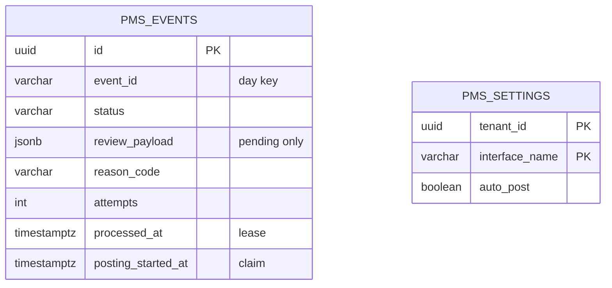
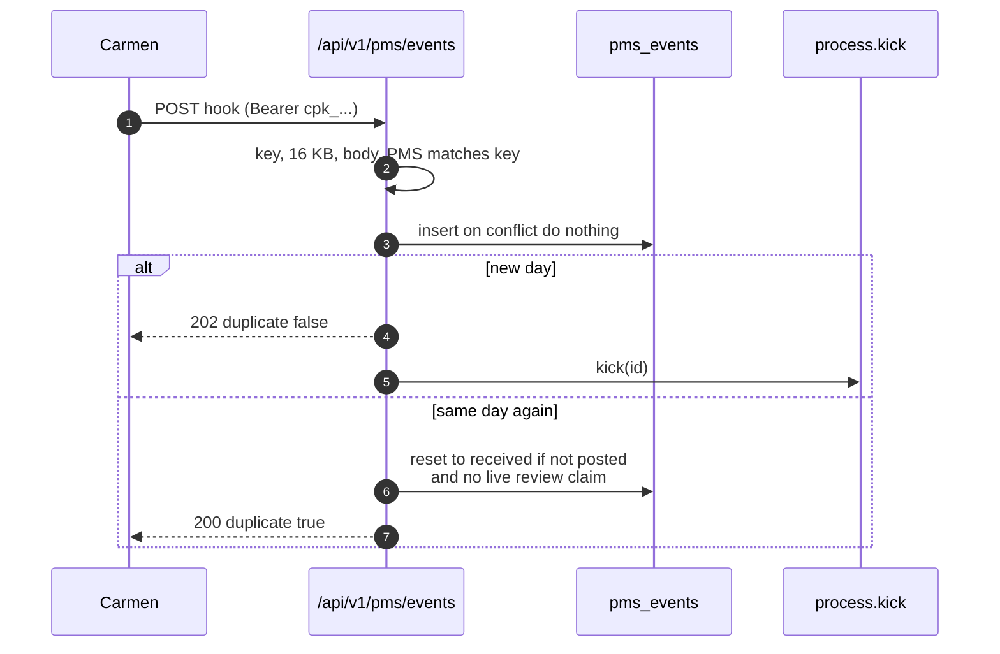
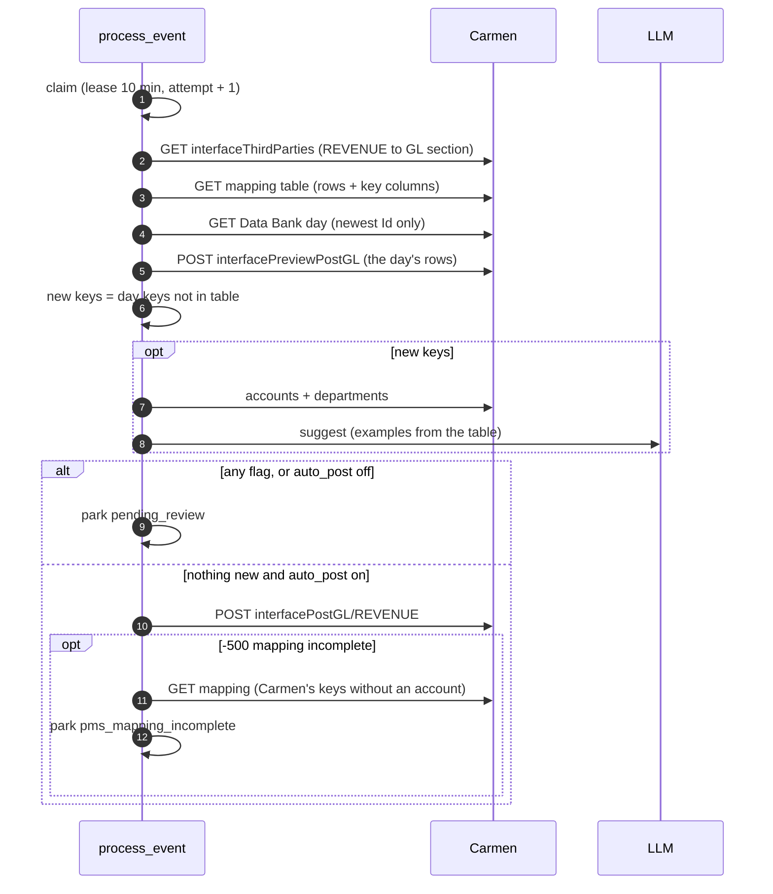
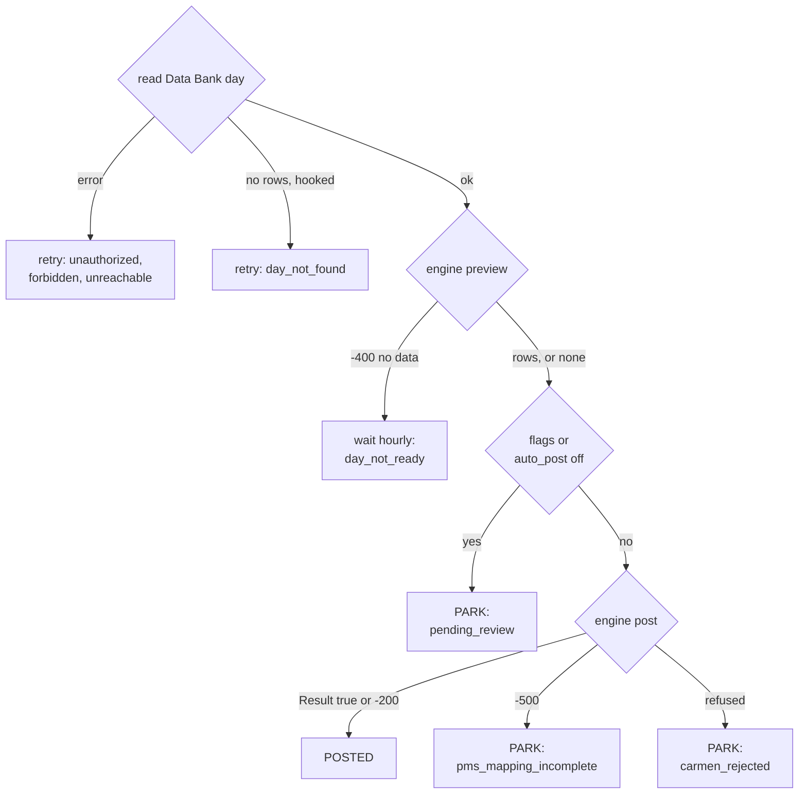
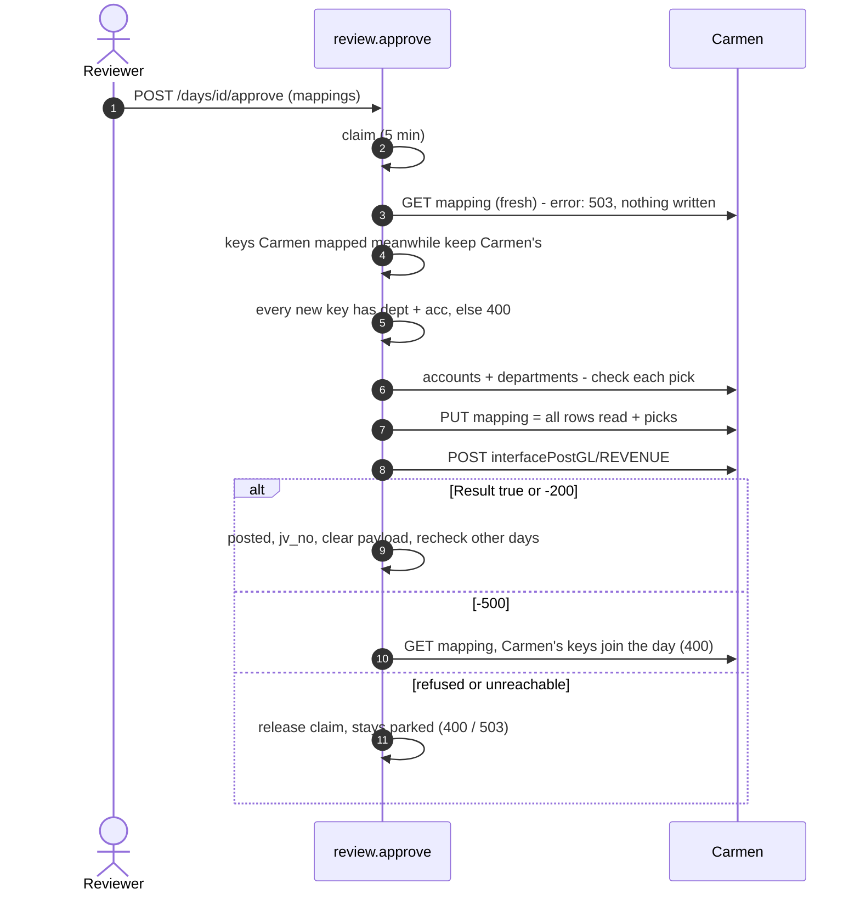
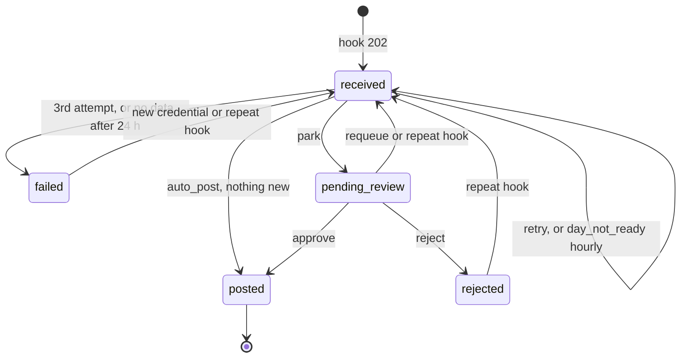

**ความสัมพันธ์กับเอกสารอื่น:** วันของ PMS เป็นแหล่งที่สามของคิว AI JV Automation การแสดงในคิว chip และ reason ใช้กติกาของ FRD-12 เอกสารนี้อธิบายตั้งแต่ Carmen ส่ง hook จนถึงตอนที่ engine ของ Carmen post วันนั้น สัญญาที่ส่งให้ทีม Carmen อยู่ใน `docs/PMS_INTEGRATION.md` และเอกสารเชิงลึกของทีมพัฒนาอยู่ใน `docs/pms-interface/`

## Document Revision History

| Version | Date | Author | Description of Changes | Approved By |
|---|---|---|---|---|
| 1.0 | 27/10/2026 | Dev Team | ฉบับแรก — เขียนจากโค้ดที่ merge เข้า main แล้ว (path B ตาม decision-log #43 และหน้าตั้งค่าของ Carmen ตาม #44, #45) ครอบคลุม hook, การอ่านวันจาก Data Bank, AI แนะนำบัญชีเฉพาะแถวใหม่, การอนุมัติที่เขียน mapping table ของ Carmen แล้วให้ engine ของ Carmen post และสิ่งที่ยังรอจาก Carmen | Reviewed |
| 1.1 | 28/10/2026 | Dev Team | Dialog ตรวจเหลือตารางเดียวแบบหน้า mapping ของ Carmen (Code, Description, DeptCode, AccCode, AccDesc): แถวใหม่อยู่บน แถวที่ map แล้วอ่านอย่างเดียว ไม่แสดงยอด ตัดช่องติ๊ก Checked, ป้าย Unsure, เหตุผลของ AI และหมายเหตุที่บอกชื่อ PMS setting ของ Carmen — กด Approve ได้เมื่อแถวใหม่ทุกแถวมีบัญชี (decision-log #47) | |
| 1.2 | 02/11/2026 | Dev Team | ตรวจกับโค้ด ณ `2be6d7c9` แล้วแก้: ข้อยกเว้นของ #45 — ถ้ามีวันที่ค้างที่ `carmen_forbidden` token ใหม่จากหน้าจอ Carmen แทน credential เดิมแม้ยังใช้ได้ (`stopped_by_permission`) (§2.1, §5); ข้อความแถวที่ post แล้วคือ "Reviewed and posted by {name}"; `pms_events.review_payload` ถูกเข้ารหัส (#319) และทุกตารางเปิด RLS (#321) | |
| 1.3 | 04/11/2026 | Dev Team | ตามโค้ด ณ da06eb2f (decision-log #51): ระบบอ่าน `interfaceThirdParties` แทน PMS setting และ INI แล้วหารหัส setting, คอลัมน์ key, รายการของวัน และรูปแบบไฟล์เอง วันไม่หยุดที่ `carmen_config_unreadable` ทุกวันแล้ว · การ post ไม่ส่งบัญชีพัก (engine ของ Carmen ใช้จาก setting ของมันเอง) · เหตุผล `pms_setting_missing` / `unsupported_pms_format` / `unreadable_day` ตามกติกาใหม่ · Comanche.PMS ยังถูก Carmen ปฏิเสธ (ask K) | |
| 1.5 | 12/11/2026 | Dev Team | ตาม decision-log #55: sweep เปิดวันของเมื่อวานให้ทุก PMS ที่ BU มี key และ `interfaceThirdParties` บอกว่าลง REVENUE → GL ไม่ว่า `From` จะเป็นอะไร (เดิมเฉพาะ PartnerApi) และเปิดตั้งแต่ 06:00 ICT (เดิม 08:00) · hook จึงเป็นทางให้วันมาเร็วขึ้น ไม่ใช่ทางเดียว · วันที่ Carmen ยังไม่มีรอ `day_not_ready` ทุกชั่วโมง และเป็น `day_not_found` หลัง 24 ชั่วโมง (§2.1, §3, §8.6) | |
| 1.6 | 12/11/2026 | Dev Team | ตาม decision-log #56: การ revoke key (จากหน้าจอ Carmen หรือ `#/admin/api-keys`) = ปิด PMS นั้นของ BU — ปิดวันที่ยังเปิดอยู่เป็น `rejected` / `pms_switched_off` (ยกเว้นวันที่มีคนกำลัง approve) และปิด auto-post · processing ปิดวันที่ไม่มี key ที่ใช้ได้ก่อนเรียก Carmen และ requeue เลือกเฉพาะ PMS ที่ยังมี key · การแทน key ไม่ใช่การปิด (§2.2, §5, §8.6, §9) | |
| 1.7 | 13/11/2026 | Dev Team | ตาม decision-log #57: คู่แผนก/บัญชีที่แผนกไม่อนุญาตไม่ทิ้งบัญชีแล้ว (ย้ายไปแผนกที่ BU ใช้กับบัญชีนั้น หรือ GEN) · แถวที่ยังว่างถูกถามซ้ำหนึ่งครั้งพร้อมเหตุผล · sweep ถามซ้ำแถวว่างของวันที่รอตรวจชั่วโมงละครั้ง ไม่เกิน 3 ครั้ง (`ai_retries`, `ai_at`) · เฉพาะ PMS ไม่เปลี่ยน UI (§3, §6.2, §7, §8.6, EC-12, EC-13) | |
| 1.8 | 13/11/2026 | Dev Team | ตาม decision-log #58: วันหนึ่งเป็นแถวเดียวไม่ว่าชื่อ PMS จะพิมพ์เล็กใหญ่อย่างไร — `store_day` ไม่ insert เมื่อมีวันนั้นแล้วในตัวพิมพ์ใดก็ตาม และ hook ซ้ำหาแถวด้วย event_id แบบไม่สนตัวพิมพ์ (EC-08, TC-PMS-29, §11.2) | |
| 1.4 | 10/11/2026 | Dev Team | ตาม decision-log #52–#54 และ ask D: การ post ของ Carmen เป็นตัวตรวจ mapping (`-500` → `pms_mapping_incomplete` พร้อม key ที่ Carmen เขียนไว้) ทุก PMS review ได้ แถวของวันมาจาก preview ของ engine (`interfacePreviewPostGL`) แทนการอ่าน FileData เอง (`unreadable_day` และ `unsupported_pms_format` ไม่ถูกเขียนแล้ว) เปิดวันของ PMS แบบ PartnerApi เอง `-400` No Data → `day_not_ready` เก็บเลข JV จาก `Id` ใน `jv_no` AI ไม่เห็นยอดเงินและลองใหม่หนึ่งครั้ง และ `scripts/qa/pms_probe.py` | |

<!-- pagebreak -->

# 1. Executive Summary & Objective

ทุกคืนหลัง night audit ระบบ PMS ของโรงแรม (ปัจจุบันคือ Comanche) เขียนตัวเลขของวันนั้นลง **Data Bank** ของ Carmen Carmen มี engine ที่ post วันหนึ่งเป็น JV หนึ่งใบตาม **PMS setting** ของ BU (layout ของไฟล์, กติกา Dr/Cr, บัญชีพัก) และ **mapping table** (แถวของ PMS → แผนกและบัญชี) แต่ engine จะไม่ post ถ้ามีแถวใดของวันนั้นยังไม่อยู่ใน mapping table และ PMS มีรหัสใหม่เพิ่มขึ้นเรื่อยๆ (outlet ใหม่, แพ็กเกจ, ส่วนลด, ชื่อที่เปลี่ยน) บน dev ตาราง Comanche ของ Carmen ครอบคลุมทุกแถวได้เพียง **1 วันจาก 73 วัน**

**PMS Interface** ทำงานนั้นแทนพนักงานบัญชี: Carmen ส่ง hook บอกวันที่เขียนลง Data Bank (หรือถ้าไม่มี hook ระบบเปิดวันของเมื่อวานเองตอน 06:00) ระบบขอให้ engine ของ Carmen preview วันนั้น (ได้แถวที่ key แบบเดียวกับตอน post) หาแถวที่ mapping table ยังไม่รู้จัก ให้ AI แนะนำบัญชีให้แถวเหล่านั้น แล้ววันนั้นรอในคิวจนกว่าคนจะยืนยันบัญชี เมื่อกด Approve บัญชีถูกเขียนลง mapping table ของ Carmen และ engine ของ Carmen post วันนั้น รหัสที่อนุมัติแล้วอยู่ในตารางของ Carmen สำหรับทุกวันถัดไป หลังสัปดาห์แรกๆ วันส่วนใหญ่จึงไม่ต้องมีคนแตะ

**หลักการ 6 ข้อ:**

- **ไม่มีกติกาบัญชีของเราเอง** (decision-log #43) — Dr/Cr, ยอดรวม, บรรทัดบัญชีพัก และ prefix ของ JV มาจาก PMS setting ของ Carmen ทั้งหมด ระบบไม่อ่าน setting เลย (menu token อ่านไม่ได้, #51) สิ่งที่ต้องรู้มาจากรายการ interface ของ BU, mapping table และ preview ของ engine
- **ทุก PMS review ได้** (decision-log #53, #54) — engine ของ Carmen อ่านวันตาม INI ของ PMS นั้นแล้วตอบผ่าน preview ระบบจึงไม่มีโค้ดเฉพาะ PMS ใด และไม่อ่านข้อมูลดิบของวัน
- **AI ทำงานเฉพาะแถวใหม่** — แถวที่ Carmen map ไว้แล้วไม่ผ่าน AI ไม่ผ่านคน
- **การกด Approve คือการยืนยันคำแนะนำของ AI** (decision-log #47) — ไม่มีช่องติ๊กแยก บัญชีที่ AI เลือกมีป้าย **AI** จนกว่าคนจะเปลี่ยน เพราะบัญชีนั้นจะไปอยู่ในตารางของ Carmen ถาวร
- **ไม่เขียนตารางของ Carmen แบบไม่ดู** — PUT ของ Carmen แทนที่ทั้งตาราง ระบบอ่านตารางสดทุกครั้งก่อนเขียน
- **ไม่คิดเครดิต** — BU จ่ายค่า interface แยกต่างหาก

## 1.1 System Context Diagram (ภาพรวมการไหลของข้อมูล)

```mermaid 1.1 | Carmen holds the data, the rules and the mapping; we find the gaps
flowchart TB
    PMS[Hotel PMS<br/>Comanche, HotelTime, Cloudbeds] -->|night audit| DB[Carmen Data Bank]
    DB -->|hook: InterfaceName, DocType, DocDate| API[OCR API<br/>/api/v1/pms/events]
    CRON[pg_cron sweep<br/>from 06:00 ICT] -->|yesterday, every PMS with a key| PROC
    API --> PROC[Process the day<br/>interface list, mapping, preview]
    PROC -->|new rows only| LLM[Text LLM<br/>suggest accounts]
    PROC --> Q[AI JV Automation queue<br/>#/CreditCardOCR]
    Q -->|Approve| MAP[Carmen mapping table<br/>PUT whole table]
    MAP --> ENG[Carmen engine<br/>interfacePostGL/REVENUE]
    SET[Carmen PMS setting screen] -->|key, auto-post| API2[OCR API<br/>/api/v1/carmen/pms]
```

# 2. Scope of Work

## 2.1 In-Scope (ขอบเขตการทำงานของระบบ)

- **รับ hook ของ Carmen** `{InterfaceType, InterfaceName, DocType, DocDate}` ที่ `POST /api/v1/pms/events` ยืนยันตัวตนด้วย API key ของ BU × PMS นั้น เก็บเป็นหนึ่งแถวต่อ BU × วัน ตอบทันทีโดยไม่รอการประมวลผล
- **Settings API สำหรับหน้า PMS setting ของ Carmen** (decision-log #44): อ่าน/ตั้ง auto-post, ออก key ใหม่ และเพิกถอน key ต่อ BU × PMS ทุกการเขียนจาก Carmen เก็บ token ของผู้ใช้เป็น credential ของ BU (ยกเว้นเมื่อ BU มี credential ที่ยังใช้ได้อยู่แล้ว ตาม #45 — **แต่ถ้ามีวันของ BU ที่ค้างที่ `carmen_forbidden` token ใหม่แทนที่เสมอ** เพราะ credential เดิมพิสูจน์แล้วว่าไม่มีสิทธิ์พอสำหรับงาน PMS และการแก้ของสาเหตุนี้คือให้ผู้ใช้ที่มีสิทธิ์กดบันทึกหน้า PMS setting)
- **ประมวลผลหนึ่งวัน:** หา section REVENUE ของ PMS ใน `interfaceThirdParties`, อ่าน mapping table (คอลัมน์ key), หา id ของแถว Data Bank ล่าสุด, ขอ preview ของ engine (แถวของวัน), หาแถวใหม่, ให้ AI แนะนำบัญชี แล้วพักรอคน หรือให้ engine post
- **เมื่อ engine ตอบ `-500`** (decision-log #52, #53): แถวที่ Carmen เขียนลงตารางโดยยังไม่มีบัญชีเข้ามาในการตรวจพร้อมคำแนะนำของ AI แล้ววันพักเป็น `pms_mapping_incomplete`
- **เปิดวันของเมื่อวานเองให้ทุก PMS** (decision-log #52, #55): ตั้งแต่ 06:00 ICT sweep เปิดวันของเมื่อวานให้ BU × PMS ที่มี key ที่ใช้ได้ และ `interfaceThirdParties` บอกว่าลง REVENUE → GL ไม่ว่า `From` จะเป็นอะไร — PMS ที่ Carmen ดึงเอง (`PartnerApi`) ไม่มี hook เลย ส่วน PMS อื่น hook แค่ทำให้วันมาเร็วขึ้น
- **ลองใหม่อัตโนมัติ** สำหรับสาเหตุที่อาจหายเอง (ยังไม่มี credential, Carmen ล่ม, Data Bank ยังไม่มีวันนั้น) สูงสุด 3 ครั้ง และปลุกวันที่รอเมื่อมี credential ใหม่ — วันที่ Carmen ตอบ `-400` "No Data Found" ลองทุกชั่วโมงโดยไม่นับครั้ง จนครบ 24 ชั่วโมง
- **ตรวจในคิว:** หนึ่งแถวต่อวัน และ dialog ตรวจที่ `#/CreditCardOCR/review?pms=<id>`
- **Approve:** อ่านตารางสด ตรวจบัญชีกับผังบัญชี เขียนตารางกลับทั้งตารางพร้อมแถวใหม่ แล้วให้ engine post จากนั้นตรวจวันอื่นที่รออยู่ของ BU เดียวกันอีกรอบ
- **Reject:** เลิกวันนั้นพร้อมเหตุผลแบบไม่บังคับ ถ้า Carmen ส่งวันนั้นมาใหม่ จะถูกอ่านอีกครั้ง
- **Support view:** `#/admin/api-keys` แสดง key ของทุก BU, PMS ของ key และเวลาที่ถูกเรียกล่าสุด — เพิกถอนได้ แต่ออก key ไม่ได้

## 2.2 Out-of-Scope (สิ่งที่ระบบไม่ทำ และผู้ใช้ต้องทำแทน)

| ไม่ทำ | ผู้ใช้ต้องทำอะไรแทน / อยู่ที่ไหนแทน |
|---|---|
| ตัดสิน Dr/Cr, ยอดรวม, บัญชีพัก หรือ prefix ของ JV | อยู่ใน PMS setting ของ Carmen |
| แก้ mapping หลังอนุมัติแล้ว | ใช้หน้าจอ mapping ของ Carmen |
| InterfaceType อื่นที่ไม่ใช่ `PMS` (INV, POS, HRM) | hook ตอบ 422 |
| Section อื่นนอกจาก REVENUE (Statistic, MarketSegment) | ไม่อ่าน |
| อ่าน layout ของ PMS หรือข้อมูลดิบของวัน (FileData) เอง | engine ของ Carmen อ่านตาม INI แล้วตอบผ่าน preview (#54) — layout ใดที่ Carmen อ่านได้ก็ review ได้ |
| ยอดเงิน, Dr/Cr และบรรทัดบัญชีพักในหน้าตรวจ หรือส่งยอดให้ AI | preview ของ Carmen ไม่มียอด — เป็นของ engine |
| เตือน error ของการ post (เช่น DrCr, Balance Account ไม่อยู่ในผัง) ก่อนกด Approve | preview ไม่ตอบ error เหล่านี้ รู้เมื่อ post (07-status ask K, N) — ก่อนเปิดใช้ PMS ใหม่ ทีมรัน `scripts/qa/pms_probe.py` ซึ่งตรวจ Balance Account ได้ |
| เลขใบสำคัญ (JvhNo) บนแถวที่ post แล้ว | engine คืนเฉพาะ seq ของ JV (`Id`) ซึ่งระบบเก็บใน `jv_no` และใช้เปิด JV — ขอ Carmen เพิ่มเลขใบสำคัญ |
| ลบแถว `pms_events` เก่าตามอายุ | ยังไม่ได้กำหนดระยะเวลา |
| ตรวจสุขภาพ token รายวันของ BU ที่ใช้เฉพาะ PMS | พบ token ตายเมื่อวันหนึ่งล้มเหลว |
| Popup ขอความยินยอมเรื่อง AI สำหรับ BU ที่ใช้เฉพาะ PMS | ยอมรับแล้ว (decision-log #44) — ขอให้ Carmen แจ้งบนหน้า PMS setting (ask J) |

<!-- pagebreak -->

# 3. Feature List & Sub-Modules

<!-- widths: 9,22,39,30 -->
| Feature ID | ชื่อฟีเจอร์ | คำอธิบาย | Source |
|---|---|---|---|
| F-01 | Hook receiver | ยืนยัน key, ตรวจ body ≤ 16 KB, ตรวจว่า PMS ตรงกับ key, insert หรือแตะแถวเดิม แล้ว kick | `routers/pms.py` (`POST /events`) |
| F-02 | API keys | ออก (หนึ่ง key ที่ใช้งานได้ต่อ BU × PMS), ยืนยันด้วย sha256, เพิกถอน | `services/shared/api_keys.py` |
| F-03 | Carmen Settings API | GET/PUT settings, POST/DELETE keys สำหรับหน้าจอของ Carmen | `routers/pms_carmen.py` |
| F-04 | Shared credential | credential เดียวของ BU ที่ email automation ใช้ด้วย | `services/email_automation/credential.py` (`adopt_token`, `posting_target`) |
| F-05 | Day processing | gate ladder, park หรือ post, ลองใหม่, ปลุก, เปิดวันของเมื่อวานให้ทุก PMS, นำ key ที่ Carmen ขาดเข้าการตรวจ, ถาม AI ซ้ำให้วันที่ยังมีแถวว่าง (#57) | `services/pms/process.py` (`process_event`, `run_pms_processing`, `post_day`, `with_carmen_keys`) |
| F-06 | Carmen config & preview | section จาก `interfaceThirdParties`, key ของ mapping, แถวของวันจาก preview ของ engine, ตารางที่รวมแล้วสำหรับ PUT | `services/pms/carmen_config.py` (`find_section`, `key_columns`, `preview_rows`, `merged_rows`) + `carmen.preview_pms_gl` |
| F-07 | AI suggestion | หนึ่งคำขอต่อวันที่มีแถวใหม่: key ตามชื่อคอลัมน์ของ PMS นั้น ไม่มียอด ใช้แถวที่ map แล้วเป็นตัวอย่าง ลองใหม่หนึ่งครั้งเมื่อคำตอบใช้ไม่ได้ · คู่แผนก/บัญชีที่แผนกไม่อนุญาตย้ายแผนกแทนการทิ้งบัญชี และถามแถวที่ยังว่างซ้ำหนึ่งครั้ง (#57) | `services/pms/mapping.py` (`suggest`) |
| F-08 | Review | ดู, approve, reject, recheck | `services/pms/review.py` + `/api/v1/pms/days/*` |
| F-09 | Queue rows | วันของ PMS เป็นแถวในคิว | `services/credit_card/activity.py` (`_pms_row`) |
| F-10 | Review dialog | dialog ตรวจของ PMS | `PmsReviewDocument.tsx`, `usePmsReview.ts` |
| F-11 | Admin keys page | รายการ key ทุก BU, เพิกถอน | `#/admin/api-keys` |
| F-12 | PMS probe | ตรวจ PMS ของ BU ก่อนเปิดใช้โดยไม่ post: section, key, Data Bank, preview และ (ด้วย web JWT) Balance Account | `scripts/qa/pms_probe.py` |

# 4. UI Specs & Field Mapping

ระบบไม่มีหน้าตั้งค่า PMS ของตัวเอง หน้า PMS setting ของ Carmen เป็นหน้าเดียว ส่วนหน้าจอของแอปมีแถวในคิวและ dialog ตรวจ

## 4.1 Hook ที่ Carmen ส่งมา

<!-- widths: 20,12,8,38,22 -->
| Field | Type | M/O | ความหมาย | ตัวอย่าง |
|---|---|---|---|---|
| `InterfaceType` | Text | M | ต้องเป็น `PMS` | PMS |
| `InterfaceName` | Text | M | ชื่อ PMS — ต้องตรงกับ PMS ของ key (ไม่สนตัวพิมพ์) | Comanche |
| `DocType` | Text | M | ประเภทเอกสารของ Data Bank | Daily |
| `DocDate` | Text | M | วันที่แบบ ISO — ระบบไม่บันทึกวันที่ที่เดาเอา | 2026-10-07 |

Day key = `PMS/<InterfaceName>/<DocType>/<DocDate>` (เก็บใน `pms_events.event_id`) หนึ่งแถวต่อ BU × day key

## 4.2 แถวในคิว

| คอลัมน์ | ค่าของแถว PMS |
|---|---|
| Document | `PMS <วันที่>` เหนือ `<InterfaceName> · <DocType>` |
| Message (รอตรวจ) | "AI suggested mapping: 103, 729" (รหัสของแถวใหม่ที่ AI แนะนำ) หรือ "Mapping missing: …" (แถวใหม่ที่ AI แนะนำไม่ได้) |
| Message (หยุดเพราะด่าน) | ข้อความของ reason code (ดู §9) — ไม่มีปุ่มแก้สาเหตุ เพราะทุกสาเหตุแก้บนหน้าจอของ Carmen |
| Message (post แล้ว) | "Reviewed and posted by {name}" หรือ "Carmen had already posted it" เมื่อ Carmen post วันนั้นเองไปก่อน |
| JV NO. | seq ของ JV จาก `Id` ในคำตอบของ engine (ask D) และลิงก์เปิด JV ใน Carmen |
| Chip | `pending_review` → Review, `posted` → Posted, `rejected`/`failed` → Not posted, `received` ไม่แสดง (กำลังอ่านอยู่ไม่กี่วินาที) |

## 4.3 Dialog ตรวจ — `#/CreditCardOCR/review?pms=<id>`

| ส่วน | เนื้อหา |
|---|---|
| Accounts | **ตารางเดียวแบบหน้า mapping ของ Carmen**: คอลัมน์ key ของ PMS นั้นตามตาราง mapping (Comanche: Code, Description · HotelTime: HT_Code, HT_Description, Department · Cloudbeds: Description, MarketSegmentDesc, Channel) ตามด้วย DeptCode, AccCode, AccDesc หัวตารางบอกจำนวนแถว (`N rows`) |
| แถวใหม่ (อยู่บนสุด) | ช่องเลือกแผนกและบัญชี, AccDesc แสดงชื่อบัญชีที่เลือก ตามด้วยป้าย **AI** (ค่าของ AI) หรือปุ่ม Undo (คนเปลี่ยนแล้ว) |
| แถวที่ Carmen map แล้ว | ข้อความอ่านอย่างเดียว หนึ่งแถวต่อ key เรียงตามลำดับของ PMS — แก้ที่หน้าจอของ Carmen |
| Footer | เหตุผลเดียวที่ทำให้ยังกด Approve ไม่ได้ ("Pick an account for every new row.") หรือสรุปว่า Approve จะเขียนอะไร |
| ปุ่ม | Approve (หรือ Ctrl/⌘+Enter), Reject (เหตุผลไม่บังคับ) — ถ้าออกโดยมีการแก้ค้าง ถามก่อน |
| ไม่มีแถว (`preview` = false) | ข้อความว่าแถวของ PMS นี้แสดงที่นี่ไม่ได้ และ Approve เปิด — engine ของ Carmen ตรวจ mapping ตอน post ถ้าตอบ `-500` dialog โหลดใหม่และแถวที่ขาดขึ้นมาให้ map |
| สิ่งที่ไม่แสดง | ยอดของแต่ละแถว, ยอดรวม, Dr/Cr, บรรทัด JV — เป็นของ engine ของ Carmen และแก้จากหน้านี้ไม่ได้ |

## 4.4 ค่าที่ Carmen PMS setting screen ตั้งได้

| ค่า | ผล |
|---|---|
| `auto_post` (ต่อ BU × PMS, ค่าเริ่มต้น false) | เปิด: วันที่ไม่มีแถวใหม่ post เอง / ปิด: ทุกวันรอคน — วันที่มีแถวใหม่รอคนเสมอทั้งสองแบบ |
| Generate key | ออก key `cpk_…` ใหม่ (แสดง plaintext ครั้งเดียว) และเพิกถอน key เดิมของ PMS นั้น |
| Revoke key | ปิด PMS นั้นของ BU (decision-log #56) — hook ถัดไปได้ 401, sweep ไม่เปิดวันใหม่, วันที่ยังเปิดอยู่ถูกปิดเป็น `rejected` / `pms_switched_off` (ขึ้นใน Not posted) และ auto-post ปิด · การ Generate key ใหม่แทนอันเดิมไม่ใช่การปิด |

# 5. Action Buttons & Business Logic

<!-- widths: 20,14,66 -->
| Button / Trigger | Action Type | Business Logic / System Behavior |
|---|---|---|
| Carmen ส่ง hook | API | ยืนยัน key (401 ถ้าไม่ผ่าน ไม่บอกว่าข้อไหน), body ≤ 16 KB (413), `PmsEventIn` (422), PMS ตรงกับ key (403) → insert ใหม่ = 202 แล้วเริ่มประมวลผลเบื้องหลัง / วันเดิม = 200 `duplicate: true` และถ้าวันนั้นยังไม่ post และไม่มีคนกำลังอนุมัติ จะรีเซ็ตเป็น `received` แล้วอ่านใหม่ |
| Generate key (หน้าจอ Carmen) | API | `POST /api/v1/carmen/pms/keys` — พิสูจน์ token กับ Carmen ของ BU, สร้าง tenant ถ้ายังไม่มี (พร้อมเครดิตทดลอง), เก็บ credential ตาม #45 (แทนที่เสมอถ้ามีวันค้างที่ `carmen_forbidden`), ปลุกวันที่รอ, ออก key ใหม่และเพิกถอน key เดิม |
| Auto-post (หน้าจอ Carmen) | API | `PUT /api/v1/carmen/pms/settings` — แทนที่ค่า auto-post ของ PMS นั้น และทำเรื่อง credential เหมือนข้างบน |
| Review (แถวคิว) | Open dialog | `GET /api/v1/pms/days/{id}` |
| เปลี่ยนบัญชี / Undo | Edit | เปลี่ยนแผนกหรือบัญชีของแถวใหม่ (ป้าย AI หายไป) หรือ Undo กลับไปค่าของ AI — Approve เปิดเมื่อแถวใหม่ทุกแถวมีแผนกและบัญชี |
| Approve | Form Submit | `POST /api/v1/pms/days/{id}/approve` `{mappings}` → claim → อ่านตารางสด → แถวที่ Carmen map ไปแล้วระหว่างนั้นใช้บัญชีของ Carmen → ทุกแถวที่เหลือต้องมีแผนกและบัญชี → ตรวจกับผังบัญชี (แผนกมีจริง, บัญชีมีจริง, แผนกอนุญาตบัญชีนั้น) → PUT ทั้งตาราง → `interfacePostGL/REVENUE` → `posted` (เก็บ `jv_no`) แล้ว recheck วันอื่นของ BU / ถ้า engine ตอบ `-500` อ่านตารางอีกครั้ง แถวที่ไม่มีบัญชีเข้ามาในวันนั้น และวันยังรอ (400) |
| Reject | Form Submit | `POST /api/v1/pms/days/{id}/reject` → `rejected`, reason `rejected_by_reviewer`, ล้าง payload |
| Revoke (admin) | Confirm | `#/admin/api-keys` — เพิกถอนทันที พร้อมเหตุผล และปิด PMS นั้นเหมือนการ revoke จากหน้าจอ Carmen (บอกในหน้าต่างยืนยัน และ toast บอกจำนวนวันที่ปิด) |

<!-- pagebreak -->

# 6. Database Schema & Tables

**สิ่งที่แต่ละแถวของ PMS post ไปที่บัญชีใด ไม่ได้เก็บในฐานข้อมูลของเรา** — อยู่ใน mapping table ของ Carmen (decision-log #43)

## 6.1 pms_events — หนึ่งแถวต่อ BU × วัน

<!-- widths: 24,22,54 -->
| Column | Type | ความหมาย |
|---|---|---|
| `id` | uuid PK | |
| `tenant_id` | uuid FK → tenants | มาจาก key ไม่ใช่จาก body |
| `event_id` | varchar(100) | day key เช่น `PMS/Comanche/Daily/2026-10-07` — unique ร่วมกับ `tenant_id` |
| `type` | varchar(50) | `InterfaceType` (`PMS`) |
| `payload` | jsonb | hook ตามที่ Carmen ส่ง |
| `status` | varchar(20) | `received` → `pending_review` → `posted` / `rejected`, หรือ `failed` เมื่อลองครบ |
| `review_payload` | jsonb (เข้ารหัส) | มีค่าเฉพาะตอน `pending_review` — ล้างทุกครั้งที่จบสถานะ · เก็บเป็น `{"enc": <Fernet token>}` ไม่มี key ใดอ่านได้ด้วย SQL ตรง ๆ แอปถอดรหัสให้เอง (`EncryptedJSON`) |
| `jv_no` | varchar(50) | seq ของ JV จาก `Id` ในคำตอบของ engine (ask D) — คิวใช้เปิด JV |
| `reason_code` / `error_message` | varchar(50) / text | เหตุที่หยุด (§9) และข้อความของ Carmen หรือเหตุผลของผู้ reject |
| `attempts` | int | จำนวนครั้งที่ประมวลผล — ครบ 3 แล้วเป็น `failed` |
| `processed_at` | timestamptz | lease ของการประมวลผล (10 นาที) และเวลาที่ลองล่าสุด |
| `posting_started_at` | timestamptz | claim ของการ approve/reject (5 นาที) |
| `reviewed_by` / `reviewed_by_name` / `reviewed_at` | | ผู้ approve หรือ reject |

## 6.2 review_payload

| Key | ความหมาย |
|---|---|
| `setting_code` / `post_type` | PMS setting ที่ post วันนั้น เช่น `Comanche.PMS` / `REVENUE` |
| `key_columns` | คอลัมน์ที่เป็น key ของ mapping เช่น `["Code","Description"]` |
| `rows` | ทุกแถวของวันตามลำดับของ preview ของ engine: key และ values — ไม่มียอด (#54) |
| `preview` | false เมื่อ preview ไม่ให้แถว — dialog ไม่แสดงแถว และ engine ตรวจ mapping ตอน post |
| `mapped` | บัญชีของ Carmen สำหรับ key ของวันนั้น |
| `guessed` | คำแนะนำของ AI สำหรับ key ใหม่: แผนก, บัญชี, ความมั่นใจ, เหตุผล |
| `flags` | `mapping_missing` (แถวใหม่ที่ AI แนะนำไม่ได้), `mapping_guessed` (แถวใหม่ที่มีแค่คำแนะนำของ AI) — ว่าง = post เองได้ |
| `missing` / `ai` | key ใหม่ที่ไม่มีคำแนะนำ / key ใหม่ที่มีคำแนะนำของ AI |
| `ai_at` / `ai_retries` | เวลาที่ถาม AI ครั้งล่าสุด / จำนวนครั้งที่ sweep ถามซ้ำ (ไม่เกิน 3, decision-log #57) |
| `databank_id` / `last_modified` | แถวของ Data Bank ที่ preview และ post ใช้ (แถวล่าสุดถ้ามีหลายแถว) — ระบบไม่อ่านเนื้อหาของแถว |

## 6.3 pms_settings — หนึ่งแถวต่อ BU × PMS

| Column | ความหมาย |
|---|---|
| `tenant_id` + `interface_name` (PK) | BU และชื่อ PMS ตัวพิมพ์เล็ก |
| `auto_post` | ค่าเริ่มต้น false — ไม่มีแถว = false |

## 6.4 api_keys (ตารางเดิม ใช้ครั้งแรกโดย PMS)

| Column | ความหมาย |
|---|---|
| `key_hash` | sha256 ของ key — ไม่เก็บ plaintext |
| `key_prefix` | 12 ตัวอักษรแรก (`cpk_` + 8) ซึ่งเป็นสิ่งเดียวที่แสดง |
| `tenant_id` / `interface_name` | BU ที่ key เขียนเข้า และ PMS ของ key |
| `scopes` | `["pms:events"]` |
| `last_used_at` / `last_used_ip` | stamp ทุก hook ที่ยืนยันผ่าน |
| `revoked_at` | เพิกถอน — มีผลทันที |

**หนึ่ง key ที่ใช้ได้ต่อ BU × PMS:** partial unique index `uq_api_keys_live_interface` ทำให้การกด Generate พร้อมกันสองครั้งได้ 409 แทนที่จะมีสอง key

## 6.5 Credential ที่ใช้ร่วมกับ Email Automation

PMS ใช้แถว `email_ingest_settings` ของ BU: `carmen_token_enc` (เข้ารหัส Fernet), `carmen_uri` และ `carmen_token_verified_at` (ใช้ในกฎปลุกวันที่รอ) BU ที่ใช้เฉพาะ PMS ก็มีแถวนี้ (สร้างโดย `set_token`) แต่ `enabled = false`

## 6.6 Entity Relationship Diagram



```mermaid 6.6b | The key that is the tenant, and the credential shared with email automation
erDiagram
    API_KEYS {
        uuid id PK
        varchar key_hash "sha256"
        varchar interface_name
        timestamptz last_used_at
        timestamptz revoked_at
    }
    EMAIL_INGEST_SETTINGS {
        uuid tenant_id PK
        text carmen_token_enc
        timestamptz carmen_token_verified_at
    }
```

Migration: `20261007000000_pms_events.sql`, `20261009000000_pms_processing.sql` (คอลัมน์ ledger, module `pms_interface`, cron `pms-process`), `20261015000000_pms_carmen_engine.sql` (path B), `20261016000000_pms_settings_per_interface.sql` (#44)

<!-- pagebreak -->

# 7. Required Data Tables (External Integrations)

ทุกคำขอไปที่ `{carmen_uri}/Carmen.API/api/interface/…` ด้วย token ของ BU ที่เก็บไว้ (menu token ซึ่งเปิดได้เฉพาะ `/api/interface/*`)

<!-- widths: 36,30,34 -->
| Endpoint ฝั่ง Carmen | ใช้ทำอะไร | สถานะ (10/11/2026) |
|---|---|---|
| `GET /{type}/{name}/{docType}/Date/{docDate}` | หา id ของแถว Data Bank ล่าสุดของวัน (ไม่อ่าน FileData) | ใช้ได้ — ผู้ใช้ของ menu token ต้องมีสิทธิ์ `Inf.PMS.DataBank` View |
| `GET /interfaceThirdParties` | รายการ interface ของ BU และ section ของแต่ละตัว `{InterfaceType, InterfaceName, PostToModule, DocType, PostType, From}` — ใช้หา section REVENUE → GL, code ของ setting และ `From` (CarmenApi / PartnerApi) | ใช้ได้ตั้งแต่ 03/11/2026 (#51) — PMS setting และ INI อ่านด้วย menu token ไม่ได้ จึงไม่อ่าน |
| `POST /interfacePreviewPostGL/{postType}` | preview ของการ post (body เดียวกับ post): แถวของวันตามที่ engine key และบัญชีของแต่ละ key — ไม่ post และไม่เขียนตาราง | ใช้ได้ตั้งแต่ 10/11/2026 (ask P, #54) |
| `GET /interfacePost/mapping/{code}/{postType}/GL` | อ่าน mapping table และชื่อคอลัมน์ (คอลัมน์ที่ไม่ใช่ DeptCode / AccCode / AccDesc คือ key) | ใช้ได้ — คำตอบที่ไม่ใช่ตาราง (เช่น 303 Configuration is missing) ถือว่าอ่านไม่ได้ |
| `PUT /interfacePost/mapping/{code}/{postType}/GL` | เขียน mapping table — **แทนที่ทั้งตาราง** | ใช้ได้ |
| `POST /interfacePostGL/{postType}` | ให้ engine post วันนั้น `{Code, DateFrom, DateTo, id}` — ไม่ส่งบัญชีพัก engine ใช้จาก setting ของ Carmen เอง | ใช้ได้ — คืน `Id` (seq ของ JV) ซึ่งเก็บใน `jv_no` |
| ผังบัญชีและแผนก | ให้ AI ใช้ และตรวจตอน approve | ใช้ได้ |

**คำตอบของ engine:**

| Carmen ตอบ | หมายถึง | ระบบบันทึก |
|---|---|---|
| `{"Result": true, "Id": [seq]}` | post แล้ว | `posted` + `jv_no` |
| `Code -200` "Already Posted." | Carmen post วันนั้นไปแล้ว | `posted` + `already_posted` |
| `Code -500` "Mapping is incomplete." | มี key ที่ยังไม่มีบัญชี — engine เขียน key เหล่านั้นลงตารางโดยไม่มีบัญชี | พักพร้อม `pms_mapping_incomplete` และแถวเหล่านั้น / approve ได้ 400 |
| `Code -400` "No Data Found …" | ยังไม่มีข้อมูลของวันนั้น | `day_not_ready` ลองทุกชั่วโมง |
| `{"Result": false, "ErrorList": […]}` | เช่น บัญชีไม่อยู่ในผัง หรือไม่มีค่า DrCr | พักพร้อม `carmen_rejected` และข้อความของ Carmen — นับว่า post เฉพาะ `Result: true` |
| 401 / 403 | token ตาย / ไม่มีสิทธิ์ | `carmen_unauthorized` / `carmen_forbidden` |

**LLM:** หนึ่ง `call_text_llm` ต่อวันที่มีแถวใหม่ ใช้ suggestion model ภายใต้ provider allowlist และ `data_collection: deny` prompt มีแถวใหม่ (ค่าของแต่ละคอลัมน์ key พร้อมชื่อคอลัมน์ของ PMS นั้น — ไม่มียอด, #54), แถวที่ map แล้วไม่เกิน 120 แถวเป็นตัวอย่าง, แผนก และบัญชี (กรองเป็นประเภท income และ balancesheet) และบอกชัดว่า Dr/Cr เป็นของ Carmen คำตอบผ่าน `_validate_codes` (ตัดรหัสที่ไม่มี) แต่คู่ที่แผนกไม่อนุญาตไม่ทิ้งบัญชี: ย้ายไปแผนกที่ BU ใช้กับบัญชีนั้นบ่อยสุดในตารางของ Carmen ถ้าไม่มีใช้ GEN (ถ้า GEN อนุญาต) ถ้าไม่ได้ทั้งคู่จึงทิ้ง และแถวที่ยังว่างถูกถามซ้ำหนึ่งครั้งทันที พร้อมเหตุผลที่คำตอบเดิมใช้ไม่ได้ (decision-log #57) คำตอบที่ขาดปีกกาปิดตัวสุดท้ายอ่านได้ (`_loads_object`) คำตอบที่ใช้ไม่ได้ลองใหม่หนึ่งครั้ง ถ้ายังใช้ไม่ได้ แถวนั้นเป็น `mapping_missing` ให้คนเลือก — LLM ไม่เคยเป็นเหตุที่วันหยุด

# 8. Workflow & End-to-End Walkthrough

## 8.1 Sequence — Onboarding จากหน้า PMS setting ของ Carmen

```mermaid 8.1 | The key is the tenant; Carmen's screen is the only settings screen
sequenceDiagram
    autonumber
    actor U as BU user
    participant C as Carmen PMS setting
    participant API as /api/v1/carmen/pms
    U->>C: open the PMS setting
    C->>API: GET /settings (Carmen token)
    API-->>C: auto_post, key, has_credential
    U->>C: Generate key
    C->>API: POST /keys
    API->>API: prove token, create tenant if new
    API->>API: adopt credential, wake waiting days
    API->>API: revoke old key, issue new
    API-->>C: 201 with api_key (only here)
    U->>C: auto-post on or off
    C->>API: PUT /settings
```

## 8.2 Sequence — Hook



## 8.3 Sequence — ประมวลผลหนึ่งวัน



## 8.4 Gate Ladder

```mermaid 8.4a | Before the day is read — Carmen's interface list and mapping table
flowchart TB
    A[claimed] --> B{credential stored}
    B -->|no| R1[retry: no_credential]
    B -->|yes| C{read interface list}
    C -->|error| R2[retry:<br/>carmen_config_unreadable]
    C -->|ok| D{PMS listed with<br/>REVENUE to GL}
    D -->|no| R3[retry:<br/>pms_setting_missing]
    D -->|yes| E{mapping table<br/>with key columns}
    E -->|no| R6[retry:<br/>carmen_config_unreadable]
    E -->|yes| N([read the day, 8.4b])
```



"retry" = แถวยังเป็น `received` พร้อม reason และ sweep จะลองใหม่เมื่อ lease หมด ครั้งที่ 3 กลายเป็น `failed` exception ที่ไม่ได้คาดไว้ลองใหม่เป็น `processing_error` — `day_not_ready` ไม่นับครั้ง ลองทุกชั่วโมงจนครบ 24 ชั่วโมงแล้วเป็น `failed` (`day_not_found`) preview ที่ล้มเหลวด้วยเหตุอื่นนอกจาก 401/403 ไม่หยุดวัน: วันพักโดยไม่มีแถว (`preview` = false) — `unsupported_pms_format` และ `unreadable_day` ไม่ถูกเขียนแล้วตั้งแต่ #52

## 8.5 Sequence — Approve



**PUT สำเร็จแต่ post ล้มเหลวได้:** บัญชีอยู่ในตารางของ Carmen แล้ว แต่วันยังรออยู่ การกด Approve อีกครั้งปลอดภัย เพราะตารางสดมีแถวเหล่านั้นแล้ว (ไม่มีแถวใหม่) และ engine ปฏิเสธวันที่ post แล้ว (`-200` บันทึกเป็น `already_posted`)

## 8.6 Sweep ทุก 10 นาที (`pms-process`)

0. **เปิดวันของเมื่อวาน** (`_open_days`, decision-log #55): ตั้งแต่ 06:00 ICT เปิดวันของเมื่อวานให้ BU × PMS ที่มี key ที่ใช้ได้ และ `interfaceThirdParties` บอกว่าลง REVENUE → GL ไม่ว่า `From` จะเป็นอะไร (อ่านรายการของแต่ละ BU วันละครั้ง) — Data Bank ยังไม่มีวันนั้นก็ไม่เป็นไร: preview ตอบ No Data แล้ววันรอ `day_not_ready` — วันที่ hook เก็บไว้แล้ว (แม้ตัวพิมพ์ต่าง) ไม่เปิดซ้ำ
1. **ถาม AI ซ้ำ** (`_resuggest_blank_days`, decision-log #57): วัน `pending_review` ที่ยังมีแถวว่าง ถามเฉพาะแถวที่ยังไม่มีคำแนะนำที่ใช้ได้ ชั่วโมงละครั้ง ไม่เกิน 3 ครั้ง (นับทุกครั้งแม้ล้ม) กับตารางของ Carmen ล่าสุด — ข้ามวันที่มีคนกำลัง approve และคำแนะนำของ AI ยังต้องรอคนเสมอ จึงไม่ post อะไร
2. **Requeue:** วันที่รออยู่ของ BU × PMS ที่เปิด auto-post และยังมี key ที่ใช้ได้ (decision-log #56) ซึ่งไม่มี reason และไม่มี flag เหลือแล้ว (เพราะ approve วันอื่นไป หรือเพิ่งเปิด auto-post) กลับไป `received` และถูกอ่านใหม่ทั้งหมดก่อน post
3. **ปลุกเมื่อมี credential ใหม่:** วันที่ `received`/`failed` ด้วย `no_credential`, `carmen_unauthorized`, `carmen_forbidden`, `carmen_config_unreadable` กลับมาใหม่ (attempts รีเซ็ต) เมื่อ `carmen_token_verified_at` ใหม่กว่า `processed_at` ของวันนั้น
4. **ประมวลผล** วัน `received` ไม่เกิน 50 วัน เก่าก่อน — `job_runs` บันทึกเฉพาะรอบที่มีงานหรือล้มเหลว

## 8.7 User Operational Workflow

- **ก่อนเปิดใช้ PMS ใหม่ (ทีมพัฒนา):** รัน `scripts/qa/pms_probe.py <PMS> <วันที่มีข้อมูล>` กับ token ของ BU — ไม่ post อะไร และบอกปัญหาที่จะหยุดวันก่อนลูกค้าเจอ
- **ตั้งค่าครั้งแรก (ในหน้าจอ Carmen):** เปิด PMS setting ของ PMS นั้น → Generate key (Carmen เก็บ key และส่งไปกับทุก hook) → เลือก auto-post (แนะนำให้ปิดไว้ในช่วงแรก)
- **ทุกวัน:** หลัง night audit วันนั้นเข้าคิวเอง ถ้ามีแถวใหม่ แถวในคิวบอกรหัสที่ AI แนะนำ → กด Review → ตรวจบัญชีของแถวใหม่ (อยู่บนสุด) เปลี่ยนถ้าไม่ถูก → Approve → Carmen post
- **หลังสัปดาห์แรก:** รหัสส่วนใหญ่อยู่ในตารางของ Carmen แล้ว ถ้าเปิด auto-post วันที่ไม่มีแถวใหม่จะ post เองโดยไม่มีใครแตะ
- **แถวหยุดเพราะการตั้งค่า:** แก้บนหน้าจอของ Carmen (บันทึก PMS setting เพื่อเก็บ credential, เปิดสิทธิ์ Data Bank, ตั้ง section REVENUE) แล้วระบบจะลองใหม่เอง

# 9. Error Handling & Edge Cases Matrix

<!-- widths: 22,30,20,28 -->
| reason_code | สาเหตุ | สถานะที่ค้าง | แก้โดย |
|---|---|---|---|
| `no_credential` | BU ยังไม่มี credential | `received` → `failed` ที่ครั้งที่ 3 | บันทึก PMS setting ใน Carmen |
| `carmen_config_unreadable` | อ่านรายการ interface หรือ mapping table ไม่ได้ หรือตาราง mapping ไม่มีคอลัมน์ key | `received` → `failed` | ตรวจ setting และ mapping table ใน Carmen — ปลุกเมื่อมี credential ใหม่ |
| `pms_setting_missing` | รายการ interface ของ Carmen ไม่มี PMS นี้ที่ post REVENUE เข้า GL | `received` → `failed` | ตั้งค่าใน Carmen |
| `unsupported_pms_format` | (ก่อน 06/11/2026) `PostType` ของ section ไม่ใช่ `Json` — ไม่ถูกเขียนแล้ว (#52) | — | — |
| `carmen_unauthorized` | token ตาย | `received` → `failed` หรือพักถ้าตอน post | token ใหม่ |
| `carmen_forbidden` | ผู้ใช้ของ token ไม่มีสิทธิ์ (เช่น Data Bank View) | เหมือนข้างบน | สิทธิ์ใน Carmen |
| `databank_unreachable` | ติดต่อ Data Bank ไม่ได้ | `received` → `failed` | Carmen กลับมา |
| `day_not_found` | Data Bank ยังไม่มีวันนั้น (hook) หรือยังไม่มีข้อมูลหลัง 24 ชั่วโมง (วันที่ sweep เปิด) | `received` → `failed` | PMS เขียนวันนั้น แล้ว Carmen ส่ง hook ใหม่ |
| `day_not_ready` | preview หรือ post ตอบ `-400` "No Data Found" | `received` ลองทุกชั่วโมง ไม่นับครั้ง | ข้อมูลของวันเข้า Carmen |
| `unreadable_day` | (ก่อน 10/11/2026) ไม่มีรายการใน FileData ที่มีทุกคอลัมน์ key — ไม่ถูกเขียนแล้ว (#52, #54) | — | — |
| `processing_error` | exception ที่ไม่ได้คาดไว้ | `received` → `failed` | ทีมพัฒนาอ่าน log |
| `pms_mapping_incomplete` | engine ตอบ `-500`: มี key ที่ไม่มีบัญชี | `pending_review` พร้อมแถวที่ Carmen เขียนไว้ | ผู้ตรวจ map ใน dialog แล้ว Approve |
| `carmen_rejected` | engine ปฏิเสธด้วยเหตุอื่น (เช่น บัญชีไม่อยู่ในผัง, ไม่มีค่า DrCr) | `pending_review` | ผู้ตรวจ พร้อมข้อความของ Carmen — ส่วนใหญ่แก้ที่ setting ของ Carmen |
| `rejected_by_reviewer` | คนกด Reject | `rejected` | — |
| `pms_switched_off` | BU ปิด PMS นี้ (revoke key, decision-log #56): วันที่ยังเปิดอยู่ตอนนั้น หรือวันที่ประมวลผลโดยไม่มี key ที่ใช้ได้ | `received` / `pending_review` → `rejected` (ไม่เรียก Carmen ไม่ post) | เปิด PMS ใหม่ใน Carmen (Generate key) แล้วให้ Carmen ส่ง hook ของวันนั้นใหม่ หรือ post เอง |
| `already_posted` | Carmen post วันนั้นเองไปก่อน | `posted` | — |

| Case ID | Scenario | ระบบทำอะไร |
|---|---|---|
| EC-01 | key ของ PMS อื่นส่ง hook | 403 ไม่บันทึกอะไร |
| EC-02 | hook ซ้ำของวันที่ post แล้ว | 200 `duplicate: true` ไม่แตะวันนั้น |
| EC-03 | hook ซ้ำระหว่างที่คนกำลัง approve | ไม่รีเซ็ตขณะที่ claim ยังไม่หมดอายุ |
| EC-04 | สองคนกด Approve พร้อมกัน | claim ให้คนแรก คนที่สองได้ 409 |
| EC-05 | ระหว่างตรวจ มีคน map รหัสเดียวกันในหน้าจอของ Carmen | ใช้บัญชีของ Carmen ไม่ใช้ค่าที่ผู้ตรวจส่ง |
| EC-06 | บัญชีที่เลือกไม่มีในผัง หรือแผนกไม่อนุญาต | 400 ระบุแถว ไม่เขียนอะไร |
| EC-07 | อ่านตารางของ Carmen ไม่ได้ตอน approve | 503 ไม่เขียนอะไร |
| EC-08 | ชื่อ PMS ตัวพิมพ์ต่างกัน: sweep เก็บ `Hoteltime` ตามรายการของ Carmen แล้ว hook ส่ง `HotelTime` (หรือ `Comanche` กับ `COMANCHE`) | เป็นวันเดียวกัน (decision-log #58): hook ได้ 200 `duplicate: true` และอ่านวันที่เก็บไว้ใหม่ ไม่มีแถวที่สอง |
| EC-09 | Data Bank มีหลายแถวของวันเดียวกัน | ใช้แถวที่ `LastModified` ล่าสุด และส่ง id เดียวกันให้ทั้ง preview และ post |
| EC-10 | preview ของ Carmen ใช้ไม่ได้ (Carmen ล่มหรือบั๊ก เช่น 09/11/2026) | วันพักโดยไม่มีแถว และ engine ตรวจ mapping ตอน post |
| EC-11 | AI ตอบ JSON ที่ขาดปีกกาปิดตัวสุดท้าย หรือตอบว่าง | อ่านได้ถ้าเติม `}` ตัวเดียวแล้วถูกต้อง / ถ้าใช้ไม่ได้ลองใหม่หนึ่งครั้ง แล้วจึงเป็น `mapping_missing` |
| EC-12 | AI จับคู่แผนกกับบัญชีที่แผนกไม่อนุญาต (`DefaultAccount`) เช่น แผนก 103 + Output Tax | บัญชีย้ายไปแผนกที่ BU ใช้กับบัญชีนั้นบ่อยสุด หรือ GEN ถ้าไม่ได้ทั้งคู่ แถวถูกถามซ้ำพร้อมเหตุผล (decision-log #57) |
| EC-13 | AI ล้มทั้งคำขอ (OpenRouter ปฏิเสธหรือเครดิตหมด) | วันพักเป็น `mapping_missing` แล้ว sweep ถามซ้ำแถวที่ว่างชั่วโมงละครั้ง ไม่เกิน 3 ครั้ง (decision-log #57) |

## 9.1 State Diagram — สถานะของ pms_events



<!-- pagebreak -->

# 10. Non-Functional & Technical Requirements

## 10.1 Tenancy & Security

- **key คือ tenant:** body ไม่ได้ระบุ BU และ key ระบุ PMS ของตัวเอง key หนึ่งจึงเขียนเข้า BU อื่นหรือ PMS อื่นไม่ได้
- เก็บเฉพาะ sha256 ของ key และ token ของ Carmen เข้ารหัส Fernet
- Carmen เป็นผู้กำหนดว่าใครเห็นหน้า PMS setting ระบบไม่ตรวจสิทธิ์ซ้ำ — token ใดที่ Carmen ของ BU รับ ใช้จัดการ key/ค่าตั้ง และ approve วันของ BU นั้นได้
- Rate limit: hook 120 ครั้ง/นาทีต่อ IP, body ไม่เกิน 16 KB, Settings API 20 ครั้ง/นาทีต่อ IP และ 300 ครั้ง/นาทีรวม

## 10.2 Idempotence & Durability

- `unique (tenant_id, event_id)` ทำให้ hook ซ้ำไม่สร้างแถวใหม่ และ claim บน `processed_at` / `posting_started_at` ทำให้ไม่มีงานใดทำซ้ำ — Carmen เป็นด่านสุดท้าย (ปฏิเสธวันที่ post แล้ว)
- แถวถูก commit ก่อน kick ถ้า process ตายระหว่างนั้น sweep จะเก็บต่อ

| Claim | Column | ถือนาน | กันอะไร |
|---|---|---|---|
| Processing lease | `processed_at` + `attempts` | 10 นาที | hook กับ sweep ทำวันเดียวกันพร้อมกัน และ worker ที่ตายค้างวันไว้ |
| Review claim | `posting_started_at` | 5 นาที | สองคน post วันเดียวกัน และ hook ซ้ำรีเซ็ตกลางการ approve |
| Sweep lock | lock ใน process | หนึ่งรอบ | cron ซ้อนกันบน instance เดียว |

## 10.3 Data Minimization & Privacy

- `review_payload` ถูกล้างทุกครั้งที่จบสถานะ ตัวเลขของวันยังอยู่ที่ Data Bank ของ Carmen
- ระหว่างรอตรวจ `review_payload` ถูกเข้ารหัสในฐานข้อมูลด้วยกุญแจเดียวกับ session (`app/utils/crypto.py`) แถวเก่าที่ยังไม่เข้ารหัสแปลงได้ด้วย `POST /api/v1/admin/encryption/backfill` และหมุนกุญแจได้ตาม `docs/KEY_ROTATION.md`
- `pms_events`, `pms_settings` และ `api_keys` เปิด row level security และ role `anon` / `authenticated` ของ Supabase ไม่มีสิทธิ์ใด ๆ
- ระบบไม่อ่านข้อมูลดิบของวัน (FileData) แล้วตั้งแต่ #54 แถวมาจาก preview ของ engine (key และบัญชีเท่านั้น) LLM ได้เพียง key ของแถวใหม่และตัวอย่างจากตาราง ไม่มียอดเงิน และทุกคำขอส่ง `data_collection: deny`

## 10.4 Observability

- `api_keys.last_used_at` / `last_used_ip` — หน้า `#/admin/api-keys` ใช้ตอบว่า "Carmen เรียกเราอยู่หรือไม่"
- `job_runs` (`pms-process`), `llm_usage_logs` (`module_id = pms_interface`), `performance_logs` ของ hook มี tenant เพราะ `_pms_key` ตั้ง `request.state.tenant_id`

# 11. Developer Checklist & Acceptance Criteria

## 11.1 Developer Checklist

| สถานะ | รายการ |
|---|---|
| เสร็จ | Hook receiver, API key ต่อ BU × PMS, 401/403/413/422 |
| เสร็จ | Settings API สำหรับหน้าจอ Carmen, การสร้าง tenant, credential ตาม #45 |
| เสร็จ | หา section จาก `interfaceThirdParties` และ key จาก mapping table (#51) — ไม่อ่าน setting ไม่ส่งบัญชีพัก |
| เสร็จ | แถวของวันจาก preview ของ engine ทุก PMS (#54) — ตัวอ่าน FileData เดิมถูกลบ |
| เสร็จ | การ post ของ Carmen เป็นตัวตรวจ mapping: `-500` นำ key ที่ขาดเข้าการตรวจ (#52, #53) |
| เสร็จ | เปิดวันของ PMS แบบ PartnerApi, `day_not_ready` ทุกชั่วโมง (#52) |
| เสร็จ | AI แนะนำเฉพาะแถวใหม่ พร้อม `_validate_codes` ไม่ส่งยอด ลองใหม่หนึ่งครั้ง |
| เสร็จ | คู่แผนก/บัญชีที่แผนกไม่อนุญาตย้ายแผนก, ถามแถวที่ยังว่างซ้ำหนึ่งครั้ง, sweep ถามซ้ำชั่วโมงละครั้งไม่เกิน 3 ครั้ง (#57) |
| เสร็จ | เลข JV จาก `Id` เก็บใน `jv_no` (ask D) |
| เสร็จ | `scripts/qa/pms_probe.py` ตรวจ PMS ก่อนเปิดใช้ |
| เสร็จ | Park / post, ลองใหม่ 3 ครั้ง, ปลุกเมื่อมี credential ใหม่, sweep ทุก 10 นาที |
| เสร็จ | Approve: อ่านตารางสด, ตรวจกับผัง, PUT ทั้งตาราง, post, recheck |
| เสร็จ | แถวในคิวและ dialog ตรวจ |
| รอ Carmen | หน้า PMS setting ของ Carmen ออก key ให้ BU (ask H) — ตอนนี้ hook ได้ 401 |
| รอ Carmen | Comanche.PMS ปฏิเสธทุกวันด้วย "Line No. 30,31 has no DrCr value." ขณะที่ข้อมูลเดียวกัน post ได้บน setting อื่น (ask K) |
| ขอเพิ่ม | preview คืนยอด, Dr/Cr และ error ของการ post เพื่อเตือนก่อน Approve; ให้ menu token อ่าน Balance Account ได้ (ask O) |
| ยังไม่ทำ | retention ของ `pms_events`, token health ของ BU ที่ใช้เฉพาะ PMS |

## 11.2 Acceptance Criteria

- hook ของวันใหม่ได้ 202 ภายในเวลาสั้น และวันเดิมได้ 200 `duplicate: true` โดยไม่สร้างแถวใหม่ ไม่ว่าชื่อ PMS จะพิมพ์เล็กใหญ่อย่างไร (decision-log #58)
- วันที่มีแถวใหม่ไปอยู่ที่คิวเสมอ ไม่ว่าจะเปิด auto-post หรือไม่ และแถวในคิวบอกรหัสที่ AI แนะนำ
- กด Approve ไม่ได้จนกว่าแถวใหม่ทุกแถวจะมีแผนกและบัญชี ถ้า AI เลือกให้ครบแล้วกดได้ทันที
- หลัง Approve ตารางของ Carmen มีแถวเดิมทั้งหมดบวกแถวใหม่ (ไม่มีแถวหาย) และ engine post วันนั้น
- รหัสที่อนุมัติแล้วไม่เป็นแถวใหม่ในวันอื่นที่รออยู่ (recheck)
- ระบบไม่ส่ง Dr/Cr หรือยอดรวมของตัวเองไปที่ Carmen
- แถวในหน้าตรวจตรงกับ preview ของ engine สำหรับทุก PMS (คอลัมน์ key ของ PMS นั้น) และไม่มียอดเงินส่งให้ LLM

# 12. API Specifications

## 12.1 Endpoints

<!-- widths: 9,30,24,37 -->
| Method | Path | Auth | หมายเหตุ |
|---|---|---|---|
| POST | `/api/v1/pms/events` | API key `cpk_…` (Bearer หรือ key เปล่า) | hook → 202 / 200 / 401 / 403 / 413 / 422 / 429 |
| POST | `/api/v1/pms/process/run` | internal job token หรือ admin JWT (`configs:write`) | sweep ของ pg_cron |
| GET | `/api/v1/pms/days/{day_id}` | session JWT | วันที่รอตรวจ (`PmsDayOut`) |
| POST | `/api/v1/pms/days/{day_id}/approve` | session JWT | `{mappings}` → `{jv_no, already_posted}` |
| POST | `/api/v1/pms/days/{day_id}/reject` | session JWT | `{reason?}` → 204 |
| GET | `/api/v1/carmen/pms/settings?uri&bu&pms` | Carmen token หรือ admin JWT | อ่านค่าตั้ง — BU ที่ไม่เคยเห็นได้ค่าเริ่มต้น ไม่สร้างอะไร |
| PUT | `/api/v1/carmen/pms/settings` | Carmen token หรือ admin JWT | `{uri, bu, pms, auto_post}` |
| POST | `/api/v1/carmen/pms/keys` | Carmen token หรือ admin JWT | `{uri, bu, pms}` → 201 พร้อม `api_key` (ครั้งเดียว) |
| DELETE | `/api/v1/carmen/pms/keys?uri&bu&pms` | Carmen token หรือ admin JWT | เพิกถอน → 204 / 404 ถ้าไม่มี key |

## 12.2 ตัวอย่าง — hook

```
POST /api/v1/pms/events
Authorization: Bearer cpk_3f9a…
{ "InterfaceType": "PMS", "InterfaceName": "Comanche", "DocType": "Daily", "DocDate": "2026-10-07" }

202 { "id": "8c2e…", "duplicate": false }
```

## 12.3 ตัวอย่าง — approve

```
POST /api/v1/pms/days/8c2e…/approve
{ "mappings": { "[\"729\",\"Package Rebate\"]": { "dept": "101", "acc": "4010006" } } }

200 { "jv_no": "1614", "already_posted": false }
```

`key` ของ mapping เป็นค่าทึบสำหรับ client — ส่งกลับตามที่ได้รับจาก `GET /days/{id}`

## 12.4 Status Codes (approve)

| Status | เมื่อไหร่ | วันนั้น |
|---|---|---|
| 200 | engine post แล้ว หรือ Carmen post ไปก่อน (`already_posted: true`) | `posted` |
| 400 | ไม่มี credential, แถวใหม่ไม่มีแผนก+บัญชี, บัญชีไม่อยู่ในผัง/แผนกไม่อนุญาต, engine ปฏิเสธ (`-500` นำแถวที่ Carmen ขาดเข้ามาในวันนั้น) | ยังรออยู่ |
| 404 | ไม่ใช่ของ BU หรือไม่มีแล้ว | — |
| 409 | มีคนถือ claim อยู่ หรือจัดการไปแล้ว | — |
| 503 | อ่านตารางไม่ได้ (ไม่เขียนอะไร), Carmen ไม่บันทึกบัญชี หรือติดต่อ engine ไม่ได้ | ยังรออยู่ |

# 13. Test Cases & QA Matrix

## 13.1 Category 1: Hook & keys

| Test Case ID | Scenario & Pre-conditions | Test Steps | Expected Result | Pass Criteria |
|---|---|---|---|---|
| TC-PMS-01 | key ถูกต้อง วันใหม่ | ส่ง hook | 202 `duplicate: false` | มีแถว `received` |
| TC-PMS-02 | วันเดิมอีกครั้ง | ส่ง hook ซ้ำ | 200 `duplicate: true` | ไม่มีแถวที่สอง |
| TC-PMS-03 | key ของ PMS อื่น | ส่ง hook ที่ `InterfaceName` ไม่ตรง | 403 ระบุ PMS ของ key | ไม่บันทึก |
| TC-PMS-04 | key ผิด / ถูกเพิกถอน | ส่ง hook | 401 | ไม่บอกว่าผิดข้อไหน |
| TC-PMS-05 | body ใหญ่เกิน | body 17 KB | 413 | — |
| TC-PMS-06 | `DocDate` ไม่ใช่วันที่ ISO | ส่ง hook | 422 ระบุ field | — |
| TC-PMS-07 | Generate key สองครั้ง | POST /keys สองครั้ง | key แรกถูกเพิกถอน | มี key ที่ใช้ได้หนึ่งอัน |

## 13.2 Category 2: Processing

| Test Case ID | Scenario & Pre-conditions | Test Steps | Expected Result | Pass Criteria |
|---|---|---|---|---|
| TC-PMS-10 | ทุกแถว map แล้ว, auto-post เปิด | ส่ง hook | engine post | `posted` |
| TC-PMS-11 | ทุกแถว map แล้ว, auto-post ปิด | ส่ง hook | `pending_review` "Ready to post" | ไม่เรียก engine |
| TC-PMS-12 | มีแถวใหม่, auto-post เปิด | ส่ง hook | `pending_review` "AI suggested mapping: …" | ไม่เรียก engine |
| TC-PMS-13 | AI ตอบใช้ไม่ได้สองครั้ง | จำลอง LLM ล้มเหลว | ลองใหม่หนึ่งครั้ง แล้วแถวนั้นเป็น `mapping_missing` | วันไม่หยุด |
| TC-PMS-14 | ยังไม่มี credential | ส่ง hook ก่อน Generate key | `received` + `no_credential` แล้ว `failed` ครั้งที่ 3 | บันทึก setting แล้ววันตื่นเอง |
| TC-PMS-15 | อ่านรายการ interface หรือ mapping table ไม่ได้ | จำลอง `interfaceThirdParties` ตอบ 500 | `carmen_config_unreadable` | ตื่นเมื่อมี credential ใหม่ |
| TC-PMS-16 | preview ใช้ไม่ได้ | จำลอง preview ตอบ 500 | `pending_review` ไม่มีแถว (`preview` = false) | Approve แล้ว engine ตรวจ mapping |
| TC-PMS-17 | engine ตอบ `-500` ตอน auto-post | วันที่มี key ที่ Carmen ไม่มีบัญชี | `pending_review` + `pms_mapping_incomplete` พร้อมแถวที่ Carmen เขียนไว้และคำแนะนำของ AI | map ใน dialog แล้ว Approve |
| TC-PMS-18 | แถวจาก preview ทุก PMS | hook HotelTime, Cloudbeds และ Comanche | แต่ละวันแสดงคอลัมน์ key ของ PMS นั้น แถวตรงกับ preview | ไม่มี `amount` ใน payload |
| TC-PMS-19 | ยังไม่มีข้อมูลของวัน | preview ตอบ `-400` "No Data Found" | `received` + `day_not_ready` ไม่นับครั้ง | ลองใหม่ทุกชั่วโมง ครบ 24 ชั่วโมงเป็น `day_not_found` |

## 13.3 Category 3: Review

| Test Case ID | Scenario & Pre-conditions | Test Steps | Expected Result | Pass Criteria |
|---|---|---|---|---|
| TC-PMS-20 | แถวใหม่ที่ AI แนะนำไม่ได้ | เปิด dialog | Approve ถูกปิด "Pick an account for every new row." | เลือกบัญชีแล้ว Approve เปิด |
| TC-PMS-21 | Approve ปกติ | AI เลือกครบ → Approve (ไม่ต้องแตะอะไร) | PUT ตาราง (แถวเดิมครบ + แถวใหม่) → post | `posted` และตารางไม่มีแถวหาย |
| TC-PMS-22 | Carmen map รหัสเดียวกันระหว่างตรวจ | map ในหน้าจอ Carmen แล้ว Approve | ใช้บัญชีของ Carmen | — |
| TC-PMS-23 | บัญชีที่แผนกไม่อนุญาต | เลือกคู่ที่ไม่อนุญาต → Approve | 400 ระบุแถว | ไม่ PUT |
| TC-PMS-24 | PUT สำเร็จ post ล้มเหลว | จำลอง engine ล่ม | 503 วันยังรอ | Approve ซ้ำได้ `posted` |
| TC-PMS-25 | Recheck | approve รหัส 729 ในวันหนึ่ง | วันอื่นที่รอไม่แสดง 729 แล้ว | ถ้า auto-post เปิดและไม่มี flag เหลือ วันนั้น post ในรอบ sweep |
| TC-PMS-26 | Reject | กด Reject พร้อมเหตุผล | `rejected` | hook ซ้ำทำให้อ่านใหม่ได้ |
| TC-PMS-27 | Carmen post วันนั้นไปก่อน | post ใน Carmen แล้ว Approve | 200 `already_posted: true` | แถว "Carmen had already posted it" |
| TC-PMS-28 | Approve ได้เลข JV | Approve วันที่ map ครบ | 200 `jv_no` = seq จาก `Id` | คิวแสดง JV NO. และเปิด JV ได้ |
| TC-PMS-29 | sweep เปิดวันไว้แล้ว (`Hoteltime`) | ส่ง hook วันเดียวกันเป็น `HotelTime` | 200 `duplicate: true` | ไม่มีแถวที่สอง (decision-log #58) |
