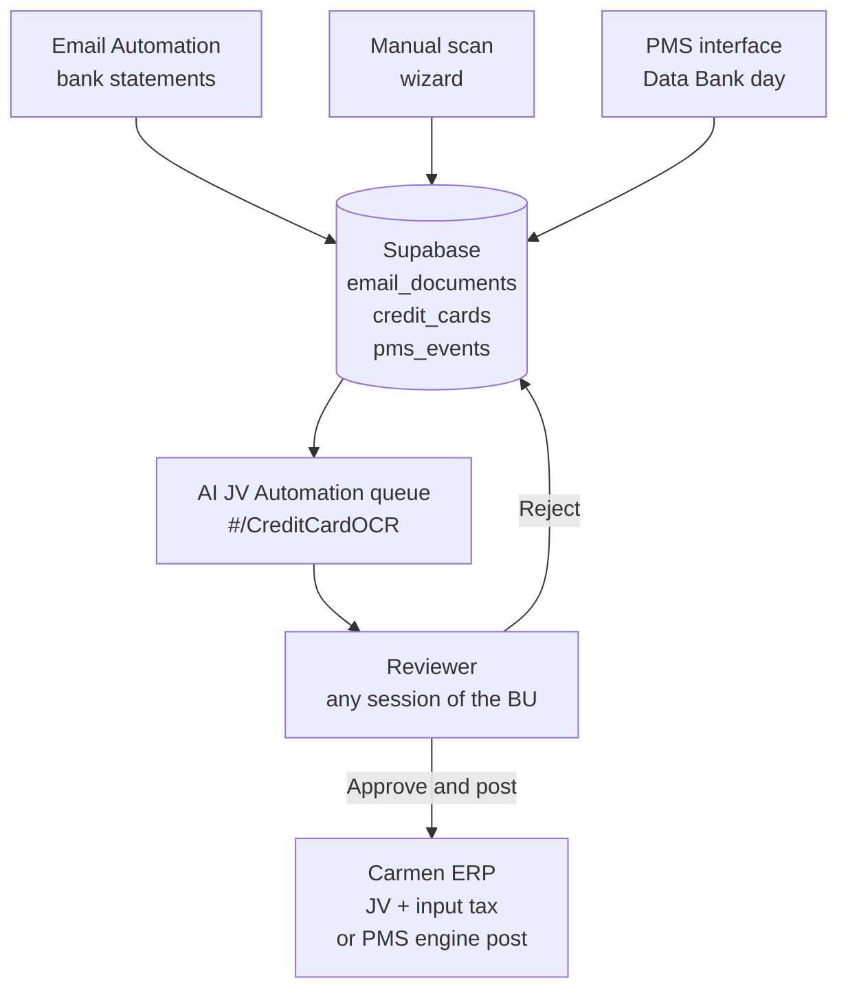
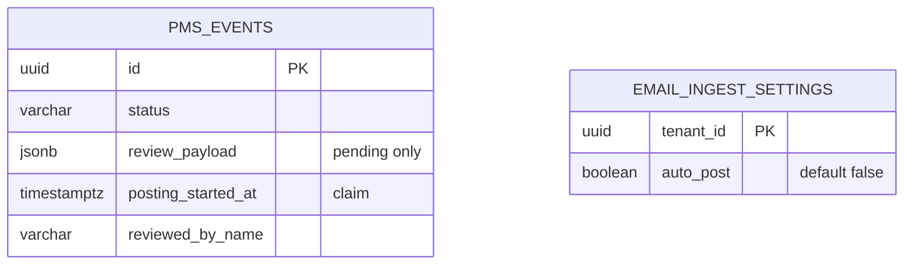
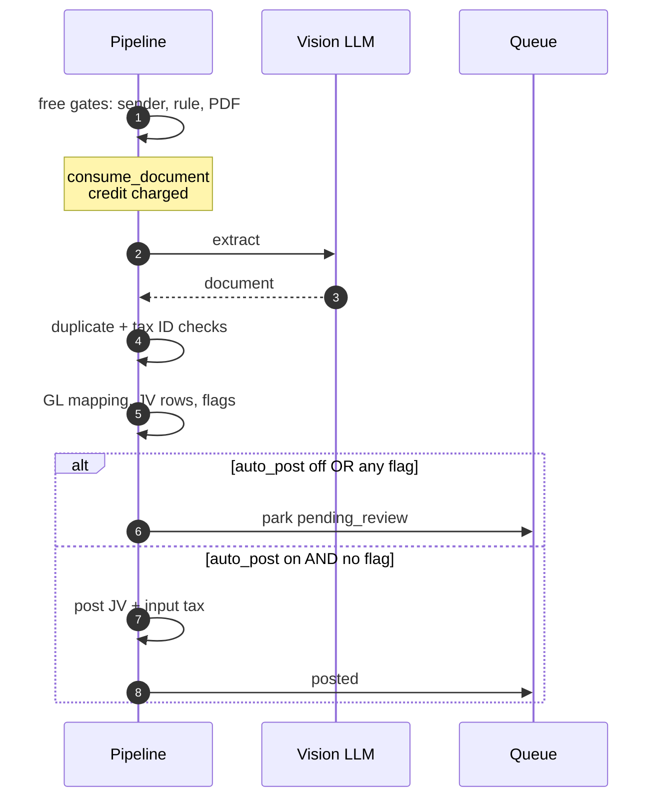
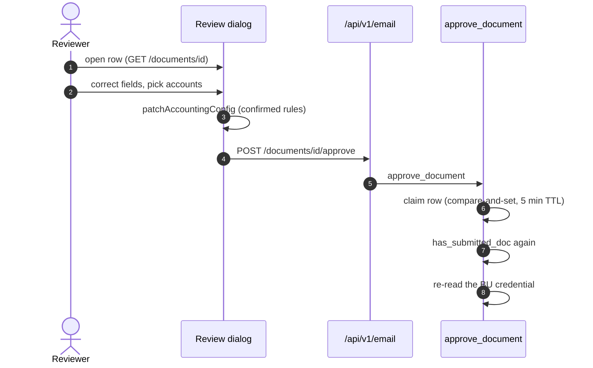
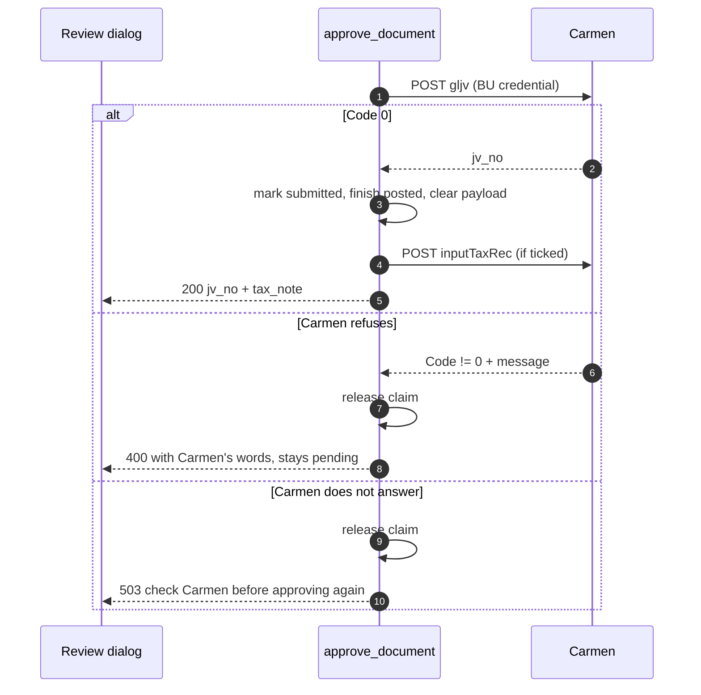
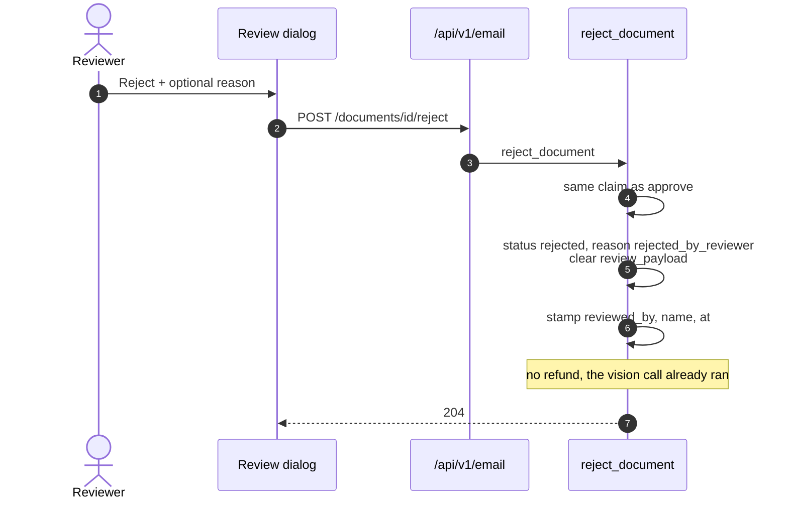
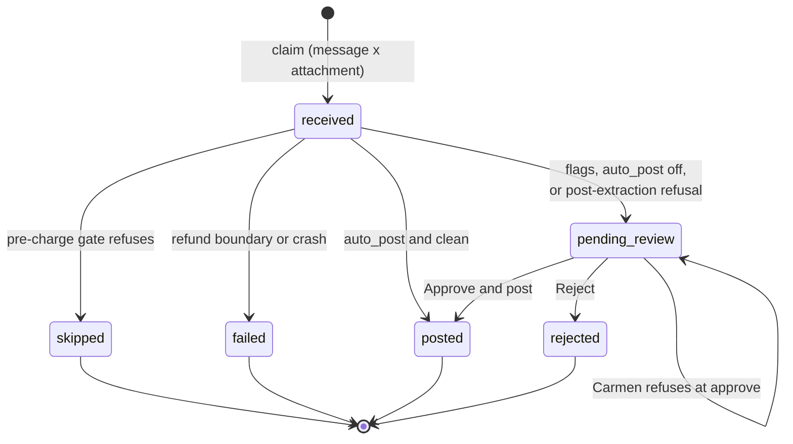

**ขอบเขตของ CR นี้:** เอกสารนี้อธิบาย "คิวตรวจก่อนลงบัญชี" ที่หน้า `#/CreditCardOCR` ซึ่งเป็นจุดเดียวที่คนตรวจ JV ทุกใบที่ AI เตรียมไว้ ไม่ว่าจะมาจากอีเมล, จากการสแกนเอง หรือจาก PMS ส่วนวิธีที่เอกสารแต่ละแหล่งเดินทางมาถึงคิว อยู่ในเอกสารของแหล่งนั้น (Email FRD v4.0, FRD-01, FRD-11) เอกสารนี้เริ่มที่จุดที่เอกสาร "พักรอคน" และจบที่จุดที่มันถูก post หรือถูก reject

## Document Revision History

| Version | Date | Author | Description of Changes | Approved By |
|---|---|---|---|---|
| 1.0 | 27/10/2026 | Dev Team | ฉบับแรก — เขียนจากโค้ดที่ merge เข้า main แล้ว รวมสเปกคิวที่เดิมกระจายอยู่ใน Email FRD v3.0/v3.1 §4.2–4.3, §8.4c–8.6, §12.1–12.2 เข้ากับส่วนที่เพิ่มหลังจากนั้น (chip 5 ตัว, charged-means-reviewable, auto-post gate, แถว manual และแถว PMS) | Reviewed |
| 1.1 | 28/10/2026 | Dev Team | ยุบ chip เหลือ 2 ตัว (Review, All) — Today / Posted / Not posted ย้ายไปเป็น dropdown ใน All, หน้าเปิดที่ Review ถ้ามีงาน ไม่งั้นไป All, ตัดจุดเตือน (dot) และ `POST /activity/seen` ออกทั้งหมด (07-human-in-the-loop.md §24) | |
| 1.2 | 28/10/2026 | Dev Team | Drop ตารางของจุดเตือนหลัง deploy v1.1 (migration `20261028000000`) | |
| 1.3 | 29/10/2026 | Dev Team | CA-111: แถว email ที่ post แล้วแต่ภาษีซื้อค้างก็มีปุ่ม Record input tax เหมือน manual — ปุ่มเปิด dialog แก้ผู้ขาย/เลขผู้เสียภาษี/profile/สาขา และเลือกงวดภาษีในกรอบ 6 เดือน พร้อมทางเลือก Keyed in Carmen already, แถวมี `card_id` (decision-log #48, FRD-09 v1.1) | |

<!-- pagebreak -->

# 1. Executive Summary & Objective

**AI Transaction Review** คือหน้าแรกของโมดูล AI JV Automation (`#/CreditCardOCR`) เป็นตารางเดียวที่รวม JV ทุกใบที่ระบบเตรียมให้ BU จากสามแหล่ง ได้แก่ เอกสารที่มาทางอีเมล, เอกสารที่ผู้ใช้สแกนเองผ่าน wizard และวันของ PMS (Data Bank day) แต่ละแถวบอกว่าเอกสารอยู่สถานะไหน ทำไมถึงมาอยู่ตรงนี้ และต้องกดอะไรต่อ เอกสารที่รอคนตัดสินใจเปิดเป็น dialog เพื่อตรวจ แก้ไข แล้วกด **Approve and post** หรือ **Reject** ได้ทันที

**ปัญหาที่ CR นี้แก้:** Email Automation รุ่นแรก (v2.2) post JV เข้า Carmen โดยไม่มีใครตรวจ ส่วนเอกสารที่ไม่ผ่านด่านใดด่านหนึ่งหลังจากเสียเครดิตไปแล้ว (เช่น tax ID ไม่ตรง หรือ Carmen ปฏิเสธ) จบเป็น `failed` และผลการอ่านที่ลูกค้าจ่ายเงินไปแล้วถูกทิ้ง ทางเดียวที่เหลือคือสแกนไฟล์เดิมซ้ำด้วยมือ ฝั่ง manual scan ก็มีปัญหาเดียวกัน คือ scan ที่เสียเครดิตแล้วแต่ไม่ได้ post ไม่ทิ้งร่องรอยไว้ที่ไหนเลย

**หลักการ 5 ข้อที่คิวนี้ยึด:**

- **มีคนตรวจเป็นค่าเริ่มต้น** — `auto_post` ต่อ BU มีค่าเริ่มต้นเป็น false ทุกเอกสารพักรอคน BU ปิดการตรวจเองเมื่อเห็นว่าเชื่อถือได้แล้ว
- **Auto-post post เฉพาะเอกสารที่พร้อม** — แม้เปิด `auto_post` แล้ว เอกสารที่มีเหตุผลให้สงสัยข้อใดข้อหนึ่ง (flag) ยังต้องผ่านคน ใช้ฟังก์ชันเดียวกับที่เขียนเหตุผลบนแถว (decision-log #24)
- **เสียเครดิตแล้วต้องตรวจได้** — การปฏิเสธที่เกิดหลังอ่านเอกสารแล้วพักไว้ในคิวพร้อมเหตุผล แทนการจบเป็น `failed` (decision-log #22)
- **Approve ตรวจทุกอย่างใหม่ ณ ตอนกด** — เช็คซ้ำซ้อนอีกรอบ อ่าน credential ของ BU ใหม่ และ post ด้วย credential ของ BU ไม่ใช่ของคนกด
- **Reject จบสถานะและไม่คืนเครดิต** — เพราะ vision model ทำงานไปแล้ว (decision-log #17)

## 1.1 System Context Diagram (ภาพรวมการไหลของข้อมูล)

แหล่งเอกสารทั้งสามมาบรรจบที่ตารางเดียว คนตรวจตัดสินใจ แล้วจึงเขียนลง Carmen ด้วย credential ของ BU



# 2. Scope of Work

## 2.1 In-Scope (ขอบเขตการทำงานของระบบ)

- **Activity table แหล่งเดียว:** รวมแถวจาก `email_documents` (อีเมล), `credit_cards` ที่ไม่ได้มาจากอีเมล (manual scan) และ `pms_events` (วันของ PMS) เรียงตามเวลาล่าสุดก่อน ทุกแถวใช้ shape เดียวกัน (`ActivityRow`)
- **Chip 2 ตัว:** Review (งานที่รอคนตัดสิน) และ All (log ทั้งหมดของโมดูล) — ใน All มี dropdown กรองได้ทีละค่า: Everything · Today · Posted · Not posted แต่ละแถวอยู่ใน bucket สถานะเดียวเท่านั้น ส่วน Today ตัดตามเวลา (ตั้งแต่เที่ยงคืนเวลาไทย)
- **ไม่มีจุดเตือน (dot):** ตัวเลขบน Review บอกแล้วว่ามีงาน และกระดิ่งแจ้ง `failed`, `wrong_pdf_password`, `unsupported_attachment` อยู่แล้ว สาเหตุที่กระดิ่งไม่แจ้ง (`sender_not_allowed`, `ingest_paused`, แถวค้าง, ภาษีซื้อล้มเหลวหลัง post, วัน PMS ที่ failed) เห็นได้ที่ All → Not posted
- **เหตุผลบนแถว:** แถวที่รอตรวจแสดงเหตุผลเพียงหนึ่งวลีตามลำดับความสำคัญ (mapping ขาด → ยอดไม่ลงตัว → AI เดา mapping → ไม่มีเลขที่เอกสาร → tax ID ยังไม่ยืนยัน → มีคำเตือน → พร้อม post)
- **Review dialog สำหรับเอกสารอีเมล:** แสดงสองฝั่งคือ "เอกสารเขียนว่าอะไร" กับ "อะไรจะถูก post" แก้หัวเอกสาร รายการ GL mapping และข้อมูลภาษีซื้อได้ก่อนกด Approve
- **Review dialog สำหรับวันของ PMS:** dialog แยก (`PmsReviewDocument.tsx`) ใช้ API ของ PMS — รายละเอียดอยู่ใน FRD-11
- **Approve and post:** synchronous กดแล้วเห็นผลจาก Carmen ในหน้าเดียวกัน ถ้า Carmen ปฏิเสธ เอกสารยังอยู่ในคิวให้แก้แล้วกดใหม่ได้
- **Reject:** จบสถานะ พร้อมเหตุผลแบบไม่บังคับกรอก ไม่คืนเครดิต
- **ปุ่มแก้สาเหตุ (fix button):** แถวที่หยุดเพราะการตั้งค่า (password, sender, tax ID, credential) มีปุ่มพาไปหน้าตั้งค่าในแอป แถวที่ mapping ขาดพาไปหน้า mapping
- **Record input tax:** แถวที่ post JV แล้วแต่ยังไม่ได้ยื่นภาษีซื้อ ทั้ง manual scan (session หมดก่อนถึง step 4 หรือกด Skip) และเอกสารอีเมล (ผู้ตรวจเอาติ๊กออก หรือการยื่นถูกปฏิเสธ) ยื่นย้อนหลังได้จากแถว หรือกด Keyed in Carmen already ถ้าคีย์เองแล้ว — รายละเอียดอยู่ใน FRD-09
- **Backpressure:** BU ที่มีเอกสารรอตรวจครบ 50 ใบ อีเมลใหม่จะถูกคืนกลับไปในสภาพยังไม่อ่าน ไม่เสียเครดิต

## 2.2 Out-of-Scope (สิ่งที่ระบบไม่ทำ และผู้ใช้ต้องทำแทน)

| ไม่ทำ | ผู้ใช้ต้องทำอะไรแทน / อยู่ที่ไหนแทน |
|---|---|
| Un-reject | เอกสารที่ reject แล้วย้อนกลับไม่ได้ ถ้าต้องการลงบัญชีให้สแกนใหม่ผ่าน `#/CreditCardOCR/manual` |
| บังคับสิทธิ์ผู้อนุมัติ | ไม่มีตาราง users ใครก็ตามที่มี session ของ BU นั้นกด Approve/Reject ได้ ระบบบันทึกชื่อคนกด (`reviewed_by_name`) ไว้เป็นหลักฐาน แต่ไม่ได้ตรวจสิทธิ์ |
| ดูไฟล์ต้นฉบับใน dialog | ระบบไม่เก็บไฟล์ dialog แสดงได้เฉพาะค่าที่ AI อ่านออกมา ผู้ตรวจต้องเปิดเอกสารจริงเทียบเอง |
| Approve ทีละหลายใบ (bulk) | ไม่มี ต้องเปิดตรวจทีละใบ ถ้าต้องการลดงานตรวจให้เปิด `auto_post` ซึ่งจะ post ให้เฉพาะเอกสารที่ไม่มี flag |
| Retry อัตโนมัติ | ไม่มี job ส่งซ้ำ เอกสารที่ Carmen ปฏิเสธหรือ Carmen ไม่ตอบ รอคนกด Approve ใหม่หลังตรวจใน Carmen แล้ว |
| แก้ JV ที่ post แล้ว | ออก reversing JV ที่ Carmen ด้วยมือ ปุ่ม Open JV บนแถวพาไปหน้า JV นั้นใน Carmen |
| แจ้งเตือนทีละเอกสารที่รอตรวจ | กระดิ่งแจ้งเป็นยอดรวมต่อ BU ("N เอกสารรอตรวจ") ไม่ใช่ทีละใบ |

<!-- pagebreak -->

# 3. Feature List & Sub-Modules

<!-- widths: 9,22,39,30 -->
| Feature ID | ชื่อฟีเจอร์ | คำอธิบาย | Source |
|---|---|---|---|
| F-01 | Activity Table API | รายการรวมสามแหล่ง แบ่งตาม filter พร้อมจำนวนและ pagination | `routers/credit_card/activity.py` + `services/credit_card/activity.py` (`list_activity`) |
| F-02 | Chip bucket (SQL) | นิยามเดียวว่าแถวไหนอยู่ bucket ไหน ใช้ทั้งตอน list และตอนนับ | `_chip_expr()`, `_pms_chip_expr()` |
| F-03 | Two chips + All dropdown | Review กับ All บนแถบ, Today / Posted / Not posted อยู่ใน dropdown ของ All | `ReviewQueue.tsx` (`QUEUE_CHIPS`, `ALL_SCOPES`) |
| F-04 | Review flags + auto-post gate | คำนวณเหตุผลของเอกสารครั้งเดียวตอนพัก และใช้เป็นด่าน auto-post ด้วย | `email_automation/ledger.py` `_review_flags()` |
| F-05 | Park-or-finish | ตัดสินว่าการปฏิเสธหลังอ่านเอกสารจะพักไว้ในคิวหรือจบสถานะ | `email_automation/pipeline.py` `_park_or_finish()` |
| F-06 | Review Queue API (email) | อ่านเอกสารที่รอตรวจ, approve, reject และสถานะของหน้า | `routers/email_automation/review.py` |
| F-07 | Approve / Reject service | claim แถว, เช็คซ้ำ, post ด้วย credential ของ BU, บันทึกผู้ตรวจ | `services/email_automation/review.py` (`approve_document`, `reject_document`) |
| F-08 | PMS day review | ดู/อนุมัติ/ปฏิเสธวันของ PMS (รายละเอียดใน FRD-11) | `routers/pms.py` `/days/*` + `services/pms/review.py` |
| F-09 | Queue UI | หน้าคิว, แถว, dialog ตรวจ | `ReviewQueue.tsx`, `QueueRow.tsx`, `ReviewDocument.tsx`, `PmsReviewDocument.tsx` |
| F-10 | Reason & fix vocabulary | ข้อความเหตุผลต่อ reason code และปุ่มแก้สาเหตุ | `shared/lib/reviewReasons.ts` (`FIX`, `stopText`) |
| F-11 | Backpressure | หยุดรับอีเมลใหม่ของ BU ที่มีเอกสารรอตรวจครบเพดาน | `REVIEW_BACKLOG_CAP` ใน `email_automation/ledger.py` |
| F-12 | Pending notification | แจ้งเตือนยอดรวมเอกสารรอตรวจต่อ BU | `document_pending_review` ใน `email_automation/ingest.py` |

# 4. UI Specs & Field Mapping

หน้าจอทั้งหมดเป็นหน้าจอของแอปเอง ใช้ session JWT ของผู้ใช้ที่ login ผ่าน Carmen SSO ภาษาของ chip, เหตุผล และปุ่มตามตัวเลือก EN | ไทย ของแอป

## 4.1 หน้าคิว — `#/CreditCardOCR`

| ส่วน | พฤติกรรม |
|---|---|
| แถบ chip | Review · All — ซ่อนทั้งแถบถ้า BU ยังไม่เคยมีเอกสารเลย (`counts.all = 0`) |
| Dropdown ใน All | แสดงเฉพาะตอนอยู่ที่ All ข้างปุ่ม Refresh: Everything · Today · Posted · Not posted (ค่า `filter` เดิมของ API) เริ่มที่ Everything ทุกครั้งที่กด All |
| ตัวเลขบน chip | แสดงเฉพาะ **Review** เพราะลดลงได้ (จำกัดไว้ที่ 0–50 ด้วย backpressure) ส่วน All เพิ่มขึ้นอย่างเดียว จำนวนแถวจึงไปแสดงที่ Pager แทน |
| จุดเตือน | ไม่มี |
| chip เริ่มต้น | Review ถ้ามีงานรอ ไม่งั้น All (Everything) — ลิงก์ที่ระบุ `?filter=` ข้ามการเลือกนี้ |
| ปุ่มบนหัวตาราง | Refresh, Mapping Settings (เปิด `#/CreditCardOCR/mapping` ในแท็บใหม่), Scan manually (ไป `#/CreditCardOCR/manual`) |
| คอลัมน์ | Status · Document · Message · Received · JV · Actions |
| Empty state | ข้อความต่างกันต่อ chip (ว่างบน Review = ไม่มีงานค้าง, ว่างบน Posted = ยังไม่มีอะไรลงบัญชี) และเป็นจริงทั้งตอน `auto_post` เปิดและปิด |
| Error state | fetch ล้มเหลวแสดงการ์ด error แยกจาก empty state เสมอ |

## 4.2 ActivityRow — หนึ่งแถวในตาราง

<!-- widths: 18,12,8,40,22 -->
| Field Name | Data Type | M/O | Meaning & Business Logic | Example |
|---|---|---|---|---|
| `id` | Text | M | id ของแถวต้นทาง (`email_documents.id`, `credit_cards.id` หรือ `pms_events.id`) | 9f1c… |
| `source` | Text | M | `email` / `manual` / `pms` — ใช้เลือก dialog ที่จะเปิด | email |
| `status` | Text | M | สถานะ ledger: `received`, `pending_review`, `posted`, `rejected`, `failed`, `skipped` และ `scanned` (manual ที่เสียเครดิตแต่ไม่ได้ post — ระบบสังเคราะห์ขึ้น ไม่ได้เก็บในตาราง) | pending_review |
| `created_at` | Datetime | M | เวลาที่ระบบรับเอกสาร สำหรับ manual ที่ post แล้วใช้ `submitted_at` | 2026-10-26T03:12Z |
| `attachment` | Text | M | ชื่อไฟล์ — สำหรับ PMS เป็น "InterfaceName · DocType" | KB1P554V2_SUM_….pdf |
| `bank_code` | Text | O | ธนาคาร — สำหรับ PMS เป็น `PMS` | KBANK |
| `doc_no` | Text | O | เลขที่เอกสาร — สำหรับ PMS เป็นวันที่ของ Data Bank day | 010626E00033898 |
| `doc_date` / `total` / `line_count` | Text / Number / Int | O | มีค่าเฉพาะแถวที่รอตรวจ อ่านจาก `review_payload` — `total` คือผลรวม `pay_amt` (ยอดที่ลงฝั่ง Credit) | 31/07/2026 · 48200.00 · 14 |
| `flags` | Array | O | เหตุผลที่คำนวณไว้ตอนพัก (ดู §4.3) — ว่าง = พร้อม post | ["mapping_guessed"] |
| `unmapped` / `guessed` | Array | O | payment type ที่ไม่มีใคร map ได้ / ที่ AI ต้องเดา ใช้เขียนชื่อ field ต่อท้ายเหตุผล | ["Mastercard"] |
| `reason_code` / `error_message` | Text | O | สาเหตุที่เอกสารหยุด (ดู §9) และรายละเอียด | tax_id_mismatch |
| `jv_no` | Text | O | เลข JV ที่ Carmen คืนมา | JV2610-0012 |
| `reviewed_by_name` / `reviewed_at` | Text / Datetime | O | ผู้อนุมัติหรือปฏิเสธ เก็บเป็นข้อความถาวร ไม่ใช่ FK | Somchai P. |
| `posted_by_name` | Text | O | (manual) ผู้สแกน อ่านจาก session ณ ตอนแสดงผล — หายได้เมื่อ session ถูกลบ | Napat K. |
| `input_tax_owed` | Boolean | O | JV post แล้ว มี VAT และภาษีซื้อยังไม่ถูกยื่นหรือ mark ว่าคีย์เอง (manual และ email) → แถวแสดงปุ่ม Record input tax | true |
| `card_id` | UUID | O | credit card ที่อยู่เบื้องหลังแถว — endpoint ภาษีซื้อใช้ค่านี้ (แถว email มี `id` เป็นของ ledger) ว่างสำหรับแถว PMS, แถวที่ยังไม่ post และเอกสารซ้ำ | 4b1e… |

## 4.3 เหตุผลบนแถวที่รอตรวจ (reason ladder)

แถวแสดงวลีเดียวตามลำดับด้านล่าง ข้อแรกที่ตรงชนะ แถวที่มี `reason_code` (หยุดเพราะด่าน ไม่ใช่เพราะ flag) แสดงข้อความของ reason code นั้นแทน

<!-- widths: 6,20,22,22,30 -->
| ลำดับ | Flag | ข้อความ (EN) | ข้อความ (TH) | ความหมาย |
|---|---|---|---|---|
| 1 | `mapping_missing` | Mapping missing: <fields> | ยังไม่มีผังบัญชี | มี payment type ที่ไม่มี GL mapping และ AI เติมให้ไม่ได้ — post ไม่ได้จนกว่าจะเลือกบัญชี |
| 2 | `unbalanced` | Amounts do not reconcile | ยอดไม่สมดุล | fee invoice: บรรทัดที่ gross ≠ commission + tax + net / settlement report: JV ไม่ balance |
| 3 | `mapping_guessed` | AI suggested mapping: <fields> | AI แนะนำผังบัญชี | AI เป็นคนเลือกบัญชีให้ ยังไม่มีคนยืนยัน |
| 4 | `doc_no_missing` | No document number | ไม่มีเลขที่เอกสาร | ด่านกันซ้ำทั้งสองชั้นใช้เลขที่เอกสาร ถ้าไม่มีก็จับใบซ้ำไม่ได้ |
| 5 | `tin_unverified` | Tax ID not verified | ยังไม่ยืนยันเลขผู้เสียภาษี | (settlement report) ไม่มีแถว CSV ที่ยืนยัน tax ID ได้ — ไม่ใช่ข้อขัดแย้ง |
| 6 | `warnings` | Extraction warnings | มีคำเตือนจากการอ่าน | การอ่านสร้างคำเตือน เช่น ยอดไม่ตรงกับ CSV หรือเดา VAT 7% |
| — | (ว่าง) | Ready to post | พร้อมโพสต์ | ไม่มีอะไรน่าสงสัย — รอเพราะ `auto_post` ปิด |

## 4.4 Status pill

| status | ป้าย (EN) | สี | หมายเหตุ |
|---|---|---|---|
| `pending_review` | Review | amber | แถวเดียวที่มีปุ่ม Review |
| `posted` | Success | green | มีปุ่ม Open JV (หรือ Record input tax ถ้ายังติดภาษีซื้อ) |
| `failed` | Failed | red | เหลือเฉพาะกรณีที่ระบบพังจริง ดู §8.3 |
| `rejected` | Rejected | red | คำไม่ซ้ำกับ Failed เพราะเป็นการตัดสินใจของคน ไม่ใช่ความผิดพลาด |
| `skipped` | Skipped | grey | ไม่เสียเครดิต — กฎของ BU เองบอกว่า "ไม่ใช่ไฟล์นี้" |
| `received` | Stuck | amber | แถวที่ค้างที่ `received` เกิน 1 ชั่วโมง = pipeline ไม่ได้ทำต่อจนจบ |
| `scanned` | Not posted | red | manual scan ที่เสียเครดิตแล้วไม่ได้ post |

## 4.5 Review dialog (เอกสารอีเมล) — `#/CreditCardOCR/review?id=<id>`

| ส่วน | เนื้อหา |
|---|---|
| ฝั่งซ้าย "Document" | หัวเอกสารและรายการที่ AI อ่าน (`extracted`) — แก้ไขได้ พร้อมแถบคำเตือนจากการอ่าน |
| ฝั่งขวา "JV" | แถว JV ที่หน้าจอสร้างจาก config ปัจจุบัน พร้อมช่องเลือกบัญชี บัญชีที่ AI เดาไว้ทำเครื่องหมายให้เห็น — settlement report ใช้ตาราง JV เดียวกับ fee invoice (decision-log #36) |
| ส่วนภาษีซื้อ | ติ๊ก "post input tax" (ค่าเริ่มต้นติ๊ก) และแก้ vendor name / tax ID / tax profile ได้ (`InputTaxOverrides`) |
| ปุ่ม | Reject (ขอเหตุผลแบบไม่บังคับ), Approve and post — ปุ่ม Approve ถูกปิดถ้ามีบรรทัดที่มีจำนวนเงินแต่ยังไม่มีบัญชี |
| ปิดโดยมีการแก้ค้าง | ถามยืนยันก่อนทิ้งการแก้ไข เอกสารยังอยู่ในคิว |
| เอกสารถูกจัดการไปแล้ว | แสดง "ไม่ได้รออยู่แล้ว" แทนข้อมูล (มีคนอื่น approve/reject ไปก่อน) |

## 4.6 ปุ่มแก้สาเหตุ (fix button)

แถวที่รอตรวจมีปุ่มเดียวคือ Review เสมอ เพราะการเปิดเอกสารเป็นการกระทำที่สำคัญกว่า ปุ่มแก้สาเหตุของแถวนั้นจะไปแสดงในแถบเตือนของ dialog แทน ส่วนแถวที่จบแล้ว (เช่น skipped เพราะ password ผิด) แสดงปุ่มแก้สาเหตุบนแถวเลย

| reason_code | ปุ่ม | พาไปที่ |
|---|---|---|
| `mapping_incomplete` | Fix mapping | `#/CreditCardOCR/mapping` ในแท็บเดิม |
| `carmen_unauthorized` | Reconnect | หน้า `/setting` ของ Carmen ในแท็บใหม่ |
| `sender_not_allowed`, `wrong_pdf_password`, `ingest_paused`, `tax_id_mismatch` | Open settings | หน้า `/setting` ของ Carmen ในแท็บใหม่ — ต้องเปิดผ่าน Carmen เพราะการเปิดจากเมนู Carmen คือจุดที่ออก token ให้ BU (decision-log #35, #38) จากนั้นเมนูของ Carmen จึงพาเข้าหน้า settings ของแอป |
| `carmen_rejected`, `duplicate_document`, `unreadable_document`, `rejected_by_reviewer` | — | ไม่มีปุ่ม เพราะไม่มีอะไรให้แก้ในแอป (Carmen เป็นผู้ปฏิเสธ, เอกสารเข้า Carmen แล้ว, ระบบไม่เก็บไฟล์ให้อ่านใหม่ หรือจบโดยตั้งใจ) |
| `no_credential` (PMS) | — | ไม่มีปุ่ม: ต้องไปบันทึก PMS setting ใน Carmen (decision-log #44) ข้อความบนแถวบอกไว้แล้ว |

# 5. Action Buttons & Business Logic

<!-- widths: 20,14,66 -->
| Button Name | Action Type | Business Logic / System Behavior |
|---|---|---|
| Chip (Review/All) และ dropdown ของ All | Filter | `GET /api/v1/credit-card/activity?filter=<review\|all\|today\|success\|unposted>` — ลิงก์จากกระดิ่งเปิดด้วย `?filter=unposted` คือ All ที่กรองเป็น Not posted |
| Refresh | Reload | โหลดหน้าปัจจุบันใหม่ ไม่ล้างตัวกรอง |
| Review | Open dialog | แถว email เปิด `?id=`, แถว PMS เปิด `?pms=` — dialog เป็น route จึงแชร์ลิงก์และกด back ได้ |
| Approve and post (email) | Form Submit | 1) ถ้ามีบัญชีที่ AI เดาหรือที่ผู้ตรวจแก้ หน้าจอบันทึกลง accounting config ก่อน (`patchAccountingConfig`) — การยืนยันของคนคือจุดที่คำแนะนำของ AI กลายเป็นกฎของ BU (decision-log #25) 2) `POST /api/v1/email/documents/{id}/approve` พร้อม `extracted`, `rows`, `post_input_tax`, `input_tax` 3) server claim แถว เช็คซ้ำ อ่าน credential ของ BU แล้ว post JV และภาษีซื้อ — ทำงานแบบ synchronous |
| Reject | Form Submit | `POST /api/v1/email/documents/{id}/reject` พร้อม `reason` (ไม่บังคับ ตัดที่ 500 ตัวอักษร) → สถานะ `rejected`, reason_code `rejected_by_reviewer`, ไม่คืนเครดิต |
| Approve / Reject (PMS) | Form Submit | `POST /api/v1/pms/days/{id}/approve` / `reject` — ดู FRD-11 |
| Fix mapping / Open settings / Reconnect | Navigate | Fix mapping เปิดหน้า mapping ของแอปในแท็บเดิม ส่วน Open settings / Reconnect เปิด `/setting` ของ Carmen ในแท็บใหม่ ตาม §4.6 |
| Open JV | External link | เปิด JV ใน Carmen (`/glJv/<jv_no>/show`) ในแท็บใหม่ เลข JV ในคอลัมน์ JV เป็นข้อความที่ copy ได้ ไม่ใช่ลิงก์ |
| Record input tax | Dialog + Submit | (manual และ email) เปิดแผงภาษีซื้อแบบเดียวกับ dialog ตรวจ: แก้ผู้ขาย/เลขผู้เสียภาษี/profile/สาขาได้ ยอดล็อกตาม JV เลือกงวดภาษีในกรอบ 6 เดือน → `POST /api/v1/credit-card/activity/{card_id}/input-tax` ใช้ token ของผู้ใช้ หรือกด Keyed in Carmen already → `POST /api/v1/credit-card/activity/{card_id}/input-tax/keyed` ไม่เรียก Carmen — ดู FRD-09 |
| Mapping Settings | Navigate | เปิดหน้า GL mapping ในแท็บใหม่ |
| Scan manually | Navigate | ไปที่ wizard `#/CreditCardOCR/manual` (FRD-01) |

<!-- pagebreak -->

# 6. Database Schema & Tables

ฐานข้อมูล: PostgreSQL (Supabase) คิวไม่มีตารางของตัวเอง อ่านจากตารางของแต่ละแหล่ง และเขียนเฉพาะคอลัมน์ review

## 6.1 ตารางที่เกี่ยวข้อง

<!-- widths: 22,38,40 -->
| ตาราง | บทบาทในคิว | คอลัมน์ที่คิวใช้ |
|---|---|---|
| `email_documents` | แถวของแหล่ง email หนึ่งแถวต่อ (message × attachment) | `status`, `reason_code`, `error_message`, `review_payload`, `posting_started_at`, `reviewed_by`, `reviewed_by_name`, `reviewed_at`, `dismissed_at`, `jv_no`, `task_id` |
| `credit_cards` | แถวของแหล่ง manual — เฉพาะแถวที่ไม่มี `email_documents` ชี้ถึง (anti-join) และ card ของแถว email ที่ post แล้ว (query เดียวต่อหน้า) | `submitted_at` (post แล้วหรือยัง), `tax_amt` + `input_tax_at` (ใช้คำนวณ `input_tax_owed`), `jv_no`, `carmen_user_id` |
| `pms_events` | แถวของแหล่ง PMS หนึ่งแถวต่อ BU × Data Bank day | `status`, `review_payload`, `reason_code`, `posting_started_at`, `reviewed_by_name`, `reviewed_at`, `jv_no` |
| `email_ingest_settings` | สวิตช์ `auto_post` ต่อ BU (ค่าเริ่มต้น false) และ credential ที่ใช้ post | `auto_post`, credential ของ BU |

## 6.2 คอลัมน์ review บน email_documents

| Column | ความหมาย |
|---|---|
| `review_payload` | jsonb มีค่าเฉพาะตอน `pending_review` เก็บ `extracted`, `flags`, `unmapped`, `guessed`, `suggested`, `doc_type` — ล้างเป็น null ทุกครั้งที่จบสถานะ ไม่เก็บแถว JV (คำนวณสดเสมอ) และไม่เก็บ credential |
| `posting_started_at` | claim ของการ approve/reject แบบ compare-and-set หมดอายุใน 5 นาที (`POSTING_CLAIM_TTL`) ป้องกันสองคนกด Approve พร้อมกันแล้ว post ซ้ำ (migration `20260925000000_email_documents_posting_claim.sql`) |
| `reviewed_by` / `reviewed_by_name` / `reviewed_at` | carmen_user_id และชื่อของผู้ตัดสิน — เก็บชื่อเป็นข้อความเพราะ `ocr_sessions` ถูกลบหลัง 90 วัน และหลักฐานว่าใครอนุมัติ JV ต้องอ่านเป็นชื่อได้แม้ผ่านไปหนึ่งปี |
| `dismissed_at` | แถวที่จบแล้วซึ่งเคยถูกเก็บออกจากมุมมอง ปัจจุบันใช้เพียงหยุดนับเป็นแถวผิดปกติ ไม่ได้ซ่อนแถว |

## 6.3 Retention (`fn_purge_email_documents`)

| สถานะ | สิ่งที่เกิดขึ้น |
|---|---|
| `pending_review` | ไม่แตะเลย — เสียเครดิตแล้วและรอคนอยู่ (มีเพดาน 50 ใบต่อ BU) |
| `skipped` | ลบเมื่อครบ 90 วัน — ไม่เคยเสียเครดิต ไม่มี JV |
| สถานะอื่น | ล้างข้อมูลส่วนบุคคลเมื่อครบ 90 วัน และลบเมื่อครบ 2 ปี — นับจาก `updated_at` |

## 6.4 Entity Relationship Diagram

ทุกตารางมี `tenant_id` อ้างถึง `tenants` (ไม่แสดงในแผนภาพเพื่อให้อ่านได้บนหน้ากระดาษ)

```mermaid 6.4a | Email and manual rows — a manual row is a credit_cards row no email_documents row points at
erDiagram
    EMAIL_DOCUMENTS }o--o| OCR_TASKS : task_id
    CREDIT_CARDS }o--|| OCR_TASKS : task_id
    EMAIL_DOCUMENTS {
        uuid id PK
        varchar status
        varchar reason_code
        jsonb review_payload "pending only"
        timestamptz posting_started_at "claim"
        varchar reviewed_by_name
        timestamptz reviewed_at
        varchar jv_no
    }
    CREDIT_CARDS {
        uuid id PK
        timestamptz submitted_at "null = not posted"
        numeric tax_amt
        varchar jv_no
    }
```



<!-- pagebreak -->

# 7. Required Data Tables (External Integrations)

| ปลายทาง | เรียกตอนไหน | credential |
|---|---|---|
| Carmen `POST /gljv` | Approve เอกสารอีเมล (และ auto-post ใน pipeline) | credential ที่ BU เก็บไว้ใน `email_ingest_settings` อ่านใหม่ทุกครั้งตอนกด |
| Carmen `POST /inputTaxRec` | หลัง JV สำเร็จ ถ้าติ๊ก post input tax — ล้มเหลวได้โดยไม่ rollback JV | credential ของ BU |
| Carmen mapping table + interface post (PMS) | Approve วันของ PMS — ดู FRD-11 | credential ของ BU |
| Carmen `POST /inputTaxRec` (ยื่นย้อนหลัง) | ปุ่ม Record input tax บนแถว manual และ email | token ของผู้ใช้ที่กด เหมือนที่ wizard ใช้ |

**ทำไมไม่ใช้ token ของผู้กด Approve:** JV ต้องถูกบันทึกเป็นของ BU ไม่ใช่ของพนักงานที่บังเอิญเปิดคิว และ session ที่หลุดไปจะใช้คิวเป็นช่องทาง post JV ในชื่อของ BU ไม่ได้ ระบบจึงไม่ post ผ่าน `proxy_gljv` (ซึ่งอ่าน token ของ session)

# 8. Workflow & End-to-End Walkthrough

## 8.1 Sequence — เอกสารอีเมลหนึ่งใบเดินทางถึงคิว



## 8.2 Gate — การตัดสินที่จุด fork

```mermaid 8.2 | One predicate decides both the row's reason and whether it may post alone
flowchart TB
    A([extraction + GL mapping done]) --> B[_review_flags<br/>mapping_missing, unbalanced<br/>mapping_guessed, doc_no_missing<br/>tin_unverified, warnings]
    B --> C{auto_post off<br/>OR any flag}
    C -->|yes| D[park pending_review<br/>store review_payload]
    C -->|no| E[post JV to Carmen<br/>under the BU credential]
    D --> F([Review chip<br/>waits for a person])
    E --> G([Posted chip<br/>posted automatically])
    classDef warn fill:#FEF3C7,stroke:#D97706,color:#78350F
    classDef good fill:#DCFCE7,stroke:#16A34A,color:#14532D
    class D,F warn
    class E,G good
```

**ฟังก์ชันเดียว สองหน้าที่:** `_review_flags()` เป็นทั้งเหตุผลที่แถวแสดง และเป็นด่านของ auto-post โดยตั้งใจ เอกสารที่ผู้ตรวจจะได้เห็นเหตุผล จึงไม่มีทาง post ไปเองโดยไม่มีใครรู้ การเพิ่ม flag ใหม่ทำให้ auto-post เข้มขึ้นไปพร้อมกัน

## 8.3 Charged means reviewable — การปฏิเสธหลังอ่านเอกสาร

เมื่อ vision model อ่านเอกสารเสร็จ เครดิตถูกหักแล้วไม่ว่าผลจะเป็นอย่างไร การปฏิเสธหลังจุดนี้จึงพักเอกสารไว้ในคิวพร้อม `reason_code` แทนการจบเป็น `failed` (`_park_or_finish`)

<!-- widths: 24,40,18,18 -->
| reason_code | สาเหตุ | ผล | เครดิต |
|---|---|---|---|
| `tax_id_mismatch` | tax ID บนเอกสารไม่อยู่ในทะเบียนของ BU นี้ | พักในคิว | ไม่คืน |
| `duplicate_document` | post เข้า Carmen ไปแล้ว หรือ "อาจ post แล้ว" (วันที่เดียวกัน เลขที่ใกล้เคียง) | พักในคิว | ไม่คืน |
| `unreadable_document` | อ่านได้ แต่ไม่มียอดที่ post ได้ | พักในคิว | ไม่คืน |
| `carmen_unauthorized` | BU ไม่มี credential หรือ Carmen ตอบ 401/403 | พักในคิว — ทุกใบ post ได้ทันทีที่ตั้ง credential ใหม่ | ไม่คืน |
| `carmen_rejected` | Carmen ปฏิเสธ JV หรือไม่ตอบ (ข้อความเตือนให้เช็คใน Carmen ก่อนกดซ้ำ) | พักในคิว | ไม่คืน |
| `duplicate_document` (ซ้ำกับใบที่รอในคิวอยู่แล้ว) | ใบแรกยังแก้และ post ได้ — แถวที่สองไม่มีประโยชน์ | `failed` ไม่แจ้งเตือน | ไม่คืน |
| (ข้อผิดพลาดที่ไม่ได้คาดไว้) | exception ทั่วไป — อาจเกิดหลัง JV post ไปแล้ว | `failed` | ไม่คืน |
| `unreadable_document` (extraction ล้มเหลว) | model ไม่ได้ทำงาน | `failed` | **คืน** — กรณีเดียวที่คืน |

## 8.4 Sequence — Approve (เอกสารอีเมล)





**สามอย่างที่ approve ตั้งใจไม่ทำ:** ไม่ post ผ่าน `proxy_gljv` (ซึ่งจะใช้ token ของคนกด), ไม่ใช้ credential ที่จำไว้ตอนพัก (token อาจหมุนไปแล้ว) และไม่เชื่อ `is_duplicate` จากตอนอ่าน (ระหว่างรอ อาจมีคนคีย์เอกสารเดียวกันเข้า Carmen เอง)

**Settlement report (KBANK, `doc_type = ar_reconcile`):** server สร้าง JV ใหม่จากเอกสารและ config แล้วเทียบกับแถวที่หน้าจอส่งมา ถ้าไม่ตรงกัน (เพราะมีคนบันทึก mapping ระหว่างนั้น) ตอบ 400 ให้ปิดแล้วเปิดเอกสารใหม่ — ไม่ post JV ที่ไม่มีใครเห็น

## 8.5 Sequence — Reject



## 8.6 แถวไหนอยู่ chip ไหน (`_chip_expr`)

```mermaid 8.6 | Exactly one bucket per row; counts and list use the same expression
flowchart TB
    A([email_documents row]) --> H{skipped AND<br/>no_rule_match}
    H -->|yes| X([hidden from every view])
    H -->|no| P{status posted}
    P -->|yes| S([Posted])
    P -->|no| R{status pending_review}
    R -->|yes| V([Review])
    R -->|no| N{skipped AND<br/>unreadable_document}
    N -->|yes| Z([noise: Today and All only])
    N -->|no| U([Not posted])
```

แหล่ง manual: post แล้ว → Posted, เสียเครดิตแต่ไม่ได้ post → Not posted (ไม่มีแถว manual ใดรอคน) แหล่ง PMS: `pending_review` → Review, `posted` → Posted, `rejected`/`failed` → Not posted ส่วน `received` (กำลังอ่านอยู่ไม่กี่วินาที) ไม่แสดง

## 8.7 User Operational Workflow

- **ทุกวัน:** เปิดเมนู AI JV Automation ใน Carmen → หน้าคิวเปิดที่ Review ถ้ามีเอกสารรอ ดูคอลัมน์ Message เพื่อเลือกแถวที่ควรเปิดก่อน แถว "Ready to post" คือแถวที่ใช้เวลาน้อยที่สุด
- **ตรวจหนึ่งใบ:** กด Review → เทียบฝั่ง Document กับเอกสารจริง → แก้ค่าที่อ่านผิด → ตรวจบัญชีที่ AI เดา (ทำเครื่องหมายไว้) → กด Approve and post → เห็นเลข JV ทันที
- **Carmen ปฏิเสธ:** อ่านข้อความของ Carmen ใน dialog (เช่น period ปิด หรือไม่รู้จัก dept code) แก้แล้วกด Approve ใหม่ได้ในหน้าเดิม
- **Carmen ไม่ตอบ:** เปิด Carmen ตรวจก่อนว่า JV เข้าไปแล้วหรือยัง ถ้าเข้าแล้วให้ Reject ใบนี้ ถ้ายังไม่เข้าจึงกด Approve อีกครั้ง
- **แถวหยุดเพราะการตั้งค่า:** กดปุ่ม Open settings / Reconnect (บนแถว หรือในแถบเตือนของ dialog) ซึ่งเปิดหน้า settings ผ่าน Carmen ในแท็บใหม่ แก้แล้วกลับมาที่คิว ถ้า mapping ขาดใช้ Fix mapping หรือเลือกบัญชีใน dialog ได้เลย
- **ปิดการตรวจ:** เมื่อเชื่อมั่นแล้ว เปิดสวิตช์ auto-post ที่หน้า settings — เอกสารสะอาดจะ post เอง เอกสารที่มี flag ยังมาที่คิวเหมือนเดิม

# 9. Error Handling & Edge Cases Matrix

<!-- widths: 8,30,34,28 -->
| Case ID | Scenario | ระบบทำอะไร | ผู้ใช้เห็นอะไร |
|---|---|---|---|
| EC-01 | สองคนกด Approve เอกสารเดียวกันพร้อมกัน | claim แบบ compare-and-set ให้คนแรก คนที่สองได้ 409 | "Another reviewer is posting this document right now" |
| EC-02 | กด Approve เอกสารที่คนอื่น approve/reject ไปแล้ว | 409 | "Someone else has already handled this document" |
| EC-03 | Reject แข่งกับ Approve | reject ใช้ claim เดียวกัน → 409 ไม่ mark rejected บน JV ที่กำลังเข้า Carmen | ข้อความ 409 |
| EC-04 | ระหว่างรอ มีคนคีย์เอกสารเดียวกันเข้า Carmen เอง | `has_submitted_doc` ตอน approve → 409 | "already been posted to Carmen" |
| EC-05 | Carmen ปฏิเสธตอน Approve | 400 พร้อมข้อความจาก Carmen, คืน claim, ยัง `pending_review` | แก้แล้วกดใหม่ได้ |
| EC-06 | Carmen ไม่ตอบ / timeout ตอน Approve | 503, คืน claim, ยัง `pending_review` — ชะตาของ JV ไม่รู้ | ข้อความให้เช็คใน Carmen ก่อนกดซ้ำ |
| EC-07 | BU ไม่มี credential ตอน Approve | 400 | "No Carmen posting credential for this business unit" |
| EC-08 | บรรทัดมีจำนวนเงินแต่ไม่มีบัญชี (เรียก API ตรง) | 400 ก่อนเรียก Carmen | รายชื่อบรรทัดที่ต้องเลือกบัญชี |
| EC-09 | Settlement report: mapping เปลี่ยนระหว่างที่ dialog เปิดอยู่ | JV ที่สร้างใหม่ไม่ตรงกับที่หน้าจอแสดง → 400 | ให้ปิดแล้วเปิดเอกสารใหม่ |
| EC-10 | JV สำเร็จ แต่ภาษีซื้อล้มเหลว | สถานะ `posted`, เก็บหมายเหตุใน `error_message`, ไม่ rollback | แถว Posted มีหมายเหตุต่อท้าย |
| EC-11 | process ตายระหว่าง approve | claim หมดอายุใน 5 นาที แล้ว approve ใหม่ได้ | ภายใน 5 นาทีได้ 409 |
| EC-12 | เปิด `?id=` ของเอกสารที่ไม่ใช่ของ BU หรือจบแล้ว | 404 แบบเดียวกันทั้งสองกรณี (ไม่บอกว่ามีอยู่จริง) | "This document is not waiting for review" |
| EC-13 | BU มีเอกสารรอครบ 50 ใบ | อีเมลใหม่ถูกคืนในสภาพยังไม่อ่าน ไม่สร้างแถว ไม่เสียเครดิต | จำนวนบน Review หยุดที่ 50 |
| EC-14 | แถวค้างที่ `received` เกิน 1 ชั่วโมง | ไปอยู่ Not posted พร้อมป้าย Stuck | ป้าย Stuck ที่ All → Not posted |
| EC-15 | payload ของแถวหายระหว่างแสดง (race) | แถวยังแสดงด้วยค่าศูนย์ ไม่ทำให้ทั้งหน้าพัง | ตัวเลขเป็น 0 |
| EC-16 | filter ใน URL ไม่รู้จัก (bookmark เก่า) | หน้าจอไม่สนใจค่า แล้วเลือก chip เริ่มต้นเอง ส่วน API fallback เป็น `all` ไม่ตอบ 400 | Review หรือ All |
| EC-17 | bookmark เก่าที่ชี้ chip ที่ถูกยุบ (`?filter=success`) | เปิด All แล้วตั้ง dropdown เป็นค่านั้น | All กรองเป็น Posted |

## 9.1 State Diagram — สถานะของ email_documents



<!-- pagebreak -->

# 10. Non-Functional & Technical Requirements

## 10.1 ความถูกต้องภายใต้การใช้งานพร้อมกัน

- claim บนแถว (`posting_started_at`) แทน `SELECT … FOR UPDATE` — lock เดิมหายไปตั้งแต่ก่อนเรียก Carmen ทำให้สองคนกดพร้อมกันแล้ว post ซ้ำได้ (DEF-1) claim คืนในทุกเส้นทางที่ไม่จบ และหลัง Carmen รับ JV แล้วจะปล่อยให้หมดอายุเอง ไม่คืนก่อนเวลา
- approve ไม่ถือ connection ของ pool ข้ามการเรียก Carmen — เปิด session สั้นๆ แยกรอบ claim, รอบอ่าน config และรอบเขียน ledger (pool ทั้งแอปมี 10 connection ตามเพดาน Supavisor)

## 10.2 Security & Privacy

- ทุก query กรอง `tenant_id` ใน WHERE ไม่ใช่ตรวจหลัง fetch — endpoint รายละเอียดคืน line item จึงต้องตอบ "ไม่ใช่ของคุณ" กับ "ไม่มีอยู่" เหมือนกัน
- post ด้วย credential ของ BU เท่านั้น (§7)
- ไม่มี role gate: ทุก session ของ BU อนุมัติได้ ระบบบันทึกชื่อผู้ตัดสินเป็นข้อความถาวร
- `review_payload` เป็นข้อยกเว้นของหลัก "ไม่เก็บ line item" — มีอยู่เฉพาะระหว่างที่คนยังต้องตัดสินใจ และถูกล้างทันทีที่จบสถานะ

## 10.3 Performance & Capacity

- จำนวนของทุก filter คำนวณใน GROUP BY เดียวต่อแหล่ง (email หนึ่ง query, manual หนึ่ง aggregate, PMS หนึ่ง aggregate)
- การรวมสามแหล่งทำใน Python (ดึง `limit + offset` จากแต่ละแหล่ง เรียง แล้วตัด) — ถูกต้องที่ปริมาณปัจจุบัน (ตารางธุรกิจใหญ่ที่สุดมี 342 แถว ตาม `docs/SQL_PERFORMANCE_AUDIT.md`) ถ้า BU ใดเปิดหน้าลึกมากจนเห็นผล ให้เปลี่ยนเป็น UNION ALL
- CASE ใน WHERE ใช้ index ไม่ได้ — ยอมรับได้ที่ปริมาณนี้ และระบุไว้ในโค้ดแล้วว่าจะขยายอย่างไร
- Approve เป็น synchronous: ใช้เวลาเท่ากับการเรียก Carmen สองครั้ง (JV + ภาษีซื้อ) timeout ครั้งละ 30 วินาที

## 10.4 Audit Trail

- `reviewed_by`, `reviewed_by_name`, `reviewed_at` ทุกครั้งที่ approve/reject — ยังอ่านเป็นชื่อได้หลังจาก session ถูกลบ
- เหตุผลของ reject เก็บใน `error_message` และแสดงบนแถว ("Rejected by <name>: <reason>")
- ทุกแถวของอีเมล รวมทั้งแถวที่ skip เก็บใน ledger ตามนโยบาย retention §6.3

## 10.5 Internationalization

chip, ป้ายสถานะ, เหตุผล และปุ่มทั้งหมดมีทั้ง EN และ TH (`i18n/dict/review.ts`) ข้อความเตือนจากการอ่านส่งมาเป็น code แล้วหน้าจอแปลเอง เพื่อให้ dialog แสดงภาษาของผู้อ่าน ไม่ใช่ภาษาของ process ที่อ่านอีเมล

# 11. Developer Checklist & Acceptance Criteria

## 11.1 Developer Checklist

| สถานะ | รายการ |
|---|---|
| เสร็จ | Activity API รวมสามแหล่ง พร้อม counts ใน response เดียว |
| เสร็จ | `_chip_expr()` เป็นนิยามเดียวที่ใช้ทั้ง list และ count, GROUP BY ด้วยชื่อคอลัมน์ (ไม่ render CASE สองครั้ง) |
| เสร็จ | `_review_flags()` เป็นทั้งเหตุผลบนแถวและด่าน auto-post |
| เสร็จ | `_park_or_finish()` — การปฏิเสธหลังอ่านพักในคิว ยกเว้นสามกรณีใน §8.3 |
| เสร็จ | Approve: claim, เช็คซ้ำ, credential ของ BU, คืน claim ทุกทางที่ไม่จบ |
| เสร็จ | Reject: ใช้ claim เดียวกัน, ไม่คืนเครดิต, บันทึกผู้ตัดสิน |
| เสร็จ | AI suggestion ไม่ถูกเขียนลง config จนกว่าคนจะ Approve |
| เสร็จ | Chip 2 ตัว + dropdown ใน All, ไม่มีจุดเตือน (v1.1) |
| เสร็จ | Drop ตารางของจุดเตือน (migration `20261028000000`) หลัง deploy v1.1 |
| เสร็จ | แถว manual (anti-join กับ email), สถานะ `scanned`, ปุ่ม Record input tax |
| เสร็จ | แถว PMS และ dialog แยก |
| เสร็จ | Backpressure 50 ใบต่อ BU และแจ้งเตือนแบบยอดรวม |

## 11.2 Acceptance Criteria

- **ค่าเริ่มต้น:** BU ใหม่มี `auto_post = false` เอกสารที่ไม่มี flag ต้องอยู่ที่ Review และต้องไม่มีการเรียก Carmen จนกว่าจะมีคนกด Approve
- **Auto-post:** เมื่อ `auto_post = true` เอกสารที่ไม่มี flag post เอง ส่วนเอกสารที่มี flag อย่างน้อยหนึ่งตัวต้องอยู่ที่ Review
- **Charged means reviewable:** เอกสารที่ tax ID ไม่ตรง, ซ้ำกับที่ post แล้ว, ไม่มี credential หรือ Carmen ปฏิเสธ ต้องอยู่ที่ Review พร้อม reason code ไม่ใช่ `failed`
- **Approve:** JV ใน Carmen ตรงกับที่หน้าจอแสดง post ด้วย credential ของ BU และแถวย้ายไป Posted พร้อมเลข JV และชื่อผู้อนุมัติ
- **Approve ตรวจซ้ำ:** เอกสารที่มีคนคีย์เข้า Carmen ระหว่างรอ ต้องได้ 409 ไม่ใช่ post ซ้ำ
- **Concurrency:** สองคนกด Approve พร้อมกัน JV เข้า Carmen เพียงครั้งเดียว
- **Reject:** แถวย้ายไป Not posted พร้อมชื่อผู้ปฏิเสธและเหตุผล ไม่มีการคืนเครดิต
- **Counts:** ผลรวมของ Review + Posted + Not posted + noise เท่ากับ All เสมอ และจำนวนบน chip ตรงกับจำนวนแถวใน Pager

# 12. API Specifications

## 12.1 Endpoints

ทุก endpoint ในตารางใช้ session JWT (`Authorization: Bearer <jwt>`) และอ่าน tenant จาก session

<!-- widths: 9,40,51 -->
| Method | Path | หมายเหตุ |
|---|---|---|
| GET | `/api/v1/credit-card/activity?filter=&limit=&offset=` | filter: `today` \| `review` \| `success` \| `unposted` \| `all` (ค่าเริ่มต้น `all`), limit 1–100 (ค่าเริ่มต้น 25) |
| GET | `/api/v1/credit-card/activity/{card_id}/input-tax` | → `{ owed }` ใช้ก่อน wizard เสนอกู้ draft |
| POST | `/api/v1/credit-card/activity/{card_id}/input-tax` | ยื่นภาษีซื้อที่ manual scan ยังค้าง → 204 (FRD-09) |
| GET | `/api/v1/email/documents/{id}` | เอกสารที่รอตรวจหนึ่งใบ พร้อม `extracted`, `suggested`, `doc_type`, `ar_jv` |
| GET | `/api/v1/email/documents?tab=&limit=&offset=` | มุมมองแบบแท็บรุ่นแรก (`review` \| `posted` \| `problem` \| `skipped`) — API ยังให้บริการ แต่หน้าจอปัจจุบันไม่ได้เรียก (หน้าคิวใช้ `/activity`) |
| GET | `/api/v1/email/status` | `enabled`, `auto_post`, `entitled`, `ingest_address`, `blockers`, `counts` — API ยังให้บริการ แต่หน้าจอปัจจุบันไม่ได้เรียก |
| POST | `/api/v1/email/documents/{id}/approve` | body `ApproveIn` → `ApproveResult` |
| POST | `/api/v1/email/documents/{id}/reject` | body `{ reason? }` → 204 |
| GET / POST | `/api/v1/pms/days/{id}`, `/approve`, `/reject` | วันของ PMS — FRD-11 |

## 12.2 ตัวอย่าง — GET /api/v1/credit-card/activity?filter=review

```
{
  "total": 3, "limit": 25, "offset": 0,
  "counts": { "today": 5, "review": 3, "success": 41, "unposted": 6, "noise": 2, "all": 52 },
  "data": [
    {
      "id": "9f1c…", "source": "email", "status": "pending_review",
      "bank_code": "KTC", "doc_no": "IV6910-00213", "attachment": "KTC_MDR_Oct.pdf",
      "doc_date": "15/10/2026", "total": 48200.0, "line_count": 3,
      "flags": ["mapping_guessed"], "unmapped": [], "guessed": ["UnionPay"],
      "reason_code": null, "jv_no": null, "input_tax_owed": false
    }
  ]
}
```

## 12.3 ตัวอย่าง — POST /api/v1/email/documents/{id}/approve

```
// request
{
  "extracted": { "...": "the document as the reviewer corrected it" },
  "rows": [ { "dept": "100", "acc": "520110", "desc": "Commission", "debit": 450.0, "credit": 0 } ],
  "post_input_tax": true,
  "input_tax": { "vendor_name": "Krungthai Card", "tax_id": "0107545000292", "profile_code": "VAT07" }
}
// response 200
{ "jv_no": "JV2610-0012", "tax_note": null }
```

## 12.4 Status Codes

<!-- widths: 10,50,40 -->
| Status | เมื่อไหร่ | Client ควรทำ |
|---|---|---|
| 200 / 204 | สำเร็จ | รีเฟรชตาราง |
| 400 | Carmen ปฏิเสธ JV (ข้อความของ Carmen), ไม่มี credential, บรรทัดไม่มีบัญชี, JV เปลี่ยนระหว่างตรวจ | แสดงข้อความ ให้ผู้ใช้แก้แล้วส่งใหม่ |
| 401 | session หมดอายุ | login ผ่าน Carmen ใหม่ |
| 404 | เอกสารไม่ได้รอตรวจ หรือไม่ใช่ของ BU นี้ | ปิด dialog แล้วรีเฟรช |
| 409 | มีคนกำลัง post อยู่, มีคนจัดการไปแล้ว หรือเอกสารถูก post เข้า Carmen แล้ว | รีเฟรช ห้ามส่งซ้ำ |
| 503 | Carmen ไม่ตอบระหว่าง post | ตรวจใน Carmen ก่อนว่า JV เข้าไปแล้วหรือยัง แล้วจึงตัดสินใจ |

<!-- pagebreak -->

# 13. Test Cases & QA Matrix

## 13.1 Category 1: Fork & Auto-post

| Test Case ID | Scenario & Pre-conditions | Test Steps | Expected Result | Pass Criteria |
|---|---|---|---|---|
| TC-Q-01 | เอกสารสะอาด, `auto_post = false` | ส่งเอกสารที่ไม่มี flag | อยู่ที่ Review, เหตุผล "Ready to post" | ไม่มีการเรียก `POST /gljv` |
| TC-Q-02 | เอกสารสะอาด, `auto_post = true` | ส่งเอกสารเดียวกัน | อยู่ที่ Posted, "Posted automatically", มีเลข JV | JV เข้า Carmen ครั้งเดียว |
| TC-Q-03 | `auto_post = true`, AI ต้องเดา mapping | ส่งเอกสารที่มี payment type ใหม่ | อยู่ที่ Review, "AI suggested mapping: <field>" | ไม่ post เอง |
| TC-Q-04 | `auto_post = true`, ไม่มีเลขที่เอกสาร | ส่งเอกสารที่ AI อ่านเลขที่ไม่ได้ | อยู่ที่ Review, "No document number" | ไม่ post เอง |
| TC-Q-05 | `auto_post = true`, บรรทัดไม่ลงตัว | ส่งเอกสารที่อ่านตัวเลขผิดหนึ่งบรรทัด | อยู่ที่ Review, "Amounts do not reconcile" | ไม่ post เอง |

## 13.2 Category 2: Charged means reviewable

| Test Case ID | Scenario & Pre-conditions | Test Steps | Expected Result | Pass Criteria |
|---|---|---|---|---|
| TC-Q-10 | tax ID ไม่อยู่ในทะเบียนของ BU | ส่งเอกสารของ BU อื่น | Review พร้อม `tax_id_mismatch` และปุ่ม Open settings | ไม่มี refund |
| TC-Q-11 | เอกสาร post แล้ว ส่งซ้ำ | forward เอกสารเดิมอีกครั้ง | Review พร้อม "Already posted to Carmen" | ไม่ post ซ้ำ ไม่มี refund |
| TC-Q-12 | ส่งซ้ำขณะใบแรกยังรอ | forward ซ้ำก่อนใบแรกถูก approve | ใบที่สองเป็น `failed` ไม่แจ้งเตือน | มีแถว Review เพียงแถวเดียว |
| TC-Q-13 | credential ของ BU ตาย | ส่งเอกสารเมื่อ Carmen ตอบ 401 | Review พร้อม `carmen_unauthorized` และปุ่ม Reconnect | หลังตั้ง credential ใหม่ approve ได้ทันที |
| TC-Q-14 | extraction ล้มเหลว | จำลอง OpenRouter ไม่ตอบ | `failed`, `unreadable_document` | คืนเครดิต 1 ครั้งพอดี |

## 13.3 Category 3: Approve & Reject

| Test Case ID | Scenario & Pre-conditions | Test Steps | Expected Result | Pass Criteria |
|---|---|---|---|---|
| TC-Q-20 | Approve ปกติ | เปิดเอกสาร กด Approve and post | 200, แถวย้ายไป Posted, "Posted by <name>" | JV ใน Carmen ตรงกับหน้าจอ |
| TC-Q-21 | Approve ใช้ credential ของ BU | login เป็นผู้ใช้ A แล้ว approve | Carmen รับ JV ด้วย credential ของ BU | ไม่ใช่ token ของผู้ใช้ A |
| TC-Q-22 | ยืนยันบัญชีที่ AI เดา | approve เอกสารที่มี `mapping_guessed` | mapping ถูกบันทึกลง accounting config | เอกสารถัดไปของ payment type นั้นไม่มี flag นี้ |
| TC-Q-23 | Carmen ปฏิเสธตอน approve | จำลอง Code ≠ 0 | 400 พร้อมข้อความของ Carmen | ยังอยู่ที่ Review และกดใหม่ได้ |
| TC-Q-24 | Carmen ไม่ตอบตอน approve | จำลอง timeout | 503 พร้อมคำเตือนให้เช็ค Carmen | ยังอยู่ที่ Review |
| TC-Q-25 | มีคนคีย์เข้า Carmen ระหว่างรอ | คีย์ JV เลขเดียวกันเอง แล้ว approve | 409 | ไม่ post ซ้ำ |
| TC-Q-26 | Reject พร้อมเหตุผล | กด Reject กรอกเหตุผล | 204, แถวไป Not posted "Rejected by <name>: <reason>" | ไม่มี refund |
| TC-Q-27 | Approve หลัง reject | เรียก approve บนเอกสารที่ reject แล้ว | 409 | ไม่มี un-reject |
| TC-Q-28 | JV สำเร็จ ภาษีซื้อล้มเหลว | จำลอง `POST /inputTaxRec` ล้มเหลว | `posted` พร้อมหมายเหตุ | JV ไม่ถูก rollback |

## 13.4 Category 4: Chips & counts

| Test Case ID | Scenario & Pre-conditions | Test Steps | Expected Result | Pass Criteria |
|---|---|---|---|---|
| TC-Q-30 | ผลรวม | เรียก `/activity` | review + success + unposted + noise = all | ตรงทุกครั้ง |
| TC-Q-31 | Today | มีเอกสารก่อนและหลังเที่ยงคืนเวลาไทย | Today นับเฉพาะหลังเที่ยงคืน ICT | ไม่ถูกบวกเข้า all |
| TC-Q-32 | ไฟล์ที่กฎ filename ของ BU ปฏิเสธ | ส่งเมลที่มีไฟล์ไม่ตรง pattern | ไม่ปรากฏในมุมมองใดเลย | ยังเห็นได้ที่ `#/admin/email` |
| TC-Q-33 | chip เริ่มต้น | เปิดหน้าคิวเมื่อมี / ไม่มีเอกสารรอ | มีงาน → Review, ไม่มี → All (Everything) | ไม่มีจุดเตือนบน chip ใด |
| TC-Q-34 | dropdown ใน All | กด All แล้วเลือก Today / Posted / Not posted | ตารางและ Pager เปลี่ยนตามค่าที่เลือก, chip All ยัง active | dropdown หายเมื่อกลับไป Review |
| TC-Q-35 | ลิงก์จากกระดิ่ง | กดแถว "N files blocked" ในกระดิ่ง | เปิด All ที่ dropdown เป็น Not posted | ไม่ไล่ chip เริ่มต้นเอง |

## 13.5 Category 5: Concurrency & sources

| Test Case ID | Scenario & Pre-conditions | Test Steps | Expected Result | Pass Criteria |
|---|---|---|---|---|
| TC-Q-40 | สองคนกด Approve พร้อมกัน | ยิง approve สองครั้งขนานกัน | หนึ่ง 200 หนึ่ง 409 | JV เข้า Carmen ครั้งเดียว |
| TC-Q-41 | Reject แข่ง Approve | ยิง approve และ reject ขนานกัน | หนึ่งสำเร็จ อีกหนึ่ง 409 | ไม่มีแถว rejected ที่มี JV |
| TC-Q-42 | แถว manual ไม่ซ้ำกับแถวอีเมล | ประมวลผลเอกสารอีเมลหนึ่งใบ | ปรากฏเป็นแถว email แถวเดียว | ไม่มีแถว manual ของ task เดียวกัน |
| TC-Q-43 | manual scan ทิ้งกลางทาง | สแกนแล้วปิดที่ step 3 | แถว `scanned` อยู่ใต้ All → Not posted | ไม่มีปุ่มบนแถว |
| TC-Q-44 | วันของ PMS ที่รอตรวจ | มี `pms_events` สถานะ `pending_review` | แถว "PMS <วันที่>" ที่ Review ปุ่ม Review เปิด dialog ของ PMS | URL เป็น `?pms=<id>` |
| TC-Q-45 | Backpressure | BU มี 50 ใบรอ แล้วส่งเมลใหม่ | ไม่มีแถวที่ 51 ไม่เสียเครดิต | เมลยังไม่ถูกอ่านใน mailbox |
