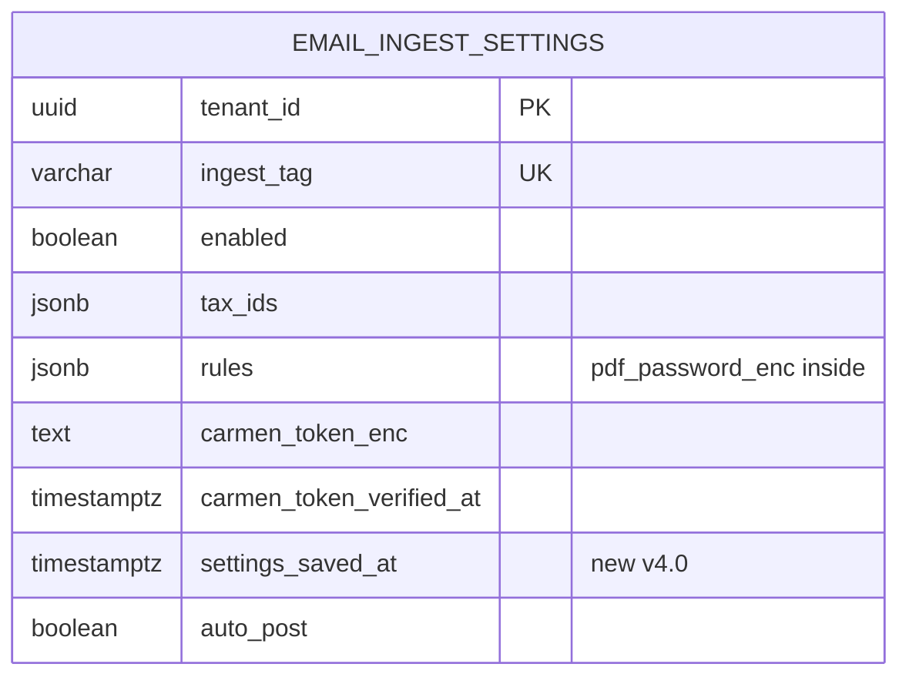
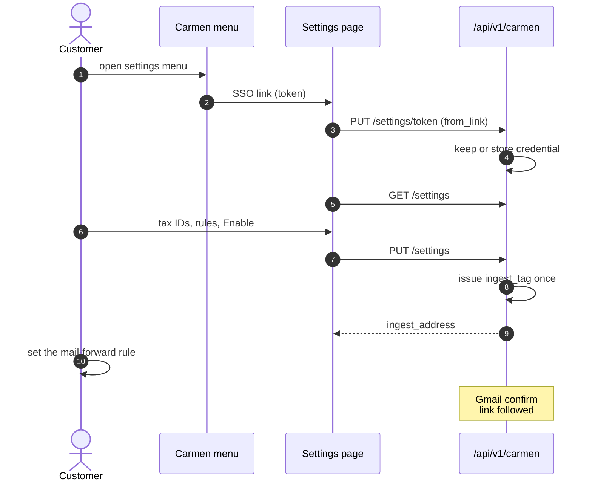
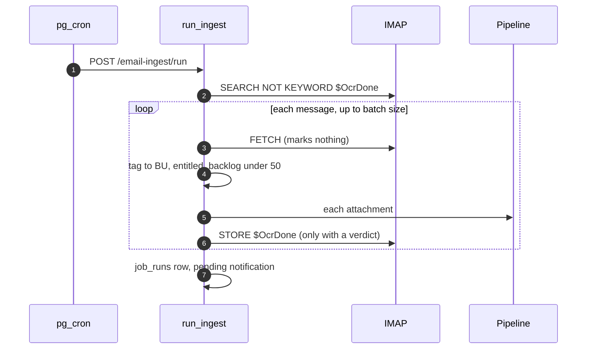
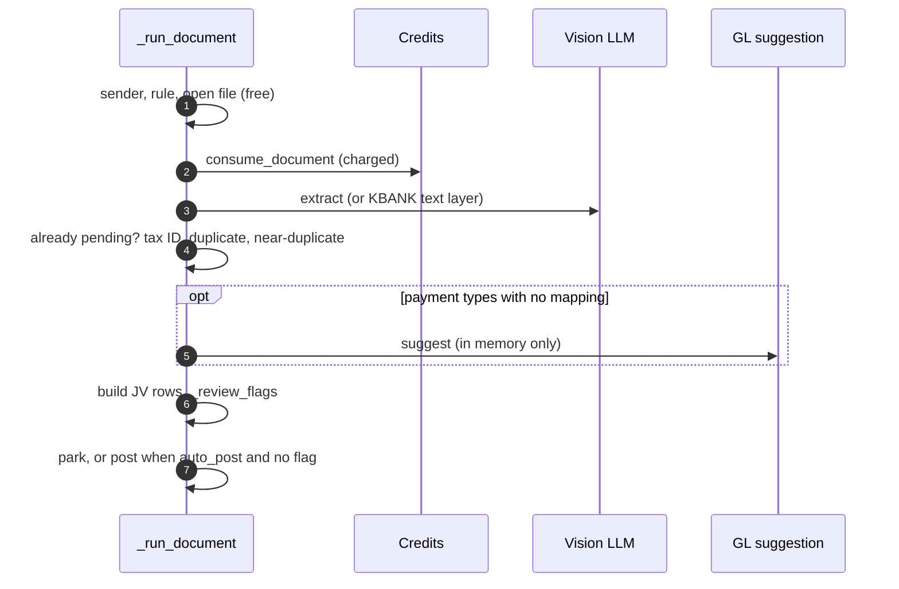
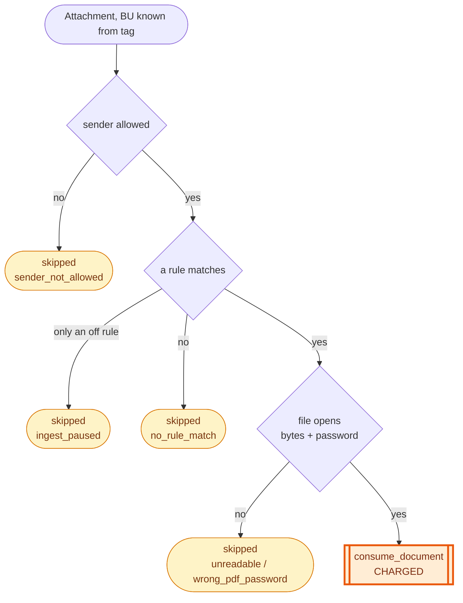
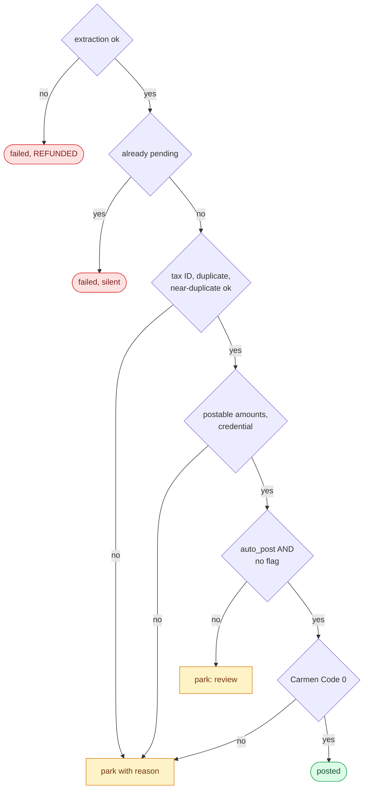
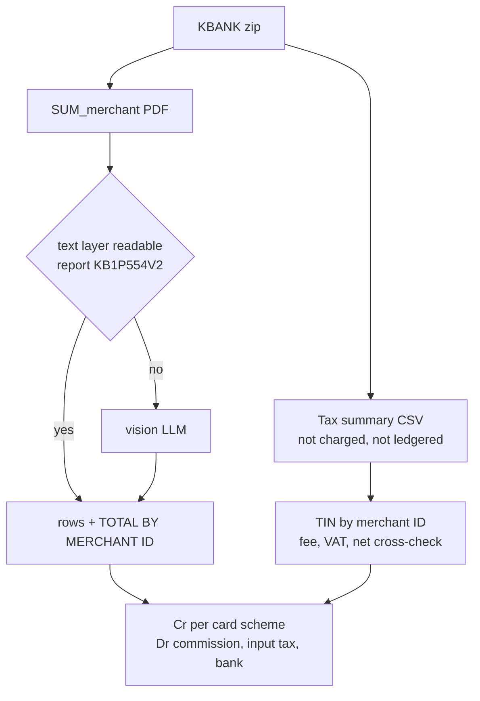
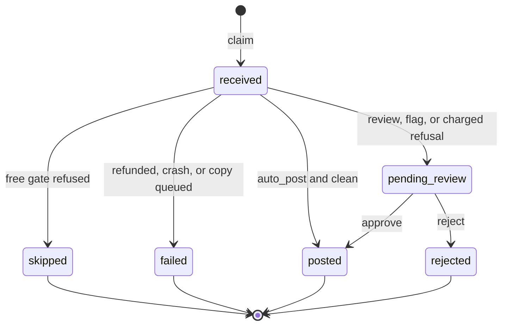

**Smart Credit Card Tax Ingestion & Auto-JV**

**เอกสารที่เกี่ยวข้อง:** การอ่านเอกสาร, GL mapping และการ post JV ใช้ระบบเดียวกับ wizard (FRD-01) — คิวตรวจ, การ approve/reject และ chip ของหน้า `#/CreditCardOCR` อยู่ใน FRD-12 — การยื่นภาษีซื้อหลัง JV อยู่ใน FRD-09 — layout ของ gateway และ BAY อยู่ใน FRD-10

## Document Revision History

| Version | Date | Author | Description of Changes | Approved By |
|---|---|---|---|---|
| 0.1 | 24/08/2026 | Senior SA/BA | Initial Draft — Requirements & Flow Gathering | Product Team |
| 1.0 | 24/08/2026 | Senior SA/BA | Final Specification with Edge Cases, DB Schemas, and Acceptance Criteria | Lead Developer |
| 1.1 | 24/08/2026 | Senior SA/BA | Added Section 12: Comprehensive Test Cases & QA Matrix | QA Lead / SA |
| 2.0 | 24/08/2026 | Dev Team | ปรับเนื้อหาทั้งฉบับตามระบบที่ build เสร็จและ live-test แล้ว — เพิ่ม Sequence Diagram, API Specifications, User Operational Workflow และ Data Dictionary | Dev Team |
| 2.1 | 25/08/2026 | Dev Team | เพิ่ม Mermaid diagram 7 ชุด | Dev Team |
| 2.2 | 25/08/2026 | Dev Team | ปรับ diagram ให้อ่านออกจริงบนหน้ากระดาษ แยก gate ladder เป็น 8.4a/8.4b | Lead Dev |
| 3.0 | 08/09/2026 | Dev Team | ปรับทั้งฉบับตามฟีเจอร์ human-in-the-loop review queue (95 commits, feat/email-hitl-review) — เพิ่มขั้นตอนอนุมัติก่อน post, การตั้งค่า auto_post ต่อ BU, หน้าจอ Review Queue/Activity ใหม่, สถานะ ledger ใหม่ 2 ค่า (pending_review, rejected), คอลัมน์ฐานข้อมูลใหม่ 4 คอลัมน์ และตารางใหม่ 1 ตาราง | Dev Team |
| 3.1 | 08/09/2026 | Dev Team | **(feat/auto-post-single-writer)** — ลบ PUT /api/v1/email/settings/auto-post และช่องตั้งค่าแยกบนหน้า Review Queue ทิ้งทั้งคู่ auto_post กลายเป็น field หนึ่งใน PUT /settings ที่มีพฤติกรรม merge (ไม่ส่ง = คงค่าเดิม) เป็นข้อยกเว้นเดียวของ endpoint นี้ที่ปกติเป็น full-replace | Dev Team |
| 4.0 | 27/10/2026 | Dev Team | ปรับตามโค้ด ณ `945c63ea` — (1) หน้าตั้งค่าเป็นของแอป `#/CreditCardOCR/email-settings` เปิดจากเมนูของ Carmen ผ่าน SSO (decision-log #34) (2) token ในลิงก์ของเมนูเป็น credential สำหรับ post ตัวเดียว (#35, #38) และไม่แทนที่ credential ที่ยังใช้ได้ (#45) (3) KBANK: สวิตช์ Detailed Credit Card AR Reconciliation พร้อม merchant ID อ่าน settlement report เป็น JV เดียว ตรวจกับ tax summary CSV ในไฟล์ zip เดียวกัน (#28, #31, #36, #37) (4) คิวของ mailbox ใช้ keyword `$OcrDone` แทน `\Seen` (5) `+tag` ต้องอยู่บนที่อยู่ของเราเป๊ะ (6) near-duplicate (F-7) (7) rule ที่ปิดอยู่ให้ผล `ingest_paused` (8) retention ของ `email_documents` (9) sweep ยืนยัน Gmail เปิดตาม `settings_saved_at` (#46) (10) สเปกคิวย้ายไป FRD-12 และภาษีซื้อไป FRD-09 | Reviewed |
| 4.1 | 28/10/2026 | Dev Team | ตาราง `email_queue_seen` (§6.3 เดิม) ถูก drop พร้อมจุดเตือนของคิว (FRD-12 v1.1–v1.2) Retention เลื่อนเป็น §6.3 และ `dismissed_at` ไม่มีผู้อ่านแล้ว | |

<!-- pagebreak -->

# 1. Executive Summary & Objective

ฟังก์ชัน Smart Credit Card Tax Ingestion & Auto-JV ถูกออกแบบขึ้นเพื่อเพิ่มประสิทธิภาพและลดภาระงานแบบ Manual ของทีมบัญชีโรงแรม ในการบันทึกใบกำกับภาษีค่าธรรมเนียมบัตรเครดิตจากธนาคารและผู้ให้บริการชำระเงิน

ระบบรับอีเมลที่ลูกค้า forward มา ถอดรหัสไฟล์ PDF อ่านตัวเลขและภาษีซื้อ ทำ Mapping รหัสบัญชี/แผนกด้วย AI แล้วเตรียม Journal Voucher เข้า Carmen พร้อมยื่นภาษีซื้อ (AP Input Tax Reconciliation)

**มีคนตรวจก่อน post เป็นค่าเริ่มต้น (ตั้งแต่ v3.0)** — เอกสารทุกใบรออนุมัติในคิว (FRD-12) เว้นแต่ BU จะเปิดสวิตช์ post โดยไม่ต้องตรวจ (`auto_post`, ค่าเริ่มต้นปิด) แม้เปิดแล้ว เอกสารที่มีสิ่งน่าสงสัย (ยอดไม่ลงตัว, GL mapping ที่ AI เดา, ไม่มีเลขที่เอกสาร, tax ID ยังไม่ยืนยัน, คำเตือนจากการอ่าน) ก็ยังต้องผ่านคน

**สิ่งที่เปลี่ยนใน v4.0:**

- **หน้าตั้งค่าเป็นของแอป** — Carmen ทำแค่เมนูที่เปิดหน้า `#/CreditCardOCR/email-settings` ผ่านลิงก์ SSO ลิงก์เดียวกับคิว ไม่ต้องสร้างฟอร์มเอง (decision-log #34)
- **Token เดียว** — `token` ในลิงก์ของเมนูคือ credential ที่ BU ใช้ post ด้วย หน้าตั้งค่าเก็บให้ก่อนอ่านอะไร และไม่แทนที่ credential ที่ยังใช้ได้อยู่ (#38, #45) ลูกค้าไม่ต้องวาง token เอง
- **KBANK settlement report** — เปิดสวิตช์ "Detailed Credit Card AR Reconciliation" บน rule ของ KBANK แล้วระบบอ่าน settlement report (`SUM_<merchant_id>`) เป็น JV เดียวที่มีทั้งฝั่งประเภทบัตรและค่าคอมมิชชัน/ภาษี/เงินเข้าบัญชี แทนใบกำกับค่าธรรมเนียม (#28, #37)

กลไกการรับอีเมล: IMAP polling ทุก 10 นาทีจาก mailbox กลาง แต่ละ BU มีที่อยู่ของตัวเอง `AIAGENT+<tag>@carmensoftware.com` — tag ในที่อยู่ (ไม่ใช่เนื้อหาเอกสาร) เป็นตัวบอกว่าเป็นของ BU ไหน และอ่านได้ฟรีก่อนเรียก LLM ใดๆ

## 1.1 System Context Diagram (ภาพรวมการไหลของข้อมูล)

```mermaid 1.1 | The tag routes the mail; the queue stands between the pipeline and Carmen
flowchart TB
    BANK[Bank / gateway mail] -->|forward rule| MBX[Shared mailbox<br/>AIAGENT+tag]
    CRON[pg_cron every 10 min] --> PIPE[Ingest pipeline<br/>route by tag, gates<br/>extract, GL map]
    MBX --> PIPE
    PIPE --> Q[Review queue<br/>FRD-12]
    Q -->|approve or auto_post| C[Carmen ERP<br/>gljv + inputTaxRec]
    MENU[Carmen menu<br/>SSO link + token] --> SET[Settings page<br/>#/CreditCardOCR/email-settings]
    SET --> DB[(email_ingest_settings)]
    PIPE --> DB
```

# 2. Scope of Work

## 2.1 In-Scope (ขอบเขตการทำงานของระบบ)

- **Email Ingestion Engine (IMAP Polling ทุก 10 นาที):**
  - รองรับ Auto-forward (ลูกค้าตั้ง rule เอง) และ Manual forward (พนักงาน forward เอง)
  - ที่อยู่ต่อ BU ออกครั้งเดียวตอนเปิดใช้ครั้งแรก ไม่ออกใหม่อีก — `+tag` ต้องอยู่บนที่อยู่ของเราเป๊ะ (โดเมนที่คล้ายกันถูกปฏิเสธ) อ่านจาก Delivered-To / Received…for ไม่ใช่ To:
  - เมลที่รอประมวลผลคือเมลที่ยังไม่มี keyword `$OcrDone` (ไม่ใช่ `\Seen`) — การเปิดอ่านเมลใน Gmail จึงไม่ทำให้เอกสารหาย
  - ทุกไฟล์แนบที่ตรง rule ประมวลผลแยกกัน รองรับแตกไฟล์ .zip
- **Bank Rules & Decryption:**
  - sender allow-list (ไม่บังคับ — ว่าง = รับทุกผู้ส่ง) และ rule ต่อธนาคาร (bank_code, ผู้ส่ง, รูปแบบชื่อไฟล์, รหัส PDF, เปิด/ปิด)
  - ถอดรหัส PDF ด้วยรหัสของ BU นั้นเท่านั้น (เข้ารหัสด้วย Fernet ดู §10)
  - rule ที่ปิดอยู่: ไฟล์ที่ตรงกับ rule นั้นบันทึกเป็น `ingest_paused` (ไม่เสียเครดิต) ให้ BU รู้ว่าต้องคีย์เอง
- **KBANK Detailed Credit Card AR Reconciliation (ใหม่ v4.0):** สวิตช์บน rule ของ KBANK เลือกระหว่างใบกำกับค่าธรรมเนียม (`E-TAX_INVOICE_CARD_*`) กับ settlement report (`SUM_<merchant_id>`) — ดู §4.2 และ §8.5
- **AI Code Mapping:** อ่านเลขที่, วันที่, ค่าธรรมเนียม, ภาษีซื้อ และยอดรวม แล้วเสนอแผนก/บัญชีให้ payment type ที่ยังไม่มี mapping — คำแนะนำของ AI **ไม่ถูกเขียนลงผังบัญชีของ BU** จนกว่าคนจะกด Approve (decision-log #25)
- **Review queue:** เอกสารที่ผ่านทุกด่านของเครื่องพักที่ `pending_review` เว้นแต่ `auto_post` เปิดและไม่มี flag — การปฏิเสธหลังอ่านเอกสารแล้วก็พักไว้ให้คนตัดสินพร้อมเหตุผล (FRD-12)
- **Duplicate Prevention:** ซ้ำกับที่ post แล้ว, อาจซ้ำกับที่ post แล้ว (วันที่เดียวกัน เลขที่ใกล้เคียง — F-7) และซ้ำกับใบที่รออยู่ในคิว
- **Auto Integration to AP Input Tax Reconciliation:** ยื่นภาษีซื้อต่อจาก JV — ล้มเหลวได้โดยไม่ rollback JV (FRD-09)
- **หน้าตั้งค่าในแอป (ใหม่ v4.0):** ที่อยู่สำหรับ forward, การเปิดใช้, post โดยไม่ต้องตรวจ, bank rules, tax ID ของบริษัท, อีเมลของบริษัท และสถานะ credential
- **Gmail forwarding confirmation:** ระบบกดลิงก์ยืนยันของ Gmail ให้เอง — sweep ทุกนาทีเปิด mailbox เฉพาะ BU ที่เพิ่งบันทึกค่าตั้งภายใน 24 ชั่วโมง (#46)
- **Retention:** แถวของ ledger ถูกล้างข้อมูลส่วนบุคคลและลบตามอายุ (§6.3)

## 2.2 Out-of-Scope (สิ่งที่อยู่นอกเหนือขอบเขต)

| ไม่ทำ | ผู้ใช้ต้องทำอะไรแทน / อยู่ที่ไหนแทน |
|---|---|
| รูปแบบขาบัญชี Debit/Credit แบบกำหนดเอง | ระบบใช้ pattern มาตรฐานของค่าธรรมเนียมบัตร (FRD-01 §4.5) และของ settlement report (§8.5) |
| AP invoice ทางอีเมล | ใช้ wizard AP Invoice (FRD-02) |
| Retry อัตโนมัติ | ไม่มี sweep ส่งซ้ำ — เอกสารที่ปฏิเสธหลังอ่านแล้วรอคนในคิว ส่วนที่อ่านไม่ได้ต้อง forward ใหม่ |
| ส่งอีเมลออก (SMTP) และ webhook แจ้ง Carmen | ไม่มีเส้นทางส่งออกในระบบ การแจ้งเตือนอยู่ที่กระดิ่งในแอป |
| Un-reject, บังคับสิทธิ์ผู้อนุมัติ, ดูไฟล์ต้นฉบับใน dialog | ดู FRD-12 §2.2 |
| ฟอร์มตั้งค่าบนหน้าจอของ Carmen | Carmen ทำเฉพาะเมนูที่เปิดหน้าตั้งค่าของแอป |
| settlement report รุ่นอื่นนอกจาก `KB1P554V2` | ถ้า KBANK เปลี่ยนรุ่นรายงาน ไฟล์จะไม่ตรง rule และไม่มี JV ใด post — เป็นความเสี่ยงที่รับไว้ (decision-log #28) |

<!-- pagebreak -->

# 3. Feature List & Sub-Modules

<!-- widths: 9,23,36,32 -->
| Feature ID | ชื่อฟีเจอร์ | คำอธิบาย | Source |
|---|---|---|---|
| F-01 | Mailbox transport | IMAP, MIME, แตก zip, อ่าน tag, keyword `$OcrDone` — ไม่แตะฐานข้อมูล | `services/email_automation/imap.py` |
| F-02 | Poll & routing | รอบ poll, routing ระดับ message, entitlement, backlog cap | `services/email_automation/ingest.py` (`run_ingest`) |
| F-03 | Document pipeline | ทุกอย่างที่ตัดสินความหมายและค่าใช้จ่ายของเอกสารหนึ่งใบ | `services/email_automation/pipeline.py` (`_run_document`) |
| F-04 | Ledger | claim, park, finish, กันซ้ำ, flag ของคิว | `services/email_automation/ledger.py` |
| F-05 | Settings service | บันทึก/อ่านค่าตั้ง, ตรวจ tax ID, ออก tag | `services/email_automation/ingest_settings.py` (`save_settings`) |
| F-06 | Credential | credential ของ BU, ใช้ token จากลิงก์เมื่อของเดิมใช้ไม่ได้ | `services/email_automation/credential.py` (`adopt_token`, `posting_target`) |
| F-07 | Settings API | endpoint ที่หน้าตั้งค่าเรียกด้วย Carmen token | `routers/email_automation/settings_api.py` |
| F-08 | Review | approve / reject (FRD-12) | `services/email_automation/review.py` |
| F-09 | Settings page | หน้าตั้งค่าของ BU | `features/email-settings/pages/EmailSettings.tsx` |
| F-10 | KBANK settlement | อ่าน settlement report จาก text layer, ตรวจกับ CSV | `services/credit_card/kbank_settlement_text.py`, `services/credit_card/kbank_tax_summary.py` |
| F-11 | Notifications | กระดิ่ง: เอกสารรอตรวจ (รวมยอด), post แล้ว, ถูกบล็อก | `email_automation/ingest.py`, `email_automation/ledger.py` |

# 4. User Interface (UI) Specs & Field Mapping

## 4.1 หน้าตั้งค่า — `#/CreditCardOCR/email-settings` (ใหม่ v4.0)

เปิดจากเมนูของ Carmen (ลิงก์ SSO เดียวกับคิว) หรือจากปุ่ม Open settings / Reconnect ของคิว ซึ่งพาไปหน้า `/setting` ของ Carmen ก่อน ไม่มีปุ่มบนหน้า Home ของแอป หน้านี้เป็นภาษาอังกฤษ และไม่มีการตรวจสิทธิ์ซ้ำ — Carmen เป็นผู้ตัดสินว่าใครเห็นเมนู

| ส่วน | เนื้อหา |
|---|---|
| Service status / To start receiving | พร้อมรับเอกสารหรือยัง และสิ่งที่ยังขาด (blockers) เช่น ยังไม่มี tax ID, ไม่มีแพ็กเกจรายเดือน, ไม่มี credential |
| Forwarding address | `AIAGENT+<tag>@carmensoftware.com` ของ BU และสถานะการยืนยัน Gmail |
| Processing | สวิตช์เปิดใช้ (`enabled`) และสวิตช์ post โดยไม่ต้องตรวจ (`auto_post`) |
| Bank rules | รายการ rule ต่อธนาคาร แก้ใน dialog (§4.2) |
| Your company | tax ID ของบริษัท (อย่างน้อย 1) และอีเมลของบริษัท (sender allow-list, ไม่บังคับ) |
| Posting credential | สถานะเท่านั้น (ยืนยันแล้วเมื่อไร, fingerprint) — ไม่มีช่องวางหรือลบ token |

**Settings Payload (`PUT /api/v1/carmen/settings`):**

<!-- widths: 20,13,10,37,20 -->
| Field Name | Data Type | M/O | Meaning & Business Logic | Example |
|---|---|---|---|---|
| `ingest_address` | Text | Read-only | ออกให้อัตโนมัติครั้งแรกที่ enable ไม่ออกใหม่อีก | AIAGENT+a1b2c3d4@carmensoftware.com |
| `tax_ids[]` | Array | M (≥ 1 เมื่อเปิดใช้) | เลขผู้เสียภาษี 13 หลักของ BU — ไม่ซ้ำกับ BU อื่น และห้ามเป็นเลขของธนาคาร | 0105567890123 |
| `owner_emails[]` | Array | O | sender allow-list — ว่าง = รับทุกผู้ส่ง | accounting@grandhotel.com |
| `rules[]` | Array | M | §4.2 — หนึ่ง rule ต่อธนาคาร | — |
| `enabled` | Boolean | M | เปิดใช้ — ต้องมีแพ็กเกจรายเดือนที่ active และ tax ID | true |
| `auto_post` | Boolean / null | O (merge) | ค่าเริ่มต้น false — field เดียวที่ไม่ส่ง = คงค่าเดิม หน้าจอส่งเฉพาะเมื่อผู้ใช้เปลี่ยนสวิตช์ | true |

## 4.2 Bank rule (dialog)

| Field | M/O | Meaning |
|---|---|---|
| `bank_code` | M | ธนาคาร/ผู้ให้บริการ (จาก `GET /api/v1/carmen/bank-codes`) — เอกสารบอกผู้ออกของตัวเอง rule เป็นเพียงค่าสำรอง (decision-log #21) |
| `bank_sender_email` | O | อีเมลผู้ส่งของธนาคาร |
| `filename_patterns[]` | M (ยกเว้น KBANK) | ส่วนของชื่อไฟล์ที่นับเป็นเอกสาร — ไฟล์ที่ไม่ตรงไม่ถูกประมวลผล |
| `pdf_password` | O (write-only) | ไม่ส่ง = คงเดิม, ค่าว่าง = ลบ, ค่า = ตั้งใหม่ — API คืนเพียง `has_password` |
| `is_active` | M | ปิด rule = ไฟล์ของธนาคารนี้เป็น `ingest_paused` |
| `doc_type` | O | `fee_invoice` (ค่าเริ่มต้น) หรือ `ar_reconcile` — สวิตช์ "Detailed Credit Card AR Reconciliation" ของ KBANK |
| `merchant_id` | O | merchant ID ของ KBANK สำหรับโหมด settlement |

**Rule ของ KBANK (decision-log #37):** `doc_type` เป็นตัวเลือกไฟล์ ไม่ใช้ filename pattern

| สวิตช์ AR Reconciliation | อ่านไฟล์ | Tax summary CSV ใน zip เดียวกัน |
|---|---|---|
| ปิด (`fee_invoice`) | `E-TAX_INVOICE_CARD_*` | ถ้ามี: ใช้ TIN ตรวจตัวตน และตรวจค่าธรรมเนียม/VAT ซ้ำ — ไม่มีก็ได้ |
| เปิด (`ar_reconcile`) | `SUM_<merchant_id>` เท่านั้น | ถ้ามี: ใช้ TIN และตรวจยอดซ้ำ — ไม่มี → flag `tin_unverified` (ไม่ auto-post) |

rule อื่นจะอ้างไฟล์ทั้งสองแบบของ KBANK ไม่ได้ และไฟล์ใบกำกับค่าธรรมเนียมที่มาถึงขณะเปิดโหมด settlement จะไม่ถูก post ซ้ำ

## 4.3 คิวตรวจ

หน้า `#/CreditCardOCR` และ dialog ตรวจ `?id=` — ดู FRD-12 ทั้งหมด (field ของแถว, เหตุผล, chip, ปุ่ม)

# 5. Action Buttons & Business Logic

<!-- widths: 20,14,66 -->
| Button Name | Action Type | Business Logic / System Behavior |
|---|---|---|
| เปิดเมนู AI JV Automation settings (Carmen) | SSO link | เปิด `#/CreditCardOCR/email-settings?token=&bu=&uri=` — หน้าจอเรียก `PUT /api/v1/carmen/settings/token` ด้วย token ของลิงก์ (`from_link: true`) **ก่อนอ่านค่าใดๆ** ถ้า BU มี credential ที่ยังใช้ได้ ระบบคงตัวเดิม (#45) |
| Enable | Toggle + Save | `PUT /api/v1/carmen/settings` `enabled: true` — ต้องมี tax ID และแพ็กเกจรายเดือนที่ active ครั้งแรกออก `ingest_tag` |
| Post without review | Toggle | `PUT /api/v1/carmen/settings` ส่ง `auto_post` เฉพาะเมื่อสวิตช์ถูกเปลี่ยน — ไม่ส่งไปกับการบันทึกอื่น เพื่อไม่ให้ค่าเก่าในฟอร์มเขียนทับค่าที่เพื่อนร่วมงานเพิ่งเปลี่ยน |
| Add / Edit bank rule | Dialog | บันทึกทันทีที่กด Save ใน dialog (rules ทั้ง array ถูกแทนที่) |
| AR Reconciliation (KBANK) | Toggle ใน dialog | เปลี่ยน `doc_type` ของ rule KBANK และให้กรอก merchant ID |
| Reload | Refresh | อ่านค่าตั้งใหม่ |
| Approve / Reject / Fix buttons | Queue | ดู FRD-12 |
| In-app Notification Bell | Drawer | แจ้งเตือนเมื่อมีเอกสารรอตรวจ (ยอดรวมต่อ BU), เมื่อ post สำเร็จในเส้นทาง auto-post เมื่อเอกสารล้มเหลว และเมื่อเอกสารถูกบล็อกด้วยสาเหตุที่ BU แก้ได้แต่จะไม่เห็นเป็นอย่างอื่น (รหัส PDF ผิด, ไฟล์แนบไม่รองรับ) — ผู้ส่งที่ไม่อยู่ใน list และ rule ที่ปิดแสดงในคิวแต่ไม่ส่งแจ้งเตือน |

<!-- pagebreak -->

# 6. Database Schema & Tables

ฐานข้อมูล: PostgreSQL (Supabase) — DDL หลักจาก `20260803000000_email_automation.sql` และ migration ต่อเนื่อง (ล่าสุด `20261021000000_email_settings_saved_at.sql`)

## 6.1 email_ingest_settings — หนึ่งแถวต่อ BU

<!-- widths: 26,74 -->
| Column | ความหมาย |
|---|---|
| `tenant_id` (PK) | BU |
| `ingest_tag` | tag ใน `+tag` — nullable, unique เมื่อมีค่า, ออกครั้งเดียว |
| `enabled` / `enabled_at` | เปิดใช้ และเวลาที่เปิดล่าสุด — เมลที่มาถึงก่อน `enabled_at` เป็น `ingest_paused` |
| `owner_emails` / `tax_ids` / `rules` | ค่าตั้งของ §4 — รหัส PDF ใน rules เข้ารหัส Fernet |
| `carmen_token_enc` / `carmen_uri` / `carmen_token_fp` | credential สำหรับ post (Fernet), origin ของ Carmen, fingerprint 8 hex |
| `carmen_token_verified_at` | ยืนยันล่าสุดเมื่อไร — ล้างเฉพาะเมื่อ Carmen ปฏิเสธจริง (401/403) ค่า null คือสิ่งที่อนุญาตให้ token จากลิงก์แทนที่ (#45) |
| `gmail_confirmed_at` (+ `gmail_confirm_code`, `gmail_confirm_at`) | Gmail ยืนยันการ forward แล้ว |
| `settings_saved_at` (ใหม่ v4.0) | เวลาที่คนบันทึกค่าตั้งล่าสุด — เขียนโดย `save_settings` เท่านั้น เปิดหน้าต่างของ sweep ยืนยัน Gmail 24 ชั่วโมง (#46) |
| `auto_post` | ค่าเริ่มต้น false — ผู้เขียนเดียวคือ `PUT /api/v1/carmen/settings` และเป็น field เดียวที่ merge เมื่อไม่ส่ง |

## 6.2 email_documents — หนึ่งแถวต่อ (message × attachment)

<!-- widths: 26,74 -->
| Column | ความหมาย |
|---|---|
| `message_id` / `attachment` | key ของการกันประมวลผลซ้ำ (unique ร่วมกับ `tenant_id`) |
| `status` | `received` / `pending_review` / `posted` / `rejected` / `failed` / `skipped` |
| `task_id` / `bank_code` / `doc_no` / `jv_no` | งาน OCR, ธนาคาร (บันทึกแม้ล้มเหลว เพื่อจับว่าธนาคารเปลี่ยนรูปแบบเอกสาร), เลขที่, เลข JV |
| `reason_code` / `error_message` | สาเหตุ (§9) และรายละเอียด |
| `review_payload` | มีค่าเฉพาะตอน `pending_review` — ล้างทุกครั้งที่จบสถานะ |
| `posting_started_at` | claim ของ approve/reject (FRD-12) |
| `reviewed_by` / `reviewed_by_name` / `reviewed_at` | ผู้อนุมัติหรือปฏิเสธ |
| `dismissed_at` | ไม่มีผู้อ่านหรือผู้เขียนแล้วตั้งแต่ FRD-12 v1.1 — เก็บไว้เป็นประวัติ |
| `auth_verdict` (ใหม่ v4.0) | ผลตรวจผู้ส่งจาก MX ของเราเอง เช่น `dmarc=pass dkim=pass` — **วัดผลอย่างเดียว** ยังไม่มีด่านใดอ่าน |

## 6.3 Retention (`fn_purge_email_documents`, ทุกวัน 03:50 UTC)

| สถานะ | ผล |
|---|---|
| `skipped` | ลบเมื่อ 90 วัน |
| สถานะอื่น (ยกเว้น `pending_review`) | ล้าง `review_payload`, ชื่อผู้ตรวจ, `error_message` และชื่อไฟล์ (เป็น `scrubbed:<id>`) เมื่อ 90 วัน และลบเมื่อ 2 ปี |
| `pending_review` | ไม่แตะ — มีเพดาน 50 ใบต่อ BU |

ปลอดภัยต่อการกันซ้ำเพราะ 90 วันยาวกว่าช่วงที่ IMAP ค้นย้อน (14 วัน) มาก

## 6.5 Dedupe Key — 4 ชั้น

| Key | กันอะไร | อยู่ที่ไหน |
|---|---|---|
| (tenant_id, message_id, attachment) | เมลเดียวกันถูกประมวลผลซ้ำ | unique index บน `email_documents` (`_claim`) |
| (tenant, doc_no, doc_date, doc_type) เมื่อ submitted_at IS NOT NULL | เอกสารเดียวกันมาถึงในเมลคนละฉบับ หลัง post แล้ว | `finalize_extraction` (FRD-01 §6.2) → พักพร้อม `duplicate_document` |
| เลขที่ "ซ้อน" กับที่ post แล้วในวันที่เดียวกัน (ใหม่ v4.0) | การอ่านเลขที่ผิดที่เพิ่มหรือตัดตัวอักษร | `_possibly_posted()` → พักพร้อมเลขที่ที่ต้องไปดูใน Carmen |
| (tenant, bank_code, doc_no, doc_type) เมื่อ status = pending_review | เอกสารเดียวกันมาซ้ำขณะใบแรกรออยู่ | `_already_pending()` → `failed` ไม่แจ้งเตือน |

## 6.6 Entity Relationship Diagram



```mermaid 6.6b | email_documents — the ledger, one row per message and attachment
erDiagram
    EMAIL_DOCUMENTS }o--o| OCR_TASKS : task_id
    EMAIL_DOCUMENTS {
        uuid id PK
        varchar message_id UK
        varchar attachment UK
        varchar status
        varchar reason_code
        jsonb review_payload
        timestamptz posting_started_at
        varchar auth_verdict "new v4.0"
    }
```

<!-- pagebreak -->

# 7. Required Data Tables (System Integrations)

ทุกคำขอไป Carmen ใช้ base URL `{carmen_uri}/Carmen.API/api/interface` ที่สร้างจาก `tenants.host` (ผ่าน SSRF check) ไม่ใช่ค่าจาก payload

| ปลายทาง | เรียกตอนไหน |
|---|---|
| `GET /department` | พิสูจน์ token ทุกครั้งที่เรียก Settings API และตอนเก็บ credential, ดึงแผนกให้ AI |
| `GET /accountCode` | ผังบัญชีให้ AI |
| `GET /taxProfile` | tax profile ก่อนยื่นภาษีซื้อ (FRD-09) |
| `POST /gljv` | post JV — เมื่อ auto_post เปิดและไม่มี flag หรือเมื่อคนกด Approve |
| `POST /inputTaxRec` | ยื่นภาษีซื้อ — ล้มเหลวได้โดยไม่กระทบ JV |
| Shared IMAP mailbox (Gmail) | poll ทุก 10 นาที (`email-ingest`), ยืนยันการ forward (`email-confirm`) |
| Vision LLM (OpenRouter) | อ่านเอกสาร 1 ครั้งต่อไฟล์ ยกเว้น settlement report ของ KBANK ที่อ่านจาก text layer ก่อน (ถ้าอ่านไม่ได้จึงใช้ LLM) |

**Credential ที่ใช้ post:** credential เดียวของ BU (`carmen_token_enc`) ทั้งสองเส้นทาง ไม่ใช่ token ของคนกด Approve อ่านใหม่ทุกครั้ง และใช้ร่วมกับ PMS Interface (FRD-11)

**ที่มาของ credential (ใหม่ v4.0):**

| ที่มา | ผล |
|---|---|
| ลิงก์ของเมนู Carmen ที่เปิดหน้าตั้งค่า (`from_link: true`) | แทนที่ credential เดิมเฉพาะเมื่อของเดิมไม่มี, เป็นตัวเดียวกัน หรือ Carmen ปฏิเสธไปแล้ว (#45) |
| `PUT /settings/token` ที่ไม่ใช่จากลิงก์ | แทนที่เลย หลังพิสูจน์กับ Carmen |
| ลิงก์ของคิว | ไม่แตะ credential (token ของผู้ใช้อาจหมดอายุเร็ว) |
| การเขียนจากหน้า PMS setting ของ Carmen | กติกาเดียวกับลิงก์ (FRD-11) |
| ตรวจรายวัน (`email-token-health`) | ยืนยันซ้ำทุก BU ที่เปิดใช้ ถ้า Carmen ปฏิเสธจึง mark ว่าใช้ไม่ได้ |

# 8. Workflow & End-to-End Walkthrough

## 8.1 Sequence — Onboarding (ใหม่ v4.0)



## 8.2 Sequence — หนึ่งรอบ Poll ทุก 10 นาที



**Backlog cap:** ถ้า BU มีเอกสารรอตรวจครบ 50 ใบ เมลของ BU นั้นถูกคืนในสภาพยังไม่ทำ ไม่สร้างแถว ไม่เสียเครดิต และลองใหม่รอบถัดไป — กลไกเดียวกับตอนเครดิตหมด

## 8.3 Sequence — หนึ่งเอกสาร



## 8.4 Gate Ladder — ลำดับการตรวจและผลต่อเครดิต





| ลำดับ | เงื่อนไข | ถ้าไม่ผ่าน | Status | เครดิต |
|---|---|---|---|---|
| 1 | ผู้ส่งอยู่ใน allow-list (ถ้ามี) | `sender_not_allowed` | skipped | ไม่เสีย |
| 2 | มี rule ที่เปิดอยู่ตรงกับไฟล์ | `ingest_paused` (มีแต่ rule ที่ปิด) / `no_rule_match` | skipped | ไม่เสีย |
| 3 | เปิดไฟล์ได้ (magic bytes + รหัสของ BU) | `unreadable_document` / `wrong_pdf_password` | skipped | ไม่เสีย |
| — | **consume_document() หักเครดิตที่จุดนี้** | — | — | **เริ่มเสีย** |
| — | extraction สำเร็จ | `unreadable_document` | failed | **คืน** — กรณีเดียวที่คืน |
| 4 | ไม่ซ้ำกับใบที่รออยู่ในคิว | `duplicate_document` | failed (ไม่แจ้งเตือน) | ไม่คืน |
| 5 | tax ID อยู่ในทะเบียนของ BU, ไม่ซ้ำกับที่ post แล้ว, ไม่ "อาจซ้ำ" | `tax_id_mismatch` / `duplicate_document` | **pending_review** | ไม่คืน |
| 6 | มียอดที่ post ได้ และมี credential + host | `unreadable_document` / `carmen_unauthorized` | **pending_review** | ไม่คืน |
| 7 | `auto_post` เปิด และไม่มี flag | (ไม่มี reason — รอคน) | **pending_review** | ไม่คืน |
| 8 | Carmen ตอบ `Code: 0` | `carmen_rejected` / `carmen_unauthorized` | **pending_review** | ไม่คืน |
| ✔ | ผ่านทุกด่าน หรือคนกด Approve | — | posted | เสีย 1 |

**กฎที่สำคัญที่สุด (ไม่เปลี่ยน): เครดิตผูกกับการเรียก LLM ไม่ได้ผูกกับผลลัพธ์** และเอกสารที่เสียเครดิตแล้วยังตรวจได้ (decision-log #22) กรณีที่จบเป็น `failed` หลังอ่านแล้วมีเพียง: exception ที่ไม่ได้คาดไว้ (อาจเกิดหลัง JV post แล้ว), การคืนเครดิต และสำเนาของใบที่รออยู่แล้ว

## 8.5 KBANK settlement report (ใหม่ v4.0)



| ส่วน | กติกา |
|---|---|
| ฝั่ง Cr | หนึ่งบรรทัดต่อประเภทบัตร (THB AMT) — Credit breakdown แบบ Detail (ตามที่พิมพ์) หรือ Summary (รวมตามแบรนด์ VS / MC / JCB) ตั้งที่หน้า mapping (FRD-01 §4.4) — กลุ่มที่ยอดติดลบสลับไปฝั่ง Dr |
| ฝั่ง Dr | Credit card commission, Input Tax, Bank Account จากแถว `TOTAL BY MERCHANT ID` (COMM AMT, VAT AMT, NET AMT) ด้วย mapping ชุดเดียวกับใบกำกับค่าธรรมเนียม |
| การตรวจ | Σ THB AMT = ยอดรวมที่พิมพ์, THB AMT = COMM + VAT + NET บนแถวรวม, merchant ID ในชื่อไฟล์ = บนหน้า, และ CSV (ถ้ามี) — ไม่ตรง = คำเตือน → พักรอคน |
| ตัวตน BU | หน้ารายงานไม่มี tax ID — ใช้ TIN จาก CSV ตาม merchant ID ไม่มีแถว CSV = flag `tin_unverified` |
| ภาษีซื้อ | settlement report ยื่นภาษีซื้อของตัวเองจากแถวรวม (FRD-09) และใบกำกับค่าธรรมเนียมของวันนั้นไม่ถูก post ซ้ำ |
| เครดิต | 1 ต่อไฟล์ เหมือนเอกสารอื่น — การอ่านจาก text layer ไม่เปลี่ยนการคิดเครดิต |
| การตรวจในคิว | ใช้ตาราง JV เดียวกับใบกำกับค่าธรรมเนียม ตอน approve server สร้าง JV ใหม่และปฏิเสธถ้าไม่ตรงกับที่หน้าจอแสดง (#36, FRD-12) |

## 8.6 Approve / Reject

ดู FRD-12 §8.4–8.5

## 8.7 User Operational Workflow

ขั้นที่ 1 — ตั้งค่าครั้งแรก (เปิดจากเมนูของ Carmen):

- เปิดเมนู AI JV Automation settings ใน Carmen — หน้าตั้งค่าเก็บ credential ให้เอง
- กรอก tax ID ของบริษัท เพิ่ม bank rule (KBANK: เลือกว่าจะใช้โหมด AR Reconciliation หรือไม่) แล้วกด Enable — ระบบออกที่อยู่ `AIAGENT+<tag>@carmensoftware.com`
- ตั้ง auto-forward ใน Gmail ไปที่อยู่นั้น ระบบกดลิงก์ยืนยันของ Gmail ให้เอง
- ตรวจว่า Service status แสดงพร้อม และไม่มีรายการใน To start receiving

ขั้นที่ 2 — งานประจำวัน:

- ธนาคารส่งเมล → forward เข้า mailbox กลาง → ระบบ poll ทุก 10 นาที
- auto_post ปิด (ค่าเริ่มต้น): เอกสารไปที่คิว ผู้ใช้ตรวจแล้วกด Approve
- auto_post เปิด: เอกสารที่ไม่มี flag post เอง เอกสารที่มี flag ยังไปที่คิว
- กระดิ่งแจ้งจำนวนเอกสารรอตรวจรวม ไม่ใช่ทีละใบ

ขั้นที่ 3 — เมื่อมีปัญหา:

- wrong_pdf_password / sender_not_allowed / ingest_paused → แก้ที่หน้าตั้งค่า แล้ว forward เมลนั้นใหม่
- carmen_unauthorized → เปิดเมนู settings ของ Carmen อีกครั้ง (credential ถูกเก็บใหม่) แล้ว approve เอกสารที่รออยู่ได้ทันที
- duplicate_document ที่บอกเลขที่ "อาจซ้ำ" → ค้นเลขที่นั้นใน Carmen ก่อนตัดสินใจ
- ตั้ง forward ทางเดียว อย่าตั้งทั้ง auto-forward และ forward มือ — สำเนาที่สองเสียเครดิตด้วย

# 9. Error Handling & Edge Cases Matrix

หมายเหตุ: ไม่มีการ rollback JV ในทุกกรณี และคืนเครดิตเฉพาะ extraction ไม่สำเร็จ

<!-- widths: 8,20,34,12,14,12 -->
| Case ID | reason_code | Edge Case Scenario | เครดิต | Status | แจ้งเตือน |
|---|---|---|---|---|---|
| EC-01 | sender_not_allowed | ผู้ส่งไม่อยู่ใน allow-list | ไม่เสีย | skipped | ไม่ (แสดงในคิว) |
| EC-02 | no_rule_match | ชื่อไฟล์ไม่ตรง rule ใด (ไม่แสดงในคิว เห็นที่ `#/admin/email`) | ไม่เสีย | skipped | ไม่ |
| EC-03 | unreadable_document / wrong_pdf_password | magic bytes ผิด / รหัส PDF ไม่ถูก | ไม่เสีย | skipped | ใช่ เฉพาะรหัสผิด |
| EC-04 | unsupported_attachment | ไฟล์แนบทุกไฟล์ในเมลไม่รองรับ | ไม่เสีย | skipped | ใช่ |
| EC-05 | ingest_paused | เมลมาก่อน `enabled_at` หรือมีแต่ rule ที่ปิดอยู่ตรงกับไฟล์ | ไม่เสีย | skipped | ไม่ (แสดงในคิว) |
| EC-06 | ar_reconcile_disabled | rule settlement ไม่ระบุธนาคาร | ไม่เสีย | skipped | — |
| EC-07 | unreadable_document | extraction ล้มเหลว | **คืน** | failed | ใช่ |
| EC-08 | duplicate_document | ซ้ำกับใบที่รออยู่ในคิว | ไม่คืน | failed | ไม่ (ใบแรกยังรอ) |
| EC-09 | tax_id_mismatch | tax ID บนเอกสารไม่อยู่ในทะเบียนของ BU | ไม่คืน | pending_review | รวมยอดรอตรวจ |
| EC-10 | duplicate_document | ซ้ำกับที่ post แล้ว หรืออาจซ้ำ (เลขที่ซ้อนกัน วันที่เดียวกัน) | ไม่คืน | pending_review | รวมยอด |
| EC-11 | unreadable_document | อ่านได้แต่ไม่มียอดที่ post ได้ | ไม่คืน | pending_review | รวมยอด |
| EC-12 | carmen_unauthorized | ไม่มี credential / host หรือ Carmen ตอบ 401/403 (credential ถูก mark) | ไม่คืน | pending_review | รวมยอด |
| EC-13 | carmen_rejected | Carmen ตอบ Code ≠ 0 หรือ transport ล้มเหลว (ให้เช็คใน Carmen ก่อนกดซ้ำ) | ไม่คืน | pending_review | รวมยอด |
| EC-14 | (ไม่มี) | JV สำเร็จ แต่ภาษีซื้อล้มเหลว | เสีย | posted + หมายเหตุ | — |
| EC-15 | (ไม่มีแถว) | BU มีเอกสารรอตรวจครบ 50 ใบ | ไม่เสีย | — | ไม่ |
| EC-16 | rejected_by_reviewer | คนกด Reject | ไม่คืน | rejected | ไม่ |
| EC-17 | (flag `tin_unverified`) | settlement report ไม่มีแถว CSV ที่ตรง merchant ID | ไม่คืน | pending_review | รวมยอด |
| EC-18 | (คำเตือน) | ยอดในรายงานไม่ตรงกับ CSV | ไม่คืน | pending_review (flag warnings) | รวมยอด |
| EC-19 | unreadable_document | exception ที่ไม่ได้คาดไว้ (อาจหลัง JV post แล้ว) | ไม่คืน | failed | ใช่ |
| EC-20 | (ไม่มีแถว) | `+tag` ไม่มีอยู่ หรืออยู่บนโดเมนที่คล้ายกัน | ไม่เสีย | — (unrouted) | ไม่ (alert ถ้า ≥ 5 ต่อรอบ) |

## 9.1 State Diagram — สถานะของ email_documents



<!-- pagebreak -->

# 10. Non-Functional & Technical Requirements

## 10.1 Security & Encryption Standard

- รหัส PDF และ credential เข้ารหัสด้วย Fernet (AES-128-CBC + HMAC-SHA256) จาก `SESSION_ENCRYPTION_KEY` ไม่แสดงเป็น plaintext ใน API response ระบุตัวได้เพียง fingerprint 8 hex
- SSRF gate บน origin ที่สร้างจาก `tenants.host` ทุกครั้งก่อนยิงออก — ปฏิเสธ loopback และ private IP
- Settings API: ตรวจรูปแบบ token ก่อน I/O, rate limit 20 ครั้ง/60 วินาทีต่อ IP และ 300 ครั้ง/60 วินาทีรวม, cache การปฏิเสธ 30 วินาที (ไม่ cache การยอมรับ)
- รหัส PDF ของ BU หนึ่งไม่ถูกลองกับไฟล์ของ BU อื่น — tag ยืนยันเจ้าของก่อนเปิดไฟล์
- credential ที่ใช้ post เป็นของ BU ไม่ใช่ของผู้กด Approve
- หัวเมลที่ใช้ route คือหัวที่ mail server เขียน (Delivered-To, Received…for) ไม่ใช่ To:/From:/Cc: ที่ผู้ส่งเขียนเองได้

## 10.2 Performance & Processing Speed

- ไฟล์แนบประมวลผลทีละไฟล์ ใช้ Vision LLM 1 ครั้งต่อเอกสาร (settlement report ของ KBANK มักไม่ต้องใช้)
- ช่วง poll ไม่ควรสั้นกว่า 10 นาที (batch เต็ม ≈ จำนวนเมล × (LLM 1 ครั้ง + Carmen 2 ครั้ง))
- sweep ยืนยัน Gmail ทุกนาทีเปิด mailbox เฉพาะ BU ที่บันทึกค่าตั้งภายใน 24 ชั่วโมง — สภาวะปกติไม่มี connection เลย (#46)

## 10.3 Audit Trail & Logging

- ทุกไฟล์แนบที่ระบบดู มีแถวใน `email_documents` (ยกเว้นตอน backlog cap) พร้อม reason_code
- `job_runs` (`email-ingest`) เฉพาะรอบที่พบเมลหรือล้มเหลว และหน้า `#/admin/email`
- ผู้อนุมัติ/ปฏิเสธบันทึกเป็นชื่อถาวร
- `auth_verdict` เก็บผล DMARC/DKIM/SPF จาก MX ของเราเพื่อวัดผลก่อนตัดสินใจทำด่านตรวจผู้ส่ง

## 10.4 Data Minimization & Retention

- ไม่เก็บเนื้อไฟล์แนบ ไม่เก็บ message body ไม่เก็บ line item หลังจบสถานะ — `review_payload` เป็นข้อยกเว้นชั่วคราวระหว่างรอคน
- Retention ตาม §6.3 (PDPA: มีวันสิ้นสุดของข้อมูลผู้ส่ง ชื่อไฟล์ และชื่อผู้ตรวจ) — ledger นี้เป็นข้อยกเว้นของ "ไม่ hard-delete" เพราะ Carmen เป็นระบบหลักของ JV

# 11. Developer Implementation Checklist & Acceptance Criteria

## 11.1 Developer Checklist

| สถานะ | รายการ |
|---|---|
| เสร็จ | IMAP polling ทุก 10 นาที พร้อมคิว `$OcrDone` และ routing ด้วย `+tag` บนที่อยู่ของเราเป๊ะ |
| เสร็จ | Fernet สำหรับรหัส PDF และ credential |
| เสร็จ | กันซ้ำ 4 ชั้น (เมลเดียวกัน, post แล้ว, อาจซ้ำ, รออยู่ในคิว) |
| เสร็จ | Post JV + ยื่นภาษีซื้อ โดยภาษีซื้อทำให้ JV ล้มเหลวไม่ได้ |
| เสร็จ | Review fork, flags, park-or-finish, backlog cap 50 (FRD-12) |
| เสร็จ (v4.0) | หน้าตั้งค่าในแอป และ credential จากลิงก์ของเมนู (#34, #38, #45) |
| เสร็จ (v4.0) | KBANK settlement: สวิตช์บน rule, merchant ID, text-layer parser, CSV cross-check, JV เดียว |
| เสร็จ (v4.0) | `ingest_paused` สำหรับ rule ที่ปิด, near-duplicate, retention, `settings_saved_at` |
| เสร็จ | แจ้งเตือนในแอป (รอตรวจรวมยอด / post / ถูกบล็อก) |
| ยังไม่ทำ | ด่านตรวจผู้ส่งจาก DMARC (เก็บ `auth_verdict` เพื่อวัดผลก่อน) |

## 11.2 Acceptance Criteria

- **auto_post ปิด (ค่าเริ่มต้น):** เอกสารที่ถูกต้องไปปรากฏในคิวสถานะ `pending_review` และไม่มีการเรียก `POST /gljv` จนกว่าจะมีคนกด Approve
- **auto_post เปิด:** เอกสารที่ไม่มี flag post เองพร้อมยื่นภาษีซื้อ เอกสารที่มี flag ยังไปที่คิว
- **ซ้ำกับที่ post แล้ว:** ไม่ลง JV ซ้ำ ไม่คืนเครดิต และเอกสารรอในคิวพร้อมเหตุผล
- **ผู้ส่ง/รหัสผิด:** บันทึกเป็น skipped โดยไม่เสียเครดิต
- **หน้าตั้งค่า (v4.0):** เปิดจากเมนูของ Carmen แล้ว credential ถูกเก็บโดยไม่ต้องวาง token และ credential ที่ยังใช้ได้ไม่ถูกแทนที่
- **KBANK settlement (v4.0):** settlement report หนึ่งไฟล์ได้ JV หนึ่งใบที่ balance (Cr ตามประเภทบัตร = Dr ค่าคอมมิชชัน + ภาษี + เงินเข้าบัญชี) เสีย 1 เครดิต และใบกำกับค่าธรรมเนียมของวันเดียวกันไม่ถูก post ซ้ำ

# 12. API Specifications

## 12.1 endpoint กลุ่มการตั้งค่า — prefix `/api/v1/carmen` (Carmen token)

<!-- widths: 9,38,53 -->
| Method | Path | หมายเหตุ |
|---|---|---|
| GET | `/bank-codes` | รายการ bank_code ที่ใช้ได้ ไม่ผูกกับ tenant |
| GET | `/settings?uri=&bu=` | อ่านค่าตั้งของ BU (§12.5) |
| PUT | `/settings` | เขียนค่าตั้ง (full-replace) — ยกเว้น `auto_post` ที่ merge และ `pdf_password` ที่ไม่ส่ง = คงเดิม |
| PUT | `/settings/token` | เก็บ credential — `from_link: true` = แทนที่เฉพาะเมื่อของเดิมใช้ไม่ได้ (#45) |
| GET | `/settings/token?uri=&bu=` | สถานะ credential (ไม่คืนค่า secret) |
| DELETE | `/settings/token?uri=&bu=` | ลบสำเนาที่ระบบเก็บไว้ ไม่ revoke ฝั่ง Carmen |
| GET | `/notifications?uri=&bu=&since=` | boolean สำหรับ badge |
| POST | `/email-ingest/run` | poll — pg_cron ทุก 10 นาที (internal job token) |
| POST | `/email-ingest/confirmations` | ยืนยัน Gmail — pg_cron ทุกนาที (เฉพาะ BU ที่เพิ่งบันทึกค่าตั้ง) |
| POST | `/email-ingest/health` | ตรวจ credential รายวัน |

คิวตรวจ (`/api/v1/email/*`, `/api/v1/credit-card/activity*`) ใช้ session JWT — ดู FRD-12 §12

## 12.2 Auth Model

endpoint การตั้งค่าใช้ Carmen token ของผู้ใช้ในรูปแบบที่ Carmen ใช้ (`Authorization: <token>` ไม่มี scheme) ระบบพิสูจน์ด้วยการเรียก `GET /department` กลับไปที่ Carmen ของ BU นั้นจริง endpoint ของ cron ใช้ `INTERNAL_JOB_TOKEN` หรือ admin JWT

## 12.3 Status Codes

| Status | เมื่อไหร่ | Client ควรทำ |
|---|---|---|
| 401 | header หายหรือผิดรูปแบบ หรือ Carmen ปฏิเสธ token | ให้ผู้ใช้ login Carmen ใหม่ ห้าม retry |
| 502 | ต่อ Carmen ของลูกค้าไม่ได้ | Transient — retry ได้ |
| 429 | เกิน rate limit | Back off |
| 400 | ไม่รู้จักคู่ (host, bu) | แก้ request |
| 409 | tax ID ซ้ำกับ BU อื่น | แสดงให้ผู้ใช้เห็น |
| 422 | field validation ไม่ผ่าน | แสดง errors[] รายฟิลด์ |

401 กับ 502 แยกกันโดยตั้งใจ — อันหนึ่งคือ session ของผู้ใช้หมดอายุ อีกอันคือเซิร์ฟเวอร์ Carmen ของลูกค้าเข้าไม่ถึง

## 12.4 Error Shape (422)

```
{
  "detail": "Tax ID checksum does not match",
  "errors": [
    { "field": "tax_ids[0]", "code": "invalid_checksum",
      "message": "Tax ID must be 13 digits with a valid check digit" }
  ]
}
```

| Code | Field | ความหมาย |
|---|---|---|
| invalid_email | owner_emails[i] | รูปแบบอีเมลผิด |
| invalid_checksum | tax_ids[i] | ไม่ใช่เลข 13 หลักที่ checksum ถูกต้อง |
| reserved_tax_id | tax_ids[i] | เลขนั้นเป็นของธนาคาร ไม่ใช่ของลูกค้า |
| required | rules[i].filename_patterns หรือ tax_ids | ขาดค่าที่บังคับ |
| unsupported_bank | rules[i].bank_code | ไม่มีในตาราง banks ที่ active |
| duplicate_bank | rules[i].bank_code | มี 2 rule ที่ระบุธนาคารเดียวกัน |
| not_entitled | enabled | เปิดใช้โดยไม่มีแพ็กเกจรายเดือนที่ยัง active |
| token_rejected | token | Carmen ตอบไม่ใช่ 200 สำหรับ token นี้ |
| invalid_uri | carmen_uri | Origin ไม่ผ่าน SSRF check |

## 12.5 GET /settings — Response Shape

```
{
  "host": "hotelgroup.carmenwork.com",
  "bu": "hq",
  "enabled": true,
  "auto_post": false,
  "entitled": true,
  "ingest_address": "AIAGENT+a1b2c3d4@carmensoftware.com",
  "owner_emails": [],
  "tax_ids": ["0105536000127"],
  "rules": [
    { "bank_code": "KBANK", "bank_sender_email": null, "filename_patterns": [],
      "has_password": false, "is_active": true,
      "doc_type": "ar_reconcile", "merchant_id": "451005189370001" }
  ],
  "gmail_confirmed_at": "2026-10-02T03:11:00Z",
  "status": { "documents_total": 128, "last_received_at": "2026-10-26T09:12:00Z",
              "ready": true, "blockers": [] }
}
```

## 12.6 PUT /settings — Full-Replace Semantics

payload แทนที่ค่าตั้งทั้งหมด (ส่งรายการ rule ปัจจุบันทั้งชุด) ยกเว้น: `pdf_password` (ไม่ส่ง = คงเดิม, ค่าว่าง = ลบ) และ `auto_post` (ไม่ส่งหรือ null = คงค่าเดิม) — `ingest_tag` ถูกออกภายใน call นี้เฉพาะครั้งแรกที่ `enabled` เป็น true และ `settings_saved_at` ถูก stamp ทุกครั้ง

```
// แก้ rule โดยไม่แตะ auto_post
PUT /settings
{ "uri": "...", "bu": "hq", "enabled": true, "tax_ids": [...], "rules": [...] }

// เปิด auto_post อย่างเดียว
PUT /settings
{ "uri": "...", "bu": "hq", "auto_post": true }
```

<!-- pagebreak -->

# 13. Detailed Test Cases & QA Test Matrix

Category 5 เดิม (Review Queue, Approve & Reject) ย้ายไปอยู่ใน FRD-12 §13

## 13.1 Category 1: Routing & Admission Gate

| Test Case ID | Scenario & Pre-conditions | Test Steps | Expected Result & วิธีตรวจผล | Pass Criteria |
|---|---|---|---|---|
| TC-ING-01 | Auto-forward จากธนาคารที่ลงทะเบียนไว้ (Happy Path) | 1. Auto-forward เมลไปที่ ingest address 2. แนบไฟล์ที่ตรง rule | ประมวลผลภายใน 10 นาที, `pending_review` (auto_post ปิด) หรือ `posted` (เปิดและสะอาด) | JV มีเลขหลัง Approve |
| TC-ING-02 | ผู้ส่งไม่อยู่ใน allow-list | 1. ส่งจากผู้ส่งที่ไม่ได้ลงทะเบียน | skipped, `sender_not_allowed`, แสดงในคิว (Not posted) พร้อมปุ่ม Open settings | ไม่เสียเครดิต และไม่มีแจ้งเตือน |
| TC-ING-03 | Auto-forward ที่ To: ยังเป็นเมลของลูกค้า | 1. ส่งผ่าน auto-forward | หา tag จาก Delivered-To หรือ Received…for | route เข้า BU ถูกต้อง |
| TC-ING-04 | tag ที่ไม่มีอยู่จริง | 1. ส่งไปที่ tag สุ่ม | unrouted | ไม่มีแถวใหม่ของ BU ใด |
| TC-ING-05 | tag บนโดเมนที่คล้ายกัน (v4.0) | 1. ส่งไป `AIAGENT+<tag>@` โดเมนอื่น | unrouted | ไม่ถูก route เข้า BU |
| TC-ING-06 | เปิดเมลใน Gmail ก่อนรอบ poll (v4.0) | 1. ส่งเมล 2. เปิดอ่านใน Gmail 3. รอ poll | ยังถูกประมวลผล | คิวคือ `$OcrDone` ไม่ใช่ `\Seen` |
| TC-ING-07 | rule ของธนาคารถูกปิด (v4.0) | 1. ปิด rule 2. ส่งไฟล์ที่ตรง rule นั้น | skipped `ingest_paused` แสดงในคิว | ไม่เสียเครดิต |

## 13.2 Category 2: Decryption & File Pattern

| Test Case ID | Scenario & Pre-conditions | Test Steps | Expected Result & วิธีตรวจผล | Pass Criteria |
|---|---|---|---|---|
| TC-DEC-01 | ถอดรหัส PDF ด้วยรหัสที่ถูกต้อง | 1. ส่ง PDF ที่ติดรหัสนั้น | ถอดรหัสและอ่านได้ | ข้อมูลตรงกับเอกสาร |
| TC-DEC-02 | ธนาคารเปลี่ยนรหัส PDF | 1. ส่ง PDF รหัสใหม่ | skipped `wrong_pdf_password` | ไม่เสียเครดิต |
| TC-DEC-03 | เมล 1 ฉบับแนบหลายไฟล์ | 1. แนบไฟล์ที่ตรงและไม่ตรง rule | แถวเฉพาะไฟล์ที่ตรง | — |
| TC-DEC-04 | ไฟล์แนบทุกไฟล์ไม่รองรับ | 1. ส่งเมลแนบไฟล์ที่ไม่รองรับ | skipped `unsupported_attachment` | ไม่เสียเครดิต |
| TC-DEC-05 | ZIP ของ KBANK | 1. ส่ง zip ที่มี PDF และ CSV | ประมวลผล PDF ตาม rule, CSV ไม่ถูกคิดเครดิตหรือบันทึกแถว | — |

## 13.3 Category 3: Duplicate Verification & AI Mapping

| Test Case ID | Scenario & Pre-conditions | Test Steps | Expected Result & วิธีตรวจผล | Pass Criteria |
|---|---|---|---|---|
| TC-DUP-01 | เลขที่ซ้ำกับที่ post แล้ว | 1. ส่งเอกสารเดิมหลัง post | `pending_review` "Already posted to Carmen" | ไม่ post ซ้ำ ไม่คืนเครดิต |
| TC-DUP-02 | ซ้ำกับใบที่รออยู่ | 1. ส่งเลขเดิมก่อนใบแรกถูก approve | ใบที่สอง `failed` `duplicate_document` | มีแถวรอตรวจแถวเดียว |
| TC-DUP-03 | อาจซ้ำ (v4.0) | 1. post เลข IV-00213 2. ส่งเอกสารวันเดียวกันที่อ่านเป็น IV-0213 | `pending_review` "Possibly already posted to Carmen as IV-00213" | ไม่ auto-post |
| TC-MAP-01 | AI แนะนำ mapping | 1. ส่งเอกสารที่มี payment type ใหม่ | flag `mapping_guessed` — ไม่เขียนลง config | หลัง Approve จึงถูกบันทึก |
| TC-MAP-02 | mapping ยังขาดแม้หลัง AI | 1. ส่งเอกสารที่ AI แนะนำไม่ได้ | flag `mapping_missing` พร้อมชื่อ field | ไม่ auto-post |

## 13.4 Category 4: GL Posting & Input Tax Sync

| Test Case ID | Scenario & Pre-conditions | Test Steps | Expected Result & วิธีตรวจผล | Pass Criteria |
|---|---|---|---|---|
| TC-PST-01 | ความถูกต้องของเดบิต-เครดิต | 1. Approve เอกสารที่ค่าธรรมเนียม 15,400.00 VAT 1,078.00 | Dr Commission 15,400.00, Dr Input Tax 1,078.00, Cr ตาม payment type รวม 16,478.00 | Dr = Cr |
| TC-PST-02 | Carmen ปฏิเสธตอน auto-post | 1. จำลอง Code ≠ 0 | `pending_review` `carmen_rejected` | อยู่ในคิวให้แก้ |
| TC-PST-03 | Transport error ตอน post | 1. จำลอง timeout | `pending_review` พร้อมข้อความให้เช็ค Carmen | ไม่คืนเครดิต |
| TC-SYNC-01 | ภาษีซื้อล้มเหลวหลัง JV | 1. จำลอง `POST /inputTaxRec` ล้มเหลว | `posted` พร้อมหมายเหตุ | JV ไม่ถูก rollback |
| TC-CRD-01 | extraction ล้มเหลว | 1. จำลอง OpenRouter ล่ม | `failed` `unreadable_document` | คืนเครดิต 1 ครั้งพอดี |
| TC-SEC-01 | ความปลอดภัยของรหัสและ credential | 1. ตรวจ DB 2. เรียก GET /settings | ciphertext ใน DB, response มีแค่ `has_password` | ไม่มี plaintext |
| TC-SEC-02 | SSRF | 1. host ที่ resolve เป็น private IP | 422 `invalid_uri` | ไม่ยิงคำขอออก |

## 13.5 Category 5: Auto-post Switch & Backpressure

| Test Case ID | Scenario & Pre-conditions | Test Steps | Expected Result & วิธีตรวจผล | Pass Criteria |
|---|---|---|---|---|
| TC-AUT-01 | ค่าเริ่มต้น | 1. BU ใหม่ | `auto_post = false` | Fail ถ้าเริ่มเป็น true |
| TC-AUT-02 | เปิดผ่าน PUT /settings | 1. PUT `{uri, bu, auto_post: true}` | เอกสารสะอาด post เอง | เอกสารที่มี flag ยังพัก |
| TC-AUT-03 | ไม่ส่ง auto_post = คงเดิม | 1. เปิดไว้ 2. บันทึก rule โดยไม่ส่ง auto_post | ยังเป็น true | Fail ถ้าถูกรีเซ็ต |
| TC-AUT-04 | ส่ง false = ปิดจริง | 1. PUT `auto_post: false` | เป็น false | แยกจาก TC-AUT-03 |
| TC-BP-01 | backlog cap | 1. รอตรวจครบ 50 ใบ 2. ส่งเมลใหม่ | ไม่มีแถวที่ 51 ไม่เสียเครดิต | เมลยังไม่ถูก mark `$OcrDone` |
| TC-BP-02 | backlog ลดลง | 1. ตรวจจนเหลือน้อยกว่า 50 | เมลที่ค้างถูกประมวลผลรอบถัดไป | ไม่ต้องแทรกแซง |

## 13.6 Category 6: Settings page & credential (ใหม่ v4.0)

| Test Case ID | Scenario & Pre-conditions | Test Steps | Expected Result & วิธีตรวจผล | Pass Criteria |
|---|---|---|---|---|
| TC-SET-01 | เปิดจากเมนูของ Carmen ครั้งแรก | 1. คลิกเมนู | `PUT /settings/token` ก่อน `GET /settings` | credential ถูกเก็บโดยไม่ต้องวาง |
| TC-SET-02 | credential เดิมยังใช้ได้ | 1. เปิดเมนูด้วย token ที่ใกล้หมดอายุ | credential เดิมไม่ถูกแทนที่ | email/PMS ยัง post ได้ |
| TC-SET-03 | credential เดิมใช้ไม่ได้แล้ว | 1. ทำให้ credential ถูก Carmen ปฏิเสธ 2. เปิดเมนู | token จากลิงก์ถูกเก็บแทน | เอกสาร `carmen_unauthorized` approve ได้ทันที |
| TC-SET-04 | เปิดใช้โดยไม่มีแพ็กเกจ | 1. PUT `enabled: true` | 422 `not_entitled` | — |
| TC-SET-05 | Gmail sweep | 1. บันทึกค่าตั้ง 2. รอ 25 ชั่วโมง | sweep ยืนยันไม่เปิด mailbox ของ BU นั้นอีก | การตรวจ credential รายวันไม่เปิดหน้าต่างใหม่ |

## 13.7 Category 7: KBANK settlement report (ใหม่ v4.0)

| Test Case ID | Scenario & Pre-conditions | Test Steps | Expected Result & วิธีตรวจผล | Pass Criteria |
|---|---|---|---|---|
| TC-AR-01 | สวิตช์เปิด, zip มี SUM และ CSV ตรงกัน | 1. ส่ง zip | JV เดียว: Cr ตามประเภทบัตร, Dr commission/VAT/net จากแถวรวม | balance, เสีย 1 เครดิต |
| TC-AR-02 | ไม่มี CSV | 1. ส่งเฉพาะ SUM | flag `tin_unverified` | ไม่ auto-post |
| TC-AR-03 | CSV ไม่ตรงกับรายงาน | 1. แก้ยอดใน CSV | คำเตือนบอกยอดที่ต่างกัน | ไม่ auto-post |
| TC-AR-04 | ใบกำกับค่าธรรมเนียมมาขณะเปิดโหมด settlement | 1. ส่ง `E-TAX_INVOICE_CARD_*` | ไม่ถูก post เป็น JV ที่สอง | ไม่มีค่าคอมมิชชันซ้ำ |
| TC-AR-05 | Summary breakdown | 1. ตั้ง Summary ที่หน้า mapping 2. ส่ง SUM | Cr รวมตามแบรนด์ (VS, MC, JCB) | ยอดรวมเท่าเดิม |
| TC-AR-06 | mapping เปลี่ยนระหว่างตรวจ | 1. เปิด dialog 2. เปลี่ยน breakdown ที่หน้า mapping 3. Approve | 400 ให้เปิดใหม่ | ไม่ post JV ที่ไม่มีใครเห็น |
