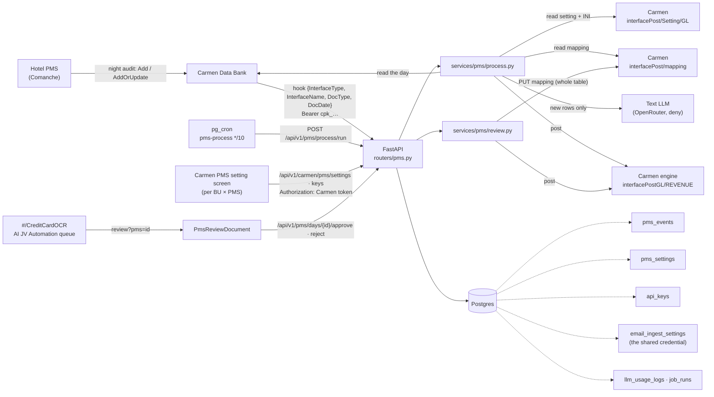
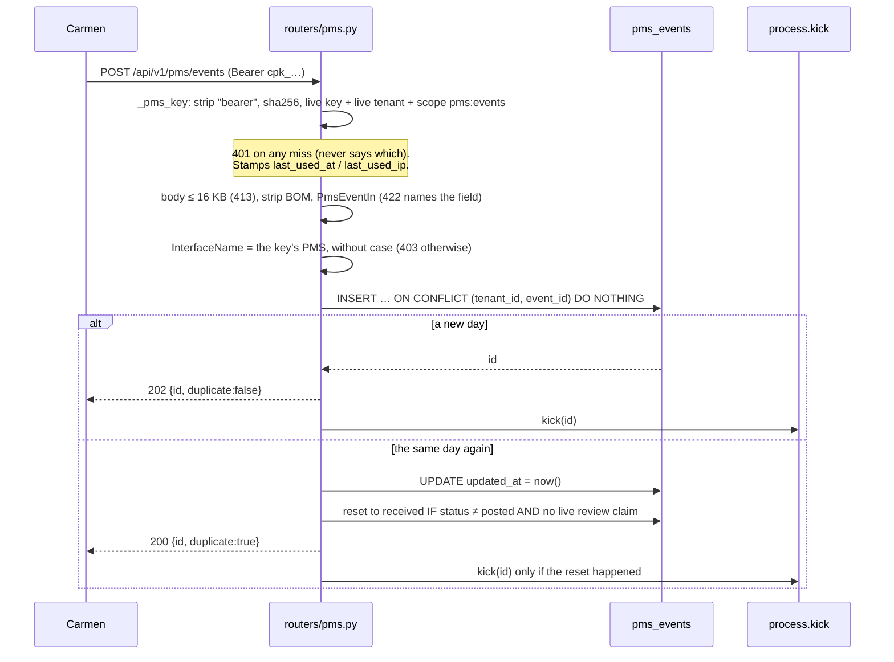
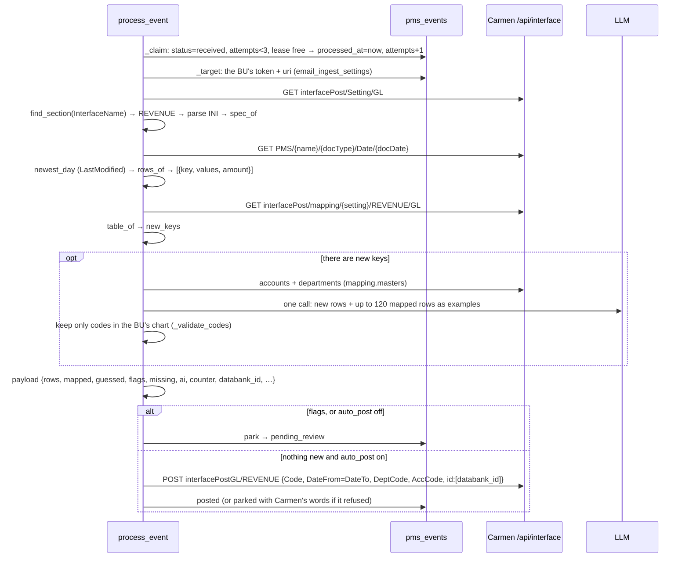
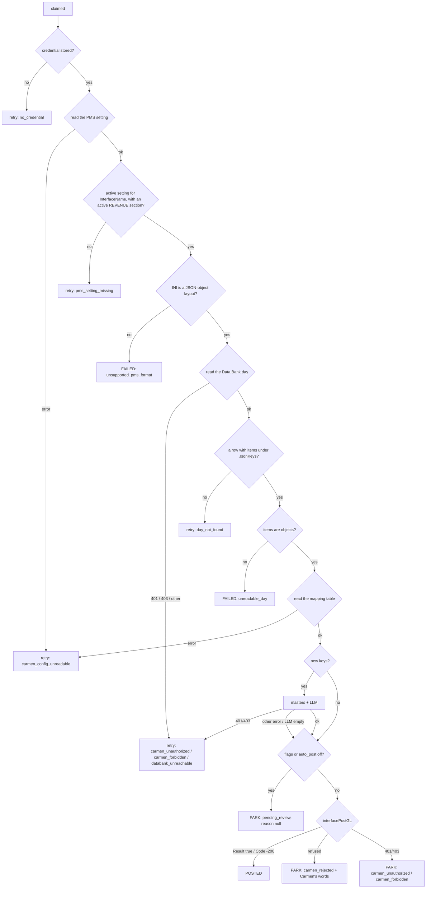
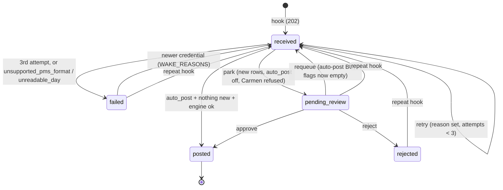

# Architecture

How the pieces fit, and what happens, in order, for each flow. The diagrams are Mermaid, as in
[`../email-automation/02-architecture.md`](../email-automation/02-architecture.md).

## Diagram 1 — component map



All Carmen calls go to `{uri}/Carmen.API/api/interface/…` with the BU's stored menu token
(`carmen._base_url()`). That token opens nothing outside `/api/interface`, and that is why the
setting read is still blocked. See [Not built](#not-built) and [07-status.md](07-status.md).

## Diagram 2 — onboarding (Carmen's PMS setting screen, decision-log #44)

```mermaid
sequenceDiagram
    participant User as BU user
    participant Carmen as Carmen PMS setting
    participant API as OCR API (routers/pms_carmen.py)

    User->>Carmen: open the PMS setting (e.g. Comanche)
    Carmen->>API: GET /api/v1/carmen/pms/settings?uri&bu&pms (Authorization: token)
    Note over API: _resolve_for_read: prove the token against uri.<br/>A BU never seen gets the defaults; nothing is created
    API-->>Carmen: {pms, auto_post, key, has_credential}
    User->>Carmen: Generate key
    Carmen->>API: POST /api/v1/carmen/pms/keys {uri, bu, pms}
    Note over API: _resolve(create=True): a BU never seen is created here, with 30 signup credits.<br/>credential.adopt_token (a held token that still works is kept, #45; else verify, Fernet, email_ingest_settings),<br/>wake_waiting + kick. issue(): revoke the old key, insert the new one
    API-->>Carmen: 201 {…, api_key: "cpk_…"} (only here)
    Carmen->>Carmen: store the key in this PMS setting
    User->>Carmen: auto-post on/off (default off)
    Carmen->>API: PUT /api/v1/carmen/pms/settings {uri, bu, pms, auto_post}
```

An operator's admin JWT (`configs:write`) can call the same routes. It never creates a BU and
stores no credential: it has no Carmen token.

## Diagram 3 — the hook



The commit comes before `kick`, so a crash between them leaves a `received` row for the sweep.
`kick` holds a strong reference to its task (`_running`). Without it, asyncio could
garbage-collect the task while it is still running.

## Diagram 4 — one day (`process_event`)



Context for the duration of the day: `current_tenant_id` is set for the LLM log, and
`current_carmen_uri` for `carmen._base_url()`. Both are reset in `finally`.

## Diagram 5 — the gate ladder

Each step either moves on, **retries** (the row stays `received` with a `reason_code`, and
the sweep tries again once the 10-minute lease expires), **fails** (terminal) or **parks**.
"Retry" becomes `failed` on the third attempt.



An unexpected exception anywhere is caught: the attempt retries as `processing_error`, so a
day is never stranded by an error nobody sees.

Two outcomes are terminal at once, without spending the attempts: `unsupported_pms_format` and
`unreadable_day`. Retrying cannot change either. Someone has to change Carmen's setting or the
PMS file, and then Carmen has to re-send the day.

## Diagram 6 — approve

```mermaid
sequenceDiagram
    participant U as Reviewer
    participant R as review.approve
    participant DB as pms_events
    participant C as Carmen /api/interface

    U->>R: POST /days/{id}/approve {mappings: {key: {dept, acc}}}
    R->>DB: claim: pending_review AND (posting_started_at null OR > 5 min old) → now
    Note over R: 404 not this BU's / not there · 409 someone else holds it or already handled it
    R->>C: GET mapping (fresh). Error → 503, nothing written
    R->>R: new_keys against the FRESH table. A key Carmen mapped meanwhile keeps Carmen's
    R->>R: every remaining key has dept + acc, else 400 "Pick an account for every new row"
    R->>C: accounts + departments → dept exists, acc exists, dept allows acc (else 400, naming the row)
    R->>C: PUT mapping = every row just read + the picks (merged_rows)
    R->>C: POST interfacePostGL/REVENUE
    alt Result true, or Code -200 Already Posted
        R->>DB: posted, review_payload null, reviewer recorded
        R->>DB: recheck: the BU's other parked days of this interface
    else refused (PostRefused) → 400 · unreachable → 503
        R->>DB: release the claim; the day stays parked
    end
```

**The PUT can land while the post fails.** The accounts are then in Carmen's table and the day
is still parked. Approving again is safe: the fresh table now has those rows, so nothing is
new, and the engine refuses a day it has already posted (`-200`, recorded as `already_posted`).

**The table is never written blind.** Carmen's PUT replaces the whole table, so a partial list
would delete the BU's other rows. That is why the GET comes first on every approve, and why a
failed GET stops everything.

## Diagram 7 — state machine



A repeat hook never moves `posted`. It also leaves a `pending_review` day alone while a
reviewer's claim on it is live (less than 5 minutes old).

## The sweep, and the two wake rules

`run_pms_processing()`, called by pg_cron every 10 minutes and serialised by `_sweep_lock`,
does three things in order:

1. **`_requeue_ready_days`.** Some parked days belong to a BU × PMS with `auto_post` on, have no
   `reason_code` and have no `flags` left: an approve on another day mapped their last rows
   (`recheck`), or the BU turned auto-post on with days waiting. These go back to `received`
   and are **read again from scratch** before they post. A day parked *with* a reason
   (`carmen_rejected`, …) is left for a person.
2. **`_wake_for_new_credential`.** Some days are `received` or `failed` with a reason in
   `WAKE_REASONS` (`no_credential`, `carmen_unauthorized`, `carmen_forbidden`,
   `carmen_config_unreadable`). These go back with their attempts reset, but only once the BU's
   `carmen_token_verified_at` is newer than the day's `processed_at`. Any writer of the shared
   credential therefore wakes them: Carmen's PMS setting screen, the email settings, or the
   daily email token-health check. (A PMS settings write also wakes them at once,
   `process.wake_waiting`, without the time test.)
3. **Process up to 50 `received` days**, oldest first, each through `process_event`, whose
   claim keeps the sweep and a `kick` from working one day twice.

A `job_runs` row (`pms-process`) is written only when the sweep did something or failed, the
same rule as the email poll. Idle runs do not bury other jobs on `#/admin/jobs`.

## Concurrency: three claims

| Claim | Column | Held for | Protects against |
|---|---|---|---|
| Processing lease | `processed_at` (+ `attempts`) | 10 min (`LEASE`) | the hook's `kick` and the sweep working one day at once; a dead worker stranding it |
| Review claim | `posting_started_at` | 5 min (`REVIEW_CLAIM_TTL`) | two reviewers posting one day; a repeat hook resetting a day mid-approve |
| Sweep lock | `asyncio.Lock` in-process | one sweep | overlapping cron calls on one instance (answers `{"status":"busy"}`) |

Carmen gives the final guard: `interfacePostGL` refuses a day it has already posted.

## Reading Carmen's config (`carmen_config.py`)

The BU's GL interface setting is a list of settings. Each has `InterfaceType`,
`InterfaceName`, `IsActive`, `Code` (e.g. `Comanche.PMS`) and `Configuration`, a map of
sections, each with `Active`, `ConfigBase64`, `DeptCode`, `AccCode` and `AccDesc`.

- **`find_section`** takes the active `PMS` setting whose `InterfaceName` matches the hook's
  (case-insensitive), then its active `REVENUE` section that has a config.
- **`decode` + `parse_ini`**: base64 → text (utf-8-sig, then utf-16, then cp874) → `[Section]`
  / `key=value`, with `;` comments. A repeated key keeps its last value.
- **`spec_of`** reads `[System]`. It requires `FileType=json`, `JsonType=jsonobject` and
  `JsonKeys` (`Transaction` for Comanche). It parses `Mapping_MapCode`, e.g.
  `[Code:Code][Description:Description]`, into (Data Bank field, table column) pairs, and reads
  `[Amount] JsonKeyName` and `UseAccountMap`. With `UseAccountMap=false`, no key is ever new.
- **`rows_of`** turns each item into `{key, values, amount}`. **It never adds, signs or
  balances**: `amount` is the string as written, kept for the reviewer to read.
- **`merged_rows`** builds the PUT body: every row just read, a pick filled in where one
  applies, then the picks the table did not have, appended.

The sides of the JV are in the same INI (`[DrCr]`; Comanche: `DrValue=-`, `CrValue=+`).
We deliberately do not read them: they are the engine's (decision-log #43).

## What the AI is asked (`mapping.suggest`)

One `call_text_llm` per day that has new keys (`module_id = pms_interface`), using the
suggestion model under the text-provider allowlist. The prompt carries:
- the new lines, as `<code> · <description>`, with their amounts;
- up to 120 of the BU's already-mapped rows, as examples of the house pattern;
- the departments;
- the accounts, filtered to `income` and `balancesheet` types when the chart types any.

It is told explicitly that **debit and credit are Carmen's, not its**.

The answer is filtered through the credit-card suggester's `_validate_codes`: unknown codes,
and pairs a department's `DefaultAccount` forbids, are dropped. An empty or failed answer
gives `{}`, and the rows park as `mapping_missing` for the reviewer to pick. The LLM is never
a reason a day stops.

## Frontend surface

| Screen | Files | What it does |
|---|---|---|
| Queue `#/CreditCardOCR` | `features/credit-card/pages/ReviewQueue.tsx`, `components/QueueRow.tsx`; backend `activity._pms_row` | A PMS day reads `PMS 05/09/2024` over `Comanche · Daily`. The chips are by status: `pending_review` → Review, `posted` → Posted, `rejected`/`failed` → Not posted. `received` is in no view. The reason reads "AI suggested mapping: 103, 729". A day Carmen had posted before we asked reads "Carmen had already posted it" |
| Review `#/CreditCardOCR/review?pms=<id>` | `features/credit-card/pages/PmsReviewDocument.tsx`, `hooks/usePmsReview.ts`, `api/pmsReview.ts` | The email review's shell. A note names the Carmen setting that posts the day. **Accounts** is one table laid out as Carmen's mapping screen (Code, Description, DeptCode, AccCode, AccDesc; decision-log #47): the new rows first, with department and account selects, the picked account's name, and an **AI** tag or Undo; then the rows Carmen already maps, as text, one per key. **No amounts.** The footer gives either the one blocking reason ("Pick an account for every new row.") or what Approve writes. Ctrl/⌘+Enter approves. Reject takes an optional reason. Leaving with edits asks first. **No balance, no Dr/Cr, no JV lines** |
| Reason → sentence | `shared/lib/reviewReasons.ts`, `i18n/dict/pms.ts` | One phrase per `reason_code`. No PMS reason has a fix button: `no_credential` and the Carmen-setting reasons are fixed on Carmen's own screens, which we cannot link to |
| `#/admin/api-keys` | `features/admin/pages/ApiKeysPage.tsx`, `features/admin/components/apiKeys/*` | Support view of every BU's keys: PMS, last used, revoke. No issuing: Carmen generates keys (decision-log #44) |

There is no PMS settings screen of ours. Carmen's PMS setting screen is the only one.

## Not built

- **Reading the PMS setting with the menu token.** `GET interfacePost/Setting/GL` has no
  `/api/interface` twin, so today every day stops at `carmen_config_unreadable`. Carmen added
  the **mapping** GET there on 2026-10-15. The setting GET is the one left
  ([07-status.md](07-status.md#what-blocks-the-merge)).
- **A JV number** on the posted row: `jv_no` stays null because the engine's answer has none.
- **Token health for PMS-only BUs.** `sweep_token_health` walks only `enabled` email BUs.
- **A retention purge** for `pms_events`.
- **Layouts other than JSON object**, and sections other than REVENUE.
